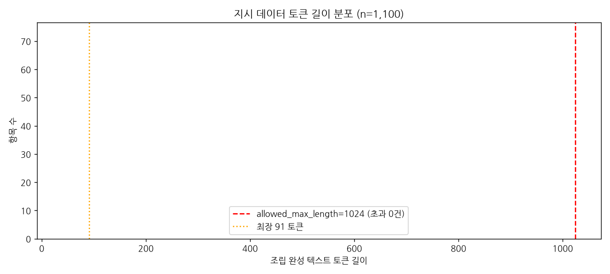

# quality_report.md — 지시 데이터 품질 점검 (P12-5 산출물)

대상: `instruction-data.json` (1,100건) · 토크나이저: tiktoken gpt2

## 요약표

| 점검 항목 | 건수 | 제외/수정 권고 |
|---|---|---|
| 완전 중복 쌍 (instruction+input) | **20** | 관련 항목 45건. output 이 다른 그룹 20개는 **스타일 일관성** 문제 — 아래 참조 |
| 근사 중복 — 정규화 후 동일 | **20** | 완전 중복과 동일 조치 |
| 근사 중복 — instruction 앞 50자 동일 | **113** | 대부분 같은 유형의 정당한 변형(input 이 다름) — 제외 불필요 |
| 빈 output | **0** | 조치 불필요 |
| output 토큰 3개 미만 | **18** | 사례 확인 후 판단 |
| 빈 instruction | **0** | 조치 불필요 |
| 1024 토큰 초과 항목 | **0** | 조치 불필요 — allowed_max_length 가 발동하지 않음 |
| output == instruction | **0** | 조치 불필요 |
| output 이 instruction 으로 시작 | **0** | 조치 불필요 |

## 토큰 길이 분포

| 통계 | 값 |
|---|---|
| 최소 | 40 토큰 |
| 25% | 51 토큰 |
| 중앙값 | 55 토큰 |
| 75% | 61 토큰 |
| 95% | 72 토큰 |
| 99% | 83 토큰 |
| 최대 | 91 토큰 |
| 평균 | 56.4 토큰 |
| **1024 초과** | **0건** |

최장이 **91 토큰**으로 1024 의 8.9% 에 불과하다. `allowed_max_length=1024` 는 이 데이터에서 **한 건도 자르지 않는다** — 13주차 훈련에서 잘림으로 인한 응답 절단은 걱정하지 않아도 된다.

## 대표 사례

**근사 중복(앞 50자 동일) 최다 그룹 — 17건**

| idx | instruction | input | output |
|---|---|---|---|
| 89 | Rewrite the sentence using a metaphor. | `The storm is very strong.` | The storm is a beast. |
| 145 | Rewrite the sentence using a metaphor. | `Her voice is very soothing.` | Her voice is a lullaby. |
| 156 | Rewrite the sentence using a metaphor. | `He is very intelligent.` | He is a genius. |
| 197 | Rewrite the sentence using a metaphor. | `The book is very boring.` | The book is a cure for insomnia. |

→ instruction 은 같지만 **input 이 서로 다르다.** 같은 과제 유형을 여러 입력으로 연습시키는 정당한 구성이다. 제외하면 오히려 그 유형의 학습 신호가 약해진다. **제외하지 않는다.**

**토큰 3개 미만 output**

| idx | 토큰 수 | instruction | output |
|---|---|---|---|
| 63 | 2 | What is an antonym of 'soft'? | `hard.` |
| 70 | 2 | What is the chemical symbol for aluminum? | `Al.` |
| 198 | 2 | What is an antonym of 'fast'? | `slow.` |
| 334 | 2 | Identify the correct word to complete the sentence. | `clarity` |
| 407 | 2 | Classify the given sentiment as either positive, negative, o | `Positive` |

**응답 스타일 모순 — 같은 질문에 서로 다른 길이의 정답**

| idx | instruction | input | output | 토큰 |
|---|---|---|---|---|
| 708 | Classify the following statement into one of these | `My computer crashed.` | Negative | 2 |
| 1060 | Classify the following statement into one of these | `My computer crashed.` | The statement "My computer crashed" can be classified as negative. | 13 |
| | | | ↑ **6.5배 길이 차이** | |
| 29 | What is the past tense of 'draw'? | `` | The past tense of 'draw' is 'drew.' | 12 |
| 1068 | What is the past tense of 'draw'? | `` | drew. | 3 |
| | | | ↑ **4.0배 길이 차이** | |
| 83 | Provide a synonym for 'strong'. | `` | A synonym for 'strong' is 'powerful'. | 11 |
| 829 | Provide a synonym for 'strong'. | `` | robust. | 3 |
| | | | ↑ **3.7배 길이 차이** | |
| 119 | Perform a sentiment analysis on the given sentence | `I hate this song!` | The sentiment of the sentence "I hate this song!" is negative. | 14 |
| 443 | Perform a sentiment analysis on the given sentence | `I hate this song!` | The sentiment of the sentence "I hate this song!" is negative. This is | 40 |
| | | | ↑ **2.9배 길이 차이** | |

## 결론과 13주차 반영 권고

**형식적 결함은 0건이다.** 빈 output 0 · 빈 instruction 0 · output==instruction 0 · 1024 초과 0. 교재용으로 정제된 데이터셋이라는 설명과 일치한다.

**그러나 '문제 없음'은 아니다.** 완전 중복 20그룹(45건)이 있고, 그중 **20그룹 전부**에서 output 이 서로 다르다. 사실관계가 틀린 것은 아니지만 **응답 스타일이 모순된다** — 같은 질문에 한쪽은 완전한 문장으로, 다른 쪽은 단어 하나로 답한다.

이것이 왜 문제인가: 지시 튜닝이 가르치는 것은 지식이 아니라 **"지시가 오면 이런 형식으로 응답한다"** 는 규약이다. 동일한 프롬프트에 상반된 길이의 정답을 주면 모델은 "짧게 답할지 길게 답할지"에 대해 서로 상쇄되는 신호를 받는다. 1,100건짜리 소규모 데이터에서 45건(4.1%)이 이런 상태라면 무시할 수 없다.

**13주차 훈련에 실제로 반영할 조치**

1. **`allowed_max_length=1024` 를 그대로 둔다.** 최장 91 토큰이라 발동하지 않는다. 다만 코드에서 빼지는 말 것 — 다른 데이터로 바꿀 때의 안전장치다.
2. **배치 크기를 길이 기준으로 잡아도 안전하다.** 95 퍼센타일이 72 토큰이므로 batch_size=8 이면 배치당 최대 약 728 토큰 규모다.
3. **근사 중복 113그룹(앞 50자 동일)은 제외하지 않는다.** instruction 이 같고 input 이 다른 정당한 변형이다.
4. **완전 중복 20그룹은 각 그룹에서 1건만 남긴다.** 남길 기준은 '더 완전한 문장으로 답한 쪽' 으로 통일한다 (예: idx 1068 `drew.` 대신 idx 29 `The past tense of 'draw' is 'drew.'`). 관련 45건 중 25건 제거 → 1,100 → 1075건. **이것이 이번 점검에서 나온 유일한 실제 조치다.**
5. **13주차 심판 채점 시 이 45건을 기억할 것.** 응답이 너무 짧다는 저점이 나오면 모델 탓이 아니라 데이터에 짧은 정답이 섞여 있던 탓일 수 있다.
6. **데이터 양(1,100건)이 가장 큰 위험 요인이다.** 원조 Alpaca 는 52,000건이다. 형식적 결함이 0건이라는 것이 '충분하다'는 뜻은 아니다 — 13주차에서 응답이 형식만 흉내 내는 증상이 나오면 데이터 결함이 아니라 **데이터 양**을 의심해야 한다.

> **"문제가 없음을 확인하는 것"도 점검의 정당한 결과다** — 그러나 이번엔 문제가 없지 않았다. 점검을 돌리지 않았다면 20그룹의 스타일 모순을 발견하지 못한 채 13주차 훈련에 들어갔을 것이다. '정제된 데이터셋'이라는 평판은 점검을 생략할 이유가 되지 못한다.
