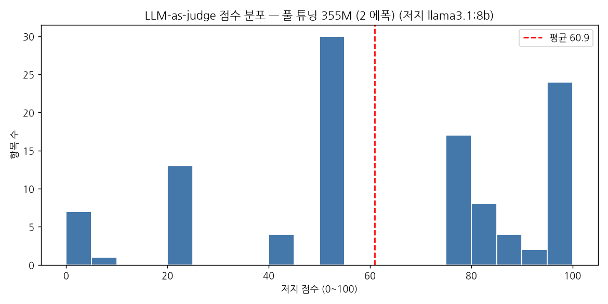

# judge_report.md — LLM-as-judge 채점 (P13-3 산출물)

채점 대상: **풀 튜닝 355M (2 에폭)** · 응답 파일 `test_responses.json` (110건)
저지: **llama3.1:8b** (로컬 Ollama, `http://172.17.0.1:11434/api/chat`) · options `seed=123, temperature=0, num_ctx=2048`

## 채점 결과

| 항목 | 값 |
|---|---|
| 채점 성공 | 110 / 110 |
| 파싱 실패 | **0** |
| 평균 | **60.92점** |
| 표준편차 | 29.34 |
| 중앙값 | 62.5 |
| 최저 / 최고 | 0 / 100 |

파싱 실패 **0건**. 프롬프트의 "Respond with the integer number only." 가 잘 작동했다.

## 상위 3 / 하위 3

| 순위 | 점수 | 지시 | 정답 | 모델 응답 |
|---|---|---|---|---|
| 상위 1 | **100** | Identify the correct spelling: 'recieve' or  | The correct spelling is 'receive'. | The correct spelling is 'receive'. |
| 상위 2 | **100** | Convert this sentence to passive voice | The plants were watered by the gardener. | The plants were watered by the gardener. |
| 상위 3 | **100** | What is the past tense of 'throw'? | The past tense of 'throw' is 'threw'. | The past tense of 'throw' is 'threw'. |
| 하위 1 | **0** | What are the first 10 elements of the Fibona | 0, 1, 1, 2, 3, 5, 8, 13, 21, 34. | The first 10 elements of the Fibonacci sequence are: 1 |
| 하위 2 | **0** | Define the term 'simile'. | A simile is a figure of speech that directly compares  | A simile is a device that simulates the movement of a  |
| 하위 3 | **0** | Translate 'Welcome' into German. | The German translation of 'Welcome' is 'Willkommen'. | The German translation of 'Welcome' is 'Wie viel koste |

## 저지 신뢰성 (V13-1)

| 검증 | 방법 | 결과 | 판정 |
|---|---|---|---|
| **상한** | 테스트셋 10개의 정답 자체를 채점 | 평균 **93.0** (점수 [95, 95, 95, 95, 100, 80, 80, 100, 95, 95]) | PASS (90 이상) |
| **하한** | 같은 10개에 `The weather is nice today.` 고정 투입 | 평균 **41.9** (점수 [50, 0, 50, 50, 50, 50, 4, 50, 20, 95]) | PASS (상한보다 크게 낮아야) |
| **결정성** | 같은 (항목,응답) 5개 × 3회 | **변동 발생** | FAIL |

상한 93.0 ≫ 하한 41.9 (격차 **51.1점**). 저지는 정답과 엉터리를 확실히 구분한다.

### 결정성 원자료

| 지시 | 3회 점수 | 동일 |
|---|---|---|
| Rewrite the sentence using a simile. | [50, 50, 50] | O |
| What type of cloud is typically associated with th | [50, 50, 50] | O |
| Name the author of 'Pride and Prejudice'. | [95, 95, 95] | O |
| What is the periodic symbol for chlorine? | [50, 75, 75] | **X** |
| Correct the punctuation in the sentence. | [50, 50, 50] | O |

> **학생 직접 단계(에이전트 금지)**: 위 상위 2개·하위 2개 응답을 직접 읽고 저지 점수에 동의하는지 항목별로 평가하라. 그리고 저지의 한계 사례를 최소 1개 찾아 report.md 에 기록하라.
