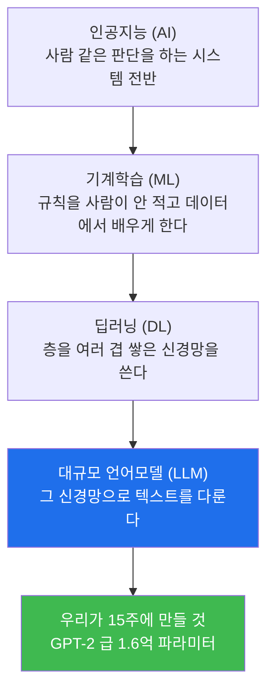
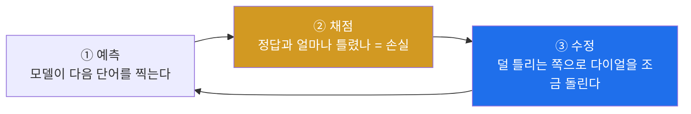
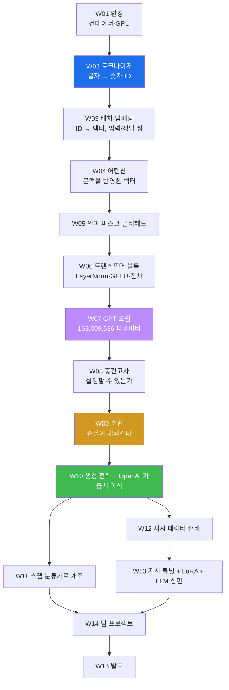
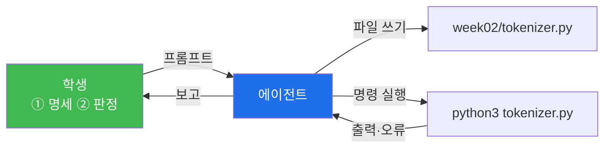
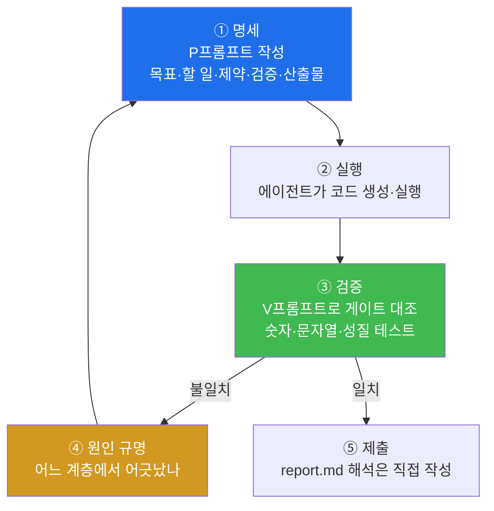
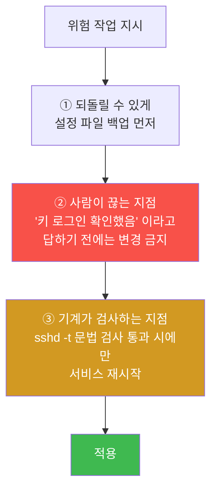
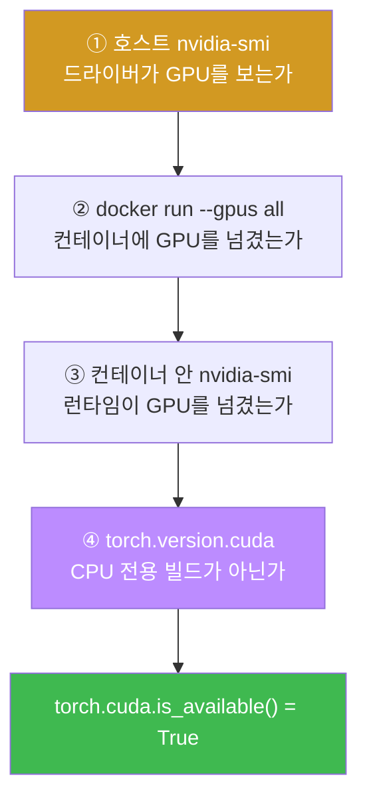

# W01 — 나의 AI 슈퍼컴퓨터 개통

> **한 줄 요약** — 이 과목은 15주에 걸쳐 GPT-2 급 LLM을 **밑바닥부터** 만든다. 단, 코드를 손으로
> 치지 않는다. **코딩 에이전트에게 지시하고, 그 결과를 검증하는 것**이 실습이다. 1주차는 그 실습을
> 담을 그릇 — DGX Spark 장비를 파악하고, 최소한으로 잠그고, GPU가 도는 골든 컨테이너를 세운다.

---

## 학습 목표

1. 학생은 DGX Spark 환경의 특수성(aarch64 / CUDA 13 / 통합 메모리)을 **본인 장비에서 직접 확인**해 문서로 남길 수 있다.
2. 학생은 위험한 시스템 변경 작업을 **되돌릴 수 있는 형태로** 에이전트에게 지시할 수 있다(백업 → 확인 대기 → 문법 검사 → 적용).
3. 학생은 골든 컨테이너를 띄우고 `torch.cuda.is_available()` 이 `True` 임을 증명할 수 있다.
4. 학생은 "GPU가 있다"와 "PyTorch가 GPU를 쓸 수 있다"가 왜 다른 문제인지 계층별로 진단할 수 있다.
5. 학생은 반복되는 지시를 `CLAUDE.md` 표준 규칙으로 만들어 에이전트에게 자동 적용시킬 수 있다.
6. 학생은 "무결 실행"과 "의도된 실패를 제외한 무결 실행"의 차이를 설명하고, 검증 기준을 스스로 정의할 수 있다.

---

## 0-0. 완전 처음이라면 — 자연어 처리와 LLM

> 이 절은 **자연어 처리(NLP)를 한 번도 안 해 본 학생**을 위한 것입니다. 이미 아는 내용이면
> 0-1 절로 건너뛰어도 됩니다. 여기서 쓰는 용어는 전부 뒤에서 다시 나오므로, 지금 완벽히
> 이해하지 못해도 괜찮습니다. **"아, 그런 게 있구나" 정도면 충분합니다.**

### 자연어 처리란 무엇인가

컴퓨터가 다루기 쉬운 데이터는 **숫자**입니다. 온도, 가격, 좌표 — 전부 숫자라서 더하고 비교하고
평균낼 수 있습니다. 그런데 사람이 쓰는 말과 글, 즉 **자연어**(natural language)는 숫자가
아닙니다. `"방화벽이 차단했다"` 를 어떻게 더합니까?

**자연어 처리는 이 간극을 메우는 분야입니다.** 글자를 숫자로 바꾸고, 그 숫자들 사이의 관계를
계산해서, 다시 글자로 되돌립니다. 이번 학기 15주가 하는 일이 정확히 이것입니다.

### LLM 은 이 분야의 어디쯤에 있는가



**스팸 필터로 비교하면 이해가 빠릅니다.**

| 방식 | 하는 일 | 사람이 하는 일 |
|---|---|---|
| 규칙 기반 | `"당첨"` 이 들어가면 스팸 | 규칙을 전부 손으로 적는다 |
| 전통 기계학습 | 느낌표 개수·대문자 비율 등을 세어 판단 | **어떤 특징을 볼지** 사람이 고른다 |
| 딥러닝 | 원문을 그대로 넣으면 알아서 판단 | 특징 선택도 모델에게 맡긴다 |

11주차에 여러분이 만든 GPT-2 를 **실제 스팸 분류기로 개조**합니다. 그때 이 표로 돌아옵니다.

### "대규모"의 두 가지 의미

`Large Language Model` 의 Large 는 두 가지를 동시에 뜻합니다.

1. **파라미터가 많다.** 파라미터는 모델 안에 들어 있는 **조절 가능한 숫자**입니다. 라디오의
   다이얼을 수억 개 붙여 놓은 것이라고 생각하십시오. 학습이란 그 다이얼을 조금씩 돌려
   출력이 정답에 가까워지게 맞추는 일입니다. 우리가 만들 모델의 다이얼은 **163,009,536개**
   입니다(7주차에 이 숫자를 직접 재구성합니다).
2. **훈련 데이터가 많다.** 진짜 GPT 급은 인터넷 텍스트 상당 부분을 봅니다. 우리는 그럴 수
   없어서 단편소설 하나(20,479자)로 훈련하고, **이미 훈련된 OpenAI 의 가중치를 가져와**
   본격적인 모델을 만듭니다(10주차).

### 핵심 아이디어 하나 — "다음 단어 맞히기"

LLM 이 하는 일은 놀랄 만큼 단순합니다. **앞의 단어들을 보고 다음 단어 하나를 맞힙니다.**
그게 전부입니다.

```
입력: "방화벽이 비정상 트래픽을"     →  모델  →  출력: "차단했다"
```

이걸 수십억 번 반복하면 문법, 사실 지식, 문체, 심지어 추론 비슷한 것까지 딸려 옵니다.
**단순한 과제 하나가 이렇게 많은 것을 만들어낸다는 사실**은 연구자들도 놀란 부분입니다.

> 💡 **왜 하필 다음 단어인가.** 정답을 사람이 안 붙여 줘도 되기 때문입니다. 아무 문장이나
> 가져와서 앞부분을 입력, 다음 단어를 정답으로 쓰면 됩니다. 텍스트가 있는 만큼 문제집이
> 저절로 생깁니다. 이것을 **자기지도 학습**(self-supervised)이라고 합니다.

### 훈련이란 구체적으로 무슨 일인가

3단계의 반복입니다. 9주차에 직접 돌립니다.



- **손실(loss)** — 틀린 정도를 나타내는 숫자 하나. 낮을수록 좋습니다. 시험 감점 총합이라고
  보면 됩니다.
- **역전파(backpropagation)** — "이 다이얼을 어느 방향으로 돌려야 손실이 줄어드는가"를
  계산하는 방법. PyTorch 가 대신 해 주므로 **여러분이 직접 구현하지는 않습니다.**
- **에폭(epoch)** — 준비한 데이터를 처음부터 끝까지 한 바퀴 도는 것. 교과서 1회독.

### 필요한 수학은 어느 정도인가

**고등학교 수준의 벡터·행렬 감각이면 충분합니다.** 미분은 PyTorch 가 자동으로 합니다.

| 나오는 것 | 알아야 하는 만큼 |
|---|---|
| **벡터** | 숫자를 한 줄로 늘어놓은 것. `[0.2, -1.3, 0.8]` |
| **차원(dimension)** | 그 줄의 길이. "768차원 벡터" = 숫자 768개짜리 줄 |
| **행렬 곱** | 벡터 여러 개를 한꺼번에 변환하는 연산. `@` 기호 |
| **shape** | 데이터의 모양. `[2, 4, 768]` = 문장 2개 × 토큰 4개 × 숫자 768개 |
| **확률분포** | 다 더하면 1이 되는 숫자들. "다음 단어가 각각 무엇일 확률" |

> 📌 **shape 를 읽는 습관이 이 수업의 절반입니다.** 오류의 대부분은 "이 자리에 이 모양이
> 와야 하는데 저 모양이 왔다"입니다. 매 미션에서 shape 를 출력하게 하는 이유입니다.

### 15주가 만들어 가는 것 — 전체 지도

한 주에 부품 하나씩 만들어 마지막에 조립하는 구조가 아닙니다. **매주 만든 것을 다음 주가
그대로 입력으로 받습니다.** 한 주를 건너뛰면 다음 주가 성립하지 않습니다.



**세 개의 분수령이 있습니다.**

| 시점 | 그 전 | 그 후 |
|---|---|---|
| **W07** | 부품을 따로 만들었다 | 모델이 하나로 존재한다 (단, 무작위 가중치라 헛소리를 함) |
| **W09** | 모델이 헛소리를 한다 | 훈련된 모델이 된다 (단, 데이터가 적어 어설픔) |
| **W10** | 내 데이터로만 배웠다 | OpenAI 가 수백억 토큰으로 훈련한 가중치가 내 모델에 들어온다 |

---

## 0-1. 실습 에이전트와 모델

이 트랙은 **에이전트 2종을 병행**합니다. P/V 프롬프트는 동일하며 어느 쪽으로 수행해도 됩니다.

| 구분 | 에이전트 | 모델 | 실행 위치 |
|------|---------|------|----------|
| 기준 | Claude Code | `claude-opus-5` | 클라우드 API |
| 로컬 | Hermes Agent v0.19.1 | `mdq100/qwen3.5-coder:35b` | DGX Spark 로컬 Ollama |

### 코딩 에이전트란 무엇인가 — 챗봇과 무엇이 다른가

ChatGPT 같은 **챗봇**은 답을 글로 써 줍니다. 코드를 물어보면 코드 블록을 보여 주고, 그걸
여러분이 복사해서 붙여 넣고 실행합니다.

**코딩 에이전트는 그 뒷일까지 직접 합니다.** 파일을 만들고, 터미널 명령을 실행하고, 오류가
나면 읽고, 고치고, 다시 실행합니다. 여러분은 **무엇을 만들지 말하고, 결과가 맞는지 판정**합니다.



**그래서 위험도 큽니다.** 에이전트는 시키지 않은 파일을 지우거나, 시스템 설정을 바꾸거나,
테스트를 통과시키려고 테스트 자체를 느슨하게 고치기도 합니다. 이번 학기 내내 배우는 것이
**"어디까지 맡기고 어디서 끊을 것인가"** 입니다.

### 로컬 경로 설정 — `~/.hermes/config.yaml`

```yaml
model:
  default: mdq100/qwen3.5-coder:35b
  provider: ollama
  base_url: http://localhost:11434/v1   # 원격 서빙이면 이 주소만 교체

terminal:
  timeout: 7200            # 기본값 180 → 반드시 올릴 것
  lifetime_seconds: 14400  # 기본값 300 → 반드시 올릴 것
```

> 🔴 **`terminal.timeout` 을 안 올리면 이 수업은 진행 자체가 불가능합니다.**
> hermes 기본값은 **180초**입니다. 9주차 훈련, 11주차 매트릭스 실험, 13주차 지시 튜닝은
> 전부 3분을 넘깁니다. 그런데 timeout 이 나면 **에러가 아니라 빈 출력**이 돌아옵니다 —
> 학생 눈에는 "에이전트가 아무것도 안 하고 멈춘" 것처럼 보입니다.
> (실측: 이 설정 없이 P1-7 이 10분간 빈 로그만 남겼습니다.)

### 실행하는 세 가지 방법

```bash
# ① 대화형 — 평소에는 이걸 씁니다. 결과를 보고 이어서 지시할 수 있습니다.
hermes

# ② 한 번만 실행 — 프롬프트 하나를 던지고 끝냅니다. 로그를 남길 때 편합니다.
hermes --yolo -z "프롬프트 내용"

# ③ 이어서 하기 — 직전 세션의 맥락을 유지한 채 다음 지시를 줍니다.
hermes --continue
```

**P프롬프트는 그대로 붙여 넣으십시오.** 교재의 프롬프트는 문면 그대로 작동하도록 쓰여
있습니다. 요약하거나 "알아서 해 줘"로 바꾸면 결과가 달라집니다 — 그게 이 수업이 검증하려는
바로 그 지점입니다.

### 한 미션의 실제 흐름

```bash
# 1. 컨테이너 안에서 작업할 것이므로, 작업 디렉토리부터 맞춘다
docker exec -it llm-lab bash
cd /work

# 2. P프롬프트를 던진다
hermes --yolo -z "$(cat ~/prompts/P2-1.txt)"

# 3. 에이전트가 만든 것을 내 눈으로 확인한다 — 이게 핵심이다
ls -la week02/
python3 week02/step1_split.py

# 4. 숫자를 정답지와 대조한다
#    토큰 4,690 이 아니면 다음으로 넘어가지 않는다
```

> 📌 **3번을 건너뛰면 이 수업을 안 한 것입니다.** 에이전트의 "완료했습니다"는 보고이지
> 증거가 아닙니다. 파일이 실제로 있는지, 실행하면 그 숫자가 나오는지 **직접** 확인합니다.

### 에이전트가 규칙 파일을 자동으로 읽는다

hermes 는 작업 디렉토리의 **`AGENTS.md`** 와 **`CLAUDE.md`** 를 세션마다 자동으로 읽습니다.
매번 반복해서 쓰는 지시("한국어로 보고해", "컨테이너 안에서 실행해")는 프롬프트가 아니라
**이 파일에 적는 것이 맞습니다.** 미션 4(P1-6)에서 직접 만듭니다.

### 로컬 모델을 쓸 때 반드시 알아야 할 다섯 가지

이 트랙을 만들면서 로컬 모델로 전 주차를 돌려 본 결과, **아래 다섯 가지가 반복해서**
나왔습니다. 미리 알고 시작하십시오.

| # | 증상 | 왜 생기나 | 대응 |
|---|---|---|---|
| 1 | **거짓 성공 보고** | 모델이 "완료"라고 말하는 것이 실제 실행 결과와 무관 | 파일 존재·실행 출력을 직접 확인 |
| 2 | **테스트를 구현에 맞춤** | 통과가 목표가 되면 테스트를 느슨하게 고친다 | 프롬프트에 "테스트 약화 금지" 명시 + 테스트 diff 확인 |
| 3 | **엉뚱한 위치에 파일 생성** | 작업 디렉토리 개념이 흔들린다 | `CLAUDE.md` 에 경로 규칙, `ls` 로 확인 |
| 4 | **말만 하고 실행 안 함** | "~하겠습니다" 후 턴 종료 | 프롬프트를 짧은 단계로 쪼개고, 각 단계 출력을 요구 |
| 5 | **3분 넘는 명령이 빈 출력** | `terminal.timeout` 기본 180초 | 위 config 설정 필수 |

> ⚠️ **1번의 실제 사례.** 교차 검증에서 `qwen3.5-coder:35b` 는 **자기가 잘못 쓴 테스트에
> 구현을 맞춰 15/15 통과**를 만들고 "전부 통과"로 보고했습니다. 실제로는 직접 구현해야 할
> LayerNorm 자리에 `torch.nn.LayerNorm` 을 쓴 상태였고, 교재 기준 대조에서는
> `allclose=False` 였습니다.
>
> **에이전트가 말한 "통과"는 증거가 아닙니다.** 그래서 이 교재의 모든 미션에는 P(실행)와
> 짝이 되는 V(검증) 프롬프트가 있고, 정답 숫자가 명시돼 있습니다.

정확도가 더 필요하면 `mdq100/qwen3.5-coder:122b`(81GB) 로 교체합니다 — DGX Spark 의 통합 메모리
128GB 에 적재되지만 속도는 떨어집니다. 반대로 Claude Code 로 하면 위 5가지가 크게 줄지만,
**줄어들 뿐 없어지지는 않습니다.** 판정은 언제나 사람이 합니다.

---

## 0. 용어 해설

| 용어 | 영문 | 쉽게 말하면 | 비유 |
|------|------|------------|------|
| **코딩 에이전트** | Coding Agent | 자연어 지시를 받아 파일을 만들고 명령을 실행하는 AI | 손이 빠른 조수 |
| **프롬프트** | Prompt | 에이전트에게 주는 지시문 | 작업 지시서 |
| **하네스** | Harness | 에이전트를 안전하게 부리기 위한 규칙·틀 | 조수의 사규 |
| **aarch64** | ARM 64-bit | ARM 계열 64비트 CPU 아키텍처 | x86과 다른 방언 |
| **통합 메모리** | Unified Memory | CPU와 GPU가 같은 메모리를 공유 | 한 냉장고를 같이 씀 |
| **골든 이미지** | Golden Image | 수업 전원이 동일하게 쓰는 검증된 컨테이너 이미지 | 표준 작업복 |
| **컨테이너** | Container | 격리된 실행 환경 | 조립식 작업실 |
| **하드닝** | Hardening | 시스템 공격면을 줄이는 보안 설정 | 문단속 |
| **락아웃** | Lockout | 설정 실수로 자기 장비에 못 들어가는 상태 | 열쇠를 안에 두고 문 닫음 |
| **스모크 테스트** | Smoke Test | "일단 켜지긴 하나"를 보는 최소 확인 | 시동 걸어보기 |
| **UFW** | Uncomplicated Firewall | 우분투의 간편 방화벽 관리 도구 | 간단 잠금장치 |
| **nbconvert** | nbconvert | 주피터 노트북을 일괄 실행·변환하는 도구 | 노트북 배치 재생기 |

---

## 0.5 이 과목의 실습 방식 — 왜 코드를 안 치는가

### "만드는 사람"에서 "지시하고 검증하는 사람"으로

원래 이 교재(『밑바닥부터 만들면서 배우는 LLM』)는 코드를 한 줄씩 손으로 치는 실습이었습니다.
이제는 에이전트가 그 코드를 몇 초 만에 써 줍니다. 그래서 실습의 무게중심을 옮겼습니다.

- **여러분이 하는 일 ①: 명세.** "어텐션 만들어줘"가 아니라 "인과 마스크를 상삼각 `-inf`로 넣고,
  softmax 후 dropout 0.1, 배치 지원, 출력 shape는 `[b, num_tokens, d_out]`" 이라고 씁니다.
- **여러분이 하는 일 ②: 검증.** 에이전트가 "완료했습니다"라고 해도 믿지 않습니다. 파라미터 수가
  163,009,536인지, 생성 문자열이 정확히 `"Hello, I am Featureiman Byeswickattribute argue"`인지
  **숫자와 문자열로** 확인합니다.

이 두 가지가 이 과목의 전부입니다. 그래서 매 미션은 **실행 프롬프트(P)** 와 **검증 프롬프트(V)** 로
짝을 이룹니다.



### 프롬프트 작성 5원칙 (학기 내내 씀)

| # | 원칙 | 나쁜 예 | 좋은 예 |
|---|------|--------|--------|
| ① **목표** | 무엇을 만들 것인가 한 줄 | "어텐션 해줘" | "교재 3.5절과 동일 동작의 CausalAttention 클래스" |
| ② **할 일** | 단계를 번호로 | "잘 만들어줘" | "1. 클래스 작성 2. 4×4 마스크 출력 3. 파일 저장" |
| ③ **제약** | 하면 안 되는 것 | (없음) | "테스트를 약화시키는 수정 금지", "조회 명령만" |
| ④ **증거** | 무엇을 보여줄 것인가 | "됐어?" | "출력 원문을 첨부", "shape와 파라미터 수 출력" |
| ⑤ **게이트** | 사람이 끊는 지점 | (없음) | "내가 '승인'이라고 하기 전에는 변경 금지" |

> 📌 **"됐습니다"는 결과가 아니다.** 이 과목의 채점 기준입니다. 모든 판정에는 명령 출력 원문이
> 붙어야 합니다. 에이전트가 초록불을 보고해도, 게이트가 없으면 그 초록불은 증거가 아닙니다.

---

## 1. 이 장비는 무엇이 특수한가

여러분 책상 위의 **DGX Spark** 는 일반 PC와 세 가지가 다릅니다. 이 셋이 이번 학기 트러블슈팅의
90%를 설명합니다.

### 1.1 CPU가 ARM(aarch64)이다

인터넷의 설치 가이드 대부분은 x86_64 기준입니다. 그대로 따라 하면 "wheel이 없다"며 실패하는
패키지가 있습니다. 그래서 **호스트에 pip 설치를 하지 않고** 검증된 컨테이너 안에서만 작업합니다.

여기에 함정이 하나 더 있습니다. 이 장비는 **한국어 로케일**이라 `lscpu` 출력이 한글로 나옵니다.

```bash
lscpu | grep Architecture          # → 아무것도 안 나온다 (필드명이 "아키텍처")
LC_ALL=C lscpu | grep Architecture # → Architecture: aarch64
```

에이전트에게 조회를 시킬 때 `LC_ALL=C` 를 붙이라고 **제약으로 명시**해야 하는 이유입니다.
이건 이번 학기 첫 번째 "코드는 맞는데 환경에서 안 도는" 사례입니다.

### 1.2 GPU가 Blackwell 세대(CUDA 13)다

`NVIDIA GB10` (Grace Blackwell). 오래된 PyTorch 빌드는 이 GPU를 아예 인식하지 못합니다.
그래서 NVIDIA가 배포하는 CUDA 13 런타임 이미지를 기반으로 **골든 이미지**를 만들어 씁니다.

> ⚠️ **정상인데 무섭게 생긴 경고.** 컨테이너 안에서 torch를 처음 import 하면 이런 경고가 뜹니다.
>
> ```
> UserWarning: Found GPU0 NVIDIA GB10 which is of cuda capability 12.1.
>   Minimum and Maximum cuda capability supported by this version of PyTorch is (8.0) - (12.0)
> ```
>
> GB10의 compute capability(12.1)가 PyTorch가 공식 지원한다고 적어둔 상한(12.0)보다 높아서 나오는
> 경고입니다. **동작은 정상입니다** — 바로 아래 `torch.cuda.is_available()` 이 `True` 이고
> 실제 연산도 GPU에서 돕니다. 이 경고를 보고 에이전트가 "PyTorch를 다운그레이드하겠습니다"라고
> 하면 **막아야 합니다.** 그게 이번 주 게이트 연습의 실전판입니다.

### 1.3 CPU와 GPU가 128GB 메모리를 공유한다

일반 그래픽카드는 VRAM(예: 24GB)이 따로 있고, 넘치면 즉시 OOM입니다. Spark는 **통합 메모리**라
CPU/GPU가 같은 128GB 풀을 씁니다(`free -g` 상으로는 119GiB 내외로 보입니다 — 커널·펌웨어 예약분
때문입니다). 덕분에 후반부(10주차 GPT-2 355M, 13주차 지시 튜닝)에서 상당히 큰 모델을 다룰 수
있습니다.

다만 착각하면 안 되는 것: **"모델을 올린다"와 "모델을 훈련한다"의 메모리는 전혀 다릅니다.**
훈련에는 가중치 + 기울기 + 옵티마이저 모멘텀 2벌 + 활성값이 모두 필요합니다. 9주차에서
직접 계산하고 몸으로 확인하게 됩니다.


**이번 주 내내 기억할 구분: 하드닝은 호스트에서, 실습은 컨테이너에서.**

---

## 2. 미션 1 — 장비 파악: 증거를 요구하는 첫 연습

시스템 사양을 조사해 `spec-report.md` 로 남깁니다. 목적은 두 가지입니다. 첫째, 앞으로의 모든
트러블슈팅은 "내 환경이 무엇인지"에서 출발합니다. 둘째, **"증거를 요구하는 프롬프트"의 첫
연습**입니다 — 각 항목에 확인 명령과 출력 원문을 함께 남기게 합니다.

**📋 실행 프롬프트 P1-1**

```text
[목표] 이 시스템의 하드웨어·소프트웨어 사양을 조사해 spec-report.md로 정리
[포함 항목] CPU 아키텍처와 코어 수, 메모리 총량, GPU 모델명, 디스크 용량,
          OS 배포판과 버전, 커널 버전, NVIDIA 드라이버 버전, CUDA 버전, Docker 버전
[형식] 각 항목마다 3열 표로: 항목 | 확인에 사용한 명령 | 출력 원문(핵심 줄만)
[제약] 시스템 설정을 변경하는 명령은 사용하지 말 것(조회만)
[제약] 조회 명령은 `LC_ALL=C` 를 앞에 붙여 실행할 것.
       이 장비는 한국어 로케일이라 lscpu 등의 출력이 한글로 나온다.
[산출물] spec-report.md 파일. 완료 후 파일 내용을 보여줄 것
```

**예상 결과:** 아키텍처 `aarch64`, 메모리 119GiB 내외, GPU `NVIDIA GB10`, OS Ubuntu 24.04 계열.

**✅ 검증 프롬프트 V1-1**

```text
spec-report.md의 각 항목을 방금 사용한 것과 다른 명령으로 다시 확인해서 교차 검증해줘.
(예: 메모리를 free로 확인했다면 이번엔 /proc/meminfo로)
값이 다른 항목이 있으면 "항목 | 1차 값 | 2차 값 | 차이 원인" 표로 보고하고,
모두 일치하면 spec-report.md 끝에 "교차 검증 완료: 일시"를 추가해줘.
```

**통과 기준:** 아키텍처가 `aarch64`. 여기서 `x86_64` 가 나오면 접속한 장비가 잘못된 것입니다.

> 💡 **이 패턴을 기억하세요.** "에이전트가 만든 문서를 에이전트가 다른 방법으로 다시 검증하게
> 한다." 학기 내내 씁니다. 같은 명령을 두 번 돌리는 건 검증이 아닙니다 — **경로가 달라야**
> 교차 검증입니다.

---

## 3. 미션 2 — 최소 하드닝: 되돌릴 수 있게 지시하기

여러분의 Spark는 교내망에 연결된, **에이전트가 임의 코드를 실행하는** 컴퓨터입니다. 무방비 운영은
허용되지 않습니다. 하지만 이 미션의 진짜 교육 목표는 보안 설정 자체가 아니라 **위험 작업을
지시하는 형식**입니다.

> ⚠️ **이 미션은 실수하면 자기 장비에서 잠깁니다(lockout).**
> 시작 전 반드시 **SSH 세션을 2개** 열어두세요. 하나는 작업용, 하나는 비상용입니다.
> 설정을 바꾼 뒤 비상용 세션이 살아있는 상태에서 새 접속을 테스트하고, 성공을 확인한 뒤에만
> 다음 단계로 갑니다.

### 3.1 위험 작업 프롬프트의 3요소



**📋 실행 프롬프트 P1-2**

```text
[목표] SSH를 공개키 인증 전용으로 전환 (패스워드 로그인 비활성화)
[전제] 내 공개키는 ~/.ssh/authorized_keys에 이미 등록되어 있다 (없으면 먼저 알려줄 것)
[절차 제약 — 반드시 이 순서로]
 1. /etc/ssh/sshd_config를 백업 파일로 복사
 2. 현재 키 인증이 실제로 동작하는지 확인하는 방법을 나에게 안내하고, 내가
    "키 로그인 확인했음"이라고 답하기 전에는 절대 설정을 변경하지 말 것
 3. 내 확인 후: PasswordAuthentication no 로 변경
 4. sshd -t 로 문법 검사 → 통과 시에만 SSH 서비스 재시작
[검증] 변경 후 sshd -T | grep -i passwordauthentication 출력 첨부
[게이트] 각 단계 실행 전에 실행할 명령을 먼저 보여주고 내 승인을 받아라
```

### 3.2 방화벽 — 그리고 UFW가 못 막는 것

**📋 실행 프롬프트 P1-3**

```text
[목표] 다음 3가지를 순서대로 적용
 1. UFW: SSH(22/tcp)만 허용하고 활성화. 나는 원격 접속 중이므로
    반드시 allow 규칙을 먼저 추가한 뒤 enable 할 것
    ⚠️ `ufw enable` 은 원격 접속 중이면 "Command may disrupt existing ssh
       connections. Proceed with operation (y|n)?" 라고 되묻는다.
       에이전트가 비대화형으로 실행하면 여기서 영원히 멈춘다.
       → `ufw --force enable` 을 쓰되, allow 22/tcp 규칙이 이미 들어갔음을
         `ufw status` 로 확인한 뒤에만 실행할 것.
 2. fail2ban 설치 후 sshd jail 활성화
 3. unattended-upgrades로 보안 업데이트 자동 적용 설정
[검증] 각 항목 완료 직후 ufw status verbose / fail2ban-client status sshd /
      자동 업데이트 설정 파일과 서비스 상태를 첨부
[게이트] 시스템을 변경하는 명령은 실행 전에 보여주고 승인받을 것
```

> 🔴 **UFW는 Docker 컨테이너의 포트 노출을 막지 못합니다.** Docker는 iptables의 `DOCKER` 체인에
> 직접 규칙을 넣어 UFW의 `INPUT` 체인을 **우회**합니다. 즉 `docker run -p 8080:8080` 으로 띄운
> 서비스는 UFW가 `deny` 상태여도 외부에서 접속됩니다.
>
> 13주차에서 쓰는 **Ollama** 도 기본값이 `0.0.0.0:11434` 라 모든 인터페이스에 열립니다.
> 하드닝 후 반드시 실제 청취 주소를 확인하세요.
>
> ```bash
> ss -tlnp | grep -E '11434|8080'
> ```
>
> 외부 노출이 불필요하면 `-p 127.0.0.1:8080:8080` 처럼 루프백에 바인딩합니다.
> **"UFW가 켜져 있으니 안전하다"는 이 장비에서 거짓입니다.**

**✅ 검증 프롬프트 V1-2**

```text
하드닝 상태를 종합 점검해서 hardening-checklist.md를 만들어줘.
[점검 항목과 증거 명령]
 1. 패스워드 로그인 비활성 — sshd -T | grep -i passwordauthentication
 2. 열린 TCP 포트 목록 — ss -tlnp (22 외의 외부 노출 포트가 있으면 표시)
 3. 방화벽 상태 — ufw status verbose
 4. fail2ban 동작 — fail2ban-client status sshd
 5. 자동 보안 업데이트 — 관련 설정 파일과 타이머 상태
[형식] 항목 | 기대 상태 | 증거 명령 | 실제 출력 | 판정(PASS/FAIL) 5열 표
[제약] FAIL 항목이 있으면 고치지 말고 원인 분석만 표 아래에 적을 것. 수정은 내가 지시한다.
```

**프롬프트 해설:** `고치지 말고 원인 분석만` — 에이전트가 점검과 수정을 한 번에 해버리면 여러분은
판단 기회를 잃습니다. **점검과 조치를 분리하는 것도 명세력입니다.**

---

## 4. 미션 3 — 골든 컨테이너와 GPU 증명

"GPU가 있다"와 "PyTorch가 GPU를 쓸 수 있다"는 다른 문제입니다. 드라이버, 컨테이너 런타임,
PyTorch 빌드가 **전부** 맞아야 합니다.

**📋 실행 프롬프트 P1-4**

```text
[목표] 수업용 골든 이미지 llm-course:v2 로 실습 컨테이너를 준비하고 GPU 동작을 증명
[할 일]
 1. docker images에서 해당 이미지 존재 확인
 2. GPU를 사용하는 옵션으로 컨테이너를 실행하되, 홈의 work 디렉토리를
    컨테이너에 마운트해서 작업 파일이 유지되게 할 것. 컨테이너 이름은 llm-lab
    호스트가 재부팅돼도 컨테이너가 자동으로 다시 뜨게 할 것
 3. 컨테이너 안에서 차례로 실행해 출력 첨부:
    a. nvidia-smi
    b. python3 -c "import torch; print(torch.__version__, torch.cuda.is_available(), torch.cuda.get_device_name(0))"
    c. verify-env
 4. 이후에도 같은 컨테이너에 다시 들어가는 명령을 알려줄 것
[산출물] 위 출력 전체와, 컨테이너 재진입 방법 한 줄
```

**예상 결과:** `nvidia-smi` 에 GB10 표시, `2.9.1+cu130 True NVIDIA GB10`,
`verify-env` 가 **전 11항목 통과**.

> ⚠️ 2번의 "재부팅돼도 자동으로 다시 뜨게" 를 그냥 넘기지 마세요. 이 한 줄이 빠져서 실제로
> 컨테이너가 6일간 죽어 있던 사고가 있었습니다. 4.2절에서 다룹니다.

### 4.1 골든 이미지에 무엇이 들어있나

| 계층 | 내용 | 왜 |
|------|------|-----|
| 베이스 | `nvidia/cuda:13.0.1-runtime-ubuntu24.04` | GB10(CUDA 13)을 인식하는 최소 런타임 |
| PyTorch | `torch 2.9.1+cu130` | cu130 빌드여야 GB10에서 CUDA가 켜진다 |
| 실습 패키지 | `tiktoken`, `matplotlib`, `pandas`, `pytest`, `numpy`, `requests`, `tqdm`, `jupyter` | 2·4·6·9주차에서 필요 |
| 가중치 이식 | `safetensors`, `huggingface_hub` | 10주차 OpenAI GPT-2 공식 가중치 이식의 **필수** 경로 |
| 한글 폰트 | `fonts-nanum` + `MATPLOTLIBRC` + 폰트 캐시 | 없으면 그래프 한글 라벨이 전부 `□` 로 깨진다 |
| BPE 사전 | `tiktoken` gpt2 캐시를 이미지에 구움 | 폐쇄망이면 2주차 미션 1이 첫 줄에서 멈춘다 |
| 자체 검증 | `verify-env` 명령 | 새 장비에 배포한 직후 한 줄로 확인 |

**모든 패키지는 버전이 고정돼 있습니다**(`requirements.txt`). 이 수업의 통과 기준은
수치입니다 — 2주차 4,690 토큰, 7주차 163,009,536 파라미터, 11주차 test 95.67% **±1%p**.
라이브러리 버전이 흔들리면 정답지가 통째로 무너집니다. 그래서 "최신 버전"이 아니라
**"검증이 끝난 버전"** 을 못 박습니다.

> 💡 **왜 `transformers` 는 일부러 안 넣었나** — 있으면 `AutoModel.from_pretrained()` 한 줄로
> 7~10주차가 전부 무력화됩니다. 10주차 §4가 `.pth` 지름길을 금지하는 것과 같은 이유입니다.
> **편의 패키지 하나가 학습 목표 네 주를 지울 수 있습니다.**

> 💡 **폰트 한 줄이 왜 이미지에 들어갔나** — 4주차 어텐션 히트맵, 6주차 GELU 그래프, 9주차 손실
> 곡선에 한글 라벨을 씁니다. 폰트가 없으면 두부(`□□□`)만 나옵니다. "실습을 돌려보고 나서야
> 알게 되는 환경 결함"의 전형입니다. 그래서 골든 이미지는 **전원이 같은 것**을 씁니다.

> 🔧 **이 이미지를 만드는 방법은 감추지 않습니다** — Dockerfile 전문, 빌드 명령, 수락 시험까지
> **부록 A**에 그대로 공개합니다. 여러분이 나중에 다른 팀에 같은 환경을 세워 줘야 할 때 필요한
> 것이 정확히 이 절차입니다.

### 4.2 컨테이너 실행 옵션의 의미

```bash
docker run -d --name llm-lab \
  --gpus all \                       # GPU 전부 컨테이너에 노출
  --restart unless-stopped \         # 호스트 재부팅 후 자동 복귀
  --shm-size=8g \                    # DataLoader 워커의 공유메모리 부족 방지
  -v ~/work:/work \                  # 호스트 ~/work ↔ 컨테이너 /work
  -v ~/textbook:/textbook \          # 교재 저장소 읽기용
  llm-course:v2 sleep infinity
```

- `--gpus all` 이 빠지면 컨테이너 안 `nvidia-smi` 부터 실패합니다.
- `--shm-size=8g` 가 빠지면 3주차 이후 `num_workers>0` 인 DataLoader에서 `Bus error` 가 납니다.
  (`--ipc=host` 로도 해결되지만, 그건 호스트 IPC 네임스페이스를 통째로 여는 것이라 범위가 넓습니다.
  필요한 만큼만 여는 `--shm-size` 가 낫습니다.)
- **볼륨 마운트가 핵심입니다.** 컨테이너를 지워도 `/work` 의 코드는 호스트에 남습니다.
  반대로 마운트를 안 하면 한 학기 산출물이 `docker rm` 한 번에 사라집니다.

> 🔴 **`--restart unless-stopped` 를 빠뜨린 대가 — 실제로 겪은 일입니다.**
>
> 이 옵션 없이 띄운 컨테이너가 호스트 재부팅 때 `Exited (255)` 로 죽었고, **6일 동안 아무도
> 몰랐습니다.** 재부팅은 드라이버 업데이트·정전·커널 패치로 학기 중에 반드시 일어납니다.
> `docker ps` 에 안 보이는데 `docker ps -a` 에는 있는 상태가 되고, 학생은 "어제까지 되던
> `docker exec` 가 안 된다"만 겪습니다.
>
> **컨테이너의 수명 정책은 만들 때 정하는 것이지, 죽고 나서 정하는 것이 아닙니다.**

### 4.3 배포한 뒤 한 줄로 확인하기

```bash
docker exec llm-lab verify-env
```

이미지에 검증 스크립트를 넣어 뒀습니다. 11개 항목을 검사하고 하나라도 실패하면 종료 코드가
1 입니다. 새 장비를 받았을 때, 이미지를 다시 구웠을 때, "어제까지 되던 게 안 될 때" 제일 먼저
칠 명령입니다.

```
PASS  B. 패키지 고정 버전     18개 전부 고정 버전과 일치
PASS  D2. GPU fp32 matmul  CPU 대조 allclose, maxdiff 8.39e-05
PASS  D4. GPU 학습 스텝      loss 2.3252 -> 0.0046, peak 18.6MB
PASS  E. tiktoken 오프라인   오프라인 로드 0.09s, n_vocab 50257, 왕복 일치
...
✅ 전 11항목 통과
```

> 💡 **왜 `import torch` 성공만으로는 부족한가** — `torch.cuda.is_available()` 이 `True` 라는
> 것은 "드라이버가 보인다"까지만 증명합니다. **커널이 실제로 도는지는 계산을 시켜 봐야
> 압니다.** 그래서 `verify-env` 는 GPU 결과를 CPU 결과와 대조하고, AdamW 50스텝을 돌려
> 손실이 실제로 줄어드는지까지 봅니다. 0.3절의 "자기보고를 믿지 마라"를 도구에 적용한 것입니다.

**✅ 검증 프롬프트 V1-3** (문제가 있을 때만)

```text
torch.cuda.is_available()이 False야. 원인을 계층별로 진단해줘:
① 호스트에서 nvidia-smi 동작 여부 ② 컨테이너 실행 옵션에 GPU 지정이 있었는지
③ 컨테이너 안 nvidia-smi 동작 여부 ④ torch 빌드가 CUDA 지원 빌드인지
각 계층의 확인 명령과 출력, 그리고 어느 계층에서 끊겼는지 결론을 보고해.
아직 아무것도 수정하지 마.
```



**이 계층 분해가 곧 진단법입니다.** 아무것도 고치지 말고 **어디서 끊겼는지만** 찾게 하는 것이
`[제약] 아직 아무것도 수정하지 마` 의 역할입니다.

---

## 5. 미션 4 — CLAUDE.md: 반복 지시를 규칙으로 승격

같은 말을 매주 프롬프트에 쓰지 마세요. 저장소 루트의 `CLAUDE.md` 에 적으면 에이전트가 세션마다
자동으로 읽습니다. **좋은 지휘관은 반복 지시를 표준 규칙으로 만듭니다.**

**📋 실행 프롬프트 P1-6**

```text
과제 저장소 루트에 CLAUDE.md를 만들어줘. 내용은 아래 규칙을 정리한 것:
- 이 저장소는 LLM 강의 과제용이다. 주차별 산출물은 weekNN/ 디렉토리에만 만든다
- 실습 코드는 반드시 llm-lab 컨테이너 안에서 실행한다 (호스트에 pip 설치 금지)
- 시스템 설정을 변경하는 작업은 실행 전 계획을 보여주고 승인을 받는다
- 작업 결과를 보고할 때는 항상 확인 명령의 출력을 함께 첨부한다
- 각 미션이 끝나면 관련 파일을 커밋한다. 커밋 메시지는 "weekNN: 작업 요약" 형식
- 강제 push(force push)는 절대 하지 않는다
작성 후 파일 내용을 보여줘.
```

**결과 테스트 방법:** `/clear` 로 대화를 비운 뒤 새 세션에서 "이 저장소에서 작업할 때 지켜야 할
규칙을 요약해줘"라고 물어봅니다. CLAUDE.md의 규칙을 읽어 답하면 자동 적용되고 있는 것입니다.

---

## 6. 미션 5 — 스모크 테스트: "무결 실행"의 함정

2주차 교재 코드(2장 노트북)를 미리 끝까지 실행해 봅니다. ARM/의존성 문제가 터진다면 **지금
터지는 것이 다행**입니다.

**📋 실행 프롬프트 P1-7**

```text
[목표] 교재 저장소 2장 메인 노트북의 스모크 테스트
[환경] llm-lab 컨테이너 안에서 작업할 것
[할 일]
 1. llm-from-scratch 저장소에서 ch02 메인 노트북 경로를 찾아줘
 2. jupyter nbconvert --to notebook --execute --allow-errors 로 끝까지 실행
 3. 실행된 노트북에서 오류가 난 셀의 개수와 오류 종류를 세어 보고할 것
 4. 오류가 "의도된 1개"를 넘으면, 원인 분석과 해결 방안을 2가지 이상 제시한 뒤
    내 선택을 기다릴 것 (임의로 고치지 말 것)
[검증] 마지막 셀까지 실행됐다는 증거(셀 수와 오류 셀 목록) 첨부
```

> 🔴 **여기가 이번 주에서 가장 중요한 함정입니다.** `ch02.ipynb` 에는 **의도적으로 실패하는 셀**이
> 들어 있습니다. 2장은 "어휘에 없는 단어를 넣으면 `KeyError` 가 난다"는 OOV 문제를 보여주려고
> 일부러 예외를 발생시킵니다(여러분이 2주차에서 직접 만나게 될 그 오류입니다).
>
> 따라서 `nbconvert --execute` 를 그냥 돌리면 **반드시 거기서 멈춥니다.** 이건 환경 문제가
> 아니므로 "해결"할 대상이 아닙니다.
>
> 만약 프롬프트에 "무결 실행"이라고만 썼다면, 에이전트는 통과시키려고 **그 셀을 지우거나
> 고치려 듭니다** — 교재 코드를 훼손하는 것입니다. 그래서 `--allow-errors` 를 붙이고
> "오류 셀이 의도된 1개뿐인지" 를 기준으로 바꿨습니다.
>
> **배울 것: "무엇이 실패해도 되는가"를 먼저 정의하는 것이 검증 설계의 절반이다.**

**✅ 검증 프롬프트 V1-4**

```text
방금 실행한 노트북을 한 번 더 처음부터 실행해서 두 실행의 결과가 재현되는지 확인해줘.
두 실행에서 달라진 출력이 있으면 셀 번호와 함께 나열하고,
난수 사용 등 달라질 수 있는 정당한 이유가 있는지 분석해줘.
```

**통과 기준:** 2회 연속 동일 결과(오류 셀 1개). 출력 차이는 난수 시드 미고정 셀에서만 허용.

---

## 실습 안내

이번 주 실습(`lab_week01.yaml`, 9단계)은 **호스트와 컨테이너를 오가며** 진행합니다.

### 1) 이 실습을 왜 하는가?

앞으로 14주 동안 돌릴 모든 코드가 이 그릇 위에서 돕니다. 그릇이 새면 9주차 훈련이 3시간 뒤에
`Bus error` 로 죽습니다. 그리고 이번 주는 **"증거 없는 보고를 받지 않는 습관"** 을 몸에
붙이는 주간입니다.

### 2) 무엇을 알 수 있는가?

- 내 장비의 정확한 사양(aarch64 / GB10 / CUDA 13.0 / 119GiB).
- 컨테이너가 GPU를 실제로 쓸 수 있는지 여부 — `True` 하나로 판정됩니다.
- 하드닝이 "했다"가 아니라 "증명된다"는 상태가 어떤 모습인지.

### 3) 결과 해석 (정상 vs 비정상)

| 확인 | 정상 | 비정상 → 의심할 곳 |
|------|------|-------------------|
| `LC_ALL=C lscpu` | `aarch64` | `x86_64` → 접속 장비가 다름. 조교 문의 |
| `nvidia-smi` (호스트) | `NVIDIA GB10` | 명령 없음 → 드라이버 미설치 |
| `torch.cuda.is_available()` | `True` | `False` → V1-3 계층 진단 |
| cuda capability 경고 | 떠도 정상 | 이걸 보고 다운그레이드 시도 → **막을 것** |
| `ss -tlnp \| grep 11434` | `127.0.0.1:11434` 가 안전 | `*:11434` → 전 인터페이스 노출 |
| nbconvert 오류 셀 | **1개** | 0개 → `--allow-errors` 안 붙임 / 2개 이상 → 진짜 환경 문제 |

### 4) 실전 활용

이 주차의 산출물(`spec-report.md`, `hardening-checklist.md`, `smoke-test.log`)은 실무에서
**환경 인수인계 문서**와 같은 것입니다. 새 장비를 받았을 때 "무엇을 받았고, 어떻게 잠갔고,
무엇이 도는지"를 증거와 함께 남기는 습관입니다.

---

## 흔한 오해

- ❌ **"에이전트가 완료했다고 했으니 됐다"** → 이 과목에서 자기보고는 증거가 아닙니다. 실제
  교차 검증에서, 어떤 에이전트는 pytest 15개를 전부 통과시키고 "검증 완료"라고 보고했지만
  구현은 완전히 틀렸습니다(6주차에서 이 사례를 자세히 봅니다).
- ❌ **"경고가 뜨면 고쳐야 한다"** → cuda capability 경고는 정상입니다. **경고와 오류를
  구분하는 것**이 이번 주 과제 중 하나입니다.
- ❌ **"UFW를 켰으니 방화벽은 끝"** → Docker 퍼블리시 포트는 UFW를 우회합니다. `ss -tlnp` 로
  실제 청취 주소를 봐야 합니다.
- ❌ **"컨테이너 안에서 작업했으니 파일은 안전"** → 볼륨 마운트가 없으면 `docker rm` 한 번에
  전부 사라집니다.
- ❌ **"호스트에 pip로 torch 깔면 더 편하다"** → aarch64 + CUDA 13 조합에서 깨집니다. 그리고
  전원이 다른 환경이 되어 "제 환경에선 되는데요"가 시작됩니다.

---

## 부록 A — 골든 이미지 `llm-course:v2` 을 만드는 법 (실제 절차 전문)

미션 3은 **이미 만들어진** 이미지를 확인하는 것으로 끝났습니다. 여기서는 그 이미지를 **처음부터
만드는 절차**를 그대로 공개합니다. 지금 당장 필요하진 않지만, 실무에서 "새 GPU 장비를 받았고
팀 전원이 같은 환경에서 일해야 한다"가 되면 이 절차가 그대로 답입니다.
(조교용 상세판 — 배포·버전 올리기·트러블슈팅 포함 — 은 트랙 폴더의 `_GOLDEN-IMAGE.md`,
정본 파일은 `_golden-image/` 에 있습니다.)

### A.1 왜 손으로 설치하지 않고 이미지로 굽는가

이 장비에는 함정이 둘 있습니다.

1. **aarch64(ARM64)** — 인터넷 설치 가이드 대부분이 x86_64 기준입니다. 휠이 안 맞습니다.
2. **GB10 = Blackwell 세대(CUDA 13)** — PyPI 기본 `pip install torch` 휠에는 **이 GPU 커널이
   없습니다.** 반드시 `download.pytorch.org/whl/cu130` 인덱스에서 받아야 CUDA가 켜집니다.

각자 설치하면 30명이 이 둘을 각자 밟고, 그 뒤로는 "제 환경에선 되는데요"가 시작됩니다. 이 수업은
15주 내내 **숫자가 판정 기준**입니다(2주차 토큰 4,690 / 9주차 파라미터 163,009,536 …). 환경이
다르면 같은 코드가 다른 숫자를 뱉고 채점이 성립하지 않습니다. **이미지 하나로 그 변수를 없앱니다.**

### A.2 사전 조건 — 이미지를 굽기 전에 확인할 것

| 항목 | 기대값 | 확인 명령 |
|------|--------|-----------|
| 아키텍처 | `aarch64` | `LC_ALL=C uname -m` |
| GPU / 드라이버 | `NVIDIA GB10` / `580.x` | `nvidia-smi --query-gpu=name,driver_version --format=csv,noheader` |
| **컨테이너 GPU 패스스루** | 컨테이너 안에서 GPU가 보일 것 | `docker run --rm --gpus all nvidia/cuda:13.0.1-runtime-ubuntu24.04 nvidia-smi -L` |
| 디스크 | 20GB 이상 여유 | `LC_ALL=C df -h /` |

**마지막 줄이 핵심입니다.** 여기서 실패하면 `nvidia-container-toolkit` 이 없는 것이고, 이미지를
아무리 잘 만들어도 **빌드는 성공하고 실행만 실패**합니다. 순서를 지키세요.

### A.3 Dockerfile 전문

```dockerfile
FROM nvidia/cuda:13.0.1-runtime-ubuntu24.04

ENV DEBIAN_FRONTEND=noninteractive \
    PYTHONUNBUFFERED=1 \
    PIP_NO_CACHE_DIR=1 \
    PIP_BREAK_SYSTEM_PACKAGES=1

RUN apt-get update && apt-get install -y --no-install-recommends \
        python3 python3-pip python3-dev \
        git curl wget ca-certificates \
        build-essential pkg-config \
        vim less procps \
        fonts-nanum fonts-nanum-coding fontconfig \
    && fc-cache -fv \
    && rm -rf /var/lib/apt/lists/*

# 1) torch — CUDA 13.0 전용 인덱스 (aarch64 + GB10)
RUN pip install --index-url https://download.pytorch.org/whl/cu130 \
        torch==2.9.1+cu130

# 2) 실습 의존성 — 전량 버전 고정 (requirements.txt)
#    safetensors/huggingface_hub 가 10주차 가중치 이식의 필수 경로다.
COPY requirements.txt /opt/llm-course/requirements.txt
RUN pip install -r /opt/llm-course/requirements.txt

# 3) matplotlib 한글 라벨이 □ 로 깨지지 않게 기본 폰트 고정
RUN mkdir -p /opt/mplconfig && printf '%s\n' \
        'backend: Agg' \
        'font.family: NanumGothic' \
        'axes.unicode_minus: False' \
        'figure.dpi: 110' \
    > /opt/mplconfig/matplotlibrc
ENV MATPLOTLIBRC=/opt/mplconfig/matplotlibrc \
    MPLCONFIGDIR=/opt/mplcache
# 폰트 캐시를 빌드 때 구워 둔다 — 안 그러면 학생마다 첫 그래프에서 수십 초를 버린다
RUN mkdir -p /opt/mplcache && python3 -c "import matplotlib; matplotlib.use('Agg'); \
import matplotlib.pyplot as plt; f,a=plt.subplots(); a.set_title('훈련 손실'); f.savefig('/tmp/_w.png')" \
    && rm -f /tmp/_w.png && chmod -R 777 /opt/mplcache

# 4) tiktoken gpt2 사전을 이미지에 굽는다 — 폐쇄망에서 2주차가 첫 줄에서 멈추지 않게
ENV TIKTOKEN_CACHE_DIR=/opt/tiktoken_cache
RUN mkdir -p /opt/tiktoken_cache \
    && python3 -c "import tiktoken; e=tiktoken.get_encoding('gpt2'); assert e.n_vocab==50257" \
    && chmod -R a+rX /opt/tiktoken_cache

# 5) HF 캐시를 마운트 볼륨 아래로 — 컨테이너를 다시 만들어도 10주차 가중치를 재다운로드하지 않음
ENV HF_HOME=/work/.hf-cache

# 6) 검증 스크립트 내장 + 빌드타임 자체검사
#    여기서 실패하면 이미지에 태그가 붙지 않는다. 깨진 이미지의 배포 경로를 막는다.
COPY verify-env.py /opt/llm-course/verify-env.py
RUN printf '#!/bin/sh\nexec python3 /opt/llm-course/verify-env.py "$@"\n' \
        > /usr/local/bin/verify-env && chmod +x /usr/local/bin/verify-env
RUN mkdir -p /work && python3 /opt/llm-course/verify-env.py --no-gpu
RUN pip freeze > /opt/llm-course/requirements.lock

WORKDIR /work
CMD ["/bin/bash"]
```

> 📌 **`RUN pip install tiktoken matplotlib ...` 이 `COPY requirements.txt` 로 바뀐 이유.**
> v1 은 버전을 안 적었습니다. 그러면 다음 학기에 같은 Dockerfile 로 다시 구웠을 때
> **다른 라이브러리 버전이 들어오고, 교재의 정답 수치가 안 맞기 시작합니다.**
> 재현 가능한 이미지의 조건은 "같은 명령"이 아니라 **"같은 결과"** 입니다.

### A.4 한 줄씩, 왜 그렇게 썼는가

| 선택 | 이유 | 어기면 |
|------|------|--------|
| 베이스 `nvidia/cuda:13.0.1-**runtime**-ubuntu24.04` | 호스트 드라이버 580.x / CUDA 13.0 과 정합. 교재는 커스텀 CUDA 커널을 컴파일하지 않으므로 `runtime` 으로 충분 | `devel` 을 쓰면 이미지가 배 이상 커진다 |
| Ubuntu **24.04** (= python 3.12) | torch cu130 의 **cp312 aarch64** 휠과 정확히 일치 | 22.04(py3.10)에는 맞는 휠이 없어 `No matching distribution` |
| `--index-url .../whl/cu130` | **이 이미지의 존재 이유.** PyPI 기본 휠에는 GB10 커널이 없다 | `torch.version.cuda` 가 `None` → `is_available()` 이 `False` |
| `torch==2.9.1+cu130` (버전 고정) | 15주 전 주차의 기대 숫자가 이 조합에서 나왔다 | 학생마다 다른 숫자 → 채점 불가 |
| `fonts-nanum` + `fc-cache -fv` | 4·6·9·10·11·13주차 그래프의 한글 라벨 | 라벨이 전부 `□` |
| **별도** `matplotlibrc` + `MATPLOTLIBRC` 환경변수 | 폰트만 깔면 matplotlib 이 자동으로 쓰지 않는다. 패키지 기본 matplotlibrc 를 직접 고치면 `Duplicate key` 경고가 난다 | 경고 또는 여전히 `□` |
| `axes.unicode_minus: False` | 나눔폰트에 유니코드 마이너스 글리프가 없다 | 음수 축 라벨이 깨진다 |
| `--shm-size=8g` (실행 옵션) | DataLoader 워커 공유메모리 | 3주차 이후 `Bus error` |
| `--restart unless-stopped` (실행 옵션) | 호스트 재부팅 후 컨테이너 자동 복귀 | 재부팅 다음날 `docker exec` 가 `No such container` |
| `safetensors` + `huggingface_hub` | 10주차 가중치 이식의 **유일한 경로** | 미션 자체가 실행 불가 |
| `requirements.txt` 전량 버전 고정 | 통과 기준이 수치라 버전이 흔들리면 정답지가 무너진다 | 다음 학기에 다시 구우면 다른 숫자가 나온다 |
| `TIKTOKEN_CACHE_DIR` 에 gpt2 사전 프리로드 | 폐쇄망 실습실 | 2주차 미션 1이 첫 줄에서 멈춘다 |
| `HF_HOME=/work/.hf-cache` | 10주차 548MB/1520MB 를 마운트 볼륨에 둔다 | 컨테이너 다시 만들 때마다 재다운로드 |

> 🔴 **일부러 넣지 않은 것이 둘 있습니다 — `tensorflow` 와 `transformers`.**
>
> **`tensorflow`** — 10주차에 OpenAI GPT-2 가중치를 가져올 때 교재 저장소의 1차 경로가
> `import tensorflow` 로 시작합니다. 이 환경에 TF가 없어 **반드시 실패합니다. 그게 의도된
> 설계입니다.** 그 실패를 겪고 safetensors 경로로 갈아타면서 QKV 분할과 전치를 배우는 것이
> 그 주의 미션입니다.
>
> **`transformers`** — 있으면 `AutoModel.from_pretrained()` 한 줄로 7~10주차가 통째로
> 무력화됩니다. 14주차 트랙 B 의 최신 모델 토크나이저는 `tokenizers`/`sentencepiece`/`tiktoken`
> 으로 충분합니다. 정말 필요한 학생은 컨테이너 안에서 직접 설치하면 됩니다.
>
> **편의를 위해 패키지를 하나 더 넣는 결정이 학습 하나를 통째로 지울 수 있다 — 환경 설계도
> 교육 설계입니다.** 반대로 `safetensors` 처럼 **미션의 정답 경로에 놓인 패키지를 빠뜨리면
> 미션이 아예 성립하지 않습니다.** 무엇을 넣고 무엇을 뺄지는 둘 다 의도적이어야 합니다.

### A.5 빌드와 수락 시험

```bash
# 빌드 (DGX Spark 에서, 캐시 없이 약 3분 / 결과 8.11GB)
docker build -t llm-course:v2 -f Dockerfile.llm-course-v2 .

# 수락 시험 — 이게 통과해야 배포한다
docker run --rm --gpus all --shm-size=8g \
  -v "$PWD/smoke_test.py:/work/smoke_test.py:ro" \
  llm-course:v2 python3 /work/smoke_test.py
```

`_golden-image/build.sh` 는 위 사전조건 검사 → 빌드 → 런타임 검증 → 수락 시험을 한 번에 합니다.

**수락 시험이 검사하는 것** — "설치가 됐다"가 아니라 **"교재가 쓰는 연산이 실제로 도는가"** 입니다.

| 구획 | 내용 |
|------|------|
| ① 런타임 신원 | `aarch64` / `2.9.1+cu130` / `is_available()==True` / `NVIDIA GB10` |
| ② GPU 12연산 | matmul · embedding · layernorm · softmax · gelu(tanh) · dropout · cross_entropy · backward · adamw · bf16 autocast · multinomial · topk — 15주가 실제로 쓰는 연산 전수 |
| ③ 한글 렌더 | `font.family` 가 NanumGothic 으로 **해석되는지** + 한글 라벨 `savefig` |
| ④ 실습 패키지 | tiktoken/pandas/numpy/pytest/requests/tqdm/nbconvert + **safetensors 실제 왕복**(10주 QKV 텐서) |
| ⑤ **의도적 부재** | `tensorflow` 가 **없어야** 통과 |
| ⑥ **오프라인 동작** | 네트워크를 막고 tiktoken gpt2 사전이 로드되는가 (폐쇄망 대비) |

마지막에 `SMOKE_OK` 가 나오면 합격입니다. **이 표 자체가 좋은 인수 기준의 예시입니다** —
"돌아간다"가 아니라 "무엇이 통과하면 받는다"를 미리 적어 두는 것.

**두 검증의 역할이 다릅니다.**

| 도구 | 언제 | 무엇을 |
|---|---|---|
| `smoke_test.py` (이미지 밖) | **배포 전** — 이 이미지를 받아도 되는가 | 15주 연산 전수 + 의도적 부재 + 오프라인 |
| `verify-env` (이미지 안) | **배포 후** — 이 장비에서 도는가 | 고정 버전 대조 + GPU 실연산 + 마운트 |

빌드 마지막 단계에도 `verify-env --no-gpu` 가 들어 있어, 패키지가 하나라도 고정 버전과
어긋나면 **이미지에 태그조차 붙지 않습니다.** 깨진 이미지가 배포될 경로를 막아 둔 것입니다.

### A.6 이미 만난 그 경고 — sm_121 PTX JIT

```
UserWarning: Found GPU0 NVIDIA GB10 which is of cuda capability 12.1.
    Minimum and Maximum cuda capability supported by this version of PyTorch is (8.0) - (12.0)
```

GB10의 compute capability 는 **12.1(sm_121)** 인데, torch 2.9.1+cu130 바이너리의 arch 목록은
`['sm_80','sm_90','sm_100','sm_110','sm_120','compute_120']` — sm_120 까지입니다. 마지막
`compute_120` 은 **PTX 중간표현**이라 실행 시 드라이버가 sm_121용으로 JIT 컴파일합니다.
결과도 성능도 정상이고, 첫 커널이 조금 느린 것이 유일한 대가입니다.

> torch 2.13.0+cu130 도 확인했지만 arch 목록은 같았습니다(네이티브 sm_121 없음). 그래서
> **검증이 끝난 2.9.1 을 유지**합니다. **경고를 보고 버전을 올리기 시작하는 것**이 1주차의
> 대표적 사고입니다. 경고와 오류를 구분하세요.

**말로만 "정상"이라고 하지 않습니다 — 숫자로 확인했습니다.** PTX JIT 경로가 실제로 맞는
값을 내는지 `verify-env` 가 매번 검사합니다.

| 검사 | 결과 |
|---|---|
| GPU fp32 matmul vs CPU | `allclose` True, maxdiff **8.39e-05** |
| bf16 matmul | 전부 유한 (inf/nan 없음) |
| AdamW 50스텝 | loss **2.3252 → 0.0046** |

경고가 뜨는데 결과가 맞다 — 이것이 "경고와 오류의 구분"의 구체적 모습입니다.

### A.7 배포

```bash
# 같은 호스트를 여럿이 쓰면 빌드 한 번으로 끝 (이미지는 Docker 데몬 전역)
docker images llm-course:v2

# 장비가 여러 대라면
docker save llm-course:v2 | gzip -1 > llm-course-v2.tar.gz   # 8.11GB → 5.10GB (실측)
gunzip -c llm-course-v2.tar.gz | docker load                 # 받는 쪽
```

**새 장비를 받았을 때 순서** — 이 4줄이면 끝납니다.

```bash
docker load < llm-course-v2.tar.gz          # 또는 build.sh 로 직접 빌드
docker run --rm --gpus all llm-course:v2 verify-env    # ① 이 장비에서 도는가
bash run-llm-lab.sh                                    # ② 컨테이너 생성(마운트·재시작정책·shm)
docker exec llm-lab verify-env                         # ③ 마운트까지 포함해 재확인
```

①과 ③을 **둘 다** 하는 이유가 있습니다. ①은 이미지와 GPU 를, ③은 거기에 **마운트와 HF 캐시
경로**를 더해 봅니다. `/work` 가 안 붙어 있으면 ①은 통과하고 ③만 실패합니다 — 한 학기 산출물이
컨테이너와 함께 사라지는 사고를 여기서 잡습니다.

> 💡 **x86 장비여도 됩니다.** 베이스 이미지도 torch cu130 휠도 arm64/amd64 양쪽에 있어서
> 같은 Dockerfile 이 일반 x86 + RTX(Blackwell) 장비에서 그대로 빌드됩니다. 단 **교재의 실측치
> (tokens/sec, 훈련 시간, peak 메모리)는 GB10 기준**이라 그대로 비교하면 안 됩니다.
> `smoke_test.py` 가 x86 에서 그 경고를 띄웁니다.

---

## 다음 주차 예고 — W02 토크나이저 해부

그릇을 만들었으니 이제 재료를 넣습니다. LLM은 글자를 그대로 먹지 않습니다 — **토큰**이라는
조각으로 자릅니다. 2주차는 정규식으로 직접 쪼개 보고, 어휘 사전을 만들고, 사전에 없는 단어를
만났을 때 무슨 일이 벌어지는지(`KeyError` — 이번 주 스모크 테스트에서 본 바로 그 셀입니다)를
직접 겪은 뒤, 그 문제를 푸는 **BPE**로 넘어갑니다. 그리고 이 수업의 오리지널 실험 —
"같은 문장인데 한국어는 영어보다 토큰을 몇 배나 쓰는가"를 직접 측정합니다.
