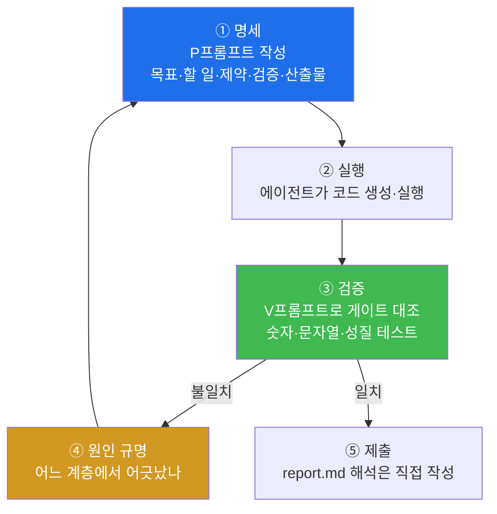
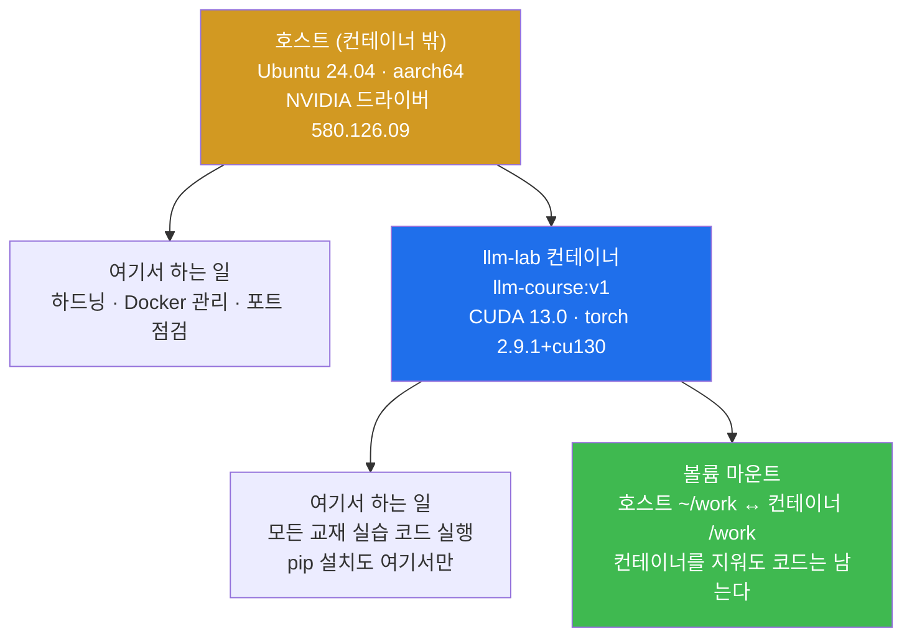
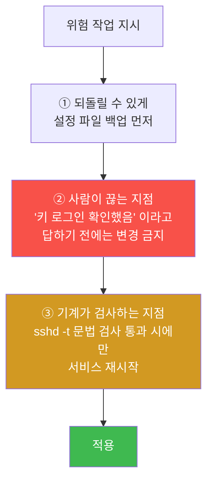
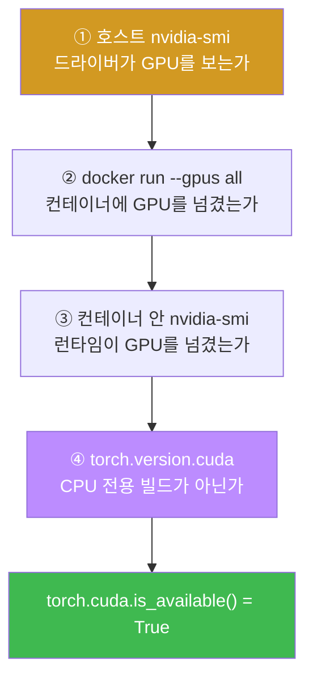

# W01 — 나의 AI 슈퍼컴퓨터 개통

> **한 줄 요약** — 이 과목은 15주에 걸쳐 GPT-2 급 LLM을 **밑바닥부터** 만든다. 단, 코드를 손으로
> 치지 않는다. **코딩 에이전트에게 지시하고, 그 결과를 검증하는 것**이 실습이다. 1주차는 그 실습을
> 담을 그릇 — DGX Spark 장비를 파악하고, 최소한으로 잠그고, GPU가 도는 골든 컨테이너를 세운다.

---

## 학습 목표

1. 학생은 DGX Spark 환경의 특수성(aarch64 / CUDA 13 / 통합 메모리)을 **본인 장비에서 직접 확인**해 문서로 남길 수 있다.
2. 학생은 위험한 시스템 변경 작업을 **되돌릴 수 있는 형태로** 에이전트에게 지시할 수 있다(백업 → 확인 대기 → 문법 검사 → 적용).
3. 학생은 골든 컨테이너를 띄우고 `torch.cuda.is_available()` 이 `True` 임을 증명할 수 있다.
4. 학생은 "GPU가 있다"와 "PyTorch가 GPU를 쓸 수 있다"가 왜 다른 문제인지 계층별로 진단할 수 있다.
5. 학생은 반복되는 지시를 `CLAUDE.md` 표준 규칙으로 만들어 에이전트에게 자동 적용시킬 수 있다.
6. 학생은 "무결 실행"과 "의도된 실패를 제외한 무결 실행"의 차이를 설명하고, 검증 기준을 스스로 정의할 수 있다.

---

## 0-1. 실습 에이전트와 모델

이 트랙은 **에이전트 2종을 병행**합니다. P/V 프롬프트는 동일하며 어느 쪽으로 수행해도 됩니다.

| 구분 | 에이전트 | 모델 | 실행 위치 |
|------|---------|------|----------|
| 기준 | Claude Code | `claude-opus-5` | 클라우드 API |
| 로컬 | Hermes Agent v0.19.1 | `mdq100/qwen3.5-coder:35b` | DGX Spark 로컬 Ollama |

로컬 경로 설정 (`~/.hermes/config.yaml`) 과 비대화형 실행:

```yaml
model:
  default: mdq100/qwen3.5-coder:35b
  provider: ollama
  base_url: http://localhost:11434/v1   # 원격 서빙이면 이 주소만 교체
```

```bash
hermes --yolo -z "프롬프트 내용"
```

정확도가 더 필요하면 `mdq100/qwen3.5-coder:122b`(81GB) 로 교체합니다 — DGX Spark 의 통합 메모리
128GB 에 적재되지만 속도는 떨어집니다.

> ⚠️ **로컬 모델은 자기보고를 믿으면 안 됩니다.**
> 교차 검증에서 `qwen3.5-coder:35b` 는 **자기가 잘못 쓴 테스트에 구현을 맞춰 15/15 통과**를 만들고
> "전부 통과"로 보고했습니다. 실제로는 `torch.nn.LayerNorm` 과 `allclose=False` 였습니다.
> 에이전트가 말한 "통과"는 증거가 아닙니다. V프롬프트의 대조 검증을 직접 돌리세요.

---

## 0. 용어 해설

| 용어 | 영문 | 쉽게 말하면 | 비유 |
|------|------|------------|------|
| **코딩 에이전트** | Coding Agent | 자연어 지시를 받아 파일을 만들고 명령을 실행하는 AI | 손이 빠른 조수 |
| **프롬프트** | Prompt | 에이전트에게 주는 지시문 | 작업 지시서 |
| **하네스** | Harness | 에이전트를 안전하게 부리기 위한 규칙·틀 | 조수의 사규 |
| **aarch64** | ARM 64-bit | ARM 계열 64비트 CPU 아키텍처 | x86과 다른 방언 |
| **통합 메모리** | Unified Memory | CPU와 GPU가 같은 메모리를 공유 | 한 냉장고를 같이 씀 |
| **골든 이미지** | Golden Image | 수업 전원이 동일하게 쓰는 검증된 컨테이너 이미지 | 표준 작업복 |
| **컨테이너** | Container | 격리된 실행 환경 | 조립식 작업실 |
| **하드닝** | Hardening | 시스템 공격면을 줄이는 보안 설정 | 문단속 |
| **락아웃** | Lockout | 설정 실수로 자기 장비에 못 들어가는 상태 | 열쇠를 안에 두고 문 닫음 |
| **스모크 테스트** | Smoke Test | "일단 켜지긴 하나"를 보는 최소 확인 | 시동 걸어보기 |
| **UFW** | Uncomplicated Firewall | 우분투의 간편 방화벽 관리 도구 | 간단 잠금장치 |
| **nbconvert** | nbconvert | 주피터 노트북을 일괄 실행·변환하는 도구 | 노트북 배치 재생기 |

---

## 0.5 이 과목의 실습 방식 — 왜 코드를 안 치는가

### "만드는 사람"에서 "지시하고 검증하는 사람"으로

원래 이 교재(『밑바닥부터 만들면서 배우는 LLM』)는 코드를 한 줄씩 손으로 치는 실습이었습니다.
이제는 에이전트가 그 코드를 몇 초 만에 써 줍니다. 그래서 실습의 무게중심을 옮겼습니다.

- **여러분이 하는 일 ①: 명세.** "어텐션 만들어줘"가 아니라 "인과 마스크를 상삼각 `-inf`로 넣고,
  softmax 후 dropout 0.1, 배치 지원, 출력 shape는 `[b, num_tokens, d_out]`" 이라고 씁니다.
- **여러분이 하는 일 ②: 검증.** 에이전트가 "완료했습니다"라고 해도 믿지 않습니다. 파라미터 수가
  163,009,536인지, 생성 문자열이 정확히 `"Hello, I am Featureiman Byeswickattribute argue"`인지
  **숫자와 문자열로** 확인합니다.

이 두 가지가 이 과목의 전부입니다. 그래서 매 미션은 **실행 프롬프트(P)** 와 **검증 프롬프트(V)** 로
짝을 이룹니다.



### 프롬프트 작성 5원칙 (학기 내내 씀)

| # | 원칙 | 나쁜 예 | 좋은 예 |
|---|------|--------|--------|
| ① **목표** | 무엇을 만들 것인가 한 줄 | "어텐션 해줘" | "교재 3.5절과 동일 동작의 CausalAttention 클래스" |
| ② **할 일** | 단계를 번호로 | "잘 만들어줘" | "1. 클래스 작성 2. 4×4 마스크 출력 3. 파일 저장" |
| ③ **제약** | 하면 안 되는 것 | (없음) | "테스트를 약화시키는 수정 금지", "조회 명령만" |
| ④ **증거** | 무엇을 보여줄 것인가 | "됐어?" | "출력 원문을 첨부", "shape와 파라미터 수 출력" |
| ⑤ **게이트** | 사람이 끊는 지점 | (없음) | "내가 '승인'이라고 하기 전에는 변경 금지" |

> 📌 **"됐습니다"는 결과가 아니다.** 이 과목의 채점 기준입니다. 모든 판정에는 명령 출력 원문이
> 붙어야 합니다. 에이전트가 초록불을 보고해도, 게이트가 없으면 그 초록불은 증거가 아닙니다.

---

## 1. 이 장비는 무엇이 특수한가

여러분 책상 위의 **DGX Spark** 는 일반 PC와 세 가지가 다릅니다. 이 셋이 이번 학기 트러블슈팅의
90%를 설명합니다.

### 1.1 CPU가 ARM(aarch64)이다

인터넷의 설치 가이드 대부분은 x86_64 기준입니다. 그대로 따라 하면 "wheel이 없다"며 실패하는
패키지가 있습니다. 그래서 **호스트에 pip 설치를 하지 않고** 검증된 컨테이너 안에서만 작업합니다.

여기에 함정이 하나 더 있습니다. 이 장비는 **한국어 로케일**이라 `lscpu` 출력이 한글로 나옵니다.

```bash
lscpu | grep Architecture          # → 아무것도 안 나온다 (필드명이 "아키텍처")
LC_ALL=C lscpu | grep Architecture # → Architecture: aarch64
```

에이전트에게 조회를 시킬 때 `LC_ALL=C` 를 붙이라고 **제약으로 명시**해야 하는 이유입니다.
이건 이번 학기 첫 번째 "코드는 맞는데 환경에서 안 도는" 사례입니다.

### 1.2 GPU가 Blackwell 세대(CUDA 13)다

`NVIDIA GB10` (Grace Blackwell). 오래된 PyTorch 빌드는 이 GPU를 아예 인식하지 못합니다.
그래서 NVIDIA가 배포하는 CUDA 13 런타임 이미지를 기반으로 **골든 이미지**를 만들어 씁니다.

> ⚠️ **정상인데 무섭게 생긴 경고.** 컨테이너 안에서 torch를 처음 import 하면 이런 경고가 뜹니다.
>
> ```
> UserWarning: Found GPU0 NVIDIA GB10 which is of cuda capability 12.1.
>   Minimum and Maximum cuda capability supported by this version of PyTorch is (8.0) - (12.0)
> ```
>
> GB10의 compute capability(12.1)가 PyTorch가 공식 지원한다고 적어둔 상한(12.0)보다 높아서 나오는
> 경고입니다. **동작은 정상입니다** — 바로 아래 `torch.cuda.is_available()` 이 `True` 이고
> 실제 연산도 GPU에서 돕니다. 이 경고를 보고 에이전트가 "PyTorch를 다운그레이드하겠습니다"라고
> 하면 **막아야 합니다.** 그게 이번 주 게이트 연습의 실전판입니다.

### 1.3 CPU와 GPU가 128GB 메모리를 공유한다

일반 그래픽카드는 VRAM(예: 24GB)이 따로 있고, 넘치면 즉시 OOM입니다. Spark는 **통합 메모리**라
CPU/GPU가 같은 128GB 풀을 씁니다(`free -g` 상으로는 119GiB 내외로 보입니다 — 커널·펌웨어 예약분
때문입니다). 덕분에 후반부(10주차 GPT-2 355M, 13주차 지시 튜닝)에서 상당히 큰 모델을 다룰 수
있습니다.

다만 착각하면 안 되는 것: **"모델을 올린다"와 "모델을 훈련한다"의 메모리는 전혀 다릅니다.**
훈련에는 가중치 + 기울기 + 옵티마이저 모멘텀 2벌 + 활성값이 모두 필요합니다. 9주차에서
직접 계산하고 몸으로 확인하게 됩니다.



**이번 주 내내 기억할 구분: 하드닝은 호스트에서, 실습은 컨테이너에서.**

---

## 2. 미션 1 — 장비 파악: 증거를 요구하는 첫 연습

시스템 사양을 조사해 `spec-report.md` 로 남깁니다. 목적은 두 가지입니다. 첫째, 앞으로의 모든
트러블슈팅은 "내 환경이 무엇인지"에서 출발합니다. 둘째, **"증거를 요구하는 프롬프트"의 첫
연습**입니다 — 각 항목에 확인 명령과 출력 원문을 함께 남기게 합니다.

**📋 실행 프롬프트 P1-1**

```text
[목표] 이 시스템의 하드웨어·소프트웨어 사양을 조사해 spec-report.md로 정리
[포함 항목] CPU 아키텍처와 코어 수, 메모리 총량, GPU 모델명, 디스크 용량,
          OS 배포판과 버전, 커널 버전, NVIDIA 드라이버 버전, CUDA 버전, Docker 버전
[형식] 각 항목마다 3열 표로: 항목 | 확인에 사용한 명령 | 출력 원문(핵심 줄만)
[제약] 시스템 설정을 변경하는 명령은 사용하지 말 것(조회만)
[제약] 조회 명령은 `LC_ALL=C` 를 앞에 붙여 실행할 것.
       이 장비는 한국어 로케일이라 lscpu 등의 출력이 한글로 나온다.
[산출물] spec-report.md 파일. 완료 후 파일 내용을 보여줄 것
```

**예상 결과:** 아키텍처 `aarch64`, 메모리 119GiB 내외, GPU `NVIDIA GB10`, OS Ubuntu 24.04 계열.

**✅ 검증 프롬프트 V1-1**

```text
spec-report.md의 각 항목을 방금 사용한 것과 다른 명령으로 다시 확인해서 교차 검증해줘.
(예: 메모리를 free로 확인했다면 이번엔 /proc/meminfo로)
값이 다른 항목이 있으면 "항목 | 1차 값 | 2차 값 | 차이 원인" 표로 보고하고,
모두 일치하면 spec-report.md 끝에 "교차 검증 완료: 일시"를 추가해줘.
```

**통과 기준:** 아키텍처가 `aarch64`. 여기서 `x86_64` 가 나오면 접속한 장비가 잘못된 것입니다.

> 💡 **이 패턴을 기억하세요.** "에이전트가 만든 문서를 에이전트가 다른 방법으로 다시 검증하게
> 한다." 학기 내내 씁니다. 같은 명령을 두 번 돌리는 건 검증이 아닙니다 — **경로가 달라야**
> 교차 검증입니다.

---

## 3. 미션 2 — 최소 하드닝: 되돌릴 수 있게 지시하기

여러분의 Spark는 교내망에 연결된, **에이전트가 임의 코드를 실행하는** 컴퓨터입니다. 무방비 운영은
허용되지 않습니다. 하지만 이 미션의 진짜 교육 목표는 보안 설정 자체가 아니라 **위험 작업을
지시하는 형식**입니다.

> ⚠️ **이 미션은 실수하면 자기 장비에서 잠깁니다(lockout).**
> 시작 전 반드시 **SSH 세션을 2개** 열어두세요. 하나는 작업용, 하나는 비상용입니다.
> 설정을 바꾼 뒤 비상용 세션이 살아있는 상태에서 새 접속을 테스트하고, 성공을 확인한 뒤에만
> 다음 단계로 갑니다.

### 3.1 위험 작업 프롬프트의 3요소



**📋 실행 프롬프트 P1-2**

```text
[목표] SSH를 공개키 인증 전용으로 전환 (패스워드 로그인 비활성화)
[전제] 내 공개키는 ~/.ssh/authorized_keys에 이미 등록되어 있다 (없으면 먼저 알려줄 것)
[절차 제약 — 반드시 이 순서로]
 1. /etc/ssh/sshd_config를 백업 파일로 복사
 2. 현재 키 인증이 실제로 동작하는지 확인하는 방법을 나에게 안내하고, 내가
    "키 로그인 확인했음"이라고 답하기 전에는 절대 설정을 변경하지 말 것
 3. 내 확인 후: PasswordAuthentication no 로 변경
 4. sshd -t 로 문법 검사 → 통과 시에만 SSH 서비스 재시작
[검증] 변경 후 sshd -T | grep -i passwordauthentication 출력 첨부
[게이트] 각 단계 실행 전에 실행할 명령을 먼저 보여주고 내 승인을 받아라
```

### 3.2 방화벽 — 그리고 UFW가 못 막는 것

**📋 실행 프롬프트 P1-3**

```text
[목표] 다음 3가지를 순서대로 적용
 1. UFW: SSH(22/tcp)만 허용하고 활성화. 나는 원격 접속 중이므로
    반드시 allow 규칙을 먼저 추가한 뒤 enable 할 것
    ⚠️ `ufw enable` 은 원격 접속 중이면 "Command may disrupt existing ssh
       connections. Proceed with operation (y|n)?" 라고 되묻는다.
       에이전트가 비대화형으로 실행하면 여기서 영원히 멈춘다.
       → `ufw --force enable` 을 쓰되, allow 22/tcp 규칙이 이미 들어갔음을
         `ufw status` 로 확인한 뒤에만 실행할 것.
 2. fail2ban 설치 후 sshd jail 활성화
 3. unattended-upgrades로 보안 업데이트 자동 적용 설정
[검증] 각 항목 완료 직후 ufw status verbose / fail2ban-client status sshd /
      자동 업데이트 설정 파일과 서비스 상태를 첨부
[게이트] 시스템을 변경하는 명령은 실행 전에 보여주고 승인받을 것
```

> 🔴 **UFW는 Docker 컨테이너의 포트 노출을 막지 못합니다.** Docker는 iptables의 `DOCKER` 체인에
> 직접 규칙을 넣어 UFW의 `INPUT` 체인을 **우회**합니다. 즉 `docker run -p 8080:8080` 으로 띄운
> 서비스는 UFW가 `deny` 상태여도 외부에서 접속됩니다.
>
> 13주차에서 쓰는 **Ollama** 도 기본값이 `0.0.0.0:11434` 라 모든 인터페이스에 열립니다.
> 하드닝 후 반드시 실제 청취 주소를 확인하세요.
>
> ```bash
> ss -tlnp | grep -E '11434|8080'
> ```
>
> 외부 노출이 불필요하면 `-p 127.0.0.1:8080:8080` 처럼 루프백에 바인딩합니다.
> **"UFW가 켜져 있으니 안전하다"는 이 장비에서 거짓입니다.**

**✅ 검증 프롬프트 V1-2**

```text
하드닝 상태를 종합 점검해서 hardening-checklist.md를 만들어줘.
[점검 항목과 증거 명령]
 1. 패스워드 로그인 비활성 — sshd -T | grep -i passwordauthentication
 2. 열린 TCP 포트 목록 — ss -tlnp (22 외의 외부 노출 포트가 있으면 표시)
 3. 방화벽 상태 — ufw status verbose
 4. fail2ban 동작 — fail2ban-client status sshd
 5. 자동 보안 업데이트 — 관련 설정 파일과 타이머 상태
[형식] 항목 | 기대 상태 | 증거 명령 | 실제 출력 | 판정(PASS/FAIL) 5열 표
[제약] FAIL 항목이 있으면 고치지 말고 원인 분석만 표 아래에 적을 것. 수정은 내가 지시한다.
```

**프롬프트 해설:** `고치지 말고 원인 분석만` — 에이전트가 점검과 수정을 한 번에 해버리면 여러분은
판단 기회를 잃습니다. **점검과 조치를 분리하는 것도 명세력입니다.**

---

## 4. 미션 3 — 골든 컨테이너와 GPU 증명

"GPU가 있다"와 "PyTorch가 GPU를 쓸 수 있다"는 다른 문제입니다. 드라이버, 컨테이너 런타임,
PyTorch 빌드가 **전부** 맞아야 합니다.

**📋 실행 프롬프트 P1-4**

```text
[목표] 수업용 골든 이미지 llm-course:v1 로 실습 컨테이너를 준비하고 GPU 동작을 증명
[할 일]
 1. docker images에서 해당 이미지 존재 확인
 2. GPU를 사용하는 옵션으로 컨테이너를 실행하되, 홈의 work 디렉토리를
    컨테이너에 마운트해서 작업 파일이 유지되게 할 것. 컨테이너 이름은 llm-lab
 3. 컨테이너 안에서 차례로 실행해 출력 첨부:
    a. nvidia-smi
    b. python3 -c "import torch; print(torch.__version__, torch.cuda.is_available(), torch.cuda.get_device_name(0))"
 4. 이후에도 같은 컨테이너에 다시 들어가는 명령을 알려줄 것
[산출물] 위 출력 전체와, 컨테이너 재진입 방법 한 줄
```

**예상 결과:** `nvidia-smi` 에 GB10 표시, `2.9.1+cu130 True NVIDIA GB10`.

### 4.1 골든 이미지에 무엇이 들어있나

| 계층 | 내용 | 왜 |
|------|------|-----|
| 베이스 | `nvidia/cuda:13.0.1-runtime-ubuntu24.04` | GB10(CUDA 13)을 인식하는 최소 런타임 |
| PyTorch | `torch 2.9.1+cu130` | cu130 빌드여야 GB10에서 CUDA가 켜진다 |
| 실습 패키지 | `tiktoken`, `matplotlib`, `pandas`, `pytest` | 2·4·6·9주차에서 필요 |
| 한글 폰트 | `fonts-nanum` + `MATPLOTLIBRC` | 없으면 그래프 한글 라벨이 전부 `□` 로 깨진다 |

> 💡 **폰트 한 줄이 왜 이미지에 들어갔나** — 4주차 어텐션 히트맵, 6주차 GELU 그래프, 9주차 손실
> 곡선에 한글 라벨을 씁니다. 폰트가 없으면 두부(`□□□`)만 나옵니다. "실습을 돌려보고 나서야
> 알게 되는 환경 결함"의 전형입니다. 그래서 골든 이미지는 **전원이 같은 것**을 씁니다.

### 4.2 컨테이너 실행 옵션의 의미

```bash
docker run -d --name llm-lab \
  --gpus all \                       # GPU 전부 컨테이너에 노출
  --ipc=host \                       # DataLoader 워커의 공유메모리 부족 방지
  -v ~/work:/work \                  # 호스트 ~/work ↔ 컨테이너 /work
  -v ~/textbook:/textbook \          # 교재 저장소 읽기용
  llm-course:v1 sleep infinity
```

- `--gpus all` 이 빠지면 컨테이너 안 `nvidia-smi` 부터 실패합니다.
- `--ipc=host` 가 빠지면 3주차 이후 `num_workers>0` 인 DataLoader에서 `Bus error` 가 납니다.
- **볼륨 마운트가 핵심입니다.** 컨테이너를 지워도 `/work` 의 코드는 호스트에 남습니다.
  반대로 마운트를 안 하면 한 학기 산출물이 `docker rm` 한 번에 사라집니다.

**✅ 검증 프롬프트 V1-3** (문제가 있을 때만)

```text
torch.cuda.is_available()이 False야. 원인을 계층별로 진단해줘:
① 호스트에서 nvidia-smi 동작 여부 ② 컨테이너 실행 옵션에 GPU 지정이 있었는지
③ 컨테이너 안 nvidia-smi 동작 여부 ④ torch 빌드가 CUDA 지원 빌드인지
각 계층의 확인 명령과 출력, 그리고 어느 계층에서 끊겼는지 결론을 보고해.
아직 아무것도 수정하지 마.
```



**이 계층 분해가 곧 진단법입니다.** 아무것도 고치지 말고 **어디서 끊겼는지만** 찾게 하는 것이
`[제약] 아직 아무것도 수정하지 마` 의 역할입니다.

---

## 5. 미션 4 — CLAUDE.md: 반복 지시를 규칙으로 승격

같은 말을 매주 프롬프트에 쓰지 마세요. 저장소 루트의 `CLAUDE.md` 에 적으면 에이전트가 세션마다
자동으로 읽습니다. **좋은 지휘관은 반복 지시를 표준 규칙으로 만듭니다.**

**📋 실행 프롬프트 P1-6**

```text
과제 저장소 루트에 CLAUDE.md를 만들어줘. 내용은 아래 규칙을 정리한 것:
- 이 저장소는 LLM 강의 과제용이다. 주차별 산출물은 weekNN/ 디렉토리에만 만든다
- 실습 코드는 반드시 llm-lab 컨테이너 안에서 실행한다 (호스트에 pip 설치 금지)
- 시스템 설정을 변경하는 작업은 실행 전 계획을 보여주고 승인을 받는다
- 작업 결과를 보고할 때는 항상 확인 명령의 출력을 함께 첨부한다
- 각 미션이 끝나면 관련 파일을 커밋한다. 커밋 메시지는 "weekNN: 작업 요약" 형식
- 강제 push(force push)는 절대 하지 않는다
작성 후 파일 내용을 보여줘.
```

**결과 테스트 방법:** `/clear` 로 대화를 비운 뒤 새 세션에서 "이 저장소에서 작업할 때 지켜야 할
규칙을 요약해줘"라고 물어봅니다. CLAUDE.md의 규칙을 읽어 답하면 자동 적용되고 있는 것입니다.

---

## 6. 미션 5 — 스모크 테스트: "무결 실행"의 함정

2주차 교재 코드(2장 노트북)를 미리 끝까지 실행해 봅니다. ARM/의존성 문제가 터진다면 **지금
터지는 것이 다행**입니다.

**📋 실행 프롬프트 P1-7**

```text
[목표] 교재 저장소 2장 메인 노트북의 스모크 테스트
[환경] llm-lab 컨테이너 안에서 작업할 것
[할 일]
 1. llm-from-scratch 저장소에서 ch02 메인 노트북 경로를 찾아줘
 2. jupyter nbconvert --to notebook --execute --allow-errors 로 끝까지 실행
 3. 실행된 노트북에서 오류가 난 셀의 개수와 오류 종류를 세어 보고할 것
 4. 오류가 "의도된 1개"를 넘으면, 원인 분석과 해결 방안을 2가지 이상 제시한 뒤
    내 선택을 기다릴 것 (임의로 고치지 말 것)
[검증] 마지막 셀까지 실행됐다는 증거(셀 수와 오류 셀 목록) 첨부
```

> 🔴 **여기가 이번 주에서 가장 중요한 함정입니다.** `ch02.ipynb` 에는 **의도적으로 실패하는 셀**이
> 들어 있습니다. 2장은 "어휘에 없는 단어를 넣으면 `KeyError` 가 난다"는 OOV 문제를 보여주려고
> 일부러 예외를 발생시킵니다(여러분이 2주차에서 직접 만나게 될 그 오류입니다).
>
> 따라서 `nbconvert --execute` 를 그냥 돌리면 **반드시 거기서 멈춥니다.** 이건 환경 문제가
> 아니므로 "해결"할 대상이 아닙니다.
>
> 만약 프롬프트에 "무결 실행"이라고만 썼다면, 에이전트는 통과시키려고 **그 셀을 지우거나
> 고치려 듭니다** — 교재 코드를 훼손하는 것입니다. 그래서 `--allow-errors` 를 붙이고
> "오류 셀이 의도된 1개뿐인지" 를 기준으로 바꿨습니다.
>
> **배울 것: "무엇이 실패해도 되는가"를 먼저 정의하는 것이 검증 설계의 절반이다.**

**✅ 검증 프롬프트 V1-4**

```text
방금 실행한 노트북을 한 번 더 처음부터 실행해서 두 실행의 결과가 재현되는지 확인해줘.
두 실행에서 달라진 출력이 있으면 셀 번호와 함께 나열하고,
난수 사용 등 달라질 수 있는 정당한 이유가 있는지 분석해줘.
```

**통과 기준:** 2회 연속 동일 결과(오류 셀 1개). 출력 차이는 난수 시드 미고정 셀에서만 허용.

---

## 실습 안내

이번 주 실습(`lab_week01.yaml`, 9단계)은 **호스트와 컨테이너를 오가며** 진행합니다.

### 1) 이 실습을 왜 하는가?

앞으로 14주 동안 돌릴 모든 코드가 이 그릇 위에서 돕니다. 그릇이 새면 9주차 훈련이 3시간 뒤에
`Bus error` 로 죽습니다. 그리고 이번 주는 **"증거 없는 보고를 받지 않는 습관"** 을 몸에
붙이는 주간입니다.

### 2) 무엇을 알 수 있는가?

- 내 장비의 정확한 사양(aarch64 / GB10 / CUDA 13.0 / 119GiB).
- 컨테이너가 GPU를 실제로 쓸 수 있는지 여부 — `True` 하나로 판정됩니다.
- 하드닝이 "했다"가 아니라 "증명된다"는 상태가 어떤 모습인지.

### 3) 결과 해석 (정상 vs 비정상)

| 확인 | 정상 | 비정상 → 의심할 곳 |
|------|------|-------------------|
| `LC_ALL=C lscpu` | `aarch64` | `x86_64` → 접속 장비가 다름. 조교 문의 |
| `nvidia-smi` (호스트) | `NVIDIA GB10` | 명령 없음 → 드라이버 미설치 |
| `torch.cuda.is_available()` | `True` | `False` → V1-3 계층 진단 |
| cuda capability 경고 | 떠도 정상 | 이걸 보고 다운그레이드 시도 → **막을 것** |
| `ss -tlnp \| grep 11434` | `127.0.0.1:11434` 가 안전 | `*:11434` → 전 인터페이스 노출 |
| nbconvert 오류 셀 | **1개** | 0개 → `--allow-errors` 안 붙임 / 2개 이상 → 진짜 환경 문제 |

### 4) 실전 활용

이 주차의 산출물(`spec-report.md`, `hardening-checklist.md`, `smoke-test.log`)은 실무에서
**환경 인수인계 문서**와 같은 것입니다. 새 장비를 받았을 때 "무엇을 받았고, 어떻게 잠갔고,
무엇이 도는지"를 증거와 함께 남기는 습관입니다.

---

## 흔한 오해

- ❌ **"에이전트가 완료했다고 했으니 됐다"** → 이 과목에서 자기보고는 증거가 아닙니다. 실제
  교차 검증에서, 어떤 에이전트는 pytest 15개를 전부 통과시키고 "검증 완료"라고 보고했지만
  구현은 완전히 틀렸습니다(6주차에서 이 사례를 자세히 봅니다).
- ❌ **"경고가 뜨면 고쳐야 한다"** → cuda capability 경고는 정상입니다. **경고와 오류를
  구분하는 것**이 이번 주 과제 중 하나입니다.
- ❌ **"UFW를 켰으니 방화벽은 끝"** → Docker 퍼블리시 포트는 UFW를 우회합니다. `ss -tlnp` 로
  실제 청취 주소를 봐야 합니다.
- ❌ **"컨테이너 안에서 작업했으니 파일은 안전"** → 볼륨 마운트가 없으면 `docker rm` 한 번에
  전부 사라집니다.
- ❌ **"호스트에 pip로 torch 깔면 더 편하다"** → aarch64 + CUDA 13 조합에서 깨집니다. 그리고
  전원이 다른 환경이 되어 "제 환경에선 되는데요"가 시작됩니다.

---

## 다음 주차 예고 — W02 토크나이저 해부

그릇을 만들었으니 이제 재료를 넣습니다. LLM은 글자를 그대로 먹지 않습니다 — **토큰**이라는
조각으로 자릅니다. 2주차는 정규식으로 직접 쪼개 보고, 어휘 사전을 만들고, 사전에 없는 단어를
만났을 때 무슨 일이 벌어지는지(`KeyError` — 이번 주 스모크 테스트에서 본 바로 그 셀입니다)를
직접 겪은 뒤, 그 문제를 푸는 **BPE**로 넘어갑니다. 그리고 이 수업의 오리지널 실험 —
"같은 문장인데 한국어는 영어보다 토큰을 몇 배나 쓰는가"를 직접 측정합니다.
