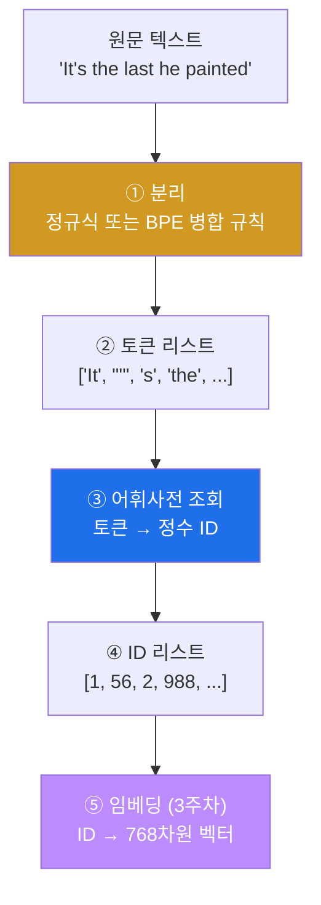
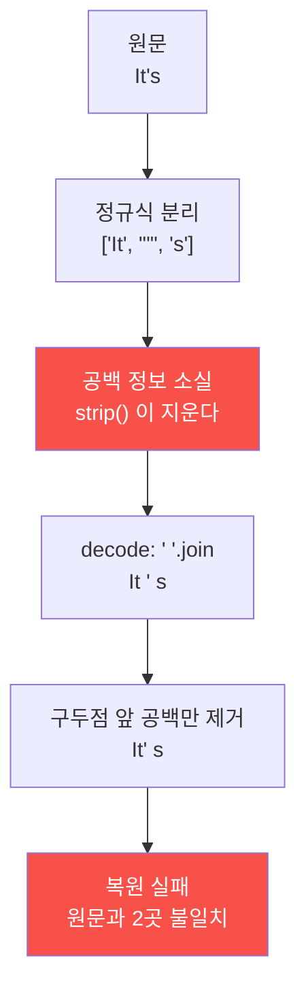
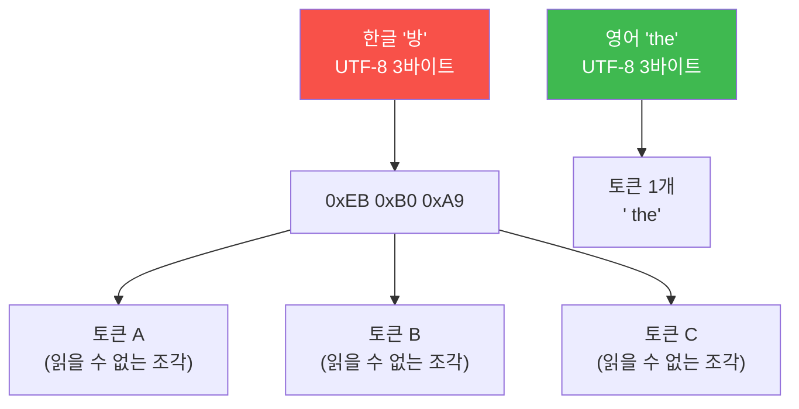
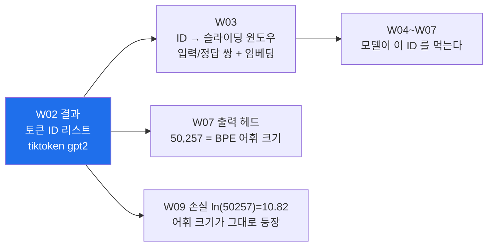

# W02 — 토크나이저 해부: 텍스트가 숫자가 되는 순간

> **한 줄 요약** — 신경망은 숫자만 계산한다. 그래서 LLM의 첫 단계는 텍스트를 조각내고(토큰화)
> 각 조각에 정수 ID를 붙이는 일이다. 이번 주는 그 변환기를 **두 번** 만든다 — 한 번은 원리를
> 보려고 원시적으로, 한 번은 GPT-2가 실제로 쓰는 방식(BPE)으로. 그 사이에서 **OOV**라는 벽에
> 일부러 부딪히고, 마지막에 "한국어는 영어보다 토큰을 몇 배 쓰는가"를 직접 측정한다.

---

## 학습 목표

1. 학생은 텍스트 → 토큰 → ID 파이프라인을 정규식 한 줄부터 직접 만들 수 있다.
2. 학생은 `SimpleTokenizerV1` 의 encode/decode 왕복이 **원문을 복원하지 못하는 이유**를 두 지점으로 특정해 설명할 수 있다.
3. 학생은 OOV(`KeyError`)를 재현하고, 그것이 어휘사전 구축 방식의 필연적 결과임을 설명할 수 있다.
4. 학생은 `<|unk|>` / `<|endoftext|>` 특수 토큰의 역할과 한계를 구분할 수 있다.
5. 학생은 BPE가 왜 원리적으로 OOV가 없는지 어휘 구성(바이트 256 + 병합 50,000 + 특수 1)으로 설명할 수 있다.
6. 학생은 한국어/영어 토큰 효율 차이를 실측하고, 그 숫자가 비용·컨텍스트 창에 갖는 의미를 해석할 수 있다.

---

## 0. 용어 해설

| 용어 | 영문 | 쉽게 말하면 | 비유 |
|------|------|------------|------|
| **토큰** | Token | 모델이 다루는 텍스트의 최소 조각 | 레고 블록 한 개 |
| **토큰화** | Tokenization | 텍스트를 토큰으로 자르는 일 | 재료 손질 |
| **어휘사전** | Vocabulary | 토큰 ↔ 정수 ID 대응표 | 부품 카탈로그 |
| **encode / decode** | — | 텍스트→ID / ID→텍스트 | 암호화 / 복호화 |
| **OOV** | Out-Of-Vocabulary | 사전에 없는 단어 | 카탈로그에 없는 부품 |
| **특수 토큰** | Special Token | 텍스트가 아닌 신호용 토큰 | 서류의 도장 |
| **`<\|unk\|>`** | unknown | 모르는 단어의 대타 | "미상" 도장 |
| **`<\|endoftext\|>`** | — | 문서 경계 표시 | 문서 끝 도장 |
| **BPE** | Byte Pair Encoding | 자주 붙는 문자쌍을 반복 병합해 만든 서브워드 어휘 | 자주 쓰는 조합은 통짜 부품으로 |
| **서브워드** | Subword | 단어보다 작은 단위 | 부품의 부품 |
| **tiktoken** | tiktoken | OpenAI의 BPE 구현 라이브러리 | 공식 재단기 |
| **손실 변환** | Lossy | 되돌렸을 때 원본이 안 나오는 변환 | 복사본의 복사본 |

---

## 0.5 이번 주 배경 지식 — 처음이라면

> 이 절은 프로그래밍은 해 봤지만 **자연어 처리는 처음인 학생**을 위한 것입니다.
> 정규식·유니코드·딕셔너리를 이미 안다면 "왜 토큰이라는 어중간한 단위인가"로 건너뛰십시오.

### 신경망은 왜 글자를 못 먹는가

신경망 안에서 일어나는 일은 전부 **곱하기와 더하기**입니다. `0.3 × 1.7 + 0.2` 같은 계산을
수억 번 합니다. 그런데 `"방화벽"` 이라는 글자는 곱할 수가 없습니다.

그래서 **먼저 숫자로 바꿔야 합니다.** 그 변환을 두 단계로 나눕니다.

| 단계 | 하는 일 | 언제 |
|---|---|---|
| ① **토큰화** | 텍스트를 조각내고 각 조각에 **정수 번호**를 붙인다 | **이번 주** |
| ② **임베딩** | 그 정수를 **의미를 담은 숫자 여러 개**(벡터)로 바꾼다 | 다음 주 |

이번 주 결과물은 `[1, 56, 2, 988, ...]` 같은 **정수 리스트**까지입니다.

> 💡 **왜 두 단계로 나누나.** 정수 번호 자체에는 의미가 없습니다. `cat` 이 348번이고
> `dog` 이 3290번이어도, 348과 3290 사이에 아무 관계가 없습니다. 의미를 담는 일은 임베딩이
> 맡습니다. 이번 주는 **번호표를 붙이는 일**만 합니다.

### 정규식(regular expression)이 처음이라면

정규식은 **문자열의 패턴을 적는 작은 언어**입니다. "쉼표나 마침표나 공백이 나오면 거기서
잘라라"를 한 줄로 표현합니다.

이번 주에 쓰는 것은 이 하나입니다.

```python
r'([,.:;?_!"()\']|--|\s)'
```

한 조각씩 읽으면 됩니다.

| 조각 | 뜻 |
|---|---|
| `r'...'` | 파이썬에서 "역슬래시를 특수문자로 해석하지 마라"는 표시(raw string) |
| `[,.:;?_!"()\']` | **대괄호 안 문자 중 아무거나 하나** — 쉼표, 마침표, 콜론, … |
| `\|` | **또는** |
| `--` | 하이픈 두 개(줄표) |
| `\s` | 공백류 — 스페이스, 탭, 줄바꿈 |
| `( ... )` | **캡처 그룹.** `re.split()` 에서 이걸 씌우면 **자른 기준 문자도 결과에 남는다** |

마지막 항목이 핵심입니다. 괄호가 없으면 구두점이 **버려지고**, 괄호가 있으면 구두점이
**독립 토큰으로 살아남습니다.** 문장부호도 의미를 나르므로 살려야 합니다.

```python
import re
re.split(r'([,.])', "Hello, world.")
# → ['Hello', ',', ' world', '.', '']    ← 쉼표·마침표가 결과에 남아 있다
```

### 딕셔너리(dict)가 곧 어휘사전이다

파이썬 딕셔너리는 **"열쇠 → 값" 대응표**입니다. 어휘사전이 정확히 이 구조입니다.

```python
vocab = {"I": 0, "HAD": 1, "always": 2, ",": 3}   # 토큰 → ID
vocab["always"]        # → 2
```

되돌리려면 **뒤집은 표**가 하나 더 필요합니다.

```python
inv = {v: k for k, v in vocab.items()}   # ID → 토큰
inv[2]                 # → "always"
```

토크나이저 클래스가 하는 일이 이 두 표를 들고 있다가 앞뒤로 찾아 주는 것, 그게 전부입니다.

### 유니코드와 UTF-8 — 미션 5를 이해하려면 필요합니다

컴퓨터는 글자도 결국 **바이트**(0~255 사이의 숫자)로 저장합니다. 어떤 글자를 몇 번 바이트로
적을지 정한 규칙이 **UTF-8** 입니다. 그리고 **글자마다 바이트 수가 다릅니다.**

| 글자 | UTF-8 바이트 수 | 실제 값 |
|---|---|---|
| `a` | **1** | `0x61` |
| `방` | **3** | `0xEB 0xB0 0xA9` |
| `😀` | **4** | `0xF0 0x9F 0x98 0x80` |

**영어 알파벳은 1바이트, 한글은 3바이트입니다.** 이 사실 하나가 미션 5의 "한국어가 토큰을
4~7배 쓴다"는 결과의 뿌리입니다. 파이썬에서 직접 확인할 수 있습니다.

```python
len("방".encode("utf-8"))    # → 3
len("a".encode("utf-8"))     # → 1
```

> ⚠️ **바이트와 글자와 토큰은 전부 다른 단위입니다.** 이번 주 내내 이 셋을 구분해야 합니다.
> `"방화벽이 비정상 트래픽을 차단했다."` = **19글자 / 49바이트 / 43토큰**.

### 왜 "토큰"이라는 어중간한 단위인가

세 가지 선택지가 있었습니다.

| 단위 | 어휘 크기 | 장점 | 치명적 단점 |
|------|----------|------|------------|
| **글자** (character) | 수백 개 | OOV 없음 | 시퀀스가 너무 길어짐 ("hello" = 5스텝) |
| **단어** (word) | 수십만~무한 | 의미 단위라 직관적 | **OOV**. 오타 하나에 무너짐 |
| **서브워드** (subword) | 5만 개 내외 | 둘의 절충 | 사람이 읽기엔 어색한 조각이 나옴 |

LLM은 세 번째를 씁니다. `"unbelievable"` 을 `un` + `bel` + `iev` + `able` 로 쪼개면,
`"unbelievably"` 도 `"believable"` 도 **아는 조각으로 표현**됩니다. 이것이 BPE의 아이디어입니다.



이번 주는 ①~④입니다. ⑤는 다음 주에 합니다.

### "정답지"라는 개념 — 이 수업의 채점 방식

이 과목은 매 미션마다 **정확한 숫자**를 제시합니다.

> 전체 문자 수 **20,479** / 토큰 수 **4,690** / 어휘사전 **1,130** → **1,132** / BPE 어휘 **50,257**

이 숫자가 안 맞으면 **다음으로 넘어가지 마세요.** 어딘가 다르게 된 것이고, 그 차이는 뒤에서
반드시 더 큰 문제로 돌아옵니다. 에이전트가 "완료했습니다"라고 해도 숫자가 안 맞으면 완료가
아닙니다.

> 📌 **동시에, 정답지도 의심하십시오.** 이번 주 P2-3의 "통과 기준"은 실제로는 **통과하지
> 않습니다** — 교재 저장소의 공식 노트북 출력도 같은 결과입니다. 왜 그런지가 이번 주의
> 핵심 학습 내용입니다.

---

## 1. 미션 1 — 정규식으로 쪼개기

토큰화의 가장 원시적인 형태를 눈으로 봅니다.

**📋 실행 프롬프트 P2-1**

```text
[목표] the-verdict.txt를 교재 2장과 동일한 방식으로 토큰 분리
[할 일]
 1. 정규식 r'([,.:;?_!"()\']|--|\s)' 로 텍스트를 분할하고,
    양끝 공백 제거 후 빈 문자열을 제외한 토큰 리스트 생성
 2. 전체 토큰 수와 처음 30개 토큰 출력
 3. 이 코드를 week02/step1_split.py 로 저장
[검증] 구두점(쉼표, 마침표)이 독립 토큰으로 분리되었는지 처음 30개에서 확인해 지적할 것
```

### 1.1 이 정규식이 무슨 일을 하는가

```python
r'([,.:;?_!"()\']|--|\s)'
```

- `re.split()` 에서 패턴을 **괄호로 감싸면 구분자도 결과에 남습니다.** 그래서 구두점이 버려지지
  않고 **독립 토큰**이 됩니다.
- 세 갈래를 `|` 로 잇습니다: 구두점 문자 하나 / `--`(em-dash) / 공백류(`\s`).
- 분리 후 `strip()` 으로 양끝 공백을 지우고 빈 문자열을 걸러냅니다.

**예상 결과:** 전체 **4,690개**. 처음 토큰은 `I`, `HAD`, `always`, ... 이고 29번째에 `,` 가
독립 토큰으로 나타납니다.

> ⚠️ **여기서 공백 정보가 사라집니다.** `strip()` 하는 순간 "이 토큰 앞에 공백이 있었는가"가
> 버려집니다. 지금은 아무 문제 없어 보이지만, 30분 뒤에 이것이 원문 복원을 막습니다.

---

## 2. 미션 2 — 어휘사전과 SimpleTokenizerV1: 일부러 실패하기

**📋 실행 프롬프트 P2-2**

```text
[목표] 어휘사전 구축과 SimpleTokenizerV1 구현
[할 일]
 1. 미션 1의 토큰 리스트에서 중복 제거·정렬한 어휘사전(토큰→ID dict)을 만들고 크기를 출력
 2. week02/tokenizer_v1.py 에 SimpleTokenizerV1 클래스 작성:
    - __init__(self, vocab): 토큰→ID, ID→토큰 매핑 보관
    - encode(self, text) -> list[int]: 미션 1과 동일한 정규식 분리 후 ID 변환
    - decode(self, ids) -> str: 공백으로 잇되, 구두점 앞의 불필요한 공백은 정규식으로 제거
 3. 클래스에는 각 메서드가 무엇을 하는지 한국어 주석을 달 것
[검증] 어휘사전의 첫 10개 항목(토큰, ID)과 마지막 5개 항목 출력
```

**예상 결과:** 어휘사전 크기 **1,130**.

> 💡 **왜 `sorted()` 로 정렬하는가** — 같은 텍스트라면 누가 언제 만들어도 같은 ID가 나와야
> 합니다. `set()` 은 순서가 보장되지 않으므로 정렬이 **재현성의 조건**입니다. 이 수업에서
> "재현"은 계속 나오는 주제입니다.

### 2.1 P2-3 — 왕복 테스트: 정답지가 틀린 자리

**📋 실행 프롬프트 P2-3**

```text
tokenizer_v1.py의 SimpleTokenizerV1로 다음을 테스트해줘:
[입력 문장] "It's the last he painted, you know," Mrs. Gisburn said with pardonable pride.
[할 일] ① encode 결과 ID 리스트 출력 ② 그 ID를 다시 decode한 문자열 출력
       ③ 원문과 decode 결과가 일치하는지 비교 (차이가 있다면 어디가 다른지)
[제약] 일치하지 않아도 코드를 고치지 말 것. 왜 다른지만 설명하라.
```

**예상 결과 (정답지): 원문이 그대로 복원되지 않습니다. 이것이 정상입니다.**

```
원문   : "It's the last he painted, you know," Mrs. Gisburn said with pardonable pride.
decode : " It' s the last he painted, you know," Mrs. Gisburn said with pardonable pride.
```

**두 군데가 다릅니다.**

1. 문장 앞에 **공백 하나**가 붙었다.
2. `It's` 가 **`It' s`** 로 벌어졌다.

**왜 그런가.** V1의 decode는 토큰을 `" ".join(...)` 으로 이어 붙인 뒤, 구두점 **앞**의 공백만
정규식으로 지웁니다. `'` 는 그 대상 목록에 있으니 `It '` → `It'` 로 붙습니다. 그런데 그
**뒤에 오는 `s` 앞의 공백을 지울 규칙은 없습니다.** 토크나이저가 `It` / `'` / `s` 셋으로
쪼개는 순간, 원문의 띄어쓰기 정보는 **이미 사라졌습니다.**

**통과 기준:** decode 결과가 원문과 다르다는 것을 **정확히 두 지점**으로 특정하고, 원인을
"토큰화 과정에서 공백 정보가 소실되기 때문"으로 설명할 것.



> 🔴 **여기서 배울 것 두 가지.**
>
> **① 토큰화는 손실 변환이다.** 이 사실이 BPE 설계의 이유입니다. GPT-2 BPE는 정반대로,
> 공백을 토큰 **안에** 넣습니다(`" the"` 처럼 선행 공백 포함). 그래서 완전 복원이 보장됩니다.
> 미션 4에서 직접 확인합니다.
>
> **② 정답지를 의심하라.** 교재 원문의 "통과 기준"은 원래 "원문 복원"이었습니다. 그런데
> 교재 저장소의 공식 노트북 `ch02.ipynb` 의 **저장된 출력에도 `" It' s"` 가 그대로 찍혀
> 있습니다.** 정답지가 틀린 것입니다. 이 과목에서 여러분이 하는 일이 바로 이것 —
> 실행 결과와 정답지를 대조해 **어느 쪽이 틀렸는지** 판정하는 일입니다.

### 2.2 P2-4 — OOV: 의도된 실패

**📋 실행 프롬프트 P2-4**

```text
같은 토크나이저로 이번엔 "Hello, do you like tea?" 를 encode해봐.
오류가 나면: 오류 전문을 보여주고, 왜 이 오류가 발생했는지 어휘사전과
연결해서 설명해줘. 아직 코드를 고치지는 마.
```

**예상 결과:** `KeyError: 'Hello'`. 훈련 텍스트(19세기 단편소설)에 `Hello` 가 한 번도 안
나왔기 때문입니다.

**프롬프트 해설:** `아직 고치지 마` — 에이전트는 시키지 않으면 오류를 즉시 고쳐버립니다.
그러면 여러분은 "왜 실패하는가"를 생각할 기회를 잃습니다. **실패를 관찰 대상으로 고정하는
지시**가 이 한 줄입니다. 1주차 스모크 테스트의 "의도된 오류 1개"와 같은 원리입니다.

---

## 3. 미션 3 — 특수 토큰과 SimpleTokenizerV2

**📋 실행 프롬프트 P2-5**

```text
[목표] SimpleTokenizerV2 구현 (특수 토큰 지원)
[할 일]
 1. 어휘사전에 <|endoftext|> 와 <|unk|> 를 추가하고 새 크기를 출력
 2. week02/tokenizer_v2.py 에 SimpleTokenizerV2 작성:
    encode에서 사전에 없는 토큰은 <|unk|>의 ID로 치환. 나머지는 V1과 동일
 3. 다음 텍스트로 encode → decode 결과를 출력:
    "Hello, do you like tea? <|endoftext|> In the sunlit terraces of the palace."
[검증] decode 결과에서 <|unk|>로 바뀐 단어가 무엇인지 짚어줄 것
```

**예상 결과:** 새 사전 크기 **1,132**.
decode 결과는 `<|unk|>, do you like tea? <|endoftext|> In the sunlit terraces of the <|unk|>.`
— `Hello` 와 `palace` 가 `<|unk|>` 로 바뀝니다(둘 다 소설에 없는 단어).

### 3.1 두 특수 토큰의 역할이 다르다

| 토큰 | 역할 | 없으면 무슨 일이 |
|------|------|----------------|
| `<\|unk\|>` | 모르는 단어의 대타 | `KeyError` 로 죽는다 |
| `<\|endoftext\|>` | 서로 무관한 문서의 **경계** | 모델이 앞 문서 끝과 뒷 문서 시작을 하나의 문맥으로 착각한다 |

GPT-2는 실제로 `<|endoftext|>` 를 씁니다(ID 50256). `<|unk|>` 는 **쓰지 않습니다** — BPE에는
OOV가 없어서 필요가 없기 때문입니다.

> ⚠️ **`<|unk|>` 는 해결이 아니라 미봉책입니다.** 모르는 단어를 전부 같은 ID로 뭉개면, 모델
> 입장에서 `Hello` 와 `palace` 와 `quantum` 이 **전부 같은 단어**가 됩니다. 정보가 파괴됩니다.

### 3.2 검증을 사람 눈에서 테스트 코드로 격상

**✅ 검증 프롬프트 V2-2**

```text
week02/test_tokenizer.py 에 pytest 테스트 3개를 작성하고 실행해줘:
 1. test_roundtrip: 사전에 있는 단어로만 된 문장은 encode→decode가 원문 복원
 2. test_unknown: 사전에 없는 단어가 <|unk|>로 치환되는지
 3. test_vocab_size: V2 어휘사전 크기가 1132인지
[제약] 테스트가 실패하면 테스트를 통과하도록 본체 코드를 고치되,
      무엇을 왜 고쳤는지 보고할 것 (테스트를 약화시키는 방식의 수정 금지)
[검증] pytest 실행 결과 전체 출력 첨부
```

**통과 기준:** `3 passed`.

**프롬프트 해설:** `테스트를 약화시키는 수정 금지` — 에이전트가 "테스트 통과"를 목표로 잡으면
가끔 **테스트 쪽을 느슨하게** 고치는 잘못된 지름길을 택합니다. 이를 명시적으로 봉쇄하는 것도
명세력입니다. (6주차에서 이 제약이 왜 부족한지, 더 강한 형태가 필요한지 보게 됩니다.)

---

## 4. 미션 4 — 진짜 토크나이저: tiktoken의 BPE

**📋 실행 프롬프트 P2-6**

```text
[목표] tiktoken의 GPT-2 BPE와 우리 V2 토크나이저 비교
[할 일]
 1. tiktoken으로 gpt2 인코딩을 로드하고 전체 어휘 크기를 출력
 2. 미션 3과 동일한 문장을 BPE로 encode → ID 리스트와 decode 결과 출력
 3. week02/bpe_compare.md 에 비교표 작성:
    (어휘 크기 / OOV 처리 방식 / 위 문장의 토큰 수 / Hello의 처리 결과)
[검증] BPE decode 결과에 <|unk|>가 등장하지 않음을 확인해서 지적할 것
```

### 4.1 GPT-2 어휘 50,257의 구성

| 구성 | 개수 | 역할 |
|------|------|------|
| 바이트 | **256** | 모든 바이트값 0~255. **이것이 OOV를 없앤다** |
| 병합 토큰 | **50,000** | 훈련 코퍼스에서 자주 붙어 나온 쌍을 반복 병합한 결과 |
| 특수 토큰 | **1** | `<\|endoftext\|>` (ID 50256) |
| **합계** | **50,257** | |

**바이트 256개가 왜 결정적인가.** 어떤 텍스트든 UTF-8로 쓰면 결국 바이트의 나열입니다.
그 바이트가 전부 어휘에 있으므로, **최악의 경우에도 바이트 단위로는 반드시 표현됩니다.**
그래서 BPE에는 원리적으로 OOV가 없습니다.

### 4.2 예고된 함정 — 특수 토큰 가드

tiktoken은 입력에 `<|endoftext|>` 문자열이 섞여 있으면 **기본적으로 오류를 냅니다.**

```
ValueError: Encountered text corresponding to disallowed special token '<|endoftext|>'.
```

이건 버그가 아니라 **보안 장치**입니다. 사용자 입력에 특수 토큰이 섞여 들어오면 모델의 문서
경계 인식을 조작할 수 있기 때문입니다(프롬프트 인젝션의 한 형태). 해결은 명시적 허용입니다.

```python
enc.encode(text, allowed_special={"<|endoftext|>"})
```

**에이전트가 이 오류를 만나 스스로 해결하는 과정을 관찰하세요.** 오류 메시지를 읽고 푸는 것도
실습의 일부입니다.

### 4.3 연습문제 2.1 — 미지의 단어 분해 관찰

**📋 실행 프롬프트 P2-7**

```text
"Akwirw ier" 라는 무의미한 문자열을 gpt2 BPE로 encode하고,
각 토큰 ID를 하나씩 개별 decode해서 "ID | 조각 문자열" 표로 보여줘.
마지막으로 전체 ID를 한 번에 decode해서 원문이 복원되는지 확인해줘.
```

**예상 결과:**

| ID | 조각 |
|----|------|
| 33901 | `Ak` |
| 86 | `w` |
| 343 | `ir` |
| 86 | `w` |
| 220 | `' '` (공백) |
| 959 | `ier` |

전체 decode는 원문 `Akwirw ier` 를 **정확히** 복원합니다. 세상에 없는 단어인데도요.
**처음 보는 단어도 아는 조각의 조합으로 표현한다** — 이것이 BPE의 답입니다.

그리고 공백이 **독립 토큰(220)** 으로 살아 있는 것을 보세요. V1이 잃어버린 그 정보입니다.

---

## 5. 미션 5 — 한국어 토큰 효율 실험 (이 수업의 오리지널)

같은 의미를 한국어와 영어로 쓰면 토큰 수가 얼마나 차이 날까요. 이 숫자는 "한국어 사용자는
같은 내용에 더 많은 **비용**과 **컨텍스트 창**을 쓴다"는 현실 문제로 직결됩니다.

**📋 실행 프롬프트 P2-8**

```text
[목표] 한국어/영어 토큰 효율 비교 실험
[할 일] week02/ko_en_tokens.py 작성 후 실행:
 1. 같은 의미의 한국어/영어 문장 쌍 10개를 리스트로 내장할 것.
    일상 문장 5쌍 + 보안 분야 문장 5쌍으로 구성
 2. 각 문장을 gpt2 BPE로 encode해 토큰 수 계산
 3. 결과를 markdown 표(번호 | 한국어 문장 | ko 토큰 수 | en 토큰 수 | 비율)로
    week02/ko_en_result.md 에 저장하고, 마지막 줄에 평균 비율 기록
[검증] 표에서 비율이 가장 큰 쌍과 가장 작은 쌍을 짚고, 문장 특성의 차이를 관찰해 보고할 것
```

**예상 결과:** 문장 10쌍 기준 **대략 4~7배**.
(참고 실측: 최소 **3.73배**, 최대 **7.17배**, 평균 **4.94배**)

| 예시 | ko 토큰 | en 토큰 | 비율 |
|------|--------|--------|------|
| 방화벽이 비정상 트래픽을 차단했다. / The firewall blocked abnormal traffic. | 43 | 6 | **7.17배** |
| 이 식당의 김치찌개가 이 동네에서 가장 맛있다. / The kimchi stew at this restaurant is the best in this neighborhood. | 56 | 15 | **3.73배** |

**문장이 짧을수록 배율이 커집니다.** 영어는 짧은 단어 하나가 토큰 하나인데, 한국어는 짧아도
글자마다 바이트 조각으로 쪼개지기 때문입니다.

### 5.1 바이트 수준에서 보면

**📋 실행 프롬프트 P2-9**

```text
위 실험의 한국어 문장 중 하나를 골라 gpt2 BPE로 encode한 뒤,
토큰 ID를 하나씩 decode해서 "ID | 복원 조각" 표로 보여줘.
글자 중간에서 잘려 사람이 읽을 수 없는 조각(바이트 조각)이 나오면 표시해줘.
그리고 이 문장의 UTF-8 바이트 수와 토큰 수를 비교해줘.
```

`"방화벽이 비정상 트래픽을 차단했다."` 는 UTF-8로 **49바이트**, BPE로 **43토큰**입니다.
개별 토큰을 decode하면 대부분 `�` (깨진 문자)로 나옵니다 — **한 글자가 여러 바이트 조각
토큰으로 쪼개졌다**는 뜻입니다.



**왜 이런가.** GPT-2의 병합 규칙은 **영어 중심 코퍼스**에서 학습됐습니다. `" the"` 같은 영어
조합은 통짜 토큰으로 병합되었지만, 한국어 바이트 조합은 병합 학습이 거의 안 되어 있습니다.
그래서 병합되지 못한 바이트가 낱개 토큰으로 남습니다.

### 5.2 해석 과제 (report.md에 **직접** 작성 — 에이전트 사용 금지)

1. 왜 한국어가 더 많은 토큰으로 쪼개지는가? (힌트: BPE 병합 규칙은 어떤 데이터에서
   학습되었나 + 한글의 UTF-8 표현)
2. 이 비율이 실제 LLM 서비스에서 갖는 의미 2가지를 쓰라. (비용 관점, 컨텍스트 창 관점)

---

## 6. 에이전트에게 시키는 법 — 이번 주 실전

이 수업의 실습은 "코드를 친다"가 아니라 **"지시하고 판정한다"** 입니다. 이번 주 프롬프트를
재료 삼아 그 방법을 구체적으로 봅니다.

### 6.1 P프롬프트는 왜 이런 모양인가

P2-1 을 다시 보십시오. 네 개의 대괄호가 각각 역할이 있습니다.

```text
[목표] the-verdict.txt를 교재 2장과 동일한 방식으로 토큰 분리      ← 무엇을
[할 일] 1. … 2. … 3. …                                          ← 어떤 순서로
[검증] 구두점이 독립 토큰으로 분리되었는지 처음 30개에서 확인      ← 무엇을 보여야 끝인가
```

| 칸 | 없으면 생기는 일 |
|---|---|
| **[목표]** | 에이전트가 자기 마음대로 범위를 넓히거나 좁힌다 |
| **[할 일]** | 단계를 건너뛰고 결론만 만든다. 중간 산출물이 안 남는다 |
| **[제약]** | 하지 말아야 할 일을 한다 (오류를 몰래 고치기, 라이브러리 갈아타기) |
| **[검증]** | "완료했습니다" 한 줄로 끝난다. **증거가 없다** |

**직접 써 볼 때의 기준:** 다른 사람이 이 프롬프트만 읽고 같은 결과를 만들 수 있으면 합격입니다.

### 6.2 이번 주의 핵심 제약 — `아직 고치지 마`

P2-4 에는 이상해 보이는 한 줄이 있습니다.

```text
오류가 나면: 오류 전문을 보여주고, 왜 이 오류가 발생했는지 어휘사전과
연결해서 설명해줘. 아직 코드를 고치지는 마.
```

**에이전트의 기본 성향은 "오류를 없애는 것"입니다.** 그냥 두면 `KeyError` 를 보자마자
`try/except` 를 두르거나 `<|unk|>` 를 미리 넣어 버립니다. 그러면 여러분은 **OOV 라는 벽에
부딪혀 볼 기회 자체를 잃습니다.**

이 한 줄이 하는 일은 **실패를 관찰 대상으로 고정하는 것**입니다. 학기 내내 반복해서 씁니다.

> 📌 **일반화하면 이렇습니다.** 에이전트에게는 "무엇을 하라"보다 **"무엇을 하지 마라"** 가
> 더 어렵고 더 중요합니다. 잘하려는 성향이 학습을 지웁니다.

### 6.3 이번 주에 에이전트가 실제로 하는 실수 세 가지

로컬 모델로 전 주차를 돌려 본 실측입니다. **이걸 잡아내는 것이 여러분의 일입니다.**

| 증상 | 어떻게 알아채나 | 대응 |
|---|---|---|
| **정규식을 "개선"한다** | 토큰 수가 4,690 이 아니다 | 정답지 대조. 프롬프트의 정규식을 문자 그대로 쓰게 다시 지시 |
| **왕복 실패를 몰래 고친다** | decode 결과가 원문과 **일치**한다 | 일치하면 오히려 실패다. `git diff` 로 decode 규칙이 늘었는지 확인 |
| **`sorted()` 를 빠뜨린다** | 실행할 때마다 ID 가 바뀐다 | 두 번 실행해 첫 10개 항목 비교 |

두 번째가 특히 고약합니다. **에이전트는 "복원이 안 되는 것"을 버그로 인식**하기 때문에,
제약이 없으면 규칙을 계속 추가해 원문을 맞추려 듭니다. 그 순간 이번 주의 학습 목표
("토큰화는 손실 변환이다")가 사라집니다.

### 6.4 판정은 이 명령들로 합니다

에이전트 보고를 믿지 말고 직접 치십시오. **전부 컨테이너 안에서** 실행합니다.

```bash
docker exec -it llm-lab bash
cd /work/week02

ls -la                                   # 파일이 실제로 생겼는가
python3 step1_split.py | tail -5         # 토큰 4,690 인가
python3 -c "
from tokenizer_v1 import SimpleTokenizerV1
import json; v = json.load(open('vocab.json'))
print('어휘사전', len(v))                 # 1,130 인가
"
python3 -m pytest test_tokenizer.py -q   # 3 passed 인가
```

> 💡 **`tail -5` 를 쓰는 이유** — 에이전트가 만든 스크립트는 출력이 길 때가 많습니다. 판정에
> 필요한 줄만 보는 습관을 들이면 "숫자를 놓쳐서 통과시켜 버리는" 사고가 줄어듭니다.

---

## 7. 이번 주 산출물이 어디로 가는가

이 수업은 매주 만든 것을 **다음 주가 그대로 입력으로 받습니다.** 이번 주 결과물의 행선지입니다.



**특히 `50,257` 이라는 숫자를 기억하십시오.** 이번 주에는 그냥 "BPE 어휘 크기"지만,

- 7주차에 **출력 헤드가 `768 × 50,257 = 38,597,376` 파라미터**가 되는 근거이고,
- 9주차에 훈련 시작 손실이 **`ln(50257) = 10.82`** 근처인 이유이고,
- 11주차에 그 출력 헤드를 **2개짜리로 갈아 끼우는** 개조의 대상입니다.

한 주에 나온 숫자가 학기 끝까지 따라다닙니다. **숫자가 안 맞으면 그 자리에서 멈추라**는 말이
이 뜻입니다.

---

## 실습 안내

이번 주 실습(`lab_week02.yaml`, 10단계)은 **전부 llm-lab 컨테이너 안에서** 진행합니다.

### 1) 이 실습을 왜 하는가?

3주차 이후 모든 것이 "토큰 ID의 나열"을 입력으로 받습니다. 여기서 숫자가 하나라도 어긋나면
9주차 훈련 손실이 이상해져도 원인을 못 찾습니다. 그리고 이번 주는 **"의도된 실패를 관찰하는
법"** 을 배우는 주간입니다 — V1의 왕복 실패와 OOV `KeyError` 는 고칠 대상이 아니라 관찰 대상입니다.

### 2) 무엇을 알 수 있는가?

- 토큰화가 **손실 변환**이라는 사실과, BPE가 그것을 어떻게 해결했는지.
- OOV가 왜 단어 단위 어휘의 필연적 결과인지.
- 한국어 사용자가 같은 내용에 **4~7배**의 토큰을 쓴다는 실측값.

### 3) 결과 해석 (정상 vs 비정상)

| 확인 | 정상 | 비정상 → 의심할 곳 |
|------|------|-------------------|
| 파일 문자 수 | **20,479** | 다르면 파일이 잘못됨. 진행 중단 |
| 정규식 토큰 수 | **4,690** | 다르면 정규식이나 `strip()` 처리가 다름 |
| 어휘사전 | **1,130** → V2 **1,132** | `sorted()` 누락 시 ID가 매번 바뀜 |
| V1 왕복 | **불일치가 정상** (`" It' s"`) | 일치하면 decode 규칙을 추가로 손댄 것 |
| `Hello` encode | **KeyError 가 정상** | 안 나면 에이전트가 몰래 고친 것 |
| BPE 어휘 | **50,257** | 다르면 gpt2 가 아닌 인코딩을 로드함 |
| ko/en 비율 | **3.7~7.2배** | 1배 근처면 한국어 문장이 로마자로 들어감 |

### 4) 실전 활용

토큰 수는 곧 **비용**이고 **컨텍스트 창 소모량**입니다. 한국어 서비스를 설계할 때 "영어로
프롬프트를 쓰면 비용이 1/5"이라는 판단이 여기서 나옵니다. 또 최신 모델들이 한국어 토크나이저를
따로 개선하는 이유도 이 실험 하나로 설명됩니다.

---

## 흔한 오해

- ❌ **"decode가 원문과 다르면 버그다"** → V1에서는 **정상**입니다. 토큰화가 손실 변환이기
  때문입니다. 버그로 오인해 고치면 이번 주의 핵심을 놓칩니다.
- ❌ **"`<|unk|>` 를 넣었으니 OOV 해결"** → 미봉책입니다. 모든 미지어가 같은 ID로 뭉개져
  정보가 파괴됩니다. 진짜 해법은 서브워드입니다.
- ❌ **"어휘를 500만으로 키우면 OOV가 없어진다"** → 다음 주에 알게 됩니다. 어휘 크기는
  임베딩 행렬 크기와 출력 헤드 크기에 **직결**됩니다. 50,257 × 768만 해도 3,860만
  파라미터입니다.
- ❌ **"tiktoken의 ValueError는 라이브러리 버그"** → 의도된 보안 장치입니다.
  `allowed_special` 로 명시 허용해야 합니다.
- ❌ **"한국어가 토큰을 많이 쓰는 건 글자가 많아서"** → 아닙니다. `"방화벽이 비정상 트래픽을
  차단했다."` 는 19글자(공백 제외 16자)인데 43토큰입니다. **글자당 2~3토큰**입니다. 원인은 병합 규칙이
  영어 코퍼스에서 학습됐기 때문입니다.

---

## 다음 주차 예고 — W03 배치가 만들어지는 순간

이제 토큰 ID 리스트가 생겼습니다. 그런데 모델은 "다음 토큰 맞히기"로 배웁니다 — 그러려면
**입력과 정답이 한 칸씩 밀린 쌍**이 필요합니다. 3주차는 슬라이딩 윈도우로 그 쌍을 만들고,
PyTorch `Dataset`/`DataLoader` 로 배치를 조립합니다. 그리고 ID를 벡터로 바꾸는
**임베딩**(= 그냥 조회 테이블입니다)과, "3번째 토큰"이라는 위치 정보를 어떻게 넣는지
(**위치 임베딩**) 를 다룹니다. 마지막엔 "위치 임베딩이 정말 필요한가"를 직접 실험으로 확인합니다.
