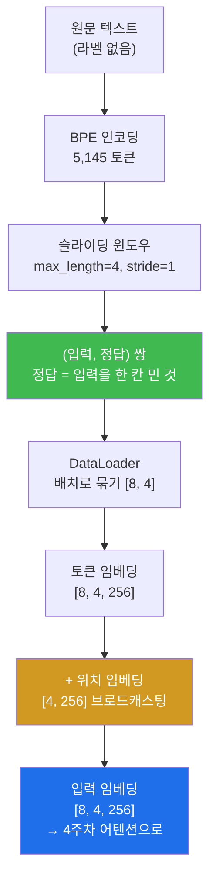
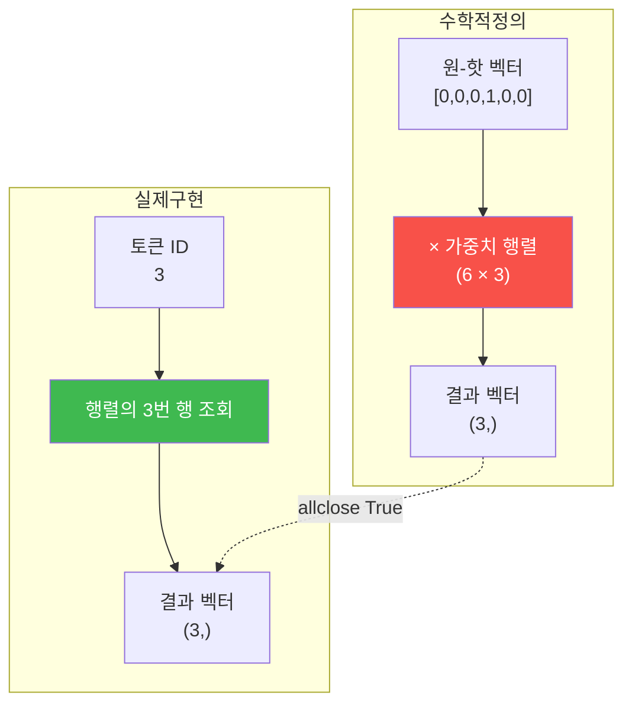

# W03 — 배치가 만들어지는 순간

> **한 줄 요약** — LLM의 학습 문제는 단 하나, **"다음 토큰 맞히기"** 다. 그래서 정답 라벨은
> 놀랍게도 **입력을 왼쪽으로 한 칸 민 것**이고, 사람이 붙일 라벨이 없다. 이번 주는 슬라이딩
> 윈도우로 그 (입력, 정답) 쌍을 뜯어내 배치로 조립하고, 토큰 ID를 벡터로 바꾸는 **임베딩이
> 사실은 조회 테이블일 뿐**임을 코드로 증명한다. 그리고 위치 정보를 왜 따로 더해야 하는지
> 텐서로 확인한다.

---

## 학습 목표

1. 학생은 "정답 = 입력을 한 칸 민 것"이 왜 라벨링 비용 0의 학습을 가능하게 하는지 설명할 수 있다.
2. 학생은 PyTorch `Dataset`/`DataLoader` 규약에 맞춰 슬라이딩 윈도우 데이터셋을 구현할 수 있다.
3. 학생은 샘플 수 공식 `⌈(N − max_length) ÷ stride⌉` 로 측정값을 **손계산 검증**할 수 있다.
4. 학생은 `nn.Embedding` 조회 == 원-핫 행렬곱임을 `torch.allclose` 로 증명하고, 그럼에도 조회로 구현하는 이유를 연산량으로 설명할 수 있다.
5. 학생은 토큰 임베딩 + 위치 임베딩 파이프라인의 shape 흐름과 브로드캐스팅 규칙을 설명할 수 있다.
6. 학생은 위치 임베딩이 없을 때 어떤 정보가 사라지는지 벡터 차이 노름으로 측정할 수 있다.

---

## 0. 용어 해설

| 용어 | 영문 | 쉽게 말하면 | 비유 |
|------|------|------------|------|
| **슬라이딩 윈도우** | Sliding Window | 긴 텍스트 위로 창을 밀며 조각을 뜯음 | 필름을 한 칸씩 돌리기 |
| **stride** | Stride | 창을 미는 간격 | 걸음 폭 |
| **컨텍스트 길이** | Context Length | 한 번에 보는 토큰 수 | 시야 폭 |
| **Dataset** | — | "몇 개 있고, i번째는 무엇인가"를 아는 객체 | 색인된 서랍장 |
| **DataLoader** | — | Dataset 에서 배치를 꺼내 주는 공급기 | 컨베이어 벨트 |
| **배치** | Batch | 여러 샘플을 한 번에 묶은 덩어리 | 한 판 굽기 |
| **임베딩** | Embedding | 토큰 ID → 연속 벡터 변환표 | 번호표 → 명함 |
| **원-핫** | One-Hot | 해당 위치만 1, 나머지 0인 벡터 | 한 칸만 체크된 마킹지 |
| **위치 임베딩** | Positional Embedding | 몇 번째 자리인지를 나타내는 벡터 | 좌석 번호표 |
| **브로드캐스팅** | Broadcasting | 모양이 다른 텐서를 자동 확장해 연산 | 도장을 여러 장에 똑같이 찍기 |
| **자기지도 학습** | Self-Supervised | 데이터 자체가 라벨이 되는 학습 | 답이 문제 안에 있음 |

---

## 0.5 신입생을 위한 핵심 개념

### "정답이 이미 데이터 안에 있다"

이미지 분류를 하려면 사람이 사진 100만 장에 "고양이/개" 라벨을 붙여야 합니다. LLM은 그게
필요 없습니다.

```
입력: [40,  367,  2885, 1464]
정답: [     367,  2885, 1464, 1807]
      ↑ 한 칸 왼쪽으로 민 것
```

각 위치에서 "그다음에 올 토큰"이 정답이기 때문입니다. **텍스트 자체가 라벨입니다.**
그래서 인터넷의 텍스트를 그대로 학습 데이터로 쓸 수 있고, 이것이 LLM이 이 규모로 커질 수
있었던 이유입니다. 이걸 **자기지도 학습(self-supervised)** 이라고 부릅니다.



### 이번 주의 새 습관 — 손계산 검증

지금까지는 에이전트 출력을 정답지와 **대조**했습니다. 이번 주부터는 여러분이 **직접 계산해서**
대조합니다. 샘플 수 공식이 그 첫 대상입니다.

> **샘플 수 = ⌈(전체 토큰 수 N − max_length) ÷ stride⌉**

에이전트가 `len(dataset)` 을 출력하면, 여러분은 계산기로 같은 값이 나오는지 확인합니다.
**에이전트 검증과 본인 검증을 겹치는 것이 이 수업의 이중 안전장치입니다.**

---

## 1. 준비 — BPE 토큰 수가 왜 달라지는가

**📋 실행 프롬프트 P3-0**

```text
[환경] llm-lab 컨테이너, 과제 저장소 week03/ 에서 작업
[할 일]
 1. week03/ 생성, week02/의 the-verdict.txt를 week03/으로 복사
 2. tiktoken gpt2로 전체 텍스트를 인코딩해 총 토큰 수를 출력
[검증] 2주차의 정규식 분리 토큰 수(4690)와 BPE 토큰 수가 왜 다른지 한 문단으로 설명할 것
```

**예상 결과:** BPE 총 토큰 수 **5,145개**.

| 방식 | 토큰 수 | 왜 다른가 |
|------|--------|----------|
| 정규식 분리 (2주차) | 4,690 | 단어와 구두점 단위. 한 단어는 무조건 한 토큰 |
| BPE (tiktoken gpt2) | **5,145** | 드문 단어는 **서브워드로 더 잘게** 쪼갠다. 공백도 토큰에 포함 |

BPE 쪽이 **더 많습니다.** 19세기 소설에는 GPT-2가 흔히 보지 못한 단어가 많아서, 통짜 토큰이
아니라 조각으로 나뉜 것이 원인입니다.

---

## 2. 미션 1 — 슬라이딩 윈도우 데이터셋

**📋 실행 프롬프트 P3-1**

```text
[목표] 슬라이딩 윈도우 데이터셋 구현 (교재 2장 GPTDatasetV1과 동일 동작)
[할 일] week03/dataset.py 작성:
 1. GPTDatasetV1(Dataset): 생성자에서 전체 텍스트를 tiktoken gpt2로 인코딩 후,
    range(0, 토큰수 - max_length, stride) 순회로 input_ids와 target_ids
    (입력을 한 칸 민 것) 청크를 저장. __len__, __getitem__ 구현
 2. create_dataloader_v1(txt, batch_size, max_length, stride, shuffle, drop_last)
 3. 실행 블록: the-verdict.txt로 batch_size=1, max_length=4, stride=1,
    shuffle=False 로더를 만들어 첫 2개 배치의 (입력, 정답)을 출력
[제약] 각 부분에 한국어 주석. 난수 요소가 없도록 shuffle=False 유지
[검증] 첫 배치의 입력과 정답을 나란히 출력하고, 정답이 입력을 한 칸 민 것인지
      직접 비교해 지적할 것
```

**예상 결과 (정답지):**

```
첫 배치 입력 : [[40, 367, 2885, 1464]]
첫 배치 정답 : [[367, 2885, 1464, 1807]]
둘째 배치 입력: [[367, 2885, 1464, 1807]]
```

**둘째 배치 입력이 첫 배치의 정답과 같습니다.** stride=1이라 창이 정확히 한 칸 밀렸기
때문입니다. 이 관계를 눈으로 확인하는 것이 이 미션의 목적입니다.

> 💡 **`shuffle=False` 를 제약으로 명시한 이유** — 셔플이 켜져 있으면 실행할 때마다 첫 배치가
> 달라져서 정답지와 대조할 수 없습니다. **재현 가능성을 위해 난수를 끄는 것**은 검증 설계의
> 기본기입니다.

**✅ 검증 프롬프트 V3-1**

```text
두 가지를 검증해줘:
 1. 교재 저장소 ch02 노트북의 같은 단계 출력과 내 첫 배치 값이 일치하는지
 2. shuffle=False 로더에서 임의의 연속한 샘플 10쌍을 뽑아,
    target[i] == input[i]를 한 칸 민 것 / input[i+1] == input[i]를 stride만큼
    민 것이 항상 성립하는지 코드로 확인 (assert 사용)
[형식] 검증 항목 | 방법 | 결과(PASS/FAIL) 표
```

**두 검증의 성격이 다릅니다.** ①은 **값 대조**(교재와 같은가), ②는 **성질 검증**(임의의
샘플에서도 규칙이 성립하는가). 값 대조는 한 지점만 보지만, 성질 검증은 구현 전체를 훑습니다.
이 수업은 뒤로 갈수록 ②의 비중이 커집니다.

---

## 3. 미션 2 — stride·context 그리드 실험

**📋 실행 프롬프트 P3-2**

```text
[목표] (max_length, stride) 조합이 데이터셋에 미치는 영향 측정
[할 일] 다음 4가지 조합으로 GPTDatasetV1을 만들어 len(dataset)을 측정:
 (4,1), (4,4), (256,128), (256,256)
[형식] week03/grid_experiment.md 에 표로 저장:
 max_length | stride | 샘플 수 | 인접 샘플 간 중복 토큰 수 | 관찰
[제약] 배치·drop_last의 영향을 받지 않도록 반드시 len(dataset) 기준으로 셀 것
[검증] 각 행의 샘플 수를 공식 ⌈(N − max_length) ÷ stride⌉ (N=총 토큰 수)로도
      계산해 별도 열에 병기하고, 측정값과 일치하는지 표시할 것
```

**예상 결과 (정답지, N = 5,145):**

| max_length | stride | 샘플 수 | 인접 중복 토큰 | 관찰 |
|---|---|---|---|---|
| 4 | 1 | **5,141** | 3 (75%) | 샘플이 압도적으로 많지만 거의 같은 내용 |
| 4 | 4 | **1,286** | 0 | 중복 없음. 샘플 수는 1/4 |
| 256 | 128 | **39** | 128 (50%) | 긴 문맥, 절반 중복 |
| 256 | 256 | **20** | 0 | 긴 문맥, 중복 없음 |

**직접 손계산해 보세요.** `⌈(5145 − 4) ÷ 1⌉ = 5141`. 계산기 없이 한 행을 골라 계산하고
`report.md` 에 과정을 남기는 것이 이번 주 과제입니다.

> ⚠️ **`[제약] len(dataset) 기준으로 셀 것` 이 왜 필요한가** — `len(dataloader)` 로 세면
> `batch_size` 와 `drop_last` 에 따라 값이 달라집니다. **무엇을 세는지 명시하지 않으면
> 에이전트가 다른 것을 셉니다.** 명세력의 예입니다.

**해석 포인트:** (4,1)은 인접 샘플이 3/4씩 겹칩니다 — 같은 문장을 사실상 4번 학습하는
셈입니다. **9주차 사전 훈련에서 과적합 곡선(훈련 손실은 내려가는데 검증 손실은 올라가는 그림)
을 볼 때 이 표를 다시 꺼내게 됩니다.**

---

## 4. 미션 3 — 임베딩은 조회 테이블이다

`nn.Embedding` 을 신비한 물건으로 두면 안 됩니다. 장난감 크기(어휘 6, 차원 3)로 해부합니다.

**📋 실행 프롬프트 P3-3**

```text
[목표] nn.Embedding의 동작 원리 해부 (장난감 예제)
[할 일] 대화형으로 진행하며 각 단계 출력을 보여줄 것:
 1. torch.manual_seed(123)으로 vocab_size=6, output_dim=3 임베딩 층 생성,
    가중치 행렬 전체 출력
 2. 토큰 ID [3] 하나를 조회한 결과와, 가중치 행렬의 3번 행을 나란히 출력 → 같은가?
 3. 토큰 ID [2, 3, 5, 1]을 조회한 결과 출력 (shape 포함)
 4. 동치성 증명: 같은 ID들을 원-핫 행렬(4×6)로 만들어 가중치 행렬(6×3)과
    행렬곱한 결과가 임베딩 조회 결과와 torch.allclose로 일치하는지 확인
[검증] 4번의 allclose 결과를 명시하고, "그런데 왜 실제로는 행렬곱 대신
      조회로 구현하는가"를 연산량 관점에서 한 문단 설명할 것
```

**예상 결과:** 2번에서 두 벡터가 **정확히 일치**(조회 = 행 꺼내기), 4번 allclose `True`.

### 4.1 왜 행렬곱이 아니라 조회인가



수학적으로는 **완전히 같습니다.** 그런데 실제 규모를 넣어 보세요.

- 원-핫 행렬곱: `[4, 50257] × [50257, 256]` → 곱셈 **5,146만 번**. 그런데 그중
  99.998%는 **0을 곱하는 것**입니다.
- 조회: 4개의 행을 메모리에서 꺼낸다. 곱셈 **0번**.

**"수학적 정의"와 "효율적 구현"이 다를 수 있다** — 이 감각이 뒤에서 계속 쓰입니다
(5주차 인과 마스크의 두 구현, 10주차 top-k의 `-inf` 트릭).

**✅ 검증 프롬프트 V3-2**

```text
방금의 동치성 증명을 일반화한 pytest 테스트를 week03/test_pipeline.py 에 추가해줘:
test_embedding_equals_onehot_matmul — 무작위 vocab_size(10~100),
차원(4~64), 임의 ID 시퀀스에 대해 임베딩 조회와 원-핫 행렬곱이
allclose인지 확인. 실행 결과 첨부.
```

**한 번의 관찰을 임의 입력에 대한 성질로 승격**시키는 것이 이 검증의 목적입니다.

---

## 5. 미션 4 — 실전 파이프라인 조립 (GPT-2 규모)

**📋 실행 프롬프트 P3-4**

```text
[목표] 배치 → 토큰 임베딩 → 위치 임베딩 합성까지 전체 파이프라인
[할 일] week03/embedding_pipeline.py 작성 후 실행:
 1. create_dataloader_v1로 batch_size=8, max_length=4, stride=4,
    shuffle=False 로더 생성, 첫 배치 획득
 2. 토큰 임베딩 층: vocab_size=50257, output_dim=256
 3. 위치 임베딩 층: context_length=4(=max_length), output_dim=256,
    입력은 torch.arange(max_length)
 4. input_embeddings = 토큰 임베딩 + 위치 임베딩
 5. 각 단계의 텐서 shape를 순서대로 출력
 6. 토큰 임베딩 층과 위치 임베딩 층의 파라미터 개수를 각각 출력
[검증] 위치 임베딩(shape [4,256])이 [8,4,256] 텐서에 더해질 때 어떤 규칙
      (브로드캐스팅)이 적용되는지 한 문단으로 설명할 것
```

**예상 결과 (정답지):**

| 단계 | shape |
|---|---|
| 배치 (토큰 ID) | `[8, 4]` |
| 토큰 임베딩 | `[8, 4, 256]` |
| 위치 임베딩 | `[4, 256]` |
| 최종 합 | `[8, 4, 256]` |

| 층 | 파라미터 |
|---|---|
| 토큰 임베딩 | **12,865,792** (= 50,257 × 256) |
| 위치 임베딩 | **1,024** (= 4 × 256) |

### 5.1 브로드캐스팅 — 왜 [4,256]을 [8,4,256]에 더할 수 있나

PyTorch는 shape가 다른 텐서를 더할 때 **뒤쪽 차원부터 맞춰 봅니다.**

```
[8, 4, 256]   ← 토큰 임베딩
   [4, 256]   ← 위치 임베딩
 ↑
 없는 차원은 1로 간주 → [1, 4, 256] → 8번 복제해서 더한다
```

**의미:** 위치 벡터는 배치 안 모든 샘플에 **똑같이** 더해집니다. 당연합니다 — "2번째 자리"의
의미는 어느 문장이든 같으니까요.

### 5.2 손계산 — 아직 모델은 시작도 안 했는데

`50,257 × 256 = 12,865,792`. **직접 계산해서 출력과 대조하세요.**

2주차의 "생각해볼 문제 4번 — 어휘를 500만으로 키우면?"의 답이 여기서 나옵니다.
어휘를 100배 키우면 임베딩 파라미터도 100배(12.8억)가 됩니다. **어휘 크기는 공짜가
아닙니다.** 그리고 7주차에서 차원이 256이 아니라 768이 되면 이 숫자는 38,597,376이 됩니다.

**✅ 검증 프롬프트 V3-3**

```text
test_pipeline.py 에 shape 회귀 테스트 2개를 추가하고 전체 pytest를 실행해줘:
 1. test_pipeline_shapes — 파이프라인 각 단계의 shape가 위 정답과 일치
 2. test_param_counts — 두 임베딩 층의 파라미터 수가 (50257*256, 4*256)과 일치
[제약] 테스트가 실패하면 테스트가 아니라 파이프라인 코드를 의심할 것
```

---

## 6. 미션 5 — 위치 임베딩은 정말 필요한가 (+ 함정)

"위치 임베딩이 순서를 구분해준다"를 말이 아니라 **텐서로** 확인합니다.

**📋 실행 프롬프트 P3-5**

```text
[목표] 위치 임베딩 유무에 따른 표현 차이 관찰
[할 일]
 1. 같은 토큰 ID가 두 번 나오는 짧은 시퀀스를 만들 것
    ⚠️ 함정 주의. "the cat and the dog" 는 중복 토큰이 하나도 없다.
       GPT-2 BPE 는 선행 공백을 토큰 안에 넣으므로 문장 맨 앞의 "the"(464)와
       중간의 " the"(262)가 서로 다른 토큰 ID 다.
       → 반드시 tokenizer.encode(...) 결과를 먼저 출력해 실제로 같은 ID가
         두 번 나오는지 눈으로 확인한 뒤 진행할 것.
       중복이 생기는 문장 예: "I saw the cat and the dog" (" the" = 262 가 두 번)
 2. 위치 임베딩 없이: 두 'the' 위치의 임베딩 벡터가 동일한지 비교
 3. 위치 임베딩을 더한 후: 두 위치의 벡터가 달라졌는지 비교
 4. 각 비교는 torch.equal / 벡터 차이의 노름으로 수치화
[형식] 결과를 week03/pos_experiment.md 에 관찰 기록으로 정리
[검증] "위치 임베딩이 없다면 모델 입장에서 어떤 두 문장이 구분 불가능해지는가"
      예시 문장 쌍을 1개 만들어 제시할 것
```

**예상 결과:**

```
IDS ['I'=40, 'saw'=2497, ' the'=262, ' cat'=3797, ' and'=290, ' the'=262, ' dog'=3290]
중복 토큰: 262 (위치 2, 5)

위치 임베딩 없이 두 벡터의 차이 노름 : 0.000000   ← 완전히 같다
위치 임베딩 더한 후 차이 노름        : 5.405994   ← 달라졌다
```

### 6.1 함정의 정체 — 실험의 전제를 측정으로 확인하라

교재가 예시로 준 문장을 그대로 쓰면 실험이 **성립하지 않습니다.**

```
'the cat and the dog'        → [1169, 3797, 290, 262, 3290]   중복 없음 ❌
'I saw the cat and the dog'  → [40, 2497, 262, 3797, 290, 262, 3290]  중복 있음 ✅
```

문장 맨 앞의 `"the"` 는 **선행 공백이 없어서** ID 1169이고, 중간의 `" the"` 는 ID 262입니다.
2주차에서 배운 "BPE는 선행 공백을 토큰에 포함한다"가 여기서 회수됩니다.

> 🔴 **여기서 배울 것.** 에이전트는 "예시"로 주어진 문장을 의심 없이 씁니다. 그리고 두 `the` 의
> 임베딩이 다르게 나오면 **"위치 임베딩 효과다"라고 잘못 해석합니다** — 실제로는 토큰 ID부터
> 달랐던 것인데요.
>
> **실험을 설계할 때는 전제 조건을 먼저 측정으로 확인하십시오.** 이번 경우 전제는 "같은 토큰
> ID가 두 번 등장한다"이고, 확인 방법은 `encode` 결과를 눈으로 보는 것입니다. 확인 한 줄이
> 없으면 **틀린 결론이 그럴듯하게 나옵니다.**

### 6.2 위치 임베딩이 없으면 무엇이 구분 불가능해지나

> **"개가 사람을 물었다"** vs **"사람이 개를 물었다"**

토큰 집합이 완전히 같습니다. 위치 정보가 없으면 모델 입장에서 두 문장의 입력 표현은
(순서를 무시하면) 구별할 근거가 없습니다. GPT-2는 **학습형 절대 위치 임베딩**을 씁니다 —
위치 벡터도 훈련으로 배웁니다.

---

## 실습 안내

이번 주 실습(`lab_week03.yaml`, 8단계)은 전부 llm-lab 컨테이너 안에서 진행합니다.

### 1) 이 실습을 왜 하는가?

4주차부터 다룰 어텐션의 **입력**이 여기서 만들어집니다. 그리고 9주차 사전 훈련이 실제로 먹는
데이터가 바로 이 배치입니다. 여기서 시프트가 한 칸이라도 어긋나면 모델은 "다음 토큰"이 아니라
"현재 토큰"을 맞히는 법을 배웁니다 — 손실이 0에 가까워지는데 생성은 엉망인 기묘한 상황이 됩니다.

### 2) 무엇을 알 수 있는가?

- 라벨 없는 텍스트가 어떻게 지도학습 데이터가 되는지.
- stride 하나로 학습 데이터 양이 5,141 ↔ 1,286 으로 4배 달라진다는 사실.
- 임베딩이 **마법이 아니라 조회 테이블**이라는 것, 그리고 그 표가 이미 1,286만 파라미터라는 것.

### 3) 결과 해석 (정상 vs 비정상)

| 확인 | 정상 | 비정상 → 의심할 곳 |
|------|------|-------------------|
| BPE 총 토큰 | **5,145** | 4,690이 나오면 정규식 분리 코드를 돌린 것 |
| 첫 배치 | 입력 `[[40,367,2885,1464]]` / 정답 `[[367,2885,1464,1807]]` | 정답이 입력과 같으면 시프트 누락 |
| 둘째 배치 입력 | 첫 배치의 **정답과 동일** | 다르면 stride 설정 확인 |
| 그리드 | 5,141 / 1,286 / 39 / 20 | 공식과 불일치 시 `len(dataloader)` 를 센 것 |
| allclose | **True** | False면 원-핫 dtype(float 변환) 확인 |
| 파라미터 | 12,865,792 / 1,024 | 다르면 vocab_size나 dim 오타 |
| 위치 실험 | 없을 때 **0.0**, 있을 때 **>0** | 없을 때도 >0이면 **중복 토큰이 아닌 것** |

### 4) 실전 활용

파인튜닝 데이터셋을 만들 때 stride/컨텍스트 길이를 정하는 판단이 그대로 이 실험입니다.
데이터가 적으면 stride를 줄여 샘플을 늘리고 싶어지지만, 중복이 커져 과적합이 빨리 옵니다.
**"샘플 수"와 "고유 정보량"은 다른 것**이라는 감각이 여기서 만들어집니다.

---

## 흔한 오해

- ❌ **"정답 라벨을 따로 만들어야 한다"** → 아닙니다. 입력을 한 칸 민 것이 정답입니다.
- ❌ **"stride를 줄이면 데이터가 늘어나니 좋다"** → 샘플 수는 늘지만 **고유 정보는 그대로**입니다.
  같은 문장을 4번 보는 것이라 과적합만 빨라집니다.
- ❌ **"임베딩은 신경망 층이라 복잡하다"** → 조회 테이블입니다. 원-핫 행렬곱과 수학적으로
  동일하고, 곱셈 없이 행만 꺼내는 것뿐입니다.
- ❌ **"batch_size를 키우면 파라미터가 는다"** → 안 늘어납니다. 파라미터는 어휘 크기와
  차원으로만 결정됩니다. 배치는 **한 번에 몇 개를 흘리느냐**일 뿐입니다.
- ❌ **"`the cat and the dog` 에는 `the` 가 두 번 있다"** → **토큰 ID 기준으로는 없습니다.**
  선행 공백 때문에 1169와 262로 다른 토큰입니다. 이번 주의 가장 중요한 함정입니다.

---

## 다음 주차 예고 — W04 어텐션은 어디를 보는가

입력 임베딩 `[8, 4, 256]` 이 준비됐습니다. 이제 이 벡터들이 **서로를 쳐다보게** 만듭니다.
4주차는 어텐션을 세 단계로 분해합니다 — ① 쿼리와 다른 토큰들의 **점수**(내적) ② softmax
**정규화** ③ 가중합으로 **컨텍스트 벡터**. 처음엔 학습 파라미터가 하나도 없는 원시형으로 손을
익히고, 그다음 Query/Key/Value 세 개의 학습 가능한 가중치를 붙입니다. 마지막엔 "왜 √d로
나누는가"를 분산 측정으로 직접 확인합니다.
