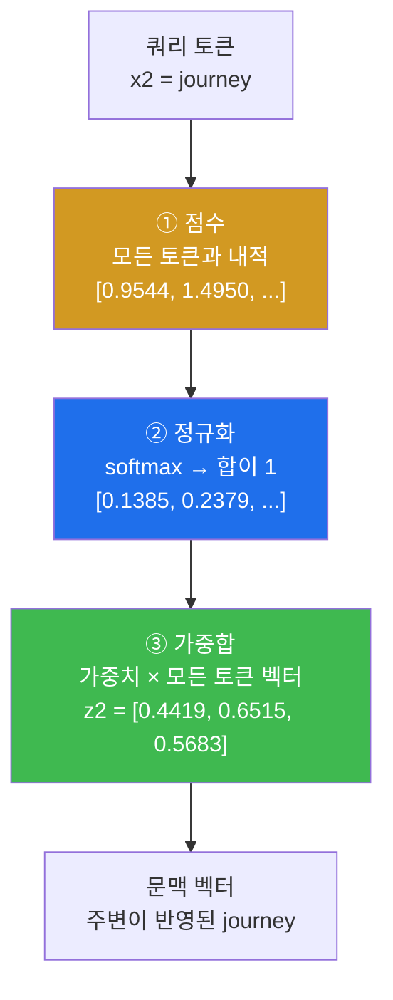
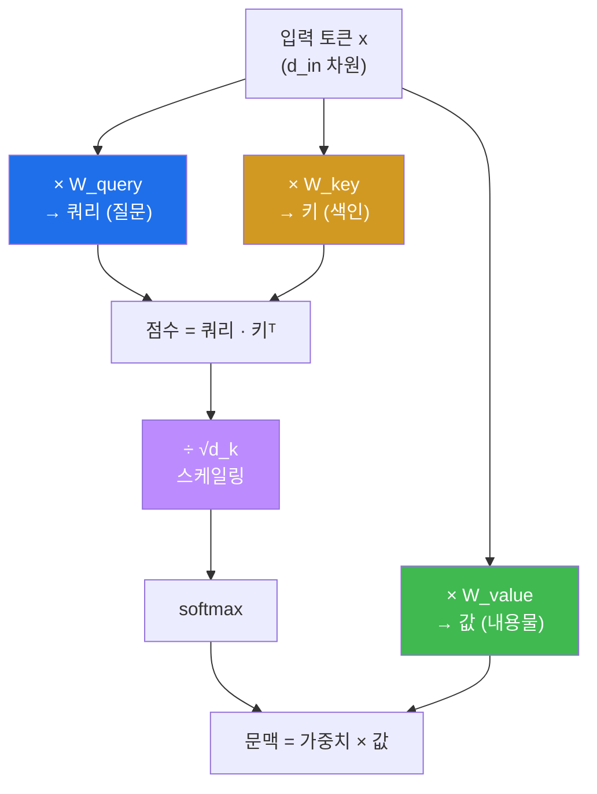
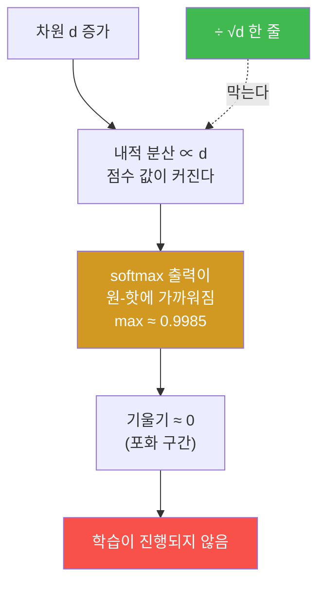
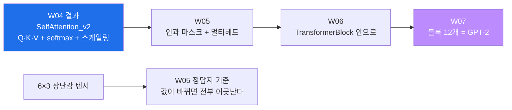

# W04 — 어텐션은 어디를 보는가

> **한 줄 요약** — 지난주 완성한 임베딩에는 결함이 있다. 토큰의 벡터가 **문맥과 무관하게
> 고정**된다. 어텐션은 각 토큰이 문장 안의 다른 토큰들을 얼마나 참고할지 가중치를 계산해
> 문맥이 반영된 새 벡터를 만든다. 이번 주는 그 계산을 **점수 → 정규화 → 가중합** 3단계로
> 분해해 손으로 검산하고, 학습 가능한 Q/K/V 가중치를 붙인 뒤, "왜 √d 로 나누는가"를
> 분산 측정으로 확인한다.

---

## 학습 목표

1. 학생은 어텐션 3단계(내적 점수 → softmax → 가중합)를 중간값까지 손으로 검산할 수 있다.
2. 학생은 루프 구현과 행렬 구현이 같은 답을 낸다는 것을 `torch.allclose` 로 검증할 수 있다.
3. 학생은 어텐션 가중치 히트맵을 읽고 관찰 사실을 근거와 함께 서술할 수 있다.
4. 학생은 Q/K/V 세 행렬의 역할을 설명하고 `SelfAttention_v1`/`v2` 를 구현할 수 있다.
5. 학생은 `nn.Linear` 의 가중치 저장 방향을 근거로 **전치가 왜 필요한지** 설명하고 두 구현의 동치를 증명할 수 있다.
6. 학생은 내적 분산이 차원 d에 비례함을 측정하고, √d 스케일링이 없을 때 softmax가 원-핫에 가까워지는 것을 관찰할 수 있다.

---

## 0. 용어 해설

| 용어 | 영문 | 쉽게 말하면 | 비유 |
|------|------|------------|------|
| **어텐션** | Attention | 어느 토큰을 얼마나 볼지 정하는 가중치 계산 | 회의에서 누구 말을 얼마나 들을지 |
| **문맥 벡터** | Context Vector | 주변을 참고해 만든 새 표현 | 회의 후 정리된 결론 |
| **내적** | Dot Product | 두 벡터의 방향 유사도 | 얼마나 죽이 맞나 |
| **softmax** | Softmax | 점수를 합이 1인 확률로 변환 | 지분 배분 |
| **쿼리 / 키 / 값** | Query / Key / Value | 질문 / 색인 / 내용물 | 검색어 / 제목 / 본문 |
| **투영** | Projection | 행렬을 곱해 다른 공간으로 옮김 | 다른 관점으로 바꿔 보기 |
| **볼록 결합** | Convex Combination | 가중치 합이 1인 가중평균 | 배합 비율 100% |
| **√d 스케일링** | Scaled Dot-Product | 점수를 √차원으로 나눔 | 볼륨 낮추기 |
| **원-핫에 가까운 분포** | Peaked Distribution | 한 곳에 확률이 몰빵된 상태 | 만장일치 |
| **기울기 소실** | Vanishing Gradient | 미분값이 0에 가까워 학습이 멈춤 | 신호가 안 옴 |

---

## 0.4 이번 주 배경 지식 — 처음이라면

> 어텐션은 이 수업의 심장입니다. 그런데 수식이 셋 나옵니다 — 내적, softmax, 가중합.
> 셋 다 고등학교 수준입니다. 여기서 확실히 잡고 가면 5~7주차가 편해집니다.

### 내적(dot product) — 왜 이게 "닮은 정도"인가

두 벡터를 자리별로 곱해서 전부 더한 값입니다.

```python
a = [1, 2, 3]
b = [4, 5, 6]
a·b = 1×4 + 2×5 + 3×6 = 32
```

**왜 이 값이 유사도인가.** 부호가 같은 자리는 곱하면 양수라 값을 키우고, 부호가 다른 자리는
음수라 값을 깎기 때문입니다.

| 두 벡터 관계 | 내적 | 직관 |
|---|---|---|
| 같은 방향 | **큰 양수** | 죽이 잘 맞는다 |
| 직각(무관) | **0** | 상관없다 |
| 반대 방향 | **큰 음수** | 정반대다 |

임베딩이 훈련되면 비슷한 의미의 토큰은 비슷한 방향을 갖습니다. **그래서 내적이 크면
"의미가 관련 있다"** 가 됩니다. 어텐션 점수가 내적인 이유가 이것입니다.

### softmax — 점수를 확률로 바꾸는 장치

내적 점수는 `[0.95, 1.50, 1.48, 0.84, 0.71, 1.06]` 처럼 아무 범위나 나옵니다. 이걸
**가중치**로 쓰려면 두 조건이 필요합니다.

1. 전부 **0 이상**이어야 한다 (음수 가중치는 의미가 이상하다)
2. 다 더하면 **1** 이어야 한다 (지분 배분처럼)

softmax 가 이 둘을 동시에 만족시킵니다.

```
softmax(xᵢ) = exp(xᵢ) / Σ exp(xⱼ)
```

- `exp`(지수함수)를 씌우면 **무조건 양수**가 됩니다 → 조건 ①
- 전체 합으로 나누면 **총합이 1** 이 됩니다 → 조건 ②

> 💡 **부작용 하나.** `exp` 는 큰 값을 아주 크게 키웁니다. 점수 차가 조금만 벌어져도 확률이
> 한 곳에 몰립니다. 이 성질이 나중에 문제가 되고, 그 해결이 **√d 스케일링**입니다(미션 4).

### 학습 가능한 가중치란 무엇인가

미션 1은 임베딩끼리 바로 내적합니다. 미션 2부터는 사이에 **행렬 셋(W_q, W_k, W_v)** 이
끼어듭니다. 이 행렬들이 **학습되는 파라미터**입니다.

```
임베딩 x  --(W_q 곱하기)-->  쿼리 q
임베딩 x  --(W_k 곱하기)-->  키   k
임베딩 x  --(W_v 곱하기)-->  값   v
```

**왜 굳이 셋으로 나누나.** 같은 토큰이라도 **역할이 다르기 때문**입니다.

| 역할 | 무엇인가 | 검색 비유 |
|---|---|---|
| **쿼리(Q)** | "나는 무엇을 찾고 있나" | 검색창에 친 말 |
| **키(K)** | "나는 이런 걸 갖고 있다" | 문서의 제목·태그 |
| **값(V)** | "실제로 건네줄 내용" | 문서 본문 |

내적은 **Q와 K 사이**에서 일어나고, 가중합은 **V를 대상으로** 합니다. 검색어와 제목을 맞춰
보고, 실제로는 본문을 가져오는 것과 같습니다.

> 📌 **셋을 안 나누면 어떻게 되나.** 임베딩끼리 바로 내적하면 자기 자신과의 내적이 항상 가장
> 커서, 모든 토큰이 자기만 쳐다봅니다. 미션 1의 결과에서 실제로 그런 경향이 보입니다.
> W_q·W_k 가 "무엇을 볼지"를 **학습으로** 정하게 해 줍니다.

### 이번 주에 계속 나올 shape

```
inputs      [6, 3]      토큰 6개 × 3차원
W_query     [3, 2]      3차원 → 2차원으로 투영
queries     [6, 2]      inputs @ W_query
attn_scores [6, 6]      queries @ keys.T   ← 모든 토큰 쌍의 점수
attn_weights[6, 6]      softmax(scores, dim=-1)
context_vec [6, 2]      attn_weights @ values
```

**`[6, 6]` 이 어텐션의 정체입니다.** 토큰 6개가 서로를 얼마나 보는지 적은 6×6 표.
5주차에서 이 표의 위쪽 삼각형을 가리는 것이 **인과 마스크**입니다.

---

## 0.5 신입생을 위한 핵심 개념

### 왜 어텐션이 필요한가 — 임베딩만으로는 안 되는 이유

3주차에서 만든 임베딩은 **조회 테이블**입니다. 토큰 ID가 같으면 벡터도 같습니다.

> "**은행**에 가서 돈을 찾았다" 의 '은행'
> "강 **은행**에 앉아 있었다" 의 '은행'

임베딩 관점에서 **완전히 같은 벡터**입니다. 위치 임베딩을 더해도 위치만 달라질 뿐, "돈"과
"강"이라는 주변 단어를 반영하지 못합니다. 어텐션은 이 문제를 풉니다 — 각 토큰이 주변을
**쳐다보고**, 본 것을 섞어 새 벡터를 만듭니다.

### 어텐션 3단계 — 이것이 전부다



나머지는 전부 이 뼈대의 변주입니다. 인과 마스크(5주차)도, 멀티헤드(5주차)도, GPT-2 전체(7주차)도
이 3단계 위에 얹힌 것입니다. **여기서 흐릿하게 넘어가면 뒤가 전부 흐려집니다.**

### 이번 주 장난감 입력 — 모든 정답지의 기준

문장 `"Your journey starts with one step"` 의 6개 토큰을 3차원으로 표현한 6×3 텐서입니다.

| 토큰 | 벡터 |
|------|------|
| Your | `[0.43, 0.15, 0.89]` |
| journey | `[0.55, 0.87, 0.66]` |
| starts | `[0.57, 0.85, 0.64]` |
| with | `[0.22, 0.58, 0.33]` |
| one | `[0.77, 0.25, 0.10]` |
| step | `[0.05, 0.80, 0.55]` |

**값을 임의로 바꾸면 이후 모든 정답지가 어긋납니다.** 5주차까지 이 텐서를 그대로 씁니다.

---

## 1. 미션 1 — 쿼리 하나로 3단계 추적

**📋 실행 프롬프트 P4-1**

```text
[목표] 두 번째 토큰(journey, 인덱스 1)에 대한 단순 어텐션 계산 추적
[할 일] week04/attention_simple.py 에 작성·실행:
 1. 쿼리 = inputs[1]. 6개 토큰 각각과의 내적으로 점수 6개 계산해 출력
 2. softmax로 가중치 계산해 출력, 합계도 출력
 3. 가중치로 inputs를 가중합해 문맥 벡터 z2 출력
[제약] 이 단계에서는 학습 가중치를 쓰지 말 것 (임베딩 그대로 비교)
[검증] 각 단계 출력을 소수 4자리로 반올림해 표시할 것
```

**예상 결과 (정답지):**

| 단계 | 값 |
|------|-----|
| 점수 | `[0.9544, 1.4950, 1.4754, 0.8434, 0.7070, 1.0865]` |
| 가중치 | `[0.1385, 0.2379, 0.2333, 0.1240, 0.1082, 0.1581]` (합 = **1.0**) |
| 문맥 벡터 z2 | `[0.4419, 0.6515, 0.5683]` |

### 1.1 손계산 — 표본 하나만 검산하라

점수의 첫 값 `0.9544` 는 내적 하나입니다.

> `0.43 × 0.55 + 0.15 × 0.87 + 0.89 × 0.66`
> `= 0.2365 + 0.1305 + 0.5874 = 0.9544`

**6×6 전체를 손으로 할 필요는 없습니다.** 표본 하나를 검산하는 것이 검증력입니다.
`report.md` 에 이 계산 과정을 남기세요.

### 1.2 가중치가 왜 두 번째와 세 번째에 몰렸나

`journey`(0.2379) 와 `starts`(0.2333) 가 가장 큽니다. 임베딩 값을 보면 두 벡터가
`[0.55,0.87,0.66]` 과 `[0.57,0.85,0.64]` 로 **거의 같습니다.** 자기 자신과의 내적이 큰 것도
당연합니다.

> ⚠️ **아직 "의미"는 없습니다.** 이 단계의 주목은 **벡터 유사도**일 뿐입니다. 학습 가중치가
> 없으니 "무엇을 기준으로 주목할지"를 배울 수 없습니다. 의미는 훈련 후에 생깁니다.

**✅ 검증 프롬프트 V4-1**

```text
softmax를 두 방식으로 교차 검증해줘:
 1. torch.softmax 사용 결과
 2. 수식 그대로 구현: exp(x_i) / Σ exp(x_j) (라이브러리 함수 없이)
두 결과가 allclose인지, 그리고 가중치 합이 1인지 확인해 보고해.
추가로: exp에 큰 값이 들어가면 생길 수 있는 수치 문제(오버플로)와
torch.softmax가 이를 어떻게 피하는지 한 문단으로 설명해줘.
```

> 💡 **오버플로 회피 트릭** — `exp(1000)` 은 `inf` 입니다. 그래서 실제 구현은 먼저 최댓값을
> 빼고(`exp(x - max(x))`) 계산합니다. 분자와 분모에 같은 상수를 곱한 것이라 **값은 안 변하는데
> 오버플로만 사라집니다.** 10주차 top-k 의 `-inf` 트릭이 이 성질의 사촌입니다.

---

## 2. 미션 2 — 전체 행렬화

쿼리 6개를 for 루프로 도는 대신 행렬 연산 한 번으로 처리합니다.

**📋 실행 프롬프트 P4-2**

```text
[목표] 모든 토큰에 대한 어텐션을 행렬 연산으로 일반화
[할 일] attention_simple.py 에 이어서:
 1. 루프 버전: 각 토큰을 쿼리로 P4-1의 3단계를 반복해 6×3 문맥 행렬 생성
 2. 행렬 버전: scores = inputs @ inputs.T → softmax(dim=-1) → contexts = weights @ inputs
 3. 두 버전의 문맥 행렬이 torch.allclose로 일치하는지 확인
 4. 행렬 버전 가중치(6×6)의 각 행 합이 모두 1인지 확인
[검증] 3, 4번 결과를 명시. 행렬 버전 2번째 행이 P4-1의 z2와 일치하는지도 확인
```

**통과 기준:** 루프 = 행렬 allclose `True`, 행 합 전부 1, 2행 = z2.

> 💡 **이것이 "벡터화 검증"의 표준 패턴입니다.** 느리지만 명백한 구현(루프)을 먼저 만들고,
> 빠른 구현(행렬)이 같은 답을 내는지 대조합니다. 3주차의 "원-핫 행렬곱 vs 조회"와 같은 구조이며,
> 5주차 인과 마스크에서 다시 씁니다.

### 2.1 `dim=-1` 이 왜 중요한가

`softmax(scores, dim=-1)` 에서 `dim=-1` 은 **마지막 차원(열 방향)** 을 따라 정규화하라는 뜻입니다.
`scores` 의 i행은 "i번째 토큰이 각 토큰을 얼마나 보는가"이므로, **행마다** 합이 1이 되어야 합니다.
`dim=0` 으로 잘못 주면 열 합이 1이 되어 의미가 완전히 달라집니다 — 그런데 shape 는 똑같이
나와서 **오류 없이 조용히 틀립니다.**

**그래서 "각 행 합이 1인지" 를 검증 항목에 넣은 것입니다.**

---

## 3. 미션 3 — 히트맵으로 보기

**📋 실행 프롬프트 P4-3**

```text
[목표] 6×6 어텐션 가중치 히트맵 생성
[할 일]
 1. matplotlib로 가중치 행렬을 히트맵으로 그리되, x·y축에 토큰 문자열 라벨,
    각 셀에 수치(소수 2자리), 컬러바 포함
 2. week04/attention_heatmap.png 로 저장 (제목: Simple Self-Attention Weights)
 3. 히트맵에서 관찰되는 사실 3가지를 보고할 것
```

**결과 테스트 방법:** 그림을 직접 열어 보고, 에이전트가 보고한 관찰 3가지가 그림과 부합하는지
확인하세요. **시각화 검증은 사람 눈이 최종 판정자입니다.**

> 💡 **컨테이너에서 그림 그릴 때 주의** — `matplotlib.use("Agg")` 를 먼저 지정해야 디스플레이
> 없는 환경에서 저장이 됩니다. 그리고 골든 이미지에는 `fonts-nanum` 이 들어 있어 한글 라벨도
> 깨지지 않습니다(1주차에서 이야기한 그 폰트입니다).

---

## 4. 미션 4 — 학습 가능한 가중치: v1과 v2, 그리고 전치

이제 W_q, W_k, W_v 를 도입합니다. 각 토큰을 **쿼리(질문) / 키(색인) / 값(내용물)** 세 역할로
투영합니다.



**검색 엔진 비유:** 여러분이 검색어(**쿼리**)를 넣으면, 엔진은 문서 **제목**(키)들과 비교해
점수를 매기고, 점수가 높은 문서의 **본문**(값)을 가져옵니다. 세 역할이 다르기 때문에 세 개의
행렬이 필요합니다.

**📋 실행 프롬프트 P4-4**

```text
[목표] SelfAttention_v1 구현 (교재 3.4절과 동일 동작)
[할 일] week04/attention_v1v2.py 작성:
 1. SelfAttention_v1(nn.Module): d_in, d_out을 받아 W_query, W_key, W_value를
    nn.Parameter(torch.rand(d_in, d_out))로 생성.
    forward: queries = x @ W_query (key, value 동일) →
    scores = queries @ keys.T → weights = softmax(scores / d_k**0.5, dim=-1)
    → contexts = weights @ values
 2. torch.manual_seed(123) 후 d_in=3, d_out=2로 인스턴스 생성,
    inputs를 넣어 6×2 출력 전체를 소수 4자리로 출력
[검증] 출력의 두 번째 행(journey의 문맥 벡터)을 별도로 표시할 것
```

**예상 결과 (정답지):** 두 번째 행 = **`[0.3061, 0.8210]`**.
다르면 **시드 호출 위치**(생성 직전이어야 함)나 forward 구조가 교재와 다른 것입니다.

### 4.1 연습문제 3.1 — 가중치 이식과 전치

**📋 실행 프롬프트 P4-5**

```text
[목표] SelfAttention_v2 구현 및 v1과의 동치 증명
[할 일] attention_v1v2.py 에 이어서:
 1. SelfAttention_v2: 세 투영을 nn.Linear(d_in, d_out, bias=False)로 구현
    (나머지는 v1과 동일). torch.manual_seed(789)로 인스턴스 생성해 inputs 출력 확인
 2. v2의 세 Linear 가중치를 v1의 파라미터로 복사해 넣어라.
    단, 그대로 복사하면 안 되고 어떤 처리가 필요할 것이다 — 왜 필요한지
    nn.Linear의 가중치 저장 방식과 연결해 설명하면서 처리할 것
 3. 이식 후 v1(inputs)과 v2(inputs)가 torch.allclose로 일치함을 보여라
[제약] 처리(전치)의 이유를 설명 없이 넘어가지 말 것
```

**답은 전치(`.T`)입니다.** 그런데 프롬프트는 일부러 답을 숨겼습니다.

| 구현 | 가중치 shape | 곱하는 방식 |
|------|------------|------------|
| `nn.Parameter(torch.rand(d_in, d_out))` | `(d_in, d_out)` | `x @ W` |
| `nn.Linear(d_in, d_out)` | **`(d_out, d_in)`** | `x @ W.T` (내부에서) |

`nn.Linear` 는 가중치를 **(출력차원, 입력차원)** 으로 저장합니다. 그래서 v2 → v1 이식에는
`sa_v1.W_query.data = sa_v2.W_query.weight.T` 처럼 전치가 필요합니다.

**프롬프트 해설:** "어떤 처리가 필요할 것이다"라고 답을 숨긴 이유 — 에이전트가 이유를 설명하게
만드는 프롬프트는, **여러분이 그 설명을 검증할 수 있을 때만** 의미가 있습니다. `nn.Linear` 의
저장 방식을 직접 확인하세요.

> 🔗 **이 전치 문제는 10주차에서 회수됩니다.** OpenAI 의 GPT-2 공식 가중치는 TensorFlow
> 규약(입력, 출력)으로 저장돼 있어서, PyTorch `nn.Linear` 에 넣을 때 **똑같은 전치**가
> 필요합니다. 오늘 이해하지 않고 넘어가면 6주 뒤에 shape 오류로 만납니다.

**✅ 검증 프롬프트 V4-2**

```text
week04/test_attention.py 에 pytest 3개를 작성·실행해줘:
 1. test_weights_sum_to_one — 단순 어텐션 가중치 행 합이 모두 1
 2. test_loop_equals_matrix — 루프 버전과 행렬 버전 문맥이 allclose
 3. test_v1_equals_v2_after_transfer — 가중치 이식 후 v1과 v2 출력이 allclose
[제약] 테스트를 약화시키는 수정 금지. 실행 결과 전체 첨부
```

**통과 기준:** `3 passed`.

---

## 5. 미션 5 — √d 스케일링은 왜 필요한가 (측정)

**📋 실행 프롬프트 P4-6**

```text
[목표] 차원 증가가 내적과 softmax에 미치는 영향 측정
[할 일] 실험 스크립트를 작성·실행하고 결과를 week04/scaling_experiment.md 에 표로 저장:
 1. d ∈ {8, 64, 512} 각각에 대해: 표준정규 무작위 벡터 쌍 1000개의 내적을 계산해 분산을 측정
 2. d=512에서 무작위 점수 벡터(길이 6) 하나를 만들어, 스케일링 없이 softmax한 결과와
    √d로 나눈 뒤 softmax한 결과를 나란히 출력 (각 분포의 최댓값도 표시)
[형식] 표 1: d | 내적 분산 (이론값 d와 비교) / 표 2: 스케일링 유무 | 분포 | 최댓값
[검증] 분산 측정값이 이론값 d에 근접하는지 표에서 판정할 것
```

**예상 결과 (실측):**

| d | 측정 분산 | 이론값 |
|---|---|---|
| 8 | **8.19** | 8 |
| 64 | **64.82** | 64 |
| 512 | **515.67** | 512 |

| d=512 | 최댓값 |
|---|---|
| 스케일링 **없이** softmax | **0.9985** ← 거의 원-핫 |
| √d 로 나눈 뒤 softmax | **0.3773** ← 완만 |

### 5.1 왜 분산이 d에 비례하는가

표준정규 벡터 두 개의 내적은 `Σ(qᵢ × kᵢ)` 로 **d개 항의 합**입니다. 각 항의 분산이 1이고
서로 독립이면, 합의 분산은 **d**가 됩니다. 그래서 `√d` 로 나누면 분산이 1로 돌아옵니다.

### 5.2 원-핫에 가까운 softmax가 왜 해로운가



softmax 는 출력이 0 또는 1에 가까워지면 **미분값이 0에 수렴**합니다. 그러면 역전파로 흘러가는
신호가 사라져 학습이 멈춥니다. 스케일링 한 줄이 이것을 막습니다.

**해석 과제 (report.md 에 **직접** 작성 — 에이전트 사용 금지):**
원-핫에 가까운 softmax 가 학습(기울기)에 왜 해로운지, 이번 측정 결과를 인용하며 3~5문장으로
설명하라.

---

## 7. 에이전트에게 시키는 법 — 이번 주 실전

### 7.1 이번 주 프롬프트의 특징 — "직접 구현하라"는 제약

이번 주부터 프롬프트에 이런 줄이 붙기 시작합니다.

```text
[제약] 이 단계에서는 학습 가중치를 쓰지 말 것
[제약] torch.nn.MultiheadAttention 등 기성 구현을 쓰지 말 것
```

**에이전트는 기성품을 좋아합니다.** "어텐션을 만들어 줘"라고만 하면 `nn.MultiheadAttention`
한 줄로 끝냅니다. 동작은 합니다. 그런데 여러분은 **아무것도 안 배웁니다.**

이 수업이 검증하는 것은 "돌아가는 코드"가 아니라 **"내가 이해한 대로 만들어졌는가"** 입니다.
그래서 금지 목록을 명시합니다.

> 🔴 **6주차에 이 제약이 왜 부족한지 알게 됩니다.** 로컬 모델 검증에서 "직접 구현하라"고
> 썼는데도 `torch.nn.LayerNorm` 을 쓴 사례가 있었습니다. **금지만으로는 부족하고,
> 결과를 대조하는 게이트가 있어야 합니다.**

### 7.2 소수점 자리를 지정하는 이유

```text
[검증] 각 단계 출력을 소수 4자리로 반올림해 표시할 것
```

정답지가 `0.4419` 인데 에이전트가 `0.44190002` 로 찍으면 눈으로 대조하기 어렵습니다.
반대로 `0.44` 로 찍으면 **다른 값인데 같아 보입니다.** 자릿수를 지정하는 것은
**대조 가능한 형태로 출력을 강제**하는 일입니다.

이 수업의 통과 기준이 "수치 일치"이므로, **출력 형식을 지정하는 것도 명세의 일부**입니다.

### 7.3 이번 주에 에이전트가 실제로 하는 실수 세 가지

| 증상 | 어떻게 알아채나 | 대응 |
|---|---|---|
| **장난감 입력값을 바꾼다** | z2 가 `[0.4419, 0.6515, 0.5683]` 이 아니다 | 6×3 텐서를 그대로 쓰게 재지시. 5주차까지 이 값이 기준이다 |
| **기성 어텐션 모듈을 쓴다** | 코드에 `nn.MultiheadAttention` 이 있다 | `grep -n "MultiheadAttention" *.py` 로 확인 |
| **softmax 축(`dim`)을 틀린다** | 가중치 행 합이 1이 아니다 | `attn_weights.sum(dim=-1)` 이 전부 1.0 인지 출력시킬 것 |

세 번째는 **조용히 틀리는 종류**라 특히 위험합니다. `dim=0` 으로 하면 **열 방향**으로 합이
1이 됩니다. 코드는 돌아가고 shape 도 맞는데 의미가 완전히 다릅니다.

### 7.4 판정 명령

```bash
docker exec -it llm-lab bash
cd /work/week04

# 기성 구현을 몰래 쓰지 않았는지
grep -n "MultiheadAttention\|scaled_dot_product_attention" *.py || echo "직접 구현 확인"

# 정답지 대조 + softmax 축 검사
python3 -c "
import torch
from attention_v1v2 import SelfAttention_v1
torch.manual_seed(123)
inputs = torch.tensor([[0.43,0.15,0.89],[0.55,0.87,0.66],[0.57,0.85,0.64],
                       [0.22,0.58,0.33],[0.77,0.25,0.10],[0.05,0.80,0.55]])
sa = SelfAttention_v1(3, 2)
out = sa(inputs)
print('shape', out.shape)                     # [6, 2]
q = inputs @ sa.W_query; k = inputs @ sa.W_key
w = torch.softmax(q @ k.T / k.shape[-1]**0.5, dim=-1)
print('행 합', w.sum(dim=-1))                  # 전부 1.0000
"
```

---

## 8. 이번 주 산출물이 어디로 가는가



**이번 주에 만든 `SelfAttention_v2` 가 5주차에 두 번 개조됩니다.**

1. **인과 마스크** — 미래 토큰을 못 보게 위쪽 삼각형을 `-inf` 로 가린다
2. **멀티헤드** — 같은 계산을 12벌 병렬로 돌리고 이어 붙인다

그리고 그 결과가 6주차 `TransformerBlock` 안에 들어가고, 7주차에 그 블록을 **12개 쌓으면
GPT-2** 입니다. **여러분은 지금 GPT-2 의 가장 안쪽 부품을 만들고 있습니다.**

> 📌 **√d 스케일링을 빠뜨리면 어디서 터지나.** 이번 주에는 아무 일도 안 일어납니다.
> 9주차 훈련에서 **손실이 안 내려가는 형태**로 나타납니다. 5주 뒤에 원인을 찾는 것보다
> 지금 맞는지 확인하는 편이 훨씬 쌉니다.

---

## 실습 안내

이번 주 실습(`lab_week04.yaml`, 7단계)은 전부 llm-lab 컨테이너 안에서 진행합니다.

### 1) 이 실습을 왜 하는가?

어텐션은 트랜스포머의 심장입니다. 그리고 이번 주에 만든 `SelfAttention` 이 5주차에서
인과 마스크를 달고, 멀티헤드가 되고, 7주차에서 12개가 쌓여 GPT-2가 됩니다.
**여기가 흐리면 뒤가 전부 흐립니다.**

### 2) 무엇을 알 수 있는가?

- 어텐션이 마법이 아니라 **내적 → softmax → 가중합** 세 줄이라는 것.
- 서로 다른 두 구현(`nn.Parameter` vs `nn.Linear`)이 같은 수학이라는 것, 그리고 그 사이에
  **전치**라는 규약 차이가 있다는 것.
- √d 스케일링이 취향이 아니라 **측정으로 정당화되는 필수**라는 것.

### 3) 결과 해석 (정상 vs 비정상)

| 확인 | 정상 | 비정상 → 의심할 곳 |
|------|------|-------------------|
| 점수 첫 값 | **0.9544** | 다르면 inputs 텐서를 바꾼 것 |
| 가중치 합 | **1.0** | 아니면 `dim` 을 잘못 준 것 |
| z2 | `[0.4419, 0.6515, 0.5683]` | 다르면 쿼리 인덱스 확인(1번) |
| 루프 vs 행렬 | allclose **True** | False면 `dim=-1` 확인 |
| v1 2행 | `[0.3061, 0.8210]` | 다르면 **시드 호출 위치** |
| 이식 후 | allclose **True** | False면 **전치 누락** 또는 `bias=True` |
| 내적 분산 | ≈ d (8/64/512) | 크게 다르면 표준정규가 아님 |

### 4) 실전 활용

Q/K/V 는 RAG, 검색 재랭킹, 크로스 어텐션 등 현대 LLM 시스템 어디에나 나옵니다.
그리고 "히트맵으로 모델이 어디를 보는지 확인한다"는 **어텐션 시각화 기반 해석(interpretability)**
의 가장 기초적인 형태입니다.

---

## 흔한 오해

- ❌ **"어텐션 가중치가 높으면 의미상 관련 있다"** → 이 단계에서는 **벡터 유사도**일 뿐입니다.
  훈련되지 않은 임베딩에서 나온 주목은 의미가 아닙니다.
- ❌ **"`dim` 은 대충 줘도 shape 만 맞으면 된다"** → `dim=0` 과 `dim=-1` 은 shape 가 같은데
  의미가 정반대입니다. **오류 없이 조용히 틀립니다.**
- ❌ **"전치는 사소한 구현 디테일"** → 10주차 OpenAI 가중치 이식에서 정확히 같은 문제로
  막힙니다. 오늘 이해하는 것이 6주 뒤를 삽니다.
- ❌ **"√d 는 관례적 상수"** → 측정하면 분산이 정확히 d에 비례합니다. **이론이 있는 상수**입니다.
- ❌ **"루프 버전은 느리니까 만들 필요 없다"** → 루프 버전은 **정답의 기준**입니다.
  빠른 구현을 검증할 대상이 없으면 틀려도 모릅니다.

---

## 다음 주차 예고 — W05 미래를 보지 마라

지금 만든 어텐션에는 치명적 결함이 있습니다 — **모든 토큰이 미래를 봅니다.** 다음 단어를
맞히는 게 목적인데 정답을 미리 보고 있으니, 훈련은 완벽한데 생성은 못 하는 모델이 됩니다.
5주차는 **인과 마스크**로 미래를 가리고(두 가지 구현의 동치를 증명하며), 드롭아웃을 넣고,
어텐션을 **여러 개 병렬로**(멀티헤드) 돌립니다. GPT-2 규모(768차원, 12헤드)의 파라미터
2,360,064개를 손계산하고, "헤드를 늘리면 파라미터가 는다"는 통념을 실험으로 깨뜨립니다.
