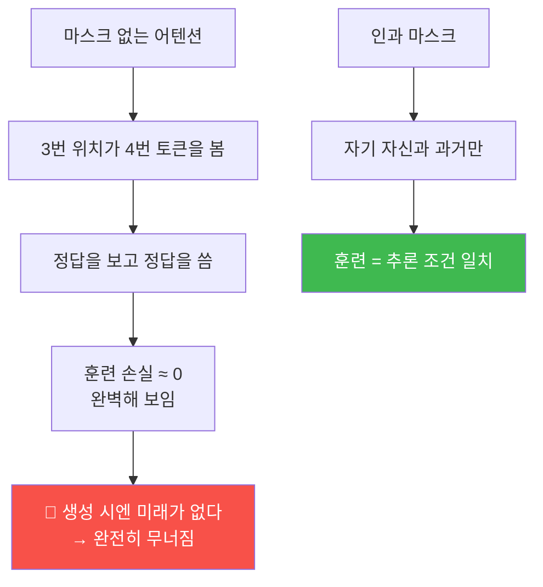
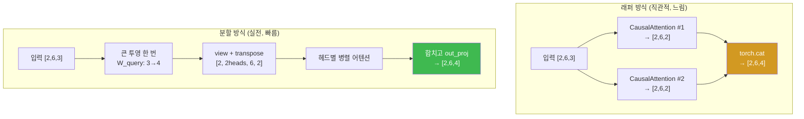
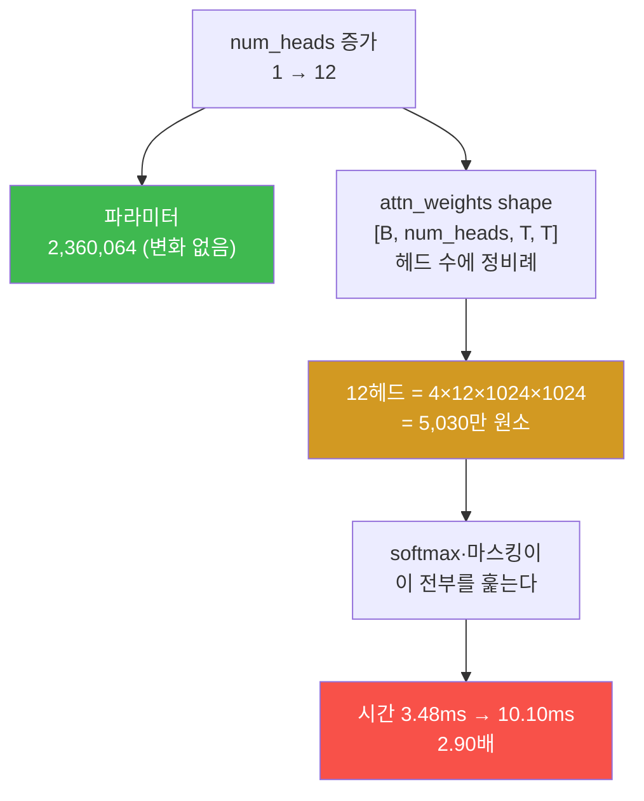

# W05 — 미래를 보지 마라: 인과 마스크와 멀티헤드

> **한 줄 요약** — 지난주 만든 어텐션에는 치명적 결함이 있다. **모든 토큰이 미래를 본다.**
> 다음 단어를 맞히는 게 목적인데 정답을 미리 보고 있으니, 훈련 손실은 완벽한데 생성은 못 하는
> 모델이 된다. 이번 주는 **인과 마스크**로 미래를 가리고(순진한 방식이 왜 틀리는지 증명하며),
> 드롭아웃을 넣고, 어텐션을 **여러 개 병렬로** 돌린다. 그리고 "헤드를 늘리면 파라미터가 는다"는
> 통념을 실측으로 깨뜨린다.

---

## 학습 목표

1. 학생은 인과 마스크가 왜 필요한지 "훈련 시 정답 누출" 관점에서 설명할 수 있다.
2. 학생은 0으로 마스킹하는 순진한 방식이 왜 틀리는지 `e⁰ = 1` 로 증명할 수 있다.
3. 학생은 `-inf` 마스킹과 마스킹 후 재정규화 두 방식이 동치임을 `allclose` 로 검증할 수 있다.
4. 학생은 드롭아웃이 train 모드에서 살아남은 원소를 `1/(1−p)` 배로 키우는 이유를 설명할 수 있다.
5. 학생은 래퍼 방식과 분할 방식 멀티헤드의 차이를 shape 로 설명하고 GPT-2 규모 파라미터 **2,360,064** 를 손계산할 수 있다.
6. 학생은 "헤드 수를 바꿔도 파라미터는 동일하지만 시간은 2.9배 느려진다"를 실측하고 원인을 활성값 부피로 설명할 수 있다.
7. 학생은 인과성을 **성질 테스트**로 옮겨 미묘한 버그를 차등 테스트로 특정할 수 있다.

---

## 0. 용어 해설

| 용어 | 영문 | 쉽게 말하면 | 비유 |
|------|------|------------|------|
| **인과 어텐션** | Causal Attention | 자기 자신과 과거만 보는 어텐션 | 앞만 보고 걷기 |
| **마스크** | Mask | 특정 위치를 못 보게 가리는 장치 | 가림막 |
| **상삼각** | Upper Triangular | 대각선 위쪽 영역 | 미래 구역 |
| **`-inf` 마스킹** | — | 점수를 −무한대로 만들어 softmax 후 0 | 아예 후보에서 제외 |
| **드롭아웃** | Dropout | 훈련 중 일부 값을 임의로 0으로 | 일부러 눈 가리고 연습 |
| **역스케일링** | Inverted Dropout | 살아남은 값을 1/(1−p) 배 | 빠진 만큼 나머지가 더 일함 |
| **멀티헤드** | Multi-Head Attention | 어텐션을 여러 개 병렬로 | 여러 관점으로 동시에 보기 |
| **head_dim** | — | 헤드 하나가 담당하는 차원 | 한 사람 몫 |
| **차등 테스트** | Differential Testing | 기준 구현과 대조해 버그 위치 특정 | 정품과 대조 |
| **성질 테스트** | Property Test | 값이 아니라 규칙을 검사 | 원리 검사 |
| **활성값** | Activation | 순전파 중간 텐서 | 작업 중 펼쳐 놓은 서류 |

---

## 0.4 이번 주 배경 지식 — 처음이라면

### `-inf` 를 넣으면 왜 0 이 되는가

마스킹은 "점수를 `-inf` 로 만든다"로 구현합니다. 이유는 softmax 의 정의에 있습니다.

```
softmax(xᵢ) = exp(xᵢ) / Σ exp(xⱼ)
```

`exp(-∞) = 0` 입니다. 지수함수는 x 가 작아질수록 0 에 붙습니다.

| x | exp(x) |
|---|---|
| 0 | 1 |
| −5 | 0.0067 |
| −20 | 0.000000002 |
| **−∞** | **0** |

분자가 0 이 되니 그 항의 확률이 **정확히 0** 이 됩니다. 그리고 분모(전체 합)에도 0 만
보태므로, **남은 항들끼리 알아서 다시 합이 1 이 됩니다.** 따로 정규화할 필요가 없습니다.

> 📌 **그래서 "0 을 곱해서 지운 뒤 다시 정규화"보다 `-inf` 가 낫습니다.** 미션 1에서 두 방식이
> 같은 값을 낸다는 것을 증명하고, 왜 `-inf` 쪽을 쓰는지 확인합니다.

### 드롭아웃 — 일부러 눈을 가리고 연습시키기

훈련 중에 **값의 일부를 무작위로 0 으로 만드는** 기법입니다.

```
원래:    [0.2, 0.5, 0.1, 0.2]
드롭아웃: [0.4, 0.0, 0.2, 0.4]   ← 일부를 0으로, 나머지는 1/(1-p) 배
```

**왜 이런 짓을 하나.** 특정 뉴런 몇 개에만 의존해서 답을 맞히는 버릇(과적합)을 막기
위해서입니다. 축구 연습에서 주전 몇 명을 일부러 빼고 훈련시키면 팀 전체가 강해지는 것과
같습니다.

**살아남은 값을 `1/(1-p)` 배 키우는 이유**(역스케일링)는 **전체 합의 크기를 유지**하기
위해서입니다. p=0.5 면 절반이 사라지므로 남은 것을 2배로 키웁니다. 그래야 다음 층이 받는
신호의 세기가 훈련·추론에서 같습니다.

> ⚠️ **드롭아웃은 훈련 때만 켭니다.** `model.eval()` 을 호출하면 꺼집니다. 이걸 빠뜨리면
> **같은 입력에 매번 다른 출력**이 나옵니다. 11주차에서 "분류 결과가 흔들린다"의 원인이
> 대부분 이것입니다.

### 멀티헤드 — 왜 하나로는 부족한가

어텐션 하나는 "한 가지 기준으로 누구를 볼지" 정합니다. 그런데 언어에는 관계가 여러 종류
있습니다.

| 헤드 | 볼 수 있는 관계 (예시) |
|---|---|
| 1번 | 주어–동사 |
| 2번 | 형용사–명사 |
| 3번 | 대명사–가리키는 대상 |
| … | … |

**여러 헤드를 병렬로 두고 각자 다른 기준을 학습하게** 한 뒤, 결과를 이어 붙입니다.
회의에 여러 전문가를 앉히고 각자 관점에서 의견을 낸 뒤 종합하는 것과 같습니다.

**중요한 것은 총 차원이 늘지 않는다는 점입니다.**

```
d_out = 768, num_heads = 12  →  head_dim = 768 / 12 = 64
헤드 12개가 각각 64차원을 맡고, 이어 붙이면 다시 768
```

> 📌 **그래서 "헤드를 늘리면 파라미터가 늘어난다"는 오해입니다.** `d_out` 이 같으면
> 파라미터 수는 **같습니다.** 나눠 맡는 방식만 달라집니다. 7주차 파라미터 계산에서
> 이 사실을 쓰게 됩니다.

### 이번 주에 나오는 4차원 텐서

멀티헤드가 들어오면 축이 하나 늘어납니다. **여기서 shape 를 못 읽으면 디버깅이 불가능합니다.**

```
x            [b, num_tokens, d_in]                예: [1, 6, 3]
queries      [b, num_tokens, d_out]               예: [1, 6, 2]
  ↓ view 로 헤드 축을 만든다
queries      [b, num_tokens, num_heads, head_dim] 예: [1, 6, 2, 1]
  ↓ transpose 로 헤드를 앞으로 뺀다
queries      [b, num_heads, num_tokens, head_dim] 예: [1, 2, 6, 1]
attn_scores  [b, num_heads, num_tokens, num_tokens]
```

**`transpose` 를 하는 이유**는 "헤드마다 독립적으로 토큰×토큰 계산"을 하기 위해서입니다.
헤드 축을 앞으로 빼 두면 뒤의 두 축(`num_tokens × head_dim`)에 대해 행렬곱이 헤드별로
따로 돕니다.

> ⚠️ **`transpose` 뒤에 `view` 를 부르면 오류가 납니다.** `RuntimeError: view size is not
> compatible ...` — transpose 는 메모리 배치를 안 바꾸고 축 순서만 바꾸기 때문입니다.
> `.contiguous()` 를 먼저 부르거나 `.reshape()` 을 쓰면 됩니다. **이번 주에 반드시 만납니다.**

---

## 0.5 신입생을 위한 핵심 개념

### 왜 미래를 가려야 하나 — 정답 누출

훈련 데이터는 (입력, 정답) 쌍이고 **정답은 입력을 한 칸 민 것**입니다(3주차).

```
입력: [Your, journey, starts, with]
정답: [journey, starts, with, one]
```

3번째 위치에서 모델은 `starts` 를 보고 `with` 를 맞혀야 합니다. 그런데 어텐션이 미래를 볼 수
있으면 4번째 위치의 `with` 를 **직접 보고** 답합니다. 컨닝입니다.



**훈련 조건과 추론 조건이 달라지면 모델은 쓸모가 없습니다.** 생성할 때는 아직 안 만든 미래
토큰이 존재하지 않으니까요.

### 인과 마스크의 모양

`num_tokens = 6` 일 때 어텐션 가중치 행렬(6×6)은 이렇게 됩니다.

| | Your | journey | starts | with | one | step |
|---|---|---|---|---|---|---|
| **Your** | 1.00 | 0 | 0 | 0 | 0 | 0 |
| **journey** | ● | ● | 0 | 0 | 0 | 0 |
| **starts** | ● | ● | ● | 0 | 0 | 0 |
| **with** | ● | ● | ● | ● | 0 | 0 |
| **one** | ● | ● | ● | ● | ● | 0 |
| **step** | ● | ● | ● | ● | ● | ● |

**첫 행이 `[1, 0, 0, 0, 0, 0]` 인 것에 주목하세요.** 첫 토큰은 볼 수 있는 것이 자기 자신뿐이라
가중치 전부가 자기에게 갑니다. 이 값은 이번 주의 좋은 검증 지표입니다.

---

## 1. 미션 1 — 인과 마스크: 두 방식의 동치 증명 (+ 순진한 방식의 함정)

**📋 실행 프롬프트 P5-1** (요지)

```text
[목표] 인과 마스크를 두 가지 방식으로 구현하고 동치를 증명
[할 일]
 방식 A: softmax를 먼저 계산한 뒤 상삼각을 0으로 만들고 행 합으로 재정규화
 방식 B: softmax 전에 상삼각을 -inf로 채운 뒤 softmax
 두 결과가 torch.allclose 인지 확인하고, 상삼각이 0인지, 각 행 합이 1인지 검사
[검증] 첫 행 가중치를 출력할 것
```

**예상 결과:** A == B (allclose `True`), 상삼각 전부 0, 행 합 전부 1, 첫 행 `[1, 0, 0, 0, 0, 0]`.

### 1.1 왜 `-inf` 인가 — 순진한 방식의 함정

"점수를 0으로 만들면 되지 않나?" 하는 생각이 자연스럽습니다. **틀립니다.**

```
점수      : [1.0, 2.0, 3.0]
0으로 마스킹: [1.0, 0.0, 0.0]    ← 미래를 0으로 눌렀다
softmax   : [0.5761, 0.2119, 0.2119]   ← 🔴 미래에 21%씩 남아 있다
```

**`softmax(0) = e⁰ = 1` 이기 때문입니다.** 0은 "없음"이 아니라 "중간값"입니다. 반면
`e^(-inf) = 0` 이므로 `-inf` 는 진짜로 후보에서 제외합니다.

> 🔴 **이 함정이 무서운 이유** — 출력 shape 도 맞고, 행 합도 1이고, 오류도 안 납니다.
> **조용히 틀립니다.** 모델은 미래를 21%씩 보면서 훈련되고, 여러분은 손실이 잘 내려간다고
> 기뻐하다가 생성 단계에서야 이상함을 발견합니다.
>
> 🔗 이 `-inf` 트릭은 10주차 top-k 샘플링에서 정확히 같은 형태로 다시 나옵니다.

### 1.2 방식 A와 B가 왜 같은가

softmax 는 분자·분모에 같은 상수를 곱해도 값이 안 변합니다. 방식 A의 "0으로 만들고 행 합으로
나누기"는 결국 **살아남은 항들만으로 다시 softmax 하는 것**과 같습니다. 그래서 B와 동치입니다.
다만 A는 두 번 계산하고 B는 한 번이므로 **실전은 B**를 씁니다.

---

## 2. 미션 2 — 드롭아웃: 왜 살아남은 값이 2배가 되나

**📋 실행 프롬프트 P5-2** (요지)

```text
[목표] 드롭아웃의 스케일링 동작 관찰
[할 일] torch.manual_seed(123), Dropout(0.5), 6×6 전부 1인 텐서에 대해
 train 모드 출력과 eval 모드 출력의 원소 값 집합을 각각 출력
[검증] train 모드에서 살아남은 원소의 값이 무엇인지 짚고 이유를 설명할 것
```

**예상 결과:**

| 모드 | 원소 값 집합 |
|------|------------|
| `train()` | `{0.0, 2.0}` ← 살아남은 값이 **2.0** |
| `eval()` | `{1.0}` ← 아무것도 안 함 |

**왜 2.0인가.** 절반을 껐으니 남은 절반이 **두 배로 일해야** 합의 기댓값이 유지됩니다.
`1 / (1 − 0.5) = 2`. 이 방식을 **역스케일링 드롭아웃(inverted dropout)** 이라 하고, 덕분에
추론(eval) 때는 아무 처리도 필요 없습니다.

> ⚠️ **`model.eval()` 을 빼먹는 것은 이 수업에서 가장 흔한 버그입니다.** 9주차 손실 평가,
> 10주차 생성, 11주차 정확도 측정에서 전부 문제가 됩니다. 평가 결과가 실행할 때마다 미묘하게
> 달라진다면 제일 먼저 의심하세요.

---

## 3. 미션 3~5 — CausalAttention에서 멀티헤드까지

### 3.1 배치 지원 CausalAttention

**예상 결과:** 입력 `[2, 6, 3]` → 출력 **`[2, 6, 2]`**.

핵심 구현 포인트 두 가지:

- **`register_buffer("mask", torch.triu(torch.ones(ctx, ctx), diagonal=1))`** — 마스크는
  학습 대상이 아니지만 `.to(device)` 때 같이 따라가야 합니다. `buffer` 로 등록하면 파라미터가
  아니면서 모듈과 함께 이동합니다.
- **`self.mask.bool()[:num_tokens, :num_tokens]`** — 실제 입력 길이가 `context_length` 보다
  짧을 수 있으므로 **잘라 써야** 합니다.

### 3.2 래퍼 방식 vs 분할 방식



| 방식 | 출력 | 특징 |
|------|------|------|
| `MultiHeadAttentionWrapper(d_in=3, d_out=2, num_heads=2)` | `[2, 6, 4]` | 헤드마다 별도 모듈, 결과를 `cat` |
| `MultiHeadAttention(d_in=3, d_out=4, num_heads=2)` | `[2, 6, 4]` | 투영 한 번 + `view`/`transpose` 로 쪼갬 |

**`d_out` 의 의미가 다릅니다.** 래퍼는 "헤드 **하나당**" 차원이고, 분할은 "**전체**" 차원입니다.
그래서 래퍼에서 `d_out=1` 로 바꾸면 출력이 `[2, 6, 2]` 가 됩니다(연습문제 3.2).
분할 방식은 `d_out` 이 `num_heads` 로 나누어떨어져야 합니다 — `assert` 로 못 박으세요.

### 3.3 GPT-2 규모 파라미터 손계산

`d_in = d_out = 768`, `num_heads = 12` → `head_dim = 768 / 12 = **64**`.

| qkv_bias | 파라미터 | 공식 |
|---|---|---|
| `False` | **2,360,064** | `3 × 768² + 768² + 768` |
| `True` | **2,362,368** | `4 × (768² + 768)` |

- 앞의 `3 × 768²` 는 Q/K/V 투영 (bias 없음)
- 뒤의 `768² + 768` 은 출력 투영 `out_proj` (bias 있음)

**직접 계산해 대조하세요.** `768² = 589,824` 입니다.

> 🔗 **`qkv_bias` 는 10주차에서 결정적으로 중요해집니다.** OpenAI 의 GPT-2 공식 가중치에는
> QKV bias 가 **있습니다.** 그래서 가중치를 이식하려면 `qkv_bias=True` 로 모델을 만들어야
> 합니다. 그리고 이 2,304개(=3×768) 차이가 11주차 파라미터 계산에까지 영향을 줍니다.

---

## 4. 미션 6 — 헤드 수 실험: 통념 깨기

**📋 실행 프롬프트 P5-6**

```text
[목표] d_out 고정, num_heads 변화가 파라미터·속도에 미치는 영향 측정
[할 일] 실험 스크립트 작성·실행, 결과를 week05/heads_experiment.md 에 저장:
 1. d_in=d_out=768, context_length=1024, dropout=0.0 고정,
    num_heads ∈ {1, 4, 12} 세 인스턴스 생성
 2. 각각의 전체 파라미터 수와 head_dim 기록
 3. GPU에서 [4, 1024, 768] 무작위 입력으로 forward 시간 측정:
    워밍업 3회 후 10회 평균, 측정 전후 torch.cuda.synchronize 호출
[형식] 표: num_heads | head_dim | 파라미터 수 | 평균 forward 시간(ms)
[검증] 파라미터 수 열에서 발견되는 사실을 명시적으로 짚을 것
```

**예상 결과 (실측, GB10):**

| num_heads | head_dim | 파라미터 | forward 시간 |
|---|---|---|---|
| 1 | 768 | **2,360,064** | **3.48 ms** |
| 4 | 192 | **2,360,064** | **5.11 ms** |
| 12 | 64 | **2,360,064** | **10.10 ms** |

### 4.1 파라미터는 같다 — 왜?

헤드를 나누는 것은 **같은 크기의 투영 출력을 조각내 병렬로 보는 것**이지, 투영을 늘리는 게
아닙니다. `768` 을 12조각(64씩)으로 자르든 1조각(768)으로 두든, 투영 행렬은 `768×768`
그대로입니다. `head_dim` 만 768 → 192 → 64 로 줄어듭니다.

### 4.2 그런데 시간은 2.90배 느려진다



어텐션 점수 텐서 `attn_weights` 의 shape 는 `[B, num_heads, T, T]` 로 **헤드 수에 정비례**해
커집니다. 파라미터(가중치 행렬)는 그대로여도 **중간 활성값의 부피가 12배**가 됩니다.

> 🔴 **여기서 배울 것: "파라미터 수가 같다 = 비용이 같다"가 아니다.**
> 모델 크기(파라미터)와 실행 비용(활성값·중간 텐서)은 **별개의 축**입니다.
> 9주차 메모리 해부에서 다시 만납니다. 실측하지 않고 "비슷하겠지"라고 넘어가면 놓칩니다.

**해석 과제 (report.md 에 **직접** 작성):** 파라미터 수가 같은데도 GPT-2 가 헤드를 12개로
나눈 이유는? "여러 관점"이라는 통설을 `head_dim` 과 연결해 3~5문장으로 쓰고, 위 시간 측정을
근거로 "그 대가는 무엇인가"를 한 문장 덧붙이세요.

---

## 5. 미션 7 — 함정 카드: 미묘하게 틀린 MHA

조교가 배포하는 `mha_trap.py` 에는 겉보기에 멀쩡하지만 **버그가 1개** 있습니다.
중간고사 실기의 예고편입니다. **절차가 중요합니다.**

### 5.1 절차 — 에이전트에게 던지기 전에 여러분이 먼저 읽는다

1. **[직접, 에이전트 금지]** `mha_trap.py` 를 정독하고 의심 지점 1~3곳을 **줄 번호와 함께**
   메모합니다.
   전형적 버그 유형: 마스크 방향 반대 / √d 누락 / transpose 누락 / softmax 차원 오류 / 0 마스킹
2. **[에이전트]** 차등 테스트로 가설을 검증합니다.
3. **[직접 작성]** `trap_report.md`: 버그 위치(줄 번호), 증상, 수학적 원인, **1단계 예측이
   맞았는지 회고.**

**📋 실행 프롬프트 P5-7**

```text
[목표] mha_trap.py 의 버그를 차등 테스트로 규명
[할 일]
 1. 내 multihead.py 의 MultiHeadAttention을 기준 구현(reference)으로,
    mha_trap.py 의 구현을 피검 대상으로 삼아 동일 시드·동일 가중치·동일 입력에서
    출력을 비교하는 스크립트를 작성해 실행
 2. 출력이 다르면: 어느 중간 단계(점수/마스킹/softmax/문맥)부터 달라지는지
    단계별 텐서를 비교해 분기 지점을 특정
 3. test_causal_invariance를 trap 구현에도 적용해 통과 여부 확인
[제약] trap 코드를 수정하지 말 것. 진단만 수행
[산출물] 분기 지점, 의심 라인, 증거 텐서 비교를 정리해 보고
```

### 5.2 인과성 성질 테스트 — 이번 주 최고의 검증

```
test_causal_invariance:
  ① 입력 시퀀스로 출력을 계산한다
  ② 마지막 토큰만 바꾼 입력으로 다시 계산한다
  ③ 마지막 위치를 제외한 모든 출력이 동일해야 한다
```

**"미래를 바꿔도 과거의 출력이 안 변한다"** — 이것이 인과 어텐션의 **정의 그 자체를 테스트로
옮긴 것**입니다.

> 📌 **좋은 테스트는 구현 세부가 아니라 성질(property)을 검사합니다.**
> 값 대조는 구현이 바뀌면 깨지지만, 성질 테스트는 구현이 어떻게 바뀌어도 살아남습니다.
> 그리고 성질 테스트는 **당신이 예상하지 못한 버그**까지 잡습니다.

---

## 7. 에이전트에게 시키는 법 — 이번 주 실전

### 7.1 이번 주에 배우는 새 무기 — 차등 테스트와 성질 테스트

지금까지는 "정답 숫자와 대조"였습니다. 이번 주에 두 가지가 추가됩니다.

| 방법 | 무엇을 하는가 | 언제 쓰는가 |
|---|---|---|
| **차등 테스트** | 기준 구현과 **같은 입력**을 넣어 출력을 대조 | 정답지가 있을 때. 어긋난 지점을 좁힐 수 있다 |
| **성질 테스트** | 값이 아니라 **규칙**을 검사 | 정답지가 없을 때. "행 합이 1", "상삼각이 0" |

**성질 테스트가 특히 강력합니다.** 정답 숫자를 몰라도 검증할 수 있기 때문입니다.
이번 주의 성질 셋을 프롬프트에 그대로 쓰십시오.

```text
[검증] 다음 성질을 pytest 로 검사할 것
 1. 가중치 행렬의 상삼각(대각선 위)이 전부 0 인가
 2. 각 행의 합이 1.0 인가 (allclose, atol=1e-6)
 3. 첫 행이 [1, 0, 0, ...] 인가
```

> 📌 **왜 이게 에이전트 시대에 중요한가.** 에이전트가 만든 코드는 **읽어서 검토하기엔
> 너무 빨리 늘어납니다.** 사람이 한 줄씩 볼 수 없으면, 대신 **성질로 가둬야** 합니다.
> 14주차 프로젝트에서 정답지 없이 검증할 때 이 방법만 남습니다.

### 7.2 이번 주에 에이전트가 실제로 하는 실수 세 가지

| 증상 | 어떻게 알아채나 | 대응 |
|---|---|---|
| **`register_buffer` 대신 일반 텐서** | `model.to('cuda')` 후 device 불일치 오류 | 마스크가 `state_dict` 에 있는지 확인 |
| **`view` 를 transpose 뒤에 호출** | `RuntimeError: view size is not compatible` | 에이전트에게 **진단만** 시키고 원인을 설명하게 할 것 |
| **드롭아웃을 eval 에서도 켠 채로** | 같은 입력에 매번 다른 출력 | `model.eval()` 호출 여부 확인 |

두 번째는 **고쳐 주면 안 되는 오류**입니다. 프롬프트에 이렇게 씁니다.

```text
[제약] 오류가 나면 원인을 먼저 진단해 보고할 것. 진단 없이 고치지 마라.
```

`contiguous()` 가 왜 필요한지는 **메모리 배치를 이해해야** 알 수 있고, 그 이해는 에이전트가
말없이 고쳐 버리면 생기지 않습니다.

### 7.3 판정 명령

```bash
docker exec -it llm-lab bash
cd /work/week05

python3 -c "
import torch
from multihead import MultiHeadAttention
torch.manual_seed(123)
x = torch.rand(1, 6, 3)
mha = MultiHeadAttention(3, 2, context_length=6, dropout=0.0, num_heads=2)
mha.eval()                                    # 드롭아웃 끄기
out = mha(x); print('shape', out.shape)       # [1, 6, 2]

# 성질 검사 — 정답 숫자를 몰라도 할 수 있다
m = mha.mask.bool()[:6,:6]
print('마스크 상삼각', m.sum().item(), '개 가려짐')   # 15 (6*5/2)
print('결정성', torch.allclose(mha(x), mha(x)))       # True (eval 이면)
"
grep -n "register_buffer" multihead.py || echo "⚠️ register_buffer 미사용 — GPU 이동 시 터진다"
```

---

## 8. 이번 주 산출물이 어디로 가는가


**이번 주 구현이 10주차에 시험받습니다.** OpenAI 가 공개한 GPT-2 가중치를 **여러분이 만든
클래스에 그대로 부어 넣을 것**이기 때문입니다. 구조가 한 군데라도 다르면 shape 가 안 맞아
`ValueError` 가 납니다.

> 🔴 **특히 QKV 를 조심하십시오.** OpenAI 는 Q·K·V 를 **한 텐서에 붙여서** 저장합니다
> (`h.0.attn.c_attn.weight` 의 shape 가 `(768, 2304)` — 768×3). 10주차에 `torch.chunk` 로
> 3분할하는 작업이 여기서 시작됩니다. **지금 Q·K·V 를 각각 별도 `nn.Linear` 로 만들어 둔
> 것이 그때 3분할이 필요한 이유입니다.**

---

## 실습 안내

이번 주 실습(`lab_week05.yaml`, 8단계)은 전부 llm-lab 컨테이너 안에서 진행합니다.
시간 측정 단계는 GPU를 씁니다.

### 1) 이 실습을 왜 하는가?

여기서 만든 `MultiHeadAttention` 이 **7주차 GPT-2 의 12개 블록 안에 그대로 들어갑니다.**
그리고 이번 주에 배운 `-inf` 마스킹, `qkv_bias`, 성질 테스트는 각각 10주차 top-k,
10주차 가중치 이식, 중간고사 실기에서 회수됩니다.

### 2) 무엇을 알 수 있는가?

- 0 마스킹이 왜 조용히 틀리는지 — `e⁰ = 1` 한 줄로 설명되는 함정.
- 파라미터 수가 같아도 실행 비용은 2.9배 다를 수 있다는 것.
- "성질을 테스트한다"가 무엇인지 — 값 대조와 근본적으로 다른 검증.

### 3) 결과 해석 (정상 vs 비정상)

| 확인 | 정상 | 비정상 → 의심할 곳 |
|------|------|-------------------|
| A == B | allclose **True** | False면 재정규화 누락 |
| 첫 행 | `[1, 0, 0, 0, 0, 0]` | 다르면 마스크 방향 반대(`tril`/`triu` 혼동) |
| 0 마스킹 softmax | 미래에 **0이 아닌 값**이 남음 | 0이면 실험이 잘못된 것 |
| 드롭아웃 train | 살아남은 값 **2.0** | 1.0이면 eval 모드 |
| CausalAttention | `[2, 6, 2]` | 다르면 d_out 확인 |
| 래퍼 / 분할 | 둘 다 `[2, 6, 4]` | d_out 의미 차이 확인 |
| head_dim (768/12) | **64** | 나누어떨어지는지 assert |
| 파라미터 | **2,360,064** / bias True **2,362,368** | 다르면 out_proj bias 확인 |
| 헤드 1/4/12 파라미터 | **전부 동일** | 다르면 d_out 을 헤드마다 곱한 것 |
| 시간 | 3.48 → 5.11 → 10.10 ms 경향 | 차이가 없으면 `synchronize` 누락 |

### 4) 실전 활용

`-inf` 마스킹은 패딩 마스크(12주차), 후보 제한(10주차 top-k) 등 어디에나 나옵니다.
차등 테스트는 "리팩터링 후 동작이 같은가"를 확인하는 실무 표준 기법이고, 성질 테스트는
LLM 출력처럼 **정답을 하나로 못 박기 어려운 대상**을 검증하는 유일한 실용적 방법입니다.

---

## 흔한 오해

- ❌ **"점수를 0으로 만들면 안 보게 된다"** → `softmax(0) = 1` 입니다. 21%씩 남습니다.
  **오류 없이 조용히 틀리는** 대표 사례입니다.
- ❌ **"헤드를 늘리면 파라미터가 는다"** → 완전히 동일합니다. `d_out` 을 쪼개는 것뿐입니다.
- ❌ **"파라미터가 같으면 비용도 같다"** → 시간이 **2.90배** 차이납니다. 활성값 부피가 다릅니다.
- ❌ **"드롭아웃은 eval 에서도 동작한다"** → `eval()` 에서는 아무것도 안 합니다. 대신 train 때
  살아남은 값을 미리 키워 둡니다.
- ❌ **"GPU 시간 측정은 그냥 `time.time()` 으로"** → CUDA 는 비동기라 커널이 끝나기 전에
  시간이 찍힙니다. **`torch.cuda.synchronize()`** 를 측정 전후에 넣어야 합니다.
- ❌ **"마스크도 파라미터니까 `nn.Parameter`"** → 학습 대상이 아닙니다. `register_buffer` 를
  씁니다 — 파라미터가 아니면서 `.to(device)` 를 따라갑니다.

---

## 다음 주차 예고 — W06 블록을 조립하다

어텐션이 완성됐습니다. 이제 트랜스포머 블록의 **나머지 부품**을 만듭니다 — LayerNorm(정규화),
GELU(활성함수), FeedForward(확장-압축), 그리고 잔차 연결. 6주차부터 지시의 순서가 바뀝니다:
**구현 전에 통과 기준이 되는 테스트를 먼저 만들게 합니다.** 테스트가 곧 명세서가 되므로
여러분의 요구가 모호했는지가 구현 전에 드러납니다. 그리고 잔차 연결이 없을 때 기울기가
**천 배** 줄어드는 것을 직접 측정합니다.
