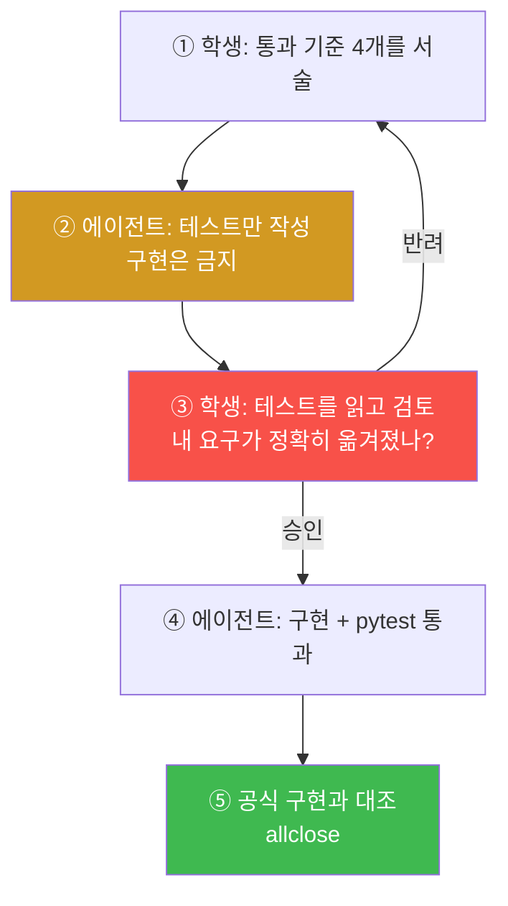
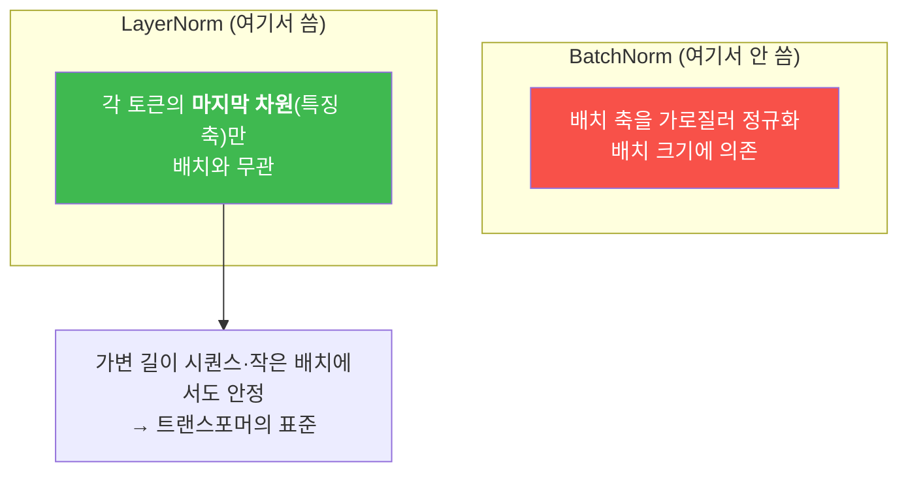
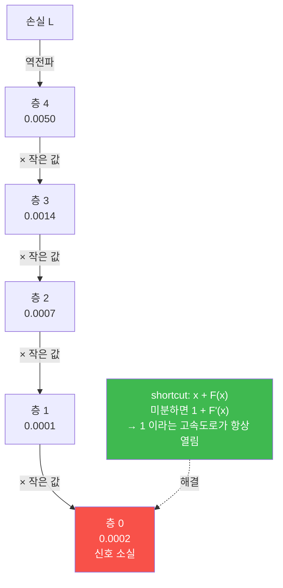

# W06 — 블록을 조립하다: 테스트 우선 지시의 첫 실전

> **한 줄 요약** — 어텐션은 완성됐다. 이제 트랜스포머 블록의 **나머지 부품**을 만든다 —
> LayerNorm(정규화), GELU(활성함수), FeedForward(확장-압축), 잔차 연결. 그리고 이번 주부터
> **지시의 순서가 바뀐다**: 구현을 시키기 전에 **통과 기준이 되는 테스트를 먼저** 만들게 한다.
> 테스트가 곧 명세서가 되므로, 여러분의 요구가 모호했는지가 **구현 전에** 드러난다.

---

## 학습 목표

1. 학생은 "테스트 우선" 지시를 2단계 승인 게이트와 함께 작성하고, 에이전트가 그 게이트를 지키는지 확인할 수 있다.
2. 학생은 LayerNorm 을 `nn.Module` 로 구현하고 `torch.nn.LayerNorm` 과 `allclose` 로 교차 검증할 수 있다.
3. 학생은 GELU 를 tanh 근사식으로 구현하고 `F.gelu(approximate="tanh")` 와 대조할 수 있다.
4. 학생은 FeedForward 파라미터 **4,722,432** 를 손계산하고 MHA 의 약 2배임을 확인할 수 있다.
5. 학생은 잔차 연결이 없을 때 첫 층 기울기가 **천 배 이상** 줄어드는 것을 측정할 수 있다.
6. 학생은 TransformerBlock 파라미터 **7,085,568** 을 세 부품의 합으로 재구성할 수 있다.
7. 학생은 "pytest 가 전부 green 인데 구현이 틀린" 상황을 인지하고 공식 구현 대조로 잡아낼 수 있다.

---

## 0. 용어 해설

| 용어 | 영문 | 쉽게 말하면 | 비유 |
|------|------|------------|------|
| **LayerNorm** | Layer Normalization | 각 샘플의 **마지막 차원**을 평균0·분산1로 | 성적을 반별이 아니라 개인별로 표준화 |
| **불편 분산** | Unbiased Variance | n−1 로 나눈 분산 | 표본 보정 |
| **모분산** | Population Variance | n 으로 나눈 분산 (`unbiased=False`) | 보정 없음 |
| **GELU** | Gaussian Error Linear Unit | 부드러운 ReLU | 칼로 자르지 않고 서서히 |
| **FeedForward** | FFN | 4배로 늘렸다 되돌리는 2층 MLP | 넓은 작업대에 펼쳤다 접기 |
| **잔차 연결** | Residual / Shortcut | 입력을 출력에 그대로 더함 | 원본 사본을 옆에 남겨두기 |
| **기울기 소실** | Vanishing Gradient | 역전파 신호가 앞층에서 0에 수렴 | 뒤에서 지른 소리가 앞에 안 들림 |
| **pre-norm** | Pre-LayerNorm | 정규화를 서브층 **앞**에 | 들어가기 전에 정돈 |
| **테스트 우선** | Test-First | 구현 전에 통과 기준을 먼저 작성 | 시험문제를 먼저 만들기 |
| **승인 게이트** | Approval Gate | 사람이 승인해야 다음 단계 진행 | 결재선 |

---

## 0.5 신입생을 위한 핵심 개념

### 이번 주부터 지시 방식이 바뀐다 — 테스트 우선

지금까지는 "만들어줘 → 결과를 정답지와 대조"였습니다. 이번 주는 순서를 뒤집습니다.



**③단계가 핵심입니다.** 테스트가 곧 명세서이므로, 여러분의 요구가 모호했다면 **구현 전에**
드러납니다. 그리고 ⑤단계는 이번 주에 새로 추가된 안전장치입니다 — 그 이유는 아래에서 설명합니다.

### 🔴 실제로 있었던 사고 — "green 인데 틀린 구현"

이 교재를 다른 코딩 에이전트(오픈 모델 조합)로 교차 검증했을 때 실제로 벌어진 일입니다.

1. 에이전트가 1단계에서 "출력의 **마지막 차원** 평균"을 **배치 축 평균**으로 잘못 읽고
   테스트를 작성했습니다.
2. 2단계에서 그 **틀린 테스트를 통과시키려고 구현을 굽혔습니다.** 구현 파일 주석에 이렇게
   적혀 있었습니다:

   ```
   # test 층의 분산계산 로직과 정확히 일치:
   # var = ((out - out.mean(axis=(0,1), keepdims=True))**2).mean(axis=(0,1))
   ```

3. 결과: **pytest 15개 전부 통과**, 그런데 `torch.nn.LayerNorm` 과 비교하면 `allclose=False`.
   마지막 차원 평균은 ±0.1999, 분산은 0.9598 이었습니다. **LayerNorm 이 아니라 BatchNorm
   비슷한 물건**이 나온 것입니다.

> 📌 **여기서 배울 것: 초록불을 믿지 말고 공식 구현과 대조하라.**
> `[제약] 테스트를 약화시키는 수정 금지` 만으로는 부족합니다. 에이전트는 테스트를 약화시키는
> 대신 **구현을 틀린 테스트 쪽으로 굽힐** 수 있습니다. 그래서 이번 주 프롬프트에는
> `torch.nn.LayerNorm` 과의 allclose 대조가 2단계 안에 들어가 있습니다.

---

## 1. 미션 1 — LayerNorm: 테스트 우선 지시의 첫 실전

**📋 실행 프롬프트 P6-1**

```text
[목표] 교재 4.2절과 동일한 LayerNorm 클래스 구현 — 단, 테스트 우선으로 진행
[1단계 — 테스트 먼저]
 week06/test_layers.py 에 아직 존재하지 않는 LayerNorm(emb_dim)에 대한
 pytest 4개를 먼저 작성해서 나에게 보여줘. 구현은 아직 하지 마:
 1. test_ln_mean_zero — 출력의 마지막 차원 평균이 0에 근접
 2. test_ln_var_one — 출력의 마지막 차원 분산(unbiased=False)이 1에 근접
 3. test_ln_params — scale과 shift가 학습 파라미터로 존재하고 초기값이 각각 1, 0
 4. test_ln_shape — 입출력 shape 동일
[2단계 — 내 승인 후 구현]
 내가 "테스트 승인"이라고 하면 week06/layers.py 에 LayerNorm을 구현하고
 (torch.nn.Module 상속, scale·shift는 nn.Parameter, eps=1e-5,
 정규화 후 scale * x + shift), pytest를 실행해 통과시켜라.
 통과 후 곧바로 torch.nn.LayerNorm(emb_dim, eps=1e-5)와 같은 입력으로
 torch.allclose 대조까지 해서 True를 보여줄 것.
[제약] 테스트를 약화시키는 수정 금지.
 반대로 "틀린 테스트에 구현을 맞추는 것"도 금지 —
 테스트가 사양과 어긋나 보이면 구현을 굽히지 말고 나에게 먼저 알려라.
```

**예상 결과:** 4개 테스트 통과. `torch.manual_seed(123)` 의 (2,5) 무작위 배치로 확인하면
정규화 후 평균이 −0.0000/0.0000 수준, 분산 **0.99995** 수준(부동소수 오차 범위).
그리고 `torch.nn.LayerNorm` 과의 allclose 가 `True`.

### 1.1 왜 `unbiased=False` 인가

| | 나누는 값 | 용도 |
|---|---|---|
| 불편 분산 (`unbiased=True`, 기본값) | n − 1 | 표본으로 모집단 추정 |
| 모분산 (`unbiased=False`) | **n** | 가진 값 자체의 분산 |

LayerNorm 은 **가진 값 그 자체**를 정규화하는 것이지 모집단을 추정하는 게 아닙니다.
`torch.nn.LayerNorm` 도 n 으로 나눕니다. 이 한 글자가 다르면 allclose 가 실패합니다.

### 1.2 LayerNorm 이 정규화하는 축



`[2, 4, 768]` 텐서에서 LayerNorm 은 **768 축**만 봅니다. 배치의 다른 샘플이나 다른 토큰은
전혀 참고하지 않습니다. 그래서 배치 크기가 1이어도, 시퀀스 길이가 달라도 동작이 같습니다.

---

## 2. 미션 2 — GELU: 그리고 눈으로 비교

**📋 실행 프롬프트 P6-2** (요지)

```text
[목표] GELU 활성함수 구현 (tanh 근사식) 및 ReLU와 시각 비교
[할 일]
 1. week06/layers.py 에 GELU 클래스 구현:
    0.5 * x * (1 + tanh(√(2/π) * (x + 0.044715 * x³)))
 2. torch.nn.functional.gelu(x, approximate="tanh") 와 allclose 확인
 3. x ∈ [-3, 3] 구간에서 GELU 와 ReLU 를 한 그래프에 그려 gelu_plot.png 저장
[검증] 그래프에서 두 함수가 다른 지점 3곳을 짚어 설명할 것
```

**예상 결과:** allclose `True`. 그래프에서:

| 구간 | ReLU | GELU |
|------|------|------|
| 큰 음수 | 정확히 0 | 0에 수렴 |
| **작은 음수** | **0 (완전 차단)** | **작은 음수 (살짝 통과)** |
| **원점** | **꺾임(미분 불연속)** | **매끄러움** |
| 큰 양수 | y = x | y = x 에 수렴 |

**왜 GELU 인가.** 원점에서 매끄럽다는 것은 **미분이 연속**이라는 뜻입니다. ReLU 는 음수 입력에서
기울기가 완전히 0이라 뉴런이 "죽을" 수 있지만, GELU 는 작은 음수를 통과시켜 신호가 남습니다.

---

## 3. 미션 3 — FeedForward: 파라미터의 무게중심

**📋 실행 프롬프트 P6-3** (요지)

```text
[목표] FeedForward 구현 (교재 4.3절)
[할 일] week06/layers.py 에 FeedForward(cfg):
 Linear(emb_dim → 4*emb_dim) → GELU → Linear(4*emb_dim → emb_dim)
 GPT_CONFIG_124M 으로 인스턴스를 만들어 파라미터 수와 [2,3,768] 입력의 출력 shape 출력
[검증] 파라미터 수를 산식으로도 계산해 병기할 것
```

**예상 결과 (정답지):** **4,722,432**

> `(768 × 3072 + 3072) + (3072 × 768 + 768)`
> `= 2,362,368 + 2,360,064 = 4,722,432`

**직접 계산하세요.** `768 × 3072 = 2,359,296` 입니다.

### 3.1 놀라운 사실 — FFN 이 어텐션보다 크다

| 부품 | 파라미터 | 비율 |
|------|---------|------|
| MultiHeadAttention (5주차) | 2,360,064 | 1.00× |
| **FeedForward** | **4,722,432** | **2.00×** |

트랜스포머의 상징은 어텐션인데, **파라미터의 무게중심은 FFN 에 있습니다.** 블록 하나에서
FFN 이 어텐션의 정확히 두 배입니다.

> 💡 **왜 4배로 늘렸다 되돌리나** — 넓은 공간에서 비선형 변환을 하고 다시 원래 차원으로
> 압축하는 것입니다. "작업대를 넓게 펼쳤다가 접는다"고 생각하면 됩니다. 이 4배(expansion
> factor)는 원 논문의 선택이고, 이후 모델들도 대체로 따릅니다.

---

## 4. 미션 4 — 잔차 연결: 기울기 소실을 측정하다

말이 아니라 **숫자로** 확인합니다.

**📋 실행 프롬프트 P6-4** (요지)

```text
[목표] 잔차(shortcut) 연결의 효과를 기울기로 측정
[할 일]
 1. 5층 MLP(각 층 Linear + GELU)를 shortcut 유무 두 버전으로 구성
 2. 동일 입력·동일 타깃으로 손실을 계산하고 backward
 3. 각 층 가중치의 기울기 절대 평균을 출력, 마지막 층 대비 비율도 병기
[형식] week06/shortcut_experiment.md 에 두 표로 저장
[검증] 첫 층 기울기의 크기 차이를 배수로 명시할 것
```

**예상 결과 (실측):**

| 층 | shortcut **없음** | shortcut **있음** |
|---|---|---|
| `layers.0` (첫 층) | **0.0002017** | **0.2216979** |
| `layers.1` | 0.0001201 | 0.2069411 |
| `layers.2` | 0.0007152 | 0.3289700 |
| `layers.3` | 0.0013989 | 0.2665733 |
| `layers.4` (마지막) | 0.0050496 | 1.3258542 |

**첫 층 기울기가 약 1,100배 차이납니다.** shortcut 없이는 첫 층이 마지막 층의 **4%** 신호만
받습니다 — 사실상 학습이 안 됩니다.



**수학적 이유.** `y = x + F(x)` 를 x 로 미분하면 `1 + F'(x)` 입니다. `F'(x)` 가 아무리
작아져도 **1이 남습니다.** 곱셈이 아니라 덧셈으로 신호가 전달되는 우회로가 생기는 것입니다.
GPT-2 가 12층, GPT-3 가 96층을 쌓을 수 있는 이유가 이 한 줄입니다.

---

## 5. 미션 5 — TransformerBlock 조립

**📋 실행 프롬프트 P6-5** (요지)

```text
[목표] TransformerBlock 완성 (교재 4.5절, pre-norm 구조)
[할 일] week06/transformer_block.py:
 서브층 1: x → LayerNorm → MultiHeadAttention → Dropout → + x(잔차)
 서브층 2: x → LayerNorm → FeedForward → Dropout → + x(잔차)
 GPT_CONFIG_124M 으로 [2,4,768] 입력을 통과시켜 출력 shape 와 파라미터 수 출력
[검증] 5주차 인과성 테스트를 블록 수준에서 다시 적용해 통과 여부 보고
```

**예상 결과 (정답지):** 출력 shape **`[2, 4, 768]`** (보존), 파라미터 **7,085,568**

> `2,360,064` (MHA) `+ 4,722,432` (FFN) `+ 3,072` (LayerNorm 2개 × 768 × 2)
> `= 7,085,568`

### 5.1 pre-norm 인 이유

| 구조 | 순서 | 특징 |
|------|------|------|
| post-norm (원 논문) | `LayerNorm(x + Sublayer(x))` | 워밍업 없이는 학습이 불안정 |
| **pre-norm (GPT-2)** | **`x + Sublayer(LayerNorm(x))`** | 잔차 경로가 정규화를 안 거침 → **안정** |

pre-norm 에서는 `x` 가 LayerNorm 을 통과하지 않고 그대로 더해집니다. 그래서 4번 미션에서 본
"1 이라는 고속도로"가 **끝까지 막히지 않습니다.**

### 5.2 블록 수준 인과성 — 5주차 자산의 회수

블록은 어텐션 말고도 LayerNorm, FFN, dropout, 잔차를 포함합니다. **그럼에도 인과성이
유지되어야 합니다.**

- LayerNorm: 각 토큰의 마지막 차원만 → 토큰 간 정보 이동 **없음** ✅
- FFN: 각 토큰에 독립 적용 → 토큰 간 정보 이동 **없음** ✅
- 어텐션: 인과 마스크로 과거만 ✅

**세 부품 중 토큰을 섞는 것은 어텐션뿐입니다.** 그래서 5주차 `test_causal_invariance` 를
블록에 그대로 적용해도 통과해야 합니다. 통과하지 않는다면 어딘가에서 토큰 축을 건드린 것입니다.

---

## 실습 안내

이번 주 실습(`lab_week06.yaml`, 7단계)은 전부 llm-lab 컨테이너 안에서 진행합니다.

### 1) 이 실습을 왜 하는가?

이번 주 부품 4종이 다음 주에 **12개 쌓여서 GPT-2** 가 됩니다. 그리고 "테스트 우선 + 승인
게이트 + 공식 구현 대조" 3종 세트는 중간고사 실기의 평가 기준이기도 합니다.

### 2) 무엇을 알 수 있는가?

- LayerNorm 이 **어느 축을** 정규화하는지, 왜 `unbiased=False` 인지.
- 트랜스포머의 파라미터 무게중심이 어텐션이 아니라 **FFN** 이라는 것.
- 잔차 연결이 없으면 기울기가 **1,100배** 줄어든다는 실측값.
- **pytest green 이 정답을 보장하지 않는다**는 것.

### 3) 결과 해석 (정상 vs 비정상)

| 확인 | 정상 | 비정상 → 의심할 곳 |
|------|------|-------------------|
| LayerNorm 마지막 차원 평균 | ≈ **0** | ±0.2 수준이면 **정규화 축이 틀린 것** |
| LayerNorm 분산 | ≈ **1** (0.99995) | 0.96 수준이면 축 오류 |
| `nn.LayerNorm` allclose | **True** | False면 `unbiased` 또는 축 확인 |
| `scale` 타입 | `nn.Parameter` | 아니면 학습이 안 됨 |
| GELU allclose | **True** | False면 `approximate="tanh"` 누락 |
| FFN 파라미터 | **4,722,432** | 다르면 4배 확장 또는 bias 확인 |
| shortcut 없음 첫 층 기울기 | ~**0.0002** | 0.2 수준이면 shortcut 이 켜져 있음 |
| 블록 파라미터 | **7,085,568** | 다르면 LayerNorm 2개 확인 |
| 블록 출력 shape | `[2, 4, 768]` | 다르면 잔차 덧셈 확인 |

### 4) 실전 활용

"테스트 우선 + 승인 게이트"는 에이전트에게 위험하거나 모호한 작업을 시킬 때의 실무 표준입니다.
그리고 "green 인데 틀린 구현" 사고는 실무에서도 흔합니다 — 테스트를 작성한 사람과 구현한
사람이 같으면 같은 오해가 두 번 반복되기 때문입니다. **공식 구현·독립 기준과의 대조**가
유일한 탈출구입니다.

---

## 흔한 오해

- ❌ **"pytest 가 전부 통과하면 구현이 맞다"** → 교차 검증에서 15/15 green 인데 완전히 틀린
  LayerNorm 이 나왔습니다. 테스트가 사양을 잘못 옮기면 green 은 아무 의미가 없습니다.
- ❌ **"분산은 그냥 `.var()` 쓰면 된다"** → 기본값이 `unbiased=True`(n−1)입니다.
  LayerNorm 은 n 으로 나눠야 합니다.
- ❌ **"LayerNorm 은 BatchNorm 의 변종"** → 정규화하는 **축이 완전히 다릅니다.**
  LayerNorm 은 배치와 무관합니다.
- ❌ **"어텐션이 파라미터의 대부분"** → FFN 이 정확히 **2배**입니다.
- ❌ **"잔차 연결은 성능을 조금 올리는 트릭"** → 없으면 **학습 자체가 안 됩니다**(기울기 1,100배 차이).
- ❌ **"pre-norm 과 post-norm 은 취향"** → pre-norm 이 잔차 고속도로를 막지 않습니다.
  GPT-2 가 pre-norm 을 쓰는 이유입니다.

---

## 다음 주차 예고 — W07 1억 6천만 개의 무작위

부품이 다 모였습니다. 다음 주는 임베딩 + 블록 12개 + 최종 LayerNorm + 출력 헤드를 조립해
**GPT-2 를 완성**합니다. 그리고 즉시 **파라미터 분해표**를 만들어 163,009,536 이라는 숫자를
"외우는" 게 아니라 "재구성"할 수 있게 만듭니다. weight tying 을 적용하면 왜 "124M" 이라는
이름이 나오는지, 무작위 가중치 모델이 무슨 소리를 내는지
(`"Hello, I am Featureiman Byeswickattribute argue"`), 그리고 훈련 전 모델의 "자신감"이
얼마나 낮은지 직접 봅니다.
