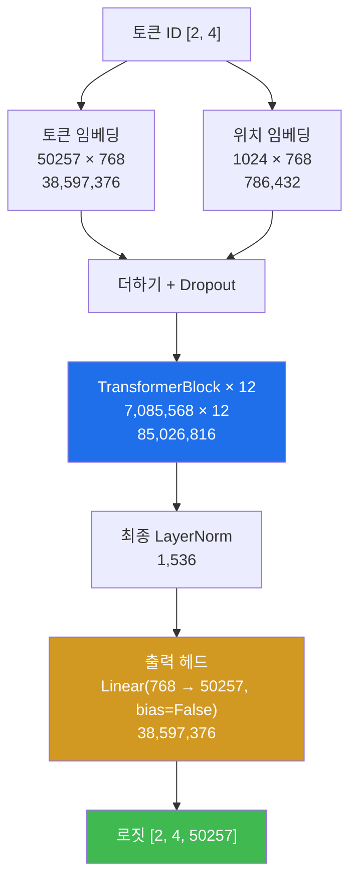
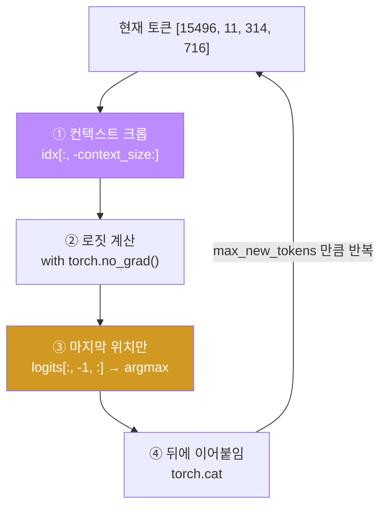

# LLM from scratch W07 — 1억 6천만 개의 무작위

> **한 줄 요약** — 부품이 다 모였다. 이번 주는 임베딩 + TransformerBlock 12개 + 최종 LayerNorm
> + 출력 헤드를 조립해 **GPT-2 를 완성**한다. 그리고 즉시 **파라미터 분해표**를 만들어
> 163,009,536 이라는 숫자를 "외우는" 게 아니라 **"재구성"** 할 수 있게 만든다. 무작위 가중치
> 모델에게 말을 시켜 보고("Hello, I am Featureiman Byeswickattribute argue"), 훈련 전 모델의
> 자신감이 얼마나 낮은지 확률로 확인한다.

---

## 학습 목표

1. 학생은 GPTModel 을 조립하고 출력 shape `[2, 4, 50257]` 의 세 차원 의미를 각각 설명할 수 있다.
2. 학생은 전체 파라미터 **163,009,536** 을 5행 분해표로 재구성할 수 있다.
3. 학생은 weight tying 시 파라미터가 **124,412,160** 이 되는 것을 확인하고 "GPT-2 124M" 이름의 유래를 설명할 수 있다.
4. 학생은 float32 메모리 **621.83MB** 를 손계산하고, "모델 적재"와 "훈련"의 메모리가 다르다는 것을 인지할 수 있다.
5. 학생은 greedy 생성 루프를 구현하고 정답지 문자열을 정확히 재현할 수 있다.
6. 학생은 훈련 전 모델의 최고 확률이 균등분포보다 겨우 10배 수준임을 관찰하고 해석할 수 있다.
7. 학생은 GPT-2 4가지 크기의 파라미터를 계산해 통칭(124M/355M/774M/1.5B)과 대조할 수 있다.

---

## 0. 용어 해설

| 용어 | 영문 | 쉽게 말하면 | 비유 |
|------|------|------------|------|
| **로짓** | Logits | softmax 전의 점수 | 채점 전 원점수 |
| **출력 헤드** | Output Head | 768차원 → 어휘 50,257 점수 | 최종 투표용지 |
| **weight tying** | Weight Tying | 입력 임베딩과 출력 헤드가 **같은 행렬** | 사전 한 권을 양방향으로 |
| **greedy 디코딩** | Greedy Decoding | 매번 최고 점수 토큰만 선택 | 항상 1등만 뽑기 |
| **컨텍스트 크롭** | Context Crop | 입력이 길면 앞을 자름 | 시야 밖은 버림 |
| **분해표** | Breakdown Table | 파라미터를 구성 요소별로 나눈 표 | 원가 명세서 |
| **누적 합계** | Cumulative Sum | 위에서부터 더해 내려온 값 | 소계 |
| **자신감** | Confidence | 최고 확률 토큰의 확률값 | 확신의 정도 |
| **균등분포** | Uniform | 모든 후보가 같은 확률 | 완전 무작위 |

---

## 0.5 신입생을 위한 핵심 개념

### 조립도 — 6주 동안 만든 것이 여기 다 들어간다



| 주차 | 만든 것 | 여기서의 위치 |
|---|---|---|
| W03 | 토큰·위치 임베딩 | 입구 |
| W04·W05 | MultiHeadAttention | 블록 안 |
| W06 | LayerNorm / GELU / FFN / 잔차 | 블록 안 + 최종 LN |
| **W07** | **조립 + 출력 헤드 + 생성** | 전체 |

### 이번 주의 목표는 "외우기"가 아니라 "재구성"

163,009,536 이라는 숫자를 외울 필요는 없습니다. 대신 **백지에서 다시 만들어낼 수 있어야**
합니다. 그래서 분해표를 만듭니다.

| 구성 요소 | 산식 | 파라미터 수 | 누적 합계 |
|---|---|---|---|
| 토큰 임베딩 | 50,257 × 768 | 38,597,376 | 38,597,376 |
| 위치 임베딩 | 1,024 × 768 | 786,432 | **39,383,808** |
| TransformerBlock × 12 | 7,085,568 × 12 | 85,026,816 | **124,410,624** |
| 최종 LayerNorm | 768 × 2 | 1,536 | **124,412,160** |
| 출력 헤드 | 768 × 50,257 | 38,597,376 | **163,009,536** |

> 📌 **누적 합계 열을 눈여겨 보세요.** 출력 헤드 **직전** 누적값이 **124,412,160** 입니다.
> 이 숫자가 다음 절의 핵심입니다.

---

## 1. 미션 1 — GPTModel 조립과 파라미터 분해

**📋 실행 프롬프트 P7-1**

```text
[목표] GPTModel 구현 (교재 4.6절과 동일 동작)
[할 일] week07/gpt_model.py 작성:
 1. GPTModel(cfg): 토큰 임베딩(50257×768) + 위치 임베딩(1024×768) →
    드롭아웃 → TransformerBlock 12개(nn.Sequential) → 최종 LayerNorm →
    출력 헤드 Linear(768→50257, bias=False)
 2. torch.manual_seed(123)으로 GPT_CONFIG_124M 인스턴스 생성
 3. "Every effort moves you"와 "Every day holds a"를 tiktoken으로 인코딩해
    [2, 4] 배치를 만들고 모델 통과 → 출력 shape 확인
 4. 전체 파라미터 수 출력
[검증] 출력 shape의 세 차원이 각각 무엇을 의미하는지 한 줄씩 설명할 것
```

**예상 결과 (정답지):** 출력 shape **`[2, 4, 50257]`**, 전체 파라미터 **163,009,536개**.

### 1.1 출력 shape 세 차원의 의미

| 차원 | 값 | 의미 |
|---|---|---|
| 0 | 2 | **배치** — 동시에 처리한 문장 수 |
| 1 | 4 | **토큰 위치** — 각 문장의 토큰 수 |
| 2 | 50,257 | **어휘 로짓** — 각 위치에서 "다음 토큰이 무엇일까"의 점수 |

**중요:** 모델은 마지막 위치뿐 아니라 **모든 위치에서** 다음 토큰을 예측합니다. 그래서 훈련
때 한 시퀀스로 4개의 학습 신호를 동시에 얻습니다(3주차의 시프트 라벨과 연결됩니다).

**✅ 검증 프롬프트 V7-1**

```text
전체 파라미터 163,009,536개를 구성 요소별로 분해한 표를 week07/param_breakdown.md 로 만들어줘.
[형식] 구성 요소 | 산식 | 파라미터 수 | 누적 합계
[제약] 각 행의 파라미터 수는 모델에서 실제로 세어 확인하고, 산식 계산치와 일치하는지
      별도 열로 표시. 총합이 163,009,536과 일치해야 한다
```

**분해표는 이럴 때를 위한 것입니다.** 총합이 안 맞으면 **어긋난 행을 찾아 역추적**하면 됩니다.
"어딘가 틀렸다"가 아니라 "3번 행이 틀렸다"를 알 수 있습니다.

---

## 2. 미션 2 — "124M"의 진실: weight tying과 메모리

**📋 실행 프롬프트 P7-2** (요지)

```text
[목표] weight tying 적용 시 파라미터·메모리 변화 확인
[할 일]
 1. 출력 헤드의 weight 를 토큰 임베딩의 weight 와 공유(tying)했을 때의 파라미터 수 계산
 2. float32 기준 모델 메모리를 MB 로 계산
[검증] tying 후 값이 분해표의 어느 값과 일치하는지 짚을 것
```

**예상 결과 (정답지):** tying 시 **124,412,160개**.

### 2.1 이 숫자가 어디서 왔나 — 뺄셈이 아니다

```
163,009,536 − 38,597,376 = 124,412,160
```

계산은 이렇게 되지만, **분해표에서는 그냥 읽힙니다.** 위 표의 "출력 헤드 직전 누적값"이 정확히
**124,412,160** 입니다. 출력 헤드를 임베딩과 공유하면 그 행이 사라지므로, 누적값이 그대로
총합이 됩니다.

**이것이 "GPT-2 124M" 이라는 이름의 유래입니다.**

### 2.2 왜 공유해도 되는가

| 행렬 | 역할 | 크기 |
|------|------|------|
| 토큰 임베딩 | 토큰 ID → 768차원 벡터 | 50,257 × 768 |
| 출력 헤드 | 768차원 벡터 → 토큰 ID 점수 | 768 × 50,257 |

**서로 전치 관계**입니다. "이 단어의 벡터는 무엇인가"와 "이 벡터는 어떤 단어에 가까운가"는
같은 사전을 양방향으로 쓰는 것이라고 볼 수 있습니다. 3,860만 파라미터를 아끼고 성능도
비슷하거나 낫다는 것이 경험적으로 알려져 있습니다.

> ⚠️ **주의:** OpenAI 의 GPT-2 공식 가중치는 tying 을 씁니다. 그래서 10주차에서 가중치를
> 이식할 때 출력 헤드에 토큰 임베딩을 그대로 넣습니다.

### 2.3 메모리 손계산

> `163,009,536 × 4 바이트 ÷ 1024² = ` **621.83 MB** (float32)
> bf16 이면 절반인 약 **310.9 MB**

**직접 계산해 대조하세요.** 128GB 통합 메모리에 몇 개나 들어갈지 감을 잡아 보세요.

> 🔴 **단, "모델 적재"와 "훈련"의 메모리는 전혀 다른 이야기입니다.**
> 훈련에는 가중치 + 기울기(같은 크기) + AdamW 모멘텀 2벌(같은 크기 × 2) + 활성값이 필요합니다.
> 대략 **가중치의 4배 이상**입니다. 9주차에서 직접 계산하고 몸으로 확인합니다.

---

## 3. 미션 3 — 생성 함수: 무작위 가중치의 목소리

**📋 실행 프롬프트 P7-3**

```text
[목표] generate_text_simple 구현과 훈련 전 생성 관찰 (교재 4.7절)
[할 일] week07/generate.py 작성:
 1. generate_text_simple(model, idx, max_new_tokens, context_size):
    루프마다 ① 입력을 context_size 이내로 뒤에서 자르고 ② 로짓 계산
    ③ 마지막 위치 로짓의 argmax를 뽑아 ④ idx 뒤에 이어붙임. torch.no_grad() 사용
 2. torch.manual_seed(123) → GPT_CONFIG_124M 모델 생성 → model.eval()
 3. "Hello, I am"을 인코딩해 6개 토큰 생성 후 디코딩해 출력
[검증] 생성 전 인코딩된 시작 토큰 ID 리스트와, 생성 후 전체 토큰 수를 함께 출력할 것
```

**예상 결과 (정답지):**

```
시작 토큰 : [15496, 11, 314, 716]  (4개)
생성 후   : 10개
디코딩    : "Hello, I am Featureiman Byeswickattribute argue"
```

시드 123 → 모델 생성 → eval 순서가 지켜졌을 때의 값입니다. **다르면 시드 호출 위치부터
의심하세요.**

### 3.1 greedy 생성 루프 4단계



**왜 마지막 위치만 쓰는가.** 인과 마스크 때문에 **마지막 위치만이 전체 시퀀스를 다 본 유일한
위치**입니다(5주차 인과성). 앞쪽 위치들은 아직 뒷부분을 못 봤으니 다음 토큰 예측에 쓸 수
없습니다. 이 논리는 11주차 "왜 마지막 토큰의 로짓으로 분류하는가"에서 그대로 회수됩니다.

### 3.2 왜 이런 말이 나오나

`"Featureiman Byeswickattribute argue"` 는 뜻이 없는 단어들의 나열입니다. 당연합니다 —
**가중치가 전부 무작위**이기 때문입니다. 아직 아무것도 배우지 않았습니다.

**중요한 것은 이 문자열이 정확히 재현된다는 사실입니다.** 같은 시드로 같은 구조를 만들면
같은 무작위 가중치가 나오고, greedy 는 결정적이므로 같은 출력이 나옵니다. **재현되지 않는다면
구조나 시드 위치가 교재와 다른 것입니다.** 이 문자열은 매우 강력한 게이트입니다.

---

## 4. 미션 4 — 훈련 전 모델의 "자신감"

**📋 실행 프롬프트 P7-4** (요지)

```text
[목표] 훈련 전 모델의 예측 확률 분포 관찰
[할 일] 마지막 위치 로짓에 softmax를 적용해 최고 확률과 그 토큰을 출력하고,
       균등분포(1/50257)와 비교해 몇 배인지 계산
[검증] "훈련 전인데 왜 완전한 균등분포가 아닌가"를 설명할 것
```

**예상 결과 (실측):**

| 항목 | 값 |
|------|-----|
| 최고 확률 | **0.0205%** |
| 균등분포 (1/50257) | 0.00199% |
| 배율 | 약 **10.3배** |

**해석.** 1%에 **한참** 못 미칩니다. 훈련 전 모델은 사실상 아무것도 모릅니다.
다만 완전한 균등분포도 아닙니다 — 무작위 가중치도 우연히 어떤 토큰에 조금 더 큰 점수를
주기 때문입니다. 이 "10배"는 지식이 아니라 **잡음**입니다.

> 🔗 **9주차에서 이 값이 어떻게 변하는지 보게 됩니다.** 훈련이 진행되면 최고 확률이
> 수십 %까지 올라갑니다. 그것이 "학습"의 눈에 보이는 형태입니다.

---

## 5. 미션 5 — 스케일 감각: small부터 XL까지 (연습문제 4.2)

**📋 실행 프롬프트 P7-5** (요지)

```text
[목표] GPT-2 4가지 크기의 파라미터 수 비교
[할 일] emb_dim/n_layers/n_heads 를 바꿔 4개 설정의 파라미터 수를 계산해 표로 저장:
 small(768/12/12), medium(1024/24/16), large(1280/36/20), xl(1600/48/25)
 각각 전체 파라미터와 weight tying 적용 시 파라미터를 병기
[검증] tying 값이 통칭(124M/355M/774M/1.5B)과 부합하는지 확인할 것
```

**예상 결과 (실측):**

| 설정 | emb/layers/heads | 전체 파라미터 | tying 적용 | 통칭 |
|---|---|---|---|---|
| small | 768 / 12 / 12 | 163,009,536 | **124,412,160** | **124M** ✅ |
| medium | 1024 / 24 / 16 | 406,212,608 | **354,749,440** | **355M** ✅ |
| large | 1280 / 36 / 20 | 838,220,800 | **773,891,840** | **774M** ✅ |
| xl | 1600 / 48 / 25 | 1,637,792,000 | **1,557,380,800** | **1.5B** ✅ |

**모델 이름의 숫자는 tying 적용 후 값입니다.** 이제 "GPT-2 355M" 이라는 이름을 들으면
`emb_dim=1024, n_layers=24, n_heads=16` 이 떠올라야 합니다.

> 💡 **관찰:** small → xl 은 파라미터가 12.5배인데, `emb_dim` 은 2배, `n_layers` 는 4배입니다.
> 파라미터는 대체로 `n_layers × emb_dim²` 에 비례하므로 `4 × 2² = 16` 배 근처가 되고,
> 임베딩 항이 선형이라 조금 낮아집니다.

---

## 실습 안내

이번 주 실습(`lab_week07.yaml`, 7단계)은 전부 llm-lab 컨테이너 안에서 진행합니다.

### 1) 이 실습을 왜 하는가?

**모델이 완성되는 주간입니다.** 9주차에서 이 모델을 실제로 훈련하고, 10주차에서 OpenAI 의
공식 가중치를 여기에 이식하고, 11~13주차에서 이 모델을 분류기와 지시 추종 모델로 개조합니다.
그리고 8주차 중간고사의 실기 범위가 정확히 이 조립 과정입니다.

### 2) 무엇을 알 수 있는가?

- 163,009,536 이 **어디에 얼마나** 들어있는지 — 그리고 그것을 백지에서 재구성하는 법.
- "GPT-2 124M" 이라는 이름이 어디서 왔는지 — **뺄셈이 아니라 분해표에서 읽히는 값**.
- 무작위 가중치 모델의 자신감이 균등분포의 겨우 10배라는 것.

### 3) 결과 해석 (정상 vs 비정상)

| 확인 | 정상 | 비정상 → 의심할 곳 |
|------|------|-------------------|
| 출력 shape | `[2, 4, 50257]` | 다르면 출력 헤드 크기 확인 |
| 전체 파라미터 | **163,009,536** | 분해표에서 **어긋난 행을 역추적** |
| 분해표 각 행 | 38,597,376 / 786,432 / 85,026,816 / 1,536 / 38,597,376 | 블록 행이 다르면 `n_layers` 또는 `qkv_bias` |
| tying | **124,412,160** | 출력 헤드 직전 누적값과 같아야 함 |
| 메모리 | **621.83 MB** | 163,009,536 × 4 ÷ 1024² |
| 시작 토큰 | `[15496, 11, 314, 716]` | 다르면 tiktoken 인코딩 확인 |
| 생성 문자열 | `"Hello, I am Featureiman Byeswickattribute argue"` | **시드 호출 위치**부터 의심 |
| 최고 확률 | 1%에 **한참** 못 미침 | 수십 %면 이미 훈련된 가중치 |
| 4크기 tying | 124M / 355M / 774M / 1.5B | 통칭과 어긋나면 설정 오타 |

### 4) 실전 활용

파라미터 분해표는 실무에서 **"이 모델이 왜 이만큼 메모리를 먹는가"** 를 설명하는 도구입니다.
그리고 weight tying, 4배 확장, pre-norm 같은 선택들은 지금도 대부분의 오픈 LLM 이 따르는
설계입니다. 이 표 하나를 읽을 수 있으면 새 모델의 config.json 을 보고 규모를 추정할 수 있습니다.

---

## 흔한 오해

- ❌ **"163,009,536 을 외워야 한다"** → 재구성할 수 있으면 됩니다. 그게 분해표의 목적입니다.
- ❌ **"124M 은 163M 에서 뺀 값"** → 계산은 맞지만, **분해표에서 그냥 읽히는 값**입니다.
  출력 헤드 직전 누적값입니다.
- ❌ **"모델이 621MB 면 훈련도 그 정도"** → 훈련에는 **4배 이상** 듭니다(기울기 + 모멘텀 2벌).
  9주차에서 확인합니다.
- ❌ **"생성 결과가 이상한 건 버그"** → 무작위 가중치니까 당연합니다. **문자열이 정확히
  재현되는지**가 검증 포인트입니다.
- ❌ **"모든 위치의 로짓을 다 써야 한다"** → 생성 시에는 **마지막 위치만** 씁니다. 인과 마스크
  때문에 그 위치만 전체를 봤습니다.
- ❌ **"훈련 전이면 확률이 정확히 균등분포"** → 아닙니다. 무작위 가중치도 우연한 편향을
  만들어 약 10배 차이가 납니다. 그건 **잡음**입니다.

---

## 다음 주차 예고 — W08 중간고사

8주차는 시험입니다. **"설명할 수 없으면 만든 것이 아니다"** 가 기준입니다.
이론(백지에서 분해표 재구성, 인과 마스크의 수학), 실기(제한 시간 내 조립 + 버그 은행 진단),
구술(본인 코드의 특정 라인을 지목해 설명) 세 가지로 평가합니다. 특히 **버그 은행** — 미묘하게
틀린 구현 12종을 준비해 두었고, 5주차 함정 카드가 그 예고편이었습니다. 준비 전략은
"에이전트로 복습하기"입니다 — 에이전트에게 문제를 내게 하고 여러분이 푸는 방식입니다.
