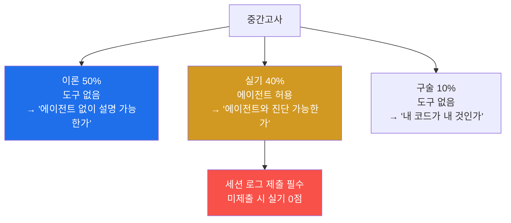
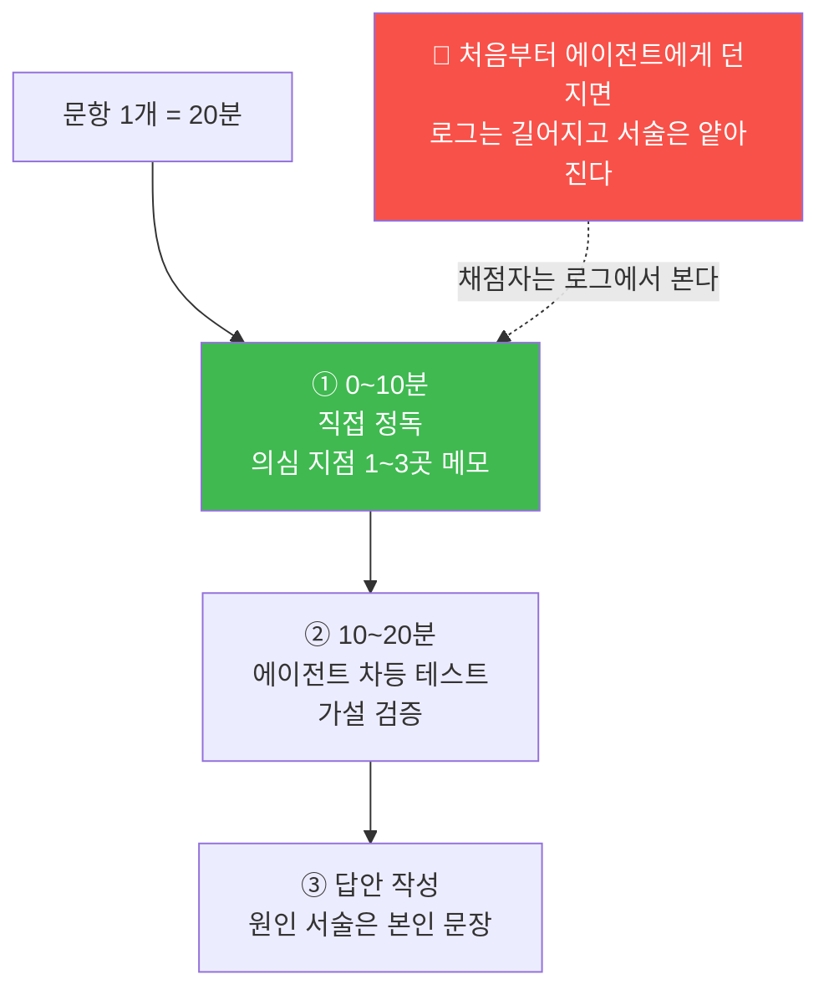

# W08 — 중간고사: 설명할 수 없으면 만든 것이 아니다

> **한 줄 요약** — 이번 주는 미션이 아니라 시험이다. 이 시험은 두 질문에 답한다:
> **① 에이전트 없이도 설명할 수 있는가**(이론·구술) **② 에이전트와 함께 진단할 수 있는가**(실기).
> 그리고 복습 방식도 바뀐다 — 지금까지는 에이전트가 만들고 여러분이 검증했다면,
> **복습에서는 에이전트가 출제하고 여러분이 답한다.**

---

## 학습 목표

1. 학생은 2~7주차 핵심 개념을 **책을 덮고** 설명할 수 있는지 자가 점검할 수 있다.
2. 학생은 버그가 심긴 코드에서 **위치를 특정하고 원인을 자기 문장으로 서술**할 수 있다.
3. 학생은 학기 동안 쌓은 자산(성질 테스트, 정답지 수치, 분해표)을 **진단 도구로 재사용**할 수 있다.
4. 학생은 "직접 정독 → 에이전트 차등 테스트" 순서로 시간을 배분할 수 있다.
5. 학생은 에이전트에게 **출제·채점**을 시키되 답을 먼저 말하지 못하게 제약을 걸 수 있다.
6. 학생은 자기 저장소의 임의 파일을 **소유권 있게** 설명할 수 있다.

---

## 0. 용어 해설

| 용어 | 영문 | 쉽게 말하면 | 비유 |
|------|------|------------|------|
| **버그 은행** | Bug Bank | 출제용으로 준비된 미묘한 버그 모음 | 문제 은행 |
| **차등 테스트** | Differential Testing | 기준 구현과 대조해 분기 지점 찾기 | 정품과 대조 |
| **분기 지점** | Divergence Point | 두 구현의 값이 처음 달라지는 곳 | 갈림길 |
| **소유권** | Ownership | 내 코드를 내 것으로 설명하는 능력 | 내가 지은 집의 도면 |
| **학기 자산** | — | 그동안 만든 테스트·수치·표 | 연장 가방 |
| **조용한 버그** | Silent Bug | 오류 없이 값만 틀리는 버그 | 무증상 감염 |

---

## 1. 시험 개요

| 구분 | 형식 | 배점 | 시간 | 도구 |
|---|---|---|---|---|
| **이론** | 지필 (워크북 변형 + 서술) | **50%** | 60분 | 도구 없음 |
| **실기** | 버그 삽입 코드 3개 디버깅 | **40%** | 60분 | **코딩 에이전트 허용** (웹 검색 금지) |
| **구술** | 자기 저장소 랜덤 파일 설명 | **10%** | 1인 5분 | 도구 없음 |

- **범위:** 2~7주차 (교재 2~4장 + 수업 실험 전체)
- **실기 채점의 절반은 "서술"이다** — 고치는 것은 에이전트가 해도, **왜 틀렸고 왜 이 수정이
  옳은지는 여러분의 문장**으로 평가한다.



---

## 2. 이론 시험 — 범위 자가점검 체크리스트

시험 전에 아래 항목을 **"책을 덮고"** 설명할 수 있는지 점검하라. 설명이 막히는 항목이
여러분의 복습 대상이다.

### 2~3주차 (데이터 파이프라인)

- [ ] 단순 토크나이저가 OOV에서 실패하는 이유와 `<|unk|>`·`<|endoftext|>`의 역할
- [ ] BPE가 OOV를 원리적으로 없애는 방법, 어휘 **50,257 = 256 + 50,000 + 1** 의 구성
- [ ] 한국어가 더 많은 토큰으로 쪼개지는 이유와 그 실무적 의미 (실측 **4~7배**)
- [ ] "정답 = 입력을 한 칸 민 것"인 이유 / 샘플 수 공식 **⌈(N − max_length) ÷ stride⌉**
- [ ] 임베딩 = 조회 테이블 = 원-핫 행렬곱, 위치 임베딩이 필요한 이유

### 4~5주차 (어텐션)

- [ ] 어텐션 3단계(점수→softmax→가중합)를 수치 예로 재현 (`0.9544` 부터)
- [ ] Q/K/V의 역할 분담과 √d 스케일링이 필요한 이유 (**분산 ∝ d**)
- [ ] 코잘 마스크의 `-inf` 트릭 / **"0 마스킹"이 오답인 이유(e⁰=1)**
- [ ] 드롭아웃의 **1/(1−p)** 스케일링과 train/eval 차이
- [ ] 분할 방식 멀티헤드의 shape 흐름 / **헤드 수와 파라미터 수는 무관** (통념 깨기)

### 6~7주차 (블록과 모델)

- [ ] LayerNorm의 정규화 대상(**마지막 차원**)과 scale·shift의 존재 이유
- [ ] GELU와 ReLU의 차이 / **FFN(4,722,432)이 어텐션(2,360,064)의 2배**
- [ ] 잔차 연결이 기울기 소실을 막는 원리 (실측 **1,099배** 인용하면 최상)
- [ ] **163,009,536의 분해표를 백지에 재구성** / "124M" 이름의 유래
- [ ] greedy 생성 루프의 4단계와 훈련 전 모델이 헛소리를 하는 이유

---

## 3. 실기 시험 — 형식과 규칙

### 3.1 답안 4요소

2~7주차 범위의 코드에 버그가 1개씩 심긴 파일 **3개**를 받는다. 각 파일에 대해:

| # | 항목 | 배점 | 기준 |
|---|---|---|---|
| 1 | **버그 위치** | 4 | 파일명과 정확한 라인. 근처만 짚으면 부분 점수 |
| 2 | **원인 서술** | 5 | 수학·구조와 연결된 **본인의** 설명(4~6줄). 증상 나열만이면 절반 |
| 3 | **수정** | \- | 고친 코드 (에이전트 사용 가능) |
| 4 | **검증 증거** | 4 | 수정 전후를 구분하는 테스트·수치 |

**검증 증거는 학기 자산을 쓰라.** 5주차 인과성 테스트, 4주차 정답지 수치(`0.9544`, `z2`),
7주차 분해표(163,009,536), 9주차 초기 손실 게이트(`ln(50257) ± 0.5`) 등이 전부 진단 도구다.

### 3.2 규칙 — 로그가 곧 답안의 일부다

- 코딩 에이전트 사용 **가능**. 시험 종료 시 `/export` 한 **세션 로그를 답안과 함께 제출**한다.
  **로그 미제출 시 실기 0점.**
- 웹 검색·타인과의 소통 **금지**.
- 로그에서 **"원인 서술을 통째로 생성시킨" 정황**이 확인되면 해당 문항 0점.
  **진단에 쓰는 것과 서술을 대필시키는 것은 다르다.**

### 3.3 시간 배분 — 첫 10분은 직접 읽어라



5주차 함정 카드의 1단계(**직접 정독 후 메모**)와 같은 절차입니다. 그때 연습한 이유가 여기 있습니다.

---

## 4. 버그 은행 — 무엇이 나오는가

실기 문항은 아래 유형에서 나옵니다. **각 버그가 어느 주차 자산으로 잡히는지**가 핵심입니다.

| # | 대상 | 버그 | 잡는 자산 | 난이도 |
|---|---|---|---|---|
| 1 | 데이터로더 | target 을 한 칸이 아니라 **두 칸** 밀기 | W03 시프트 검증 | 쉬움 |
| 2 | 데이터로더 | range 끝을 `len(ids)` 로 잡아 마지막 청크 초과 | 경계 조건 테스트 | 쉬움 |
| 3 | 어텐션 | **√d 스케일링 생략** | W04 분산 실험 | 쉬움 |
| 4 | 어텐션 | `softmax(dim=-2)` | W04 행 합 = 1 검사 | 중간 |
| 5 | 코잘 | 마스크를 `-inf` 대신 **0으로** 채움 | W05 첫 행 `[1,0,...]` | 중간 |
| 6 | 코잘 | `tril`/`triu` 뒤바꿈 (**미래만** 보는 모델) | W05 인과성 성질 테스트 | 중간 |
| 7 | MHA | transpose 누락 후 reshape (**조용히 값만 오염**) | 차등 테스트 | 어려움 |
| 8 | 블록 | **한 층에만** 잔차 덧셈 누락 | W06 층별 노름 + W09 초기 손실 게이트 | 어려움 |
| 9 | GPT | 위치 임베딩 덧셈 누락 | W03 위치 실험 | 중간 |
| 10 | 생성 | `torch.argmax(logits.flatten(1), dim=-1)` | 즉시 `IndexError` | 어려움 |

### 4.1 8번과 10번 — 출제 검증에서 드러난 사실

> ⚠️ **이 두 문항은 "소박하게 구현하면 버그가 되지 않는다"는 것이 실측으로 확인되었습니다.**
> 출제 검증(버그 은행 10종 전수 삽입·검출 실험)에서 나온 결과입니다.

**#8 잔차 덧셈 누락 — 몇 층에 심느냐가 전부**

| 블록 수 | 정상 (입력 기울기) | 잔차 누락 | 비율 |
|---|---|---|---|
| 1 | 1.581876 | 0.802745 | 0.5075배 |
| 4 | 3.098750 | 0.971331 | 0.3135배 |
| **12** | **5.586712** | **0.863204** | **0.1545배** |

1층에서는 절반 차이라 잡기 어렵고, **12층을 쌓으면 6.5배 차이**가 나서 드러납니다.
그리고 9주차 초기 손실 게이트로도 잡힙니다:

```
게이트: ln(50257) = 10.8249 ± 0.5 → 허용 [10.3249, 11.3249]
  정상 모델      : 10.6388  → 통과
  잔차 누락 모델 : 10.3156  → FAIL (검출됨)
```

**전 층에 심으면** 손실이 눈에 띄게 발산해 누구나 "뭔가 크게 잘못됐다"고 알아채지만
**어느 층인지 특정하지 못합니다.** 그래서 **12개 블록 중 하나에만** 심고, 문제에
"12개 블록 중 하나에 심었다"를 명시합니다.

**#10 argmax 위치 — 소박한 구현은 버그가 아니다**

```python
torch.argmax(logits, dim=-1)[:, -1:]   # ← 버그가 아니다! 정답과 출력이 완전히 일치
```

마지막 시점의 argmax 를 **먼저 슬라이스하나 나중에 슬라이스하나 수학적으로 같기** 때문입니다.
진짜 버그가 되려면 **차원을 평탄화해 시점 정보를 뭉개야** 합니다:

```python
idx_next = torch.argmax(logits.flatten(1), dim=-1, keepdim=True)   # ← 진짜 버그
```

`[B, T, 50257]` 이 `[B, T×50257]` 로 평탄화되어 argmax 가 **50,257을 넘는 값**(실측 233,626)을
내고, 다음 스텝의 임베딩 조회에서 `IndexError: index out of range in self` 가 납니다.

> 📌 **이 문항의 노림수:** 학생이 오류 메시지에서 **"인덱스가 어휘 크기를 넘었다 → 그럼
> argmax 가 무엇 위에서 돌았나"** 를 역추적하게 하는 것입니다.

---

## 5. 구술 시험 — 평가 기준은 "소유권"

교수가 여러분의 저장소에서 파일 하나를 **즉석 추첨**합니다. 5분간 진행되며 전형적 질문은:

1. 이 파일은 무엇을 하고, **어느 주차의 어떤 개념**을 구현했는가?
2. (교수가 한 줄을 지목하며) **이 줄이 없으면 무슨 일이 생기는가?**
3. 이 코드를 만들 때 에이전트에게 **어떤 검증을 시켰고, 왜 그 검증을 골랐는가?**

평가 기준은 "유창함"이 아니라 **소유권**입니다 — 자기 저장소의 코드를 자기 것으로 말하는가.

---

## 6. 준비 전략 — 에이전트로 복습하기

복습에도 에이전트를 씁니다. 단, **방향이 반대**입니다.

**📋 준비 프롬프트 P8-1 — 나의 학기 지도 만들기**

```text
[목표] 시험 범위 복습 지도 생성
[할 일] 내 과제 저장소의 week02~week07 코드와 report.md를 훑고:
 1. 주차별 핵심 개념 5개씩을 뽑되, 각 개념마다 "내 저장소에서 그 개념이
    구현된 파일과 함수/클래스 이름"을 연결한 표를 만들어줘
 2. 내 report.md들에서 해석이 빈약해 보이는 부분 3곳을 지적해줘
[제약] 개념 설명을 써주지 말 것 — 위치만 연결하라. 설명은 내가 한다
```

**📋 준비 프롬프트 P8-2 — 모의 구술**

```text
[목표] 구술 시험 리허설
[역할] 너는 시험관이다. 내 저장소에서 파일 하나를 무작위로 골라
       8.4절 유형의 질문을 하나씩 던져라. 나는 답을 타이핑한다.
[규칙] 내 답을 받으면: 정확한 부분 / 틀리거나 빈 부분 / 더 깊이 물을 후속
       질문 순으로 짧게 피드백하고 다음 질문으로 넘어가라. 5문답 후
       총평과 취약 개념을 정리해줘. 먼저 답을 알려주지 말 것
```

**📋 준비 프롬프트 P8-3 — 셀프 함정 (모의 실기)**

```text
[목표] 실기 시험 모의 문제 생성
[할 일]
 1. 내 week05/multihead.py 를 week08_prep/mock_trap.py 로 복사한 뒤,
    미묘한 버그 1개를 심어라. 어디에 무엇을 심었는지 절대 알려주지 말 것
 2. 정답(버그 위치·내용)은 week08_prep/answer.md 에 저장하되
    내가 "정답 공개"라고 말하기 전에는 내용을 출력하지 말 것
 3. 원본 파일은 절대 수정 금지
[이후] 내가 버그를 찾아 보고하면 answer.md와 대조해 채점해줘
```

**✅ 준비 프롬프트 V8-1 — 개념 구멍 진단**

```text
2~7주차 범위에서 워크북 스타일 문제 10개를 출제해줘 (객관식 5 + 단답 5,
주차 고르게 분배). 한 번에 한 문제씩 내고 내 답을 받아 채점하라.
10문제 후: 점수, 주차별 정오표, 가장 취약한 주차 2개와 그 주차의
내 저장소 파일 중 다시 읽을 것을 추천해줘.
```

> 📌 **네 프롬프트의 공통 제약: 에이전트가 답을 먼저 말하지 못하게 막는다.**
> 복습 단계에서 에이전트의 가장 위험한 친절은 **"대신 설명해주기"** 입니다.

---

## 7. 시험 당일 체크리스트 (실기)

- [ ] **장비 정상 확인** (시험 시작 전 5분): 컨테이너 기동, `nvidia-smi`, pytest 동작
- [ ] **학기 자산 준비**: 내 test 파일들(인과성 테스트 등), 4·7주차 정답지 수치 — 시험 중 자유 사용
- [ ] **새 세션으로 시작** (`/clear`) — 로그가 곧 답안의 일부다
- [ ] **종료 5분 전**: `/export` → 답안과 함께 제출

---

## 실습 안내

이번 주 실습(`lab_week08.yaml`, 6단계)은 **모의 실기**입니다.

### 1) 이 실습을 왜 하는가?

시험장에서 처음 해보면 늦습니다. 버그 은행 유형을 미리 한 번씩 겪고, **어떤 자산이 어떤 버그를
잡는지** 연결해 두는 것이 목적입니다.

### 2) 무엇을 알 수 있는가?

- 내가 만든 테스트가 **실제로 버그를 잡는지**.
- "shape 는 맞는데 값이 틀린" **조용한 버그**를 차등 테스트로 좁히는 법.
- 8번·10번처럼 **소박하게 구현하면 버그가 안 되는** 경우가 있다는 것 — 즉,
  "버그를 심었다"와 "버그가 검출된다"는 다른 문제라는 것.

### 3) 결과 해석 (정상 vs 비정상)

| 확인 | 정상 | 비정상 → 의심할 곳 |
|------|------|-------------------|
| 버그 은행 10종 검출 | **10/10** | 8/10 이면 8·10번을 소박하게 구현한 것 |
| #8 12층 기울기 비율 | ~**0.15배** | 0.5배면 1층에만 쌓은 것 |
| #8 초기 손실 | 정상 10.64 / 버그 **10.32** → FAIL | 둘 다 통과면 층 수 확인 |
| #10 평탄화 argmax | **IndexError (233,626)** | 오류가 없으면 `[:, -1:]` 형태로 짠 것 |
| 인과성 테스트 (버그 6) | **실패해야 정상** | 통과하면 마스크를 안 뒤집은 것 |

### 4) 실전 활용

"내 테스트가 이 버그를 잡는가"를 확인하는 것은 실무에서 **뮤테이션 테스팅(mutation testing)**
이라고 부르는 기법입니다. 코드에 의도적으로 결함을 심어 테스트 스위트의 실효성을 측정합니다.
테스트 커버리지 100%인데 아무 버그도 못 잡는 경우가 실제로 흔합니다.

---

## 흔한 오해

- ❌ **"에이전트를 쓸 수 있으니 실기는 쉽다"** — 채점의 절반이 **본인 문장의 원인 서술**입니다.
  로그에서 대필 정황이 보이면 0점입니다.
- ❌ **"버그를 심으면 당연히 검출된다"** — 8번·10번은 소박하게 심으면 **검출되지 않습니다.**
  실측으로 확인된 사실입니다.
- ❌ **"오류가 안 나면 정상"** — 7번(transpose 누락)은 shape 도 맞고 오류도 없이 **값만
  오염**됩니다. 차등 테스트 없이는 못 찾습니다.
- ❌ **"이론은 암기 과목"** — 분해표 백지 재구성, 공식 유도, 측정 결과 해석이 나옵니다.
  외운 숫자보다 **재구성 능력**을 봅니다.
- ❌ **"구술은 말 잘하면 된다"** — 평가 기준은 **소유권**입니다. 자기 코드의 한 줄을 지목당했을 때
  "그건 에이전트가 썼는데요"는 0점 답변입니다.

---

## 다음 주차 예고 — W09 내 모델의 첫 학습

시험이 끝나면 드디어 **훈련**입니다. 지금까지 만든 모델은 무작위 가중치였습니다.
9주차는 손실 함수를 **softmax부터 ln(50257)까지** 손으로 재구성하고(초기 손실이 왜 정확히
10.79 인지), train/val 을 분리해 첫 사전 훈련을 돌립니다. 그리고 **과적합을 일부러 관찰**합니다 —
train 손실은 1 아래로 내려가는데 val 손실은 6에서 정체하다 **다시 올라갑니다.** 모델이
데이터를 "이해"한 게 아니라 **암기**했다는 물증을 직접 찾습니다.
