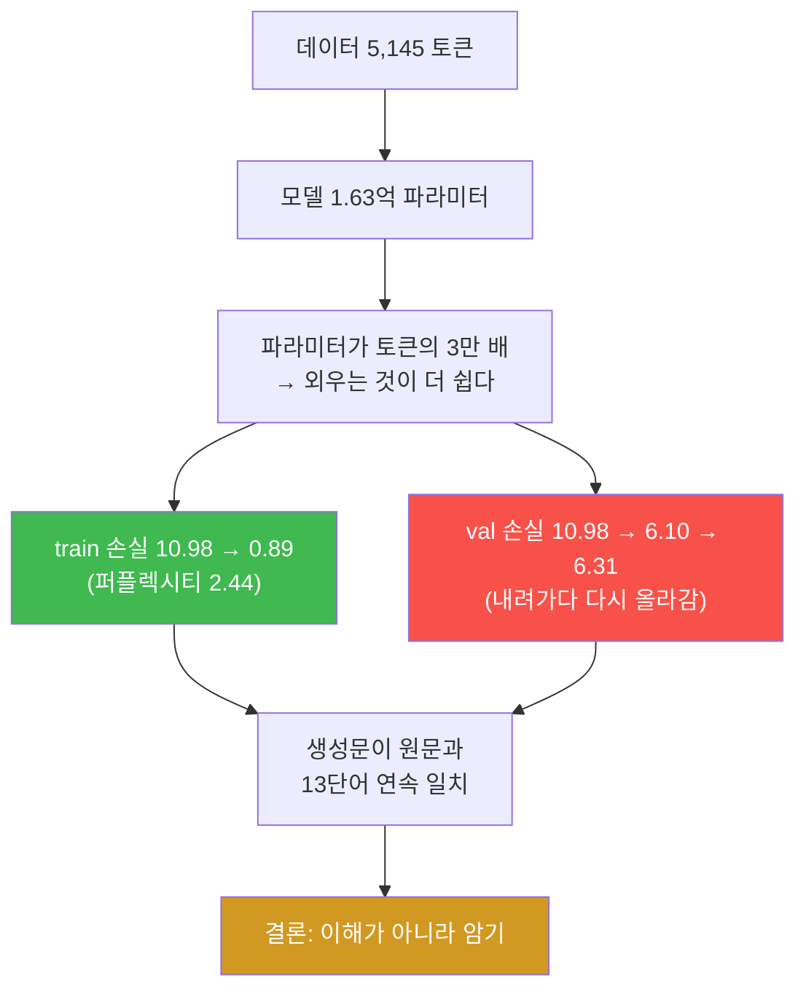
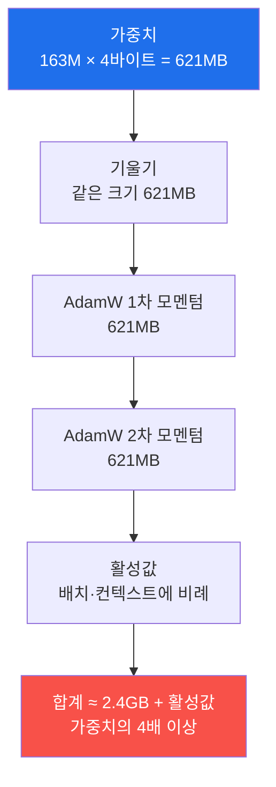
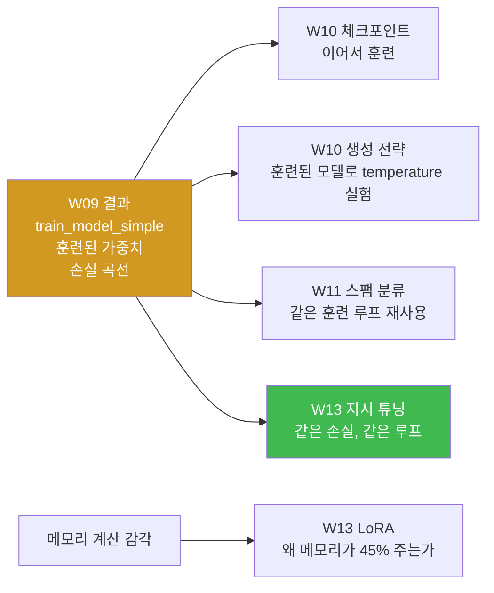

# W09 — 내 모델의 첫 학습

> **한 줄 요약** — 드디어 훈련이다. 먼저 손실 함수를 **softmax부터 ln(50257)까지** 손으로
> 재구성해 "초기 손실이 왜 하필 10.79 인지"를 이론으로 예언하고 측정으로 확인한다. 그다음
> train/val 을 나눠 10 에폭을 돌린다. 그리고 **과적합을 일부러 관찰한다** — train 손실은
> 1 아래로 내려가는데 val 손실은 6에서 정체하다 **다시 올라간다.** 모델이 데이터를 이해한 게
> 아니라 **암기**했다는 물증을 직접 찾는다.

---

## 학습 목표

1. 학생은 크로스 엔트로피를 확률 단계부터 수동 재구성해 `F.cross_entropy` 와 소수 4자리까지 일치시킬 수 있다.
2. 학생은 훈련 전 손실이 왜 `ln(vocab_size)` 근처인지 설명하고 퍼플렉시티로 해석할 수 있다.
3. 학생은 train/val 로더의 배치 수를 손계산으로 유도해 대조할 수 있다.
4. 학생은 훈련 루프를 구현하고 손실 곡선에서 **두 곡선이 갈라지는 지점**을 짚을 수 있다.
5. 학생은 생성문이 원문에 그대로 존재함을 검색으로 입증해 **암기의 물증**을 수집할 수 있다.
6. 학생은 CPU/GPU/bf16/배치 크기를 바꿔 처리량을 측정하고 "작은 배치는 GPU를 굶긴다"를 확인할 수 있다.
7. 학생은 "모델 적재 621MB"와 "훈련 메모리"가 왜 다른지 설명할 수 있다.

---

## 0. 용어 해설

| 용어 | 영문 | 쉽게 말하면 | 비유 |
|------|------|------------|------|
| **크로스 엔트로피** | Cross Entropy | 정답 토큰이 받은 확률의 −로그 평균 | 정답에 얼마나 확신 없었나 |
| **퍼플렉시티** | Perplexity | `exp(손실)` — "몇 개 후보에서 헤매는가" | 헷갈림의 개수 |
| **에폭** | Epoch | 훈련 데이터를 한 바퀴 도는 것 | 교과서 1회독 |
| **과적합** | Overfitting | 훈련 데이터만 잘하고 새 데이터는 못함 | 기출문제만 외움 |
| **AdamW** | AdamW | 모멘텀 2개를 쓰는 옵티마이저 | 관성 + 감쇠 |
| **weight decay** | Weight Decay | 가중치를 조금씩 0쪽으로 당기는 규제 | 과욕 억제 |
| **autocast / bf16** | Mixed Precision | 일부 연산을 16비트로 | 정밀도를 낮춰 속도 확보 |
| **tokens/sec** | Throughput | 초당 처리 토큰 수 | 처리 속도 |
| **활성값** | Activation | 순전파 중간 결과(역전파용 보관) | 작업 중 서류 |

---

## 0.4 이번 주 배경 지식 — 처음이라면

> 드디어 훈련입니다. 지금까지는 "모델이 계산하는 법"을 만들었고, 이번 주는 **"모델이 배우는
> 법"** 을 만듭니다. 새 개념이 넷 나옵니다 — 손실, 기울기, 옵티마이저, 과적합.

### ① 손실(loss) — 얼마나 틀렸는지를 숫자 하나로

모델은 각 자리에서 "다음 토큰이 무엇일 확률"을 5만 개 내놓습니다. 그중 **정답 토큰이 받은
확률**이 높으면 잘한 것입니다.

```
정답이 'journey' 인데
  잘한 경우:  P(journey) = 0.85   →  손실 작다
  못한 경우:  P(journey) = 0.001  →  손실 크다
```

손실은 이렇게 계산합니다.

```
손실 = −ln(정답 토큰의 확률)
```

| 정답 확률 | −ln(확률) = 손실 |
|---|---|
| 1.0 (완벽) | **0** |
| 0.5 | 0.69 |
| 0.1 | 2.30 |
| 0.0000199 (=1/50257) | **10.82** |

**왜 로그를 쓰나.** 두 가지 이유가 있습니다.

1. **곱셈을 덧셈으로.** 문장 전체의 확률은 각 토큰 확률의 **곱**인데, 0.1을 100번 곱하면
   `1e-100` 이 되어 컴퓨터가 0으로 뭉갭니다. 로그를 씌우면 덧셈이 되어 안 터집니다.
2. **틀릴수록 벌을 급격히 키운다.** 확률이 0에 가까워지면 −ln 은 무한대로 갑니다.
   "확신을 갖고 틀린 것"을 가장 세게 벌합니다.

이 손실을 **교차 엔트로피(cross entropy)** 라고 부르고, PyTorch 에서는 한 줄입니다.

```python
torch.nn.functional.cross_entropy(logits.flatten(0, 1), targets.flatten())
```

> 📌 **`flatten(0, 1)` 이 하는 일.** 로짓은 `[2, 3, 50257]`(문장 2 × 토큰 3)인데,
> `cross_entropy` 는 `[N, 어휘]` 형태를 받습니다. 그래서 앞의 두 축을 **하나로 뭉갭니다**
> → `[6, 50257]`. 어차피 각 예측은 독립적으로 채점되므로 문제없습니다.

### ② 기울기(gradient) — 어느 방향으로 고쳐야 하나

손실이 크다는 건 알았는데, **1억 6천만 개 중 어느 숫자를 어느 쪽으로 얼마나** 움직여야
할까요? 그걸 알려 주는 것이 기울기입니다.

> **기울기 = "이 숫자를 아주 조금 키우면 손실이 얼마나 변하는가"**

기울기가 양수면 그 숫자를 **줄여야** 손실이 줍니다. 음수면 키워야 합니다.
**안개 속 산에서 발밑 경사를 더듬어 내려가는 것**과 같습니다.

PyTorch 가 이걸 자동으로 계산해 줍니다(자동미분). 여러분이 쓰는 것은 세 줄입니다.

```python
optimizer.zero_grad()   # ① 지난번 기울기를 지운다  ← 빠뜨리면 누적된다
loss.backward()         # ② 모든 파라미터의 기울기를 계산
optimizer.step()        # ③ 그 방향으로 조금 움직인다
```

> 🔴 **`zero_grad()` 를 빠뜨리는 것이 초보자 1순위 실수입니다.** PyTorch 는 기울기를
> **더합니다**(누적). 안 지우면 지난 배치의 기울기가 남아서 학습이 이상해집니다.
> 그런데 **오류가 안 납니다.** 손실이 안 내려가는 형태로만 나타납니다.

### ③ 옵티마이저와 학습률

기울기 방향으로 **얼마나** 움직일지 정하는 것이 **학습률**(learning rate)입니다.

| 학습률 | 결과 |
|---|---|
| 너무 크다 | 최저점을 뛰어넘어 왔다 갔다. 손실이 발산 |
| 너무 작다 | 거의 안 움직임. 100 에폭 돌려도 제자리 |
| 적당 (`4e-4`) | 안정적으로 내려감 |

**AdamW** 는 그냥 기울기 방향으로 가는 게 아니라 **관성**을 씁니다. 파라미터마다 과거 기울기의
평균(1차 모멘텀)과 제곱 평균(2차 모멘텀)을 기억해서, 자주 흔들리는 방향은 조심스럽게,
꾸준한 방향은 과감하게 움직입니다.

> ⚠️ **이 "기억"이 메모리를 먹습니다.** 파라미터마다 상태가 **2개** 더 붙습니다.
> 그래서 모델 적재는 621MB 인데 훈련에는 그 몇 배가 필요합니다. 미션 4의 해석 과제가 이것입니다.
>
> ```
> 훈련 메모리 ≈ 파라미터 + 기울기 + AdamW 상태 2개 + 활성값
>              = 파라미터당 4바이트 × 4벌 + α
> ```

### ④ train / val 분리와 과적합

데이터를 전부 훈련에 쓰면, 모델이 **잘 배운 것**인지 **외운 것**인지 구별할 방법이 없습니다.
그래서 일부를 떼어 놓고 **채점 전용**으로 씁니다.

| 이름 | 비율(이번 주) | 쓰임 |
|---|---|---|
| **train** | 90% | 파라미터를 고치는 데 쓴다 |
| **val**(검증) | 10% | 고치는 데 **안 쓰고** 채점만 한다 |

**과적합**은 train 손실은 계속 내려가는데 **val 손실은 내려가다 다시 올라가는** 현상입니다.
교과서를 통째로 외운 학생이 모의고사 문제는 다 맞고 실제 시험은 틀리는 것과 같습니다.

```
train:  10.98 → 0.89    계속 내려간다  (외우고 있다)
val:    10.98 → 6.10 → 6.31   내려가다 올라간다  ← 과적합 시작
```

> 📌 **이번 주는 과적합을 일부러 관찰합니다.** 데이터 5,145 토큰에 파라미터 1.63억 —
> 파라미터가 토큰의 **3만 배**입니다. 이 조건에서 모델은 이해하는 것보다 **외우는 것이
> 훨씬 쉽습니다.** 그게 정상이고, 그걸 물증으로 잡는 것이 이번 주 미션입니다.

---

## 0.5 신입생을 위한 핵심 개념

### 손실이 왜 하필 10.79 인가 — 이론으로 예언하기

훈련 전 모델은 아무것도 모릅니다. 그러면 50,257개 토큰에 **균등하게** 확률을 나눠 줄 것입니다.

```
정답 토큰이 받는 확률 ≈ 1/50257 = 0.0000199
손실 = −ln(1/50257) = ln(50257) = 10.8249
퍼플렉시티 = exp(10.8249) = 50,257   ← 어휘 크기 자체!
```

**측정하면 10.7940 이 나옵니다.** 이론 예언 10.8249 와 0.03 차이입니다.
(무작위 가중치가 완전 균등은 아니라 아주 조금 낮습니다 — 7주차에서 본 "10배 잡음"의 결과입니다.)

> 📌 **이것이 이 수업이 가르치는 사고방식입니다.** 숫자를 보고 놀라는 게 아니라, **먼저
> 예언하고 나서 측정으로 확인**합니다. 예언과 다르면 그때 무언가를 배웁니다.

### 퍼플렉시티 — 손실을 사람 말로

| 손실 | 퍼플렉시티 | 의미 |
|---|---|---|
| 10.82 | 50,257 | 어휘 전체에서 헤맴 (아무것도 모름) |
| 6.31 | 551 | 551개 후보에서 헤맴 |
| **0.89** | **2.44** | **후보 3개 미만에서 고민** ← 사실상 안다 |

**퍼플렉시티 = "몇 개 중에서 고민하는가"** 입니다. 손실 1 미만은 퍼플렉시티 2.7 이하 —
5만 개 어휘 중에서 다음 토큰을 거의 **알고 있는** 상태입니다.

### 이번 주의 클라이맥스 — 과적합을 물증으로 잡기



---

## 1. 미션 1 — 손실 해부: softmax부터 ln(50257)까지

**📋 실행 프롬프트 P9-1** (요지)

```text
[목표] 크로스 엔트로피를 확률 단계부터 수동 재구성 (교재 5.1.2절)
[할 일] week09/loss_anatomy.py:
 1. context_length 를 256 으로 줄인 config 로 모델 생성 (시드 123, eval)
 2. 예제 배치 inputs/targets 로 로짓 → softmax → 정답 토큰 확률 추출
 3. −log 후 평균으로 수동 손실 계산
 4. F.cross_entropy(logits.flatten(0,1), targets.flatten()) 와 대조
 5. 퍼플렉시티 = exp(손실) 출력
[검증] 수동과 자동이 소수 4자리까지 일치하는지, ln(50257) 과 얼마나 다른지 보고
```

**예상 결과 (정답지):**

| 항목 | 값 |
|------|-----|
| 수동 손실 | **10.7940** |
| `F.cross_entropy` | **10.7940** |
| 퍼플렉시티 | **48,725.82** (≈ 48,726) |
| `ln(50257)` (이론) | 10.8249 |
| 차이 | 0.0309 |

### 1.1 `flatten(0, 1)` 이 왜 필요한가

`F.cross_entropy` 는 `(N, C)` 모양의 로짓과 `(N,)` 모양의 정답을 받습니다.
그런데 우리 로짓은 `[2, 3, 50257]` 입니다.

```
logits.flatten(0, 1)  → [6, 50257]   (배치 2 × 토큰 3 = 6개 예측)
targets.flatten()     → [6]
```

**배치와 토큰 축을 하나로 뭉갭니다.** 어차피 각 예측은 독립적으로 채점되므로 문제없습니다.
"6개 문제를 한 줄로 세워 채점한다"고 생각하면 됩니다.

### 1.2 왜 context_length 를 1024 → 256 으로 줄이나

훈련 데이터가 5,145 토큰뿐입니다. 컨텍스트를 1024로 두면 샘플이 4개밖에 안 나옵니다.
256으로 줄이면 20개가 나옵니다. **위치 임베딩 파라미터도 786,432 → 196,608 로 줄어** 훈련이
가벼워집니다.

> ⚠️ 이 설정 변경 때문에 모델 파라미터 총계가 7주차의 163,009,536 과 달라집니다.
> **정답지 수치는 항상 "어떤 설정에서"인지 함께 기억하세요.**

**✅ 검증 프롬프트 V9-1** → pytest 2개 (수동==내장, 초기 손실이 `ln(50257) ± 0.5`)

---

## 2. 미션 2 — 데이터 분리와 로더 구성

**📋 실행 프롬프트 P9-2** (요지)

```text
[목표] train/val 분리와 로더 구성 (교재 5.1.3절)
[할 일]
 1. the-verdict.txt 를 90:10 으로 분할 (문자 기준)
 2. week03 의 create_dataloader_v1 재사용:
    train — batch_size=2, max_length=256, stride=256, shuffle=True, drop_last=True
    val   — batch_size=2, max_length=256, stride=256, shuffle=False, drop_last=False
 3. 각 로더의 배치 수·shape·커버 토큰 수 출력
 4. calc_loss_batch, calc_loss_loader 구현
 5. 훈련 전 train/val 손실을 GPU 에서 계산해 출력
[검증] 배치 수를 데이터 크기에서 손계산으로도 유도해 대조할 것
```

**예상 결과 (정답지):**

| 로더 | 배치 수 | shape | 커버 토큰 |
|---|---|---|---|
| train | **9** | `[2, 256]` | **4,608** |
| val | **1** | `[2, 256]` | **512** |

훈련 전 손실: train **10.9876** / val **10.9811** — 미션 1의 이론 예언(≈10.8)과 같은 동네입니다.

> 💡 **`stride = 256 = max_length`** 는 3주차 그리드 실험에서 **"중복 0"** 이던 그 설정입니다.
> 데이터가 이렇게 적은데 왜 중복을 늘리지 않았을까요? 이번 주 끝에서 과적합을 본 뒤 다시
> 생각해 보세요.

---

## 3. 미션 3 — 첫 사전 훈련: 곡선과 물증

**📋 실행 프롬프트 P9-3** (요지)

```text
[목표] 훈련 루프 구현과 10 에폭 사전 훈련 (교재 5.2절)
[할 일]
 1. train_model_simple(...): 배치마다 기울기 초기화 → 손실 → 역전파 → step,
    tokens_seen 누적, eval_freq 마다 train/val 손실 기록, 에폭 끝마다 50토큰 생성
 2. 시드 123 → 모델 → device → AdamW(lr=4e-4, weight_decay=0.1) → 10 에폭
 3. week09/loss_curve.png 생성 (두 곡선이 갈라지는 지점에 세로 점선과 주석)
 4. week09/model_10ep.pth 저장
[검증] 에폭별 생성 문장을 순서대로 나열해 "헛소리 → 문장 형태 → 원문 비슷"의 변화 관찰 보고
```

### 3.1 에폭별 생성문 — 학습의 눈에 보이는 형태

| 에폭 | 생성문 (앞부분) |
|---|---|
| 1 | `Every effort moves you,,,,,,,,,,,,.` |
| 2 | `Every effort moves you, and,, and,,,,,,, and,.` |
| 3 | `... and, and the to the of the to the to the of the ... Stroud, an` |
| 5 | `... I had the picture--as of the picture--as I had been the of the fact` |
| 7 | `... know the picture, and pushed one of the deep arm-chairs.  "I turned, and I w` |
| **10** | **`Every effort moves you?"  "Yes--quite insensible to the irony. She wanted him vindicated--and by me!"`** |

**변화의 순서를 보세요.** ① 쉼표만 반복 → ② 흔한 단어(`and`, `the`) → ③ 구문 형태 →
④ 원문 문장. 모델은 **빈도가 높은 것부터** 배웁니다.

### 3.2 손실 곡선 — 두 곡선이 갈라진다

| 항목 | 값 |
|---|---|
| 최종 train 손실 | **0.8908** (퍼플렉시티 **2.44**) |
| 최종 val 손실 | **6.3130** (퍼플렉시티 **551.69**) |
| val 최소값 | **6.0994** (에폭 7.1) |
| 최소 이후 **상승폭** | **+0.2136** |

**val 손실이 내려가다 멈추고 다시 올라갑니다.** 이것이 과적합의 교과서적 그림입니다.

### 3.3 암기의 물증 — "비슷해 보인다"로는 부족하다

**✅ 검증 프롬프트 V9-2** (요지)

```text
[목표] 과적합 물증 수집
[할 일] 훈련된 모델로 "Every effort moves you" 에서 50토큰 greedy 생성 후:
 1. 생성문을 6~8단어 조각으로 잘라 각 조각이 the-verdict.txt 원문에 그대로 존재하는지 검색
 2. week09/overfit_evidence.md 에 표로 정리 (조각 | 존재 여부 | 원문 오프셋)
 3. train 손실 1 미만이 퍼플렉시티로 몇 이하인지 계산해 추가
[검증] 원문과 일치한 조각의 비율과 최장 연속 일치 길이를 명시할 것
```

**통과 기준:** **최장 연속 일치 구간이 10단어 이상.**
(참고 실측: **11~13단어**. 조각 비율은 어떻게 자르느냐에 따라 22%~44% 로 흔들리므로
**최장 연속 길이가 더 신뢰할 수 있는 지표**입니다.)

> 🔴 **최장 연속 일치를 요구하는 이유.** 조각 비율만 보면 "흔한 표현이 우연히 겹쳤다"는 반론이
> 가능합니다. **13단어가 연속으로 일치하는 것은 우연일 수 없습니다.**
>
> 그리고 실측에서 모델은 원문 오프셋 13,218 구간을 재현한 뒤 **멀리 떨어진 오프셋 14,294
> 구간으로 건너뛰어 이어 붙였습니다** — 서로 떨어진 두 구절을 각각 외워 봉합한 것입니다.
> **이것이 "이해가 아니라 암기"의 가장 강한 형태의 증거입니다.**

**해석 과제 (report.md 에 **직접** 작성):** val 손실이 내려가다 멈추고 train 과 벌어지는 이유를
**데이터 크기(5,145 토큰)와 모델 크기(1.63억 파라미터)의 대비**로 3~5문장 설명하라.

---

## 4. 미션 4 — 속도 실험: Spark의 첫 몸풀기

**📋 실행 프롬프트 P9-4** (요지)

```text
[실험 A — 장치 비교] 동일 설정(1 에폭, batch=2)으로 3회씩 측정, 평균:
 CPU / GPU(fp32) / GPU + bf16 autocast
[실험 B — GPU 처리량] GPU fp32 에서 batch_size ∈ {2, 8, 32} 로 1 에폭 시간과 tokens/sec
 ⚠️ 이 실험만 stride=128 로 바꿔 로더를 다시 만들 것.
    P9-2 설정(max_length=stride=256)으로는 train 샘플이 18개뿐이라
    batch=32 에서 drop_last=True 가 배치를 0개로 만든다 — tokens/sec 가 0 이거나 ZeroDivisionError.
    stride=128 이면 샘플이 35개가 되어 세 조건 모두 측정된다.
    로더를 만든 직후 len(loader) 를 세 조건 모두 출력해 확인할 것.
[측정 규약] GPU 측정은 워밍업 1회 후 시작, 시작·종료 시 torch.cuda.synchronize()
```

**예상 결과 (참고 실측 GB10):**

| 장치 | CPU 대비 |
|---|---|
| CPU | 1× |
| **GPU (fp32)** | **11.5×** |
| GPU + bf16 | 1.13× (GPU fp32 대비) |

| batch | tokens/sec | batch=2 대비 |
|---|---|---|
| 2 | 4,155 | 1.00× |
| 32 | **7,166** | **1.72×** |

**bf16 의 이득이 크지 않습니다.** 이 규모(124M, ctx 256, batch 2)에서는 **배치가 작아 GPU가
놀고 있기** 때문입니다. 배치를 키우면 에폭 시간은 큰 차이 없이 tokens/sec 가 뛰어오릅니다 —
**작은 배치는 GPU를 굶깁니다.**

> ⚠️ **`stride=128` 경고를 반드시 지키세요.** 3주차 그리드 표의 `(256, 128)` 행이 바로 이
> 설정입니다. 원래 설정으로는 batch=32 에서 배치가 **0개**가 되어 실험이 성립하지 않습니다.
> **로더를 만든 직후 `len(loader)` 를 찍어 확인하는 습관**이 이런 사고를 막습니다.

**해석 과제 (직접 작성):** "모델 적재 621MB(7주차)면 충분한 줄 알았는데 훈련은 왜 메모리가 더
필요한가?" — 기울기, 옵티마이저 상태(AdamW는 파라미터당 **2개**), 활성값을 들어 3~4문장으로
설명하라.

### 4.1 훈련 메모리의 실제 구성



---

## 5. 에이전트에게 시키는 법 — 이번 주 실전

### 5.1 오래 걸리는 작업을 시킬 때

이번 주부터 명령 하나가 **몇 분씩** 걸립니다. 여기서 두 가지가 문제가 됩니다.

**① `terminal.timeout`.** 1주차에서 7200 으로 올렸는지 확인하십시오. 기본값 180초면
훈련이 끝나기 전에 잘리고, **에러가 아니라 빈 출력**이 돌아옵니다.

```bash
grep -A2 "^terminal:" ~/.hermes/config.yaml     # timeout: 7200 이어야 한다
```

**② 진행 상황이 안 보인다.** 10분간 아무 출력도 없으면 죽은 건지 도는 건지 알 수 없습니다.
프롬프트에 중간 출력을 요구하십시오.

```text
[할 일] eval_freq 마다 train/val 손실을 출력하고, 에폭이 끝날 때마다 50토큰을 생성해 보일 것
```

**이건 편의 기능이 아니라 진단 장치입니다.** 손실이 안 내려가는 것을 10 에폭 뒤가 아니라
1 에폭째에 알 수 있습니다.

### 5.2 GPU 측정을 시킬 때의 3규약

미션 4는 속도를 측정합니다. 측정 코드는 **틀리기 쉽고, 틀려도 그럴듯한 숫자가 나옵니다.**
그래서 프롬프트에 규약을 명시합니다.

```text
[측정 규약]
 1. 모델과 배치를 명시적으로 device 로 옮길 것
 2. 시간 측정 전후에 torch.cuda.synchronize() 를 호출할 것
 3. 워밍업 1회 후 측정을 시작할 것
 4. 큰 모델은 측정 후 del + torch.cuda.empty_cache()
```

| 규약 | 빠뜨리면 |
|---|---|
| `synchronize()` | GPU 는 **비동기**라 아직 안 끝났는데 시간을 잽니다. **실제보다 훨씬 빠르게** 나옵니다 |
| 워밍업 | 첫 커널은 JIT 컴파일 때문에 느립니다. 그 시간이 측정에 섞입니다 |
| `empty_cache()` | 앞 실험의 모델이 메모리에 남아 뒤 실험이 OOM |

> 🔴 **`synchronize()` 누락은 조용히 틀립니다.** "GPU 가 CPU 보다 500배 빠르다" 같은 말도
> 안 되는 결과가 나오면 이걸 의심하십시오.

### 5.3 이번 주에 에이전트가 실제로 하는 실수 세 가지

| 증상 | 어떻게 알아채나 | 대응 |
|---|---|---|
| **`optimizer.zero_grad()` 누락** | 손실이 들쭉날쭉하거나 안 내려감 | 훈련 루프 코드를 직접 읽을 것. 세 줄이 다 있는가 |
| **`drop_last=True` + 큰 배치 → 배치 0개** | `ZeroDivisionError` 또는 tokens/sec 0 | 로더 생성 직후 `len(loader)` 출력 |
| **과적합을 "버그"로 보고 고치려 함** | val 손실 상승을 막으려 dropout·정규화를 추가 | **관찰이 목적**이라고 프롬프트에 명시 |

세 번째는 2주차 "왕복 실패를 몰래 고친다"의 재판입니다. **에이전트는 나빠 보이는 지표를
개선하려 합니다.** 이번 주의 val 손실 상승은 고칠 대상이 아니라 **증거**입니다.

### 5.4 판정 명령

```bash
docker exec -it llm-lab bash
cd /work/week09

# 훈련 루프에 세 줄이 다 있는가
grep -n "zero_grad\|backward\|\.step()" *.py

# 손실 궤적이 정답지와 맞는가
python3 -c "
import json; h = json.load(open('train_history.json'))
print('train 시작', round(h['train'][0], 2), '→ 끝', round(h['train'][-1], 4))   # 10.98 → 0.89
print('val   최소', round(min(h['val']), 4), '→ 끝', round(h['val'][-1], 4))     # 6.0994 → 6.31
print('과적합 관측', min(h['val']) < h['val'][-1])                                # True 여야 한다
"
```

> 📌 **마지막 줄이 `True` 여야 합니다.** val 손실이 최저점을 찍고 다시 올라간 것 —
> 그게 이번 주가 잡아내려는 현상입니다. `False` 면 과적합이 아직 안 왔거나 설정이 다릅니다.

---

## 6. 이번 주 산출물이 어디로 가는가



**이번 주에 만든 훈련 루프가 학기 끝까지 갑니다.** 11주차 스팸 분류도, 13주차 지시 튜닝도
**같은 루프에 데이터만 바꿔** 넣습니다.

> 📌 **9주차의 메모리 해석 과제가 13주차에 회수됩니다.** "AdamW 는 파라미터마다 상태 2개를
> 든다"를 이해했으면, 13주차에서 **LoRA 가 왜 peak 메모리를 8.28GB → 4.52GB 로 줄이는지**
> 바로 설명할 수 있습니다 — 옵티마이저 상태가 전체가 아니라 **곁가지 1%에만** 붙기 때문입니다.

---

## 실습 안내

이번 주 실습(`lab_week09.yaml`, 7단계)은 llm-lab 컨테이너에서, 훈련·측정은 GPU 로 진행합니다.

### 1) 이 실습을 왜 하는가?

**모델이 처음으로 배우는 주간입니다.** 그리고 여기서 만든 `model_10ep.pth` 가 10주차 디코딩
실험과 4모델 비교표의 재료가 됩니다. 속도 실험에서 얻은 배치·정밀도 감각은 11~13주차 훈련
설정의 근거가 됩니다.

### 2) 무엇을 알 수 있는가?

- 손실 숫자가 **이론으로 예언 가능**하다는 것 (`ln(50257) = 10.8249`).
- 과적합이 그래프가 아니라 **13단어 연속 일치**라는 물증으로 보인다는 것.
- "작은 배치는 GPU를 굶긴다" — 처리량으로 확인.

### 3) 결과 해석 (정상 vs 비정상)

| 확인 | 정상 | 비정상 → 의심할 곳 |
|------|------|-------------------|
| 수동 == 자동 손실 | **10.7940** | 다르면 `flatten` 축 확인 |
| 퍼플렉시티 | **48,726** | 50,257 근처면 정상 범위 |
| train/val 배치 | **9 / 1** | 다르면 90:10 분할 또는 stride |
| 커버 토큰 | **4,608 / 512** | 배치 수 × 2 × 256 |
| 훈련 전 손실 | 약 **10.98** | 6 근처면 이미 학습된 가중치 |
| 최종 train | **1 미만** (0.89) | 여전히 6이면 lr 또는 루프 확인 |
| 최종 val | **6 초반대** | train 과 같이 내려가면 과적합이 안 온 것 |
| 최장 연속 일치 | **10단어 이상** | 3~4단어면 훈련이 덜 된 것 |
| GPU / CPU | 수 배~수십 배 | 1배 근처면 GPU 미사용 |
| batch 32 tokens/sec | batch 2 보다 큼 | 0 이면 **stride=128 경고 무시** |

### 4) 실전 활용

이 주차의 손실 곡선 읽기는 실무 파인튜닝의 기본기입니다. "언제 멈출 것인가(early stopping)"를
val 곡선의 최소점으로 정하는 것, 그리고 "데이터 대비 모델이 너무 큰가"를 두 곡선의 간격으로
판단하는 것 — 둘 다 여기서 배웁니다.

---

## 흔한 오해

- ❌ **"초기 손실이 10.79 인 건 우연"** → `ln(50257) = 10.8249` 로 **예언 가능**합니다.
- ❌ **"train 손실이 낮으면 좋은 모델"** → val 손실이 6이면 새 데이터에서 551개 후보를
  헤맵니다. **암기했을 뿐입니다.**
- ❌ **"생성문이 원문과 비슷하니 잘 배웠다"** → **그대로 일치**하면 배운 게 아니라 외운 것입니다.
- ❌ **"bf16 을 쓰면 항상 빨라진다"** → 이 규모에서는 1.13배뿐입니다. **GPU가 굶고 있으면**
  정밀도를 낮춰도 소용없습니다.
- ❌ **"모델이 621MB 면 훈련도 그 정도"** → 기울기 + 모멘텀 2벌 = 최소 4배입니다.
- ❌ **"로더를 만들면 당연히 배치가 있다"** → `drop_last=True` + 큰 배치 = **0개**가 될 수
  있습니다. `len(loader)` 를 찍어 확인하세요.

---

## 다음 주차 예고 — W10 말투를 조절하다

훈련된 모델이 생겼습니다. 그런데 greedy 생성은 항상 같은 말만 합니다. 10주차는 **temperature**
와 **top-k** 로 말투를 조절하고(그리고 `-inf` 트릭이 또 나옵니다), 체크포인트를 저장·재개하며,
마지막으로 **OpenAI 의 GPT-2 공식 가중치를 내 모델에 이식**합니다. 그때 4주차의 **전치** 문제가
정확히 같은 형태로 돌아옵니다. 그리고 4모델 비교표 — 무작위(10.98) → 10에폭(6.34) →
124M(3.56) → 355M(3.36) — 로 "다른 것은 데이터의 양뿐"이라는 사실을 한 표에 담습니다.
