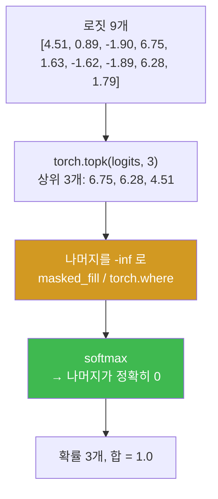
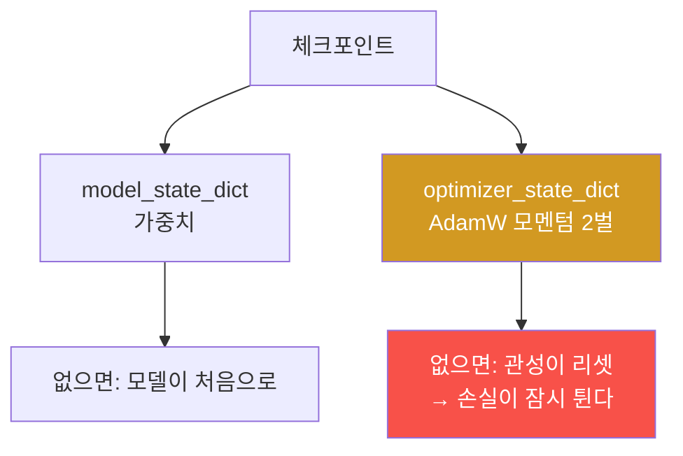
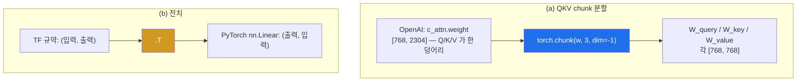

# LLM from scratch W10 — 말투를 조절하다

> **한 줄 요약** — 훈련된 모델이 생겼지만 greedy 생성은 항상 같은 말만 한다. 이번 주는
> **temperature** 와 **top-k** 로 말투를 조절하고(4주차·5주차의 `-inf` 트릭이 또 나온다),
> 체크포인트를 저장·재개하고, 마지막으로 **OpenAI 의 GPT-2 공식 가중치를 내 모델에 이식**한다.
> 그때 4주차의 **전치** 문제가 정확히 같은 형태로 돌아온다. 그리고 4모델 비교표로
> "다른 것은 데이터의 양뿐"이라는 사실을 한 표에 담는다.

---

## 학습 목표

1. 학생은 temperature 가 확률 분포를 어떻게 바꾸는지 샘플링 빈도와 엔트로피로 측정할 수 있다.
2. 학생은 top-k 마스킹이 `-inf` 로 구현되는 이유를 설명하고 마스킹 후 확률 합이 1임을 확인할 수 있다.
3. 학생은 `temperature=0` 에서 greedy 로 폴백하는 `generate` 를 구현하고 결정성을 테스트할 수 있다.
4. 학생은 모델 + 옵티마이저 상태를 저장·복원해 훈련을 매끄럽게 재개할 수 있다.
5. 학생은 OpenAI 가중치를 이식하며 **QKV chunk 분할**과 **전치**가 왜 필요한지 설명할 수 있다.
6. 학생은 `qkv_bias=False` 로는 로드가 실패한다는 것을 확인하고 그 이유를 5주차와 연결할 수 있다.
7. 학생은 4모델 val 손실 비교표를 만들고 "차이는 데이터의 양"이라고 해석할 수 있다.

---

## 0. 용어 해설

| 용어 | 영문 | 쉽게 말하면 | 비유 |
|------|------|------------|------|
| **temperature** | Temperature | 로짓을 나누는 값. 클수록 분포가 평평 | 창의성 다이얼 |
| **top-k** | Top-k Sampling | 상위 k개만 후보로 남김 | 최종 후보 압축 |
| **엔트로피** | Entropy | 분포가 얼마나 퍼져 있는가 | 예측 불가능성 |
| **greedy 폴백** | Greedy Fallback | `T=0` 이면 argmax 로 되돌림 | 창의성 0 = 1등만 |
| **체크포인트** | Checkpoint | 모델 + 옵티마이저 상태 저장 | 게임 세이브 |
| **`state_dict`** | — | 파라미터/버퍼의 이름-텐서 사전 | 부품 목록 |
| **safetensors** | safetensors | 안전한 텐서 저장 포맷 | 봉인된 상자 |
| **QKV chunk** | — | Q/K/V 가 한 행렬에 붙어 저장된 것 | 3인분 한 접시 |
| **전치** | Transpose | 행과 열을 바꿈 | 표를 90도 돌리기 |

---

## 0.5 신입생을 위한 핵심 개념

### temperature 는 로짓을 나누는 것뿐이다

```python
probs = torch.softmax(logits / temperature, dim=-1)
```

**그게 전부입니다.** 그런데 효과는 극적입니다.

| T | 효과 | 비유 |
|---|------|------|
| **작다** (0.1) | 로짓 차이가 **커져** 최고값에 확률이 몰림 | 확신에 찬 사람 |
| **1.0** | 원래 분포 그대로 | 평소 |
| **크다** (5.0) | 로짓 차이가 **작아져** 평평해짐 | 아무 말이나 |

장난감 어휘 9개로 실측하면:

| T | `forward` 선택 (1000회 중) | `pizza` 선택 | 엔트로피 |
|---|---|---|---|
| 0.01 | **1000** | 0 | 0.0000 |
| 0.1 | 995 | 0 | 0.0514 |
| 1.0 | 576 | 0 | 0.9127 |
| **5.0** | 237 | **41 (약 4%)** | **1.9990** |

`pizza` 는 로짓이 **−1.89** 로 최하위권입니다. T=1 에서는 사실상 **0회** 뽑히지만, T=5 에서는
**약 4%** 나 뽑힙니다. **temperature 를 올린다는 것은 "말도 안 되는 후보에게도 기회를 준다"는
뜻입니다.**

### top-k 는 `-inf` 트릭의 재등장



**5주차 인과 마스크와 정확히 같은 트릭입니다.** 0으로 만들면 `e⁰ = 1` 이라 남지만,
`-inf` 로 만들면 `e^(-inf) = 0` 이라 사라집니다. 이 수업에서 세 번째로 나오는 패턴입니다.

> ⚠️ **top-k 와 temperature 를 함께 쓸 때 순서:** 먼저 top-k 마스킹, 그다음 temperature 나눗셈,
> 그다음 softmax 입니다. 순서를 바꾸면 `-inf / T` 가 되어(여전히 `-inf` 라 결과는 같지만)
> 의도가 흐려집니다.

---

## 1. 미션 1~2 — temperature 와 top-k 해부

**📋 실행 프롬프트 P10-1** (요지)

```text
[목표] temperature 의 효과를 장난감 어휘로 측정
[할 일] week10/decoding.py:
 1. 9단어 장난감 어휘와 로짓 벡터를 상수로 정의
 2. softmax_with_temperature(logits, temperature) 구현
 3. T ∈ {0.01, 0.1, 1, 5} 각각에서 1000회 multinomial 샘플링,
    forward/pizza 빈도와 엔트로피 기록
 4. 막대그래프로 temp_plot.png 저장
[검증] argmax 단어와 그 로짓 값을 먼저 출력할 것
```

**예상 결과:** argmax 단어 = **`forward`** (로짓 **6.75**).

> 💡 **어휘 순서 주의** — 장난감 어휘는 알파벳순이 아닙니다(`every` < `effort` 가 아님).
> 인덱스를 눈으로 확인하고 쓰세요.

**📋 실행 프롬프트 P10-2** (요지) — top-k

**예상 결과 (정답지):** 남는 로짓 3개 = **6.75(forward), 6.28(toward), 4.51(closer)**.
나머지 6개는 softmax 후 **정확히 0**, 확률 합 **1.0**.

---

## 2. 미션 3 — generate 통합과 (T × k) 그리드

**📋 실행 프롬프트 P10-3** (요지)

```text
[목표] temperature·top-k·eos 를 지원하는 generate 구현
[할 일] week10/decoding.py 에:
 generate(model, idx, max_new_tokens, context_size, temperature=0.0, top_k=None, eos_id=None)
 - top_k 가 주어지면 먼저 -inf 마스킹
 - temperature > 0 이면 softmax 후 multinomial, 아니면 argmax(greedy 폴백)
 - eos_id 가 나오면 조기 종료
[검증] (T, k) 그리드로 생성문을 표로 만들어 sampling_grid.md 에 저장
```

**핵심 구조:**

```python
if top_k is not None:
    logits = topk_mask(logits, top_k)
if temperature > 0.0:
    probs = torch.softmax(logits / temperature, dim=-1)
    idx_next = torch.multinomial(probs, num_samples=1)
else:
    idx_next = torch.argmax(logits, dim=-1, keepdim=True)   # greedy 폴백
```

**예상 결과:** 낮은 T·작은 k → 9주차에서 외운 문장으로 수렴 / 높은 T·큰 k → 문장 붕괴.

> ⚠️ **T=0.5 행에서 top_k 를 바꿔도 출력이 같을 수 있습니다 — 정상입니다.**
> 온도가 낮으면 확률이 최상위 몇 개에 몰려서, k를 5로 하든 25로 하든 뽑히는 토큰이 같아집니다.
> **버그로 오인하지 마세요.** k가 의미를 갖는 것은 분포가 평평할 때(높은 T)입니다.

**통과 기준:** pytest `3 passed` (greedy 폴백이 `generate_text_simple` 과 동일 / 시드 고정 시
재현 / top-k 제약이 지켜짐).

---

## 3. 미션 4 — 체크포인트: 끊긴 자리에서 잇기

**📋 실행 프롬프트 P10-4** (요지)

```text
[목표] 훈련 중단·재개를 위한 체크포인트
[할 일]
 1. 5 에폭 훈련 후 model_state_dict 와 optimizer_state_dict 를 함께 저장
 2. 새 프로세스에서 로드해 val 손실이 저장 직전과 일치하는지 확인
 3. 이어서 5 에폭 더 훈련해 손실이 매끄럽게 이어지는지 관찰
[검증] 로드 직후 val 손실을 저장 직전 값과 소수 3~4자리까지 대조
```

### 3.1 왜 옵티마이저 상태도 저장하는가



AdamW 는 파라미터마다 **1차·2차 모멘텀 2개**를 들고 있습니다(9주차 메모리 계산의 그것입니다).
모델만 저장하고 재개하면 관성이 사라져 **손실이 잠시 튀어 오릅니다.** "매끄럽게 이어지는가"가
이 미션의 통과 기준인 이유입니다.

---

## 4. 미션 5 — OpenAI 가중치 이식: 남의 체크포인트 싣기

이번 주의 절정입니다. **내가 만든 클래스에 OpenAI 가 훈련한 1억 2천만 개의 숫자를 부어 넣습니다.**

**📋 실행 프롬프트 P10-5** (요지)

```text
[목표] OpenAI GPT-2 공식 가중치를 내 GPTModel 에 이식
[할 일] week10/openai_load.py:
 1. huggingface 의 openai-community/gpt2(-medium) 에서 model.safetensors 다운로드
 2. BASE_CONFIG: context_length=1024, qkv_bias=True, drop_rate=0.0
 3. assign(left, right): shape 불일치면 즉시 ValueError
 4. load_weights_into_gpt(gpt, params):
    (a) QKV 가 한 텐서에 붙어 있으므로 chunk 로 3분할
    (b) TF 규약(입력, 출력)이므로 nn.Linear 에 넣을 때 .T 전치
 5. 로드 후 생성 결과 출력
[검증] shape 불일치가 나면 어느 키에서 났는지 함께 보고할 것
```

> 🔴 **다운로드 경로에 함정이 셋 있습니다.**
>
> | 경로 | 문제 |
> |---|---|
> | 교재의 TensorFlow 체크포인트 | 이 환경에 **TF 가 없다** (aarch64 + CUDA 13) |
> | `.safetensors` | ✅ **이 경로를 쓴다** |
> | 누군가 변환해 둔 `.pth` | 🔴 **미션이 무력화된다** — `load_state_dict()` 한 줄로 끝나서 chunk 분할도 전치도 배우지 못한다 |
>
> **`.pth` 지름길을 쓰면 이 미션의 학습 목표가 통째로 사라집니다.** 실제로 확인해 봤습니다 —
> 702MB `.pth` 를 받아 `load_state_dict(..., strict=True)` 를 돌리니 **한 줄로 성공**했습니다.
> 그래서 이 실습은 **safetensors 를 필수로 지정**합니다.

### 4.1 두 가지 변환 — chunk 분할과 전치



**(b) 전치는 4주차 연습문제 3.1 그 자체입니다.** 그때 "v2 → v1 이식에 왜 `.T` 가 필요한가"를
설명하게 만든 이유가 여기 있습니다. **6주 전의 연습이 오늘 회수됩니다.**

### 4.2 `qkv_bias=True` 가 필수인 이유

**✅ 검증 프롬프트 V10-3** 은 일부러 `qkv_bias=False` 로 로드를 시도하게 합니다.

```
AttributeError: 'NoneType' object has no attribute 'shape'
```

**오류가 나는 것이 정답입니다.** OpenAI 의 GPT-2 에는 QKV bias 가 **있는데** 우리 모델에
그 자리가 없으니 넣을 데가 없습니다. 5주차에서 계산한 `2,360,064` vs `2,362,368` 의
**2,304 = 3 × 768** 차이가 바로 이것입니다.

### 4.3 4모델 비교표 — 이번 주의 결론

| 모델 | the-verdict val 손실 | 퍼플렉시티 | 무엇이 다른가 |
|---|---|---|---|
| 무작위 초기화 | **10.98** | 58,900 | 아무것도 모름 |
| 내 10에폭 모델 | **6.31** | 551 | 5,145 토큰을 외움 |
| **OpenAI 124M** | **3.56** | 35 | 수백억 토큰 학습 |
| **OpenAI 355M** | **3.36** | 29 | 같은 데이터, 더 큰 모델 |

> 📌 **아키텍처는 우리가 만든 것과 똑같습니다.** 클래스도, 층 수 계산도, 파라미터 분해표도
> 동일합니다. **다른 것은 오직 데이터의 양입니다.**
>
> 그리고 124M → 355M 은 파라미터가 2.85배인데 손실은 3.56 → 3.36 (0.2 감소)뿐입니다.
> **모델을 키우는 것보다 데이터를 늘리는 것이 압도적으로 효과적**이라는 사실이 이 표에 있습니다.

---

## 실습 안내

이번 주 실습(`lab_week10.yaml`, 7단계)은 llm-lab 컨테이너에서 진행합니다. 5단계 이후는 GPU 와
네트워크(가중치 다운로드 548MB / 1520MB)를 씁니다.

### 1) 이 실습을 왜 하는가?

10주차에서 이식한 **OpenAI 355M 모델**이 11~13주차의 출발점입니다. 11주차 스팸 분류기도,
13주차 지시 튜닝도 전부 이 가중치 위에서 시작합니다. 그리고 디코딩 파라미터(T, k)는
LLM 서비스를 다룰 때 가장 자주 만지는 손잡이입니다.

### 2) 무엇을 알 수 있는가?

- temperature 가 **로짓을 나누는 한 줄**일 뿐이라는 것, 그리고 그 효과의 크기.
- `-inf` 트릭이 세 번째로 등장한다는 것(인과 마스크 → top-k).
- 남의 가중치를 내 클래스에 붓는 일이 **chunk 분할 + 전치** 두 가지라는 것.
- "차이는 데이터의 양"이라는 결론을 **한 표의 숫자**로 보는 것.

### 3) 결과 해석 (정상 vs 비정상)

| 확인 | 정상 | 비정상 → 의심할 곳 |
|------|------|-------------------|
| argmax 단어 | **forward** (6.75) | 다르면 어휘 인덱스 오류 |
| T=1 에서 pizza | 사실상 **0회** | 자주 나오면 T 적용 위치 확인 |
| T=5 에서 pizza | 약 **4%** | 0이면 temperature 나눗셈 누락 |
| 엔트로피 | T 증가에 **단조 증가** | 아니면 계산식 확인 |
| top-3 로짓 | **6.75 / 6.28 / 4.51** | 다르면 `topk` dim 확인 |
| 마스킹 후 확률 | 나머지 **정확히 0**, 합 **1.0** | 0이 아니면 **0 마스킹**을 한 것 |
| T=0.5 행 k 변화 | **출력이 같아도 정상** | 버그로 오인 금지 |
| 체크포인트 재개 | val 손실 **소수 3~4자리 일치** | 다르면 eval 모드/시드 확인 |
| `qkv_bias=False` 로드 | **오류가 정상** | 성공하면 bias 를 안 넣은 것 |
| OpenAI 124M val | **3점대 중반** (3.56) | 6점대면 이식 실패 |
| 355M val | **3.36** | 124M 보다 낮아야 함 |

### 4) 실전 활용

`temperature` 와 `top_k`(그리고 `top_p`)는 모든 LLM API 의 표준 파라미터입니다. "분석·채점에는
낮은 온도, 브레인스토밍에는 높은 온도"라는 실무 규칙의 근거가 이번 주 측정입니다.
그리고 가중치 포맷 변환(safetensors ↔ 프레임워크 규약)은 오픈 모델을 다룰 때 반드시 만나는 일입니다.

---

## 흔한 오해

- ❌ **"temperature 는 복잡한 알고리즘"** → `logits / T` 한 줄입니다.
- ❌ **"top-k 는 상위 k개의 확률을 그대로 쓴다"** → 나머지를 `-inf` 로 만든 뒤 **다시 softmax**
  하므로 확률이 재분배됩니다. 합이 1이 되는 이유입니다.
- ❌ **"T=0.5 에서 k를 바꿨는데 출력이 같으면 버그"** → **정상**입니다. 온도가 낮아 상위 몇 개에
  확률이 몰려서 k가 무의미해진 것입니다.
- ❌ **"모델만 저장하면 된다"** → 옵티마이저 모멘텀이 없으면 재개 시 손실이 튑니다.
- ❌ **"변환된 .pth 를 받으면 편하다"** → **미션이 무력화됩니다.** chunk 분할도 전치도 배우지
  못합니다.
- ❌ **"`qkv_bias` 는 사소한 옵션"** → `False` 면 OpenAI 가중치 로드가 **실패**합니다.
- ❌ **"355M 이 124M 보다 훨씬 좋을 것"** → 3.56 → 3.36 입니다. **데이터가 같으면 크기의
  효과는 제한적**입니다.

---

## 다음 주차 예고 — W11 분류기가 된 GPT

이제 남은 것은 **개조**입니다. 11주차는 GPT-2 를 **스팸 분류기**로 바꿉니다 — 출력 헤드를
50,257개에서 **2개**로 갈아 끼우고, 대부분의 층을 **얼리고**, 마지막 블록만 훈련합니다.
그리고 "왜 마지막 토큰의 로짓으로 분류하는가"에 5주차 인과성이 답을 줍니다. 훈련 가능
파라미터를 손계산하고(정답지에 오류가 있습니다 — 직접 찾아내야 합니다), **±1%p 재현 게이트**로
결과를 검증합니다.
