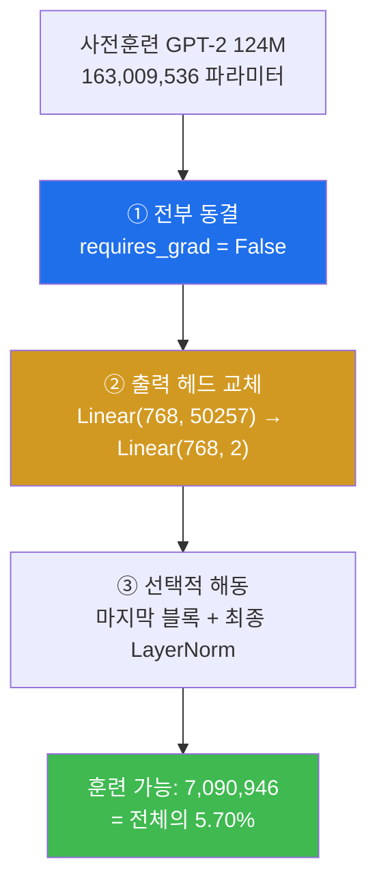
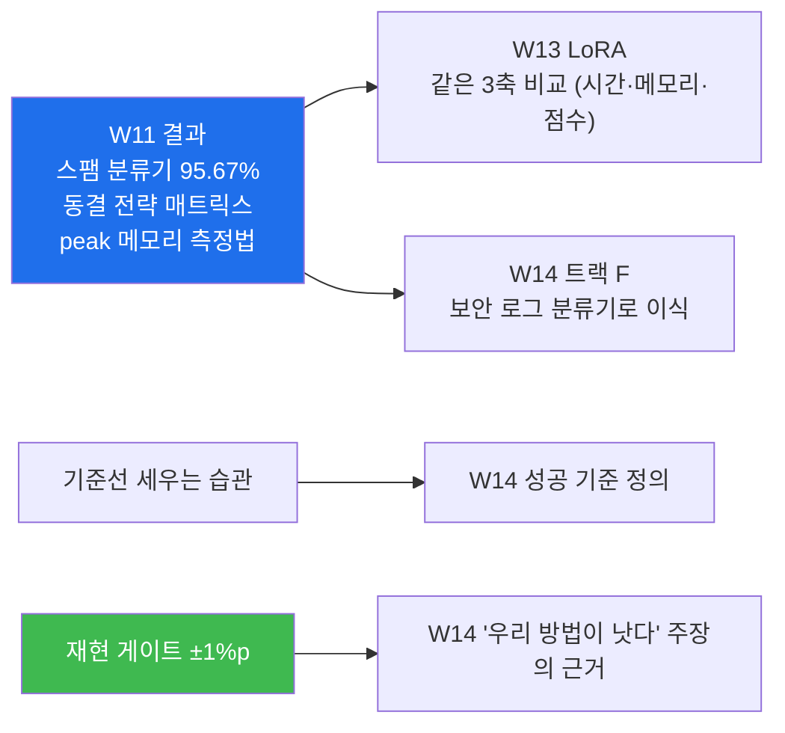

# W11 — 분류기가 된 GPT

> **한 줄 요약** — 이제 **개조**다. GPT-2 를 스팸 분류기로 바꾼다 — 출력 헤드를 50,257개에서
> **2개**로 갈아 끼우고, 대부분의 층을 **얼리고**, 마지막 블록만 훈련한다. 그리고
> "왜 마지막 토큰의 로짓으로 분류하는가"에 5주차 인과성이 답을 준다. 훈련 가능 파라미터를
> 손계산하고(**교재 정답지에 오류가 있다 — 직접 찾아내야 한다**), **±1%p 재현 게이트**로
> 결과를 검증한다.

---

## 학습 목표

1. 학생은 불균형 데이터에서 "바보 분류기"의 정확도를 계산해 **기준선**을 세울 수 있다.
2. 학생은 균형화·3분할 후 데이터 크기를 정답지와 대조할 수 있다.
3. 학생은 배치를 만들려면 왜 **패딩**이 필요한지, 왜 `50256`(=`<|endoftext|>`)을 쓰는지 설명할 수 있다.
4. 학생은 출력 헤드를 교체하고 선택적 동결을 적용해 훈련 가능 파라미터를 **손계산**할 수 있다.
5. 학생은 "왜 마지막 토큰의 로짓인가"를 5주차 인과성으로 설명할 수 있다.
6. 학생은 훈련 결과를 **±1%p 재현 게이트**로 검증할 수 있다.
7. 학생은 (모델 크기 × 동결 전략) 매트릭스 실험을 설계하고 통념과 어긋나는 결과를 해석할 수 있다.

---

## 0. 용어 해설

| 용어 | 영문 | 쉽게 말하면 | 비유 |
|------|------|------------|------|
| **파인튜닝** | Fine-tuning | 사전훈련 모델을 특정 과제에 맞게 추가 훈련 | 경력직 재교육 |
| **분류 헤드** | Classification Head | 출력층을 클래스 수만큼으로 교체 | 출구를 바꿔 달기 |
| **동결** | Freezing | 파라미터를 학습에서 제외 | 굳혀 두기 |
| **`requires_grad`** | — | 이 파라미터를 학습할지 여부 | 수정 허가 |
| **패딩** | Padding | 길이를 맞추려 채워 넣는 토큰 | 빈칸 메우기 |
| **불균형 데이터** | Imbalanced Data | 클래스 비율이 크게 치우친 데이터 | 한쪽으로 기운 저울 |
| **바보 분류기** | Majority Baseline | 항상 다수 클래스로 찍는 분류기 | 무조건 "정상"이라 답하기 |
| **재현 게이트** | Reproducibility Gate | 재실행 시 허용 오차 범위 | 계측기 정밀도 |
| **혼동 행렬** | Confusion Matrix | TP/FP/FN/TN 표 | 오답 유형표 |

---

## 0.4 이번 주 배경 지식 — 처음이라면

### 파인튜닝이란 무엇인가

**사전훈련**(pretraining)은 방대한 텍스트로 "언어 일반"을 배우는 단계입니다. 10주차에
가져온 OpenAI 가중치가 그 결과물입니다.

**파인튜닝**(fine-tuning)은 그 위에 **특정 과제**를 얹는 단계입니다. 처음부터 다시 배우는 게
아니라, 이미 아는 것을 조금 비틀어 쓰게 만듭니다.

| 비유 | 사전훈련 | 파인튜닝 |
|---|---|---|
| 사람 | 국어를 익힌다 | 법률 문서 읽는 법을 익힌다 |
| 비용 | 수백억 토큰, 수천 GPU 시간 | 수천 건, 몇 분 |

**파인튜닝에는 두 종류가 있습니다.** 이번 주는 첫 번째, 13주차가 두 번째입니다.

| 종류 | 하는 일 | 출력 | 주차 |
|---|---|---|---|
| **분류 파인튜닝** | 정해진 몇 개 중 하나를 고른다 | 라벨 (스팸/정상) | **W11** |
| **지시 파인튜닝** | 지시를 따르는 문장을 만든다 | 자유 텍스트 | W13 |

### 생성 모델을 분류기로 바꾼다는 것

지금 모델의 출력 헤드는 `Linear(768, 50257)` — **어휘 5만 개 중 하나**를 고릅니다.
스팸 판별은 **2개 중 하나**만 고르면 됩니다.

```python
model.out_head = torch.nn.Linear(768, 2)      # 이 한 줄이 개조 수술의 전부
```

**나머지 12개 블록은 그대로 둡니다.** "영어 문장을 이해하는" 능력은 이미 갖고 있고,
그 능력 위에 판단만 얹는 것입니다.

> 💡 **왜 이게 되는가.** 트랜스포머 블록을 다 통과한 벡터에는 이미 문장의 의미가 압축돼
> 있습니다. 출력 헤드는 그 벡터를 무엇으로 번역할지만 정합니다 — "다음 단어"로 번역할
> 수도, "스팸/정상"으로 번역할 수도 있습니다.

### 동결(freeze)이란 무엇인가

```python
for p in model.parameters():
    p.requires_grad = False      # 이 파라미터는 학습하지 않는다
```

`requires_grad = False` 로 두면 **기울기를 계산하지 않고, 따라서 값이 안 바뀝니다.**

| 동결하면 | 얻는 것 | 잃는 것 |
|---|---|---|
| 전부 동결 + 헤드만 | 빠르고 메모리 적음. 데이터 적어도 안전 | 과제 특화가 약함 |
| 전부 해동 | 최대 성능 가능 | 느리고, 적은 데이터로는 **오히려 망가짐** |

**적은 데이터로 전부 훈련하면 왜 망가지나.** 1억 6천만 개의 다이얼을 1,000건의 예시로
돌리면, 모델이 그 1,000건을 외워 버리고 원래 갖고 있던 언어 능력을 잊습니다
(**파국적 망각**, catastrophic forgetting).

### 기준선(baseline)을 먼저 세우는 이유

이번 주 데이터는 ham 4,825 / spam 747 입니다. **아무 생각 없이 항상 "ham"이라고 답하는
분류기**의 정확도는 얼마일까요?

```
4,825 / 5,572 = 86.59%
```

**86.59% 입니다.** 그러니 여러분의 모델이 85% 를 냈다면 그건 **바보 분류기보다 못한 것**입니다.

> 🔴 **숫자만 보고 좋아하면 안 됩니다.** "정확도 86%" 는 여기서 아무 의미가 없습니다.
> 그래서 이 실습은 데이터를 **균형화**합니다 — spam 747건에 맞춰 ham 도 747건만 남깁니다.
> 그러면 바보 분류기의 정확도가 50% 가 되어, 그 위로 얼마나 올렸는지가 실력이 됩니다.

**모든 평가에는 기준선이 먼저 있어야 합니다.** 14주차 프로젝트에서 성공 기준을 정할 때
이 습관이 필요합니다.

### 패딩(padding)이 왜 필요한가

문장마다 길이가 다릅니다. 그런데 배치로 묶으려면 **직사각형**이 되어야 합니다.

```
"무료 쿠폰"            → [2334, 8912]
"지금 바로 클릭하세요"   → [1102, 993, 4415, 77]

패딩 후:
[2334, 8912, 50256, 50256]     ← 짧은 쪽을 채운다
[1102,  993,  4415,    77]
```

채우는 값으로 `<|endoftext|>`(50256)를 씁니다. **이번 주는 그냥 채우면 됩니다** — 분류는
마지막 위치의 로짓만 쓰기 때문입니다. 12주차에서는 이 패딩 자리가 **학습에 섞이는** 문제가
생기고, 그걸 `-100` 으로 가리는 법을 배웁니다.

---

## 0.5 신입생을 위한 핵심 개념

### 개조 수술 — 무엇을 바꾸고 무엇을 남기나



**왜 전부 훈련하지 않는가.** 스팸/정상 판별에 필요한 언어 능력은 사전훈련에서 이미 다
얻었습니다. 앞쪽 층은 "영어를 이해하는" 일반 능력이고, 뒤쪽 층과 헤드가 "이 과제"에
특화됩니다. 전부 훈련하면 시간·메모리가 훨씬 들고, 적은 데이터로는 오히려 망가지기 쉽습니다.

### 왜 마지막 토큰의 로짓인가 — 5주차 자산의 회수

모델 출력은 `[batch, num_tokens, 2]` 입니다. 여기서 **`logits[:, -1, :]`** 만 씁니다.

> **인과 마스크 때문에 마지막 위치만이 전체 문장을 다 본 유일한 위치이기 때문입니다.**

앞쪽 위치들은 아직 뒷부분을 못 봤습니다. 문장 전체를 판단해야 하는 분류에서 앞쪽 위치의
로짓을 쓰는 것은 **문장을 끝까지 읽지 않고 판단하는 것**과 같습니다.

5주차에서 만든 인과성 성질 테스트가 여기서 답의 근거가 됩니다. **7주차 생성에서
`logits[:, -1, :]` 를 쓴 이유와 정확히 같습니다.**

### 이번 주의 특별한 점 — 정답지가 틀렸다

교재는 훈련 가능 파라미터를 **7,088,642** 라고 적어 두었습니다. 실제로 세어 보면
**7,090,946** 입니다. **차이는 2,304 = 3 × 768** 입니다.

> 🔴 **원인:** 10주차에서 OpenAI 가중치를 이식하려고 `qkv_bias=True` 로 바꿨는데, 11주차
> 산식이 그 변경을 반영하지 않았습니다. QKV bias 3개(각 768)가 마지막 블록에 들어 있습니다.
>
> 그리고 교재의 "전체의 약 4.3%"도 틀렸습니다 — **수술 전 분모(163,009,536)**로 나눈 값입니다.
> 수술 후 모델은 출력 헤드가 2개짜리로 바뀌어 **124,441,346** 파라미터이므로 실제 비율은
> **5.70%** 입니다.
>
> **주차 간 설정 변경이 정답지에 전파되는지 확인하는 절차가 없으면 이런 일이 생깁니다.**

---

## 1. 준비 — 데이터 확보와 기준선

### 1.1 SMS Spam Collection

| 항목 | 값 |
|---|---|
| 총 건수 | **5,572** |
| ham (정상) | **4,825** (86.6%) |
| spam | **747** (13.4%) |

### 1.2 바보 분류기의 정확도 — 기준선을 먼저 세워라

```
항상 "ham" 이라고 답하는 분류기의 정확도 = 4,825 / 5,572 = 86.59%
```

> 📌 **86.6% 를 넘지 못하면 아무 의미가 없습니다.** 불균형 데이터에서 정확도만 보면
> 속기 쉽습니다. 이 기준선을 먼저 세우는 것이 실무 습관입니다.

그래서 이 실습은 **균형화**를 합니다 — spam 747건에 맞춰 ham 을 747건만 남깁니다.
그러면 바보 분류기의 정확도는 **50%** 가 되고, 그 위로 얼마나 올라가는지가 순수한 실력이 됩니다.

**균형 후 1,494건 → 분할 train 1,045 / val 149 / test 300.**

---

## 2. 미션 2 — SpamDataset과 로더: 패딩의 등장

### 2.1 왜 패딩이 필요한가

문자 메시지는 길이가 제각각입니다. 그런데 배치는 **직사각형 텐서**여야 합니다.

```
"Ok"                          → 1 토큰
"You are a winner ..."        → 30 토큰
```

**가장 긴 것에 맞춰 나머지를 채웁니다.** 채우는 값은 `50256` — GPT-2 의 `<|endoftext|>` 입니다
(2주차에서 만든 그 특수 토큰입니다).

### 2.2 train 의 max_length 를 val/test 에 **강제**한다

**예상 결과:** train max_length = **120**.

```python
train_ds = SpamDataset("train.csv", tokenizer, max_length=None)          # 자동 결정
val_ds   = SpamDataset("validation.csv", tokenizer, max_length=train_ds.max_length)
test_ds  = SpamDataset("test.csv",  tokenizer, max_length=train_ds.max_length)
```

> ⚠️ **val/test 가 자기 max_length 를 쓰면 안 되는 이유** — 평가 데이터의 특성이 모델 입력
> 형태를 바꾸면 **데이터 누수(leakage)** 입니다. 실전에서는 새 데이터가 얼마나 길지 모르므로,
> 훈련 때 정한 길이로 자르거나 채워야 합니다.

**로더:** 배치 수 **130 / 19 / 38**, 배치 shape **`[8, 120]`**.

---

## 3. 미션 3 — 개조 수술: 헤드 교체와 선택적 동결

### 3.1 수술 전 — 프롬프트로 시켜보면 안 된다

**📋 실행 프롬프트 P11-2** 는 개조 **전** 모델에게 `"Is the following text 'spam'? Answer
with 'yes' or 'no'"` 를 시킵니다.

**예상 결과: 지시를 따르지 못합니다.** GPT-2 는 사전훈련만 된 모델이라 **지시 추종
능력이 없습니다.** 그냥 다음 단어를 이어 쓸 뿐입니다.

> 📌 **이 실패가 이번 주 미션의 존재 이유입니다.** 그리고 13주차 지시 튜닝의 동기이기도 합니다.

### 3.2 세 단계 수술

```python
# ① 전부 동결
for p in model.parameters():
    p.requires_grad = False

# ② 출력 헤드 교체 (새로 만든 층은 기본적으로 requires_grad=True)
model.out_head = torch.nn.Linear(768, 2)

# ③ 선택적 해동 — 마지막 블록 + 최종 LayerNorm
for p in model.trf_blocks[-1].parameters():
    p.requires_grad = True
for p in model.final_norm.parameters():
    p.requires_grad = True
```

### 3.3 훈련 가능 파라미터 손계산 — 정답지를 고쳐라

| 구성 | 계산 | 값 |
|---|---|---|
| 마지막 TransformerBlock | 7,085,568 + **2,304**(QKV bias) | **7,087,872** |
| 최종 LayerNorm | 768 × 2 | 1,536 |
| 새 출력 헤드 | 768 × 2 + 2 | 1,538 |
| **합계** | | **7,090,946** |

수술 후 전체 파라미터는 **124,441,346** 이므로 비율은 **5.70%** 입니다.

> 🔴 **교재의 7,088,642 / "약 4.3%" 는 둘 다 틀렸습니다.** 여러분이 직접 세어 확인하세요.
> **"정답지도 틀릴 수 있다"** — 2주차 `" It' s"` 이후 두 번째 사례입니다.

---

## 4. 미션 4~5 — 베이스라인과 파인튜닝

### 4.1 훈련 전 정확도 — 동전의 실력

**예상 결과:** train/val/test 세 분할 모두 **50% 안팎**. 균형화했으므로 무작위 추측 수준입니다.
새로 만든 헤드는 무작위 초기화라 당연합니다.

### 4.2 훈련 후 — 그리고 재현 게이트

**예상 결과 (정답지):**

| 분할 | 정확도 |
|---|---|
| train | **97.21%** |
| val | **97.32%** |
| test | **95.67%** |

**재현 게이트: test 정확도 ±1%p.** 시드·설정을 그대로 두고 재실행했을 때 이 범위를 벗어나면
어딘가 비결정적 요소가 있는 것입니다.

> 💡 **±1%p 게이트는 이 교재에서 가장 엄격한 정량 기준입니다.** 다른 하드웨어에서 이 정밀도가
> 나온다는 것은 교재의 명세가 그만큼 빈틈없다는 뜻입니다.

**`classify_review`** 는 결정적이어야 합니다 — 같은 문장은 항상 같은 답. 샘플링이 없으니
당연하지만, `model.eval()` 을 빼먹으면 dropout 때문에 흔들립니다.

---

## 5. 미션 6 — 매트릭스 실험: 어디까지 풀어야 하는가

**📋 실행 프롬프트 P11-6** 은 (모델 크기 × 동결 전략) 매트릭스를 만들게 합니다.

| 전략 | 훈련 대상 |
|---|---|
| (a) | 출력 헤드만 |
| (b) | 헤드 + 마지막 블록 + 최종 LayerNorm |
| (c) | 헤드 + 마지막 **두** 블록 + 최종 LayerNorm |

**예상 결과:** 대체로 (a) < (b) ≤ (c). 더 많이 풀수록 좋아지지만 **수확 체감**이 옵니다.

### 5.1 그런데 "355M ≥ 124M" 은 성립하지 않았다

교재는 "355M 이 124M 보다 낫다"고 예상했지만, **실측에서는 3개 전략 중 1개에서만
성립했습니다.**

| 전략 | 124M | 355M |
|---|---|---|
| (b) | **96.33%** | **85.00%** |

**20 에폭으로 늘려 재측정해도 94.33%** 로 124M 에 못 미쳤습니다. 훈련 부족이 아니라
**전략의 문제**입니다.

> 🔴 **원인:** 전략 (b)는 "마지막 블록 1개"를 푸는 것입니다. 124M 은 12층이라 **1/12** 를
> 풀지만, 355M 은 24층이라 **1/24** 만 풉니다. **모델이 클수록 같은 전략이 더 적은 비율을
> 푸는 것입니다.**
>
> **"큰 모델이 항상 낫다"는 통념이 깨지는 지점입니다.** 큰 모델을 쓰려면 동결 전략도 함께
> 조정해야 합니다.

---

## 6. 에이전트에게 시키는 법 — 이번 주 실전

### 6.1 재현 게이트 ±1%p — 이 교재에서 가장 엄격한 기준

```text
[검증] 시드·설정을 그대로 두고 재실행했을 때 test 정확도가 ±1%p 안에 들어오는지 확인할 것
```

**두 번 돌려서 같은 값이 나오는가**를 묻는 것입니다. 안 나오면 어딘가에 **비결정적 요소**가
있다는 뜻입니다.

| 흔한 원인 | 확인 |
|---|---|
| `model.eval()` 누락 | 드롭아웃이 추론에서도 켜져 있다 |
| 시드 미고정 | `torch.manual_seed(123)` 이 있는가 |
| `shuffle=True` 인 채로 평가 | 평가 로더는 `shuffle=False` 여야 |

> 📌 **재현되지 않는 실험은 결과가 아닙니다.** 14주차 프로젝트에서 "우리 방법이 더 좋다"고
> 주장하려면, 그 차이가 **잡음보다 큰지** 먼저 보여야 합니다. 이번 주의 ±1%p 게이트가
> 그 훈련입니다.

### 6.2 매트릭스 실험을 시킬 때 — 메모리 관리를 명시하라

미션 6은 (모델 크기 2종 × 동결 전략 3종) = **6개 조합**을 순서대로 돌립니다.
그냥 시키면 앞 모델이 메모리에 남아 뒤 실험이 느려지거나 죽습니다.

```text
[측정] 최대 메모리는 torch.cuda.max_memory_allocated 사용
[제약] 조합 하나가 끝날 때마다 del + torch.cuda.empty_cache() +
      torch.cuda.reset_peak_memory_stats() 를 호출할 것
```

**`reset_peak_memory_stats()` 를 빠뜨리면** 두 번째 조합부터 peak 값이 앞 조합의 값을
그대로 물려받아 **전부 같은 숫자**가 나옵니다. 그럴듯해 보이지만 측정이 안 된 것입니다.

### 6.3 이번 주에 에이전트가 실제로 하는 실수 세 가지

| 증상 | 어떻게 알아채나 | 대응 |
|---|---|---|
| **불균형 데이터를 그대로 씀** | 정확도가 86% 근처에 붙어 있다 | 균형화 후 spam/ham 각 747건인지 확인 |
| **`logits[:, -1, :]` 대신 평균/첫 토큰** | 정확도가 낮거나 이상 | 왜 마지막 위치인지 설명하게 시킬 것 |
| **peak 메모리가 전부 동일** | 6개 조합의 값이 똑같다 | `reset_peak_memory_stats()` 호출 확인 |

### 6.4 판정 명령

```bash
docker exec -it llm-lab bash
cd /work/week11

# 데이터 균형화 확인
python3 -c "
import pandas as pd
d = pd.read_csv('balanced.csv')
print(d['Label'].value_counts())            # spam 747 / ham 747
"

# 재현 게이트 — 두 번 돌려 같은가
for i in 1 2; do python3 spam_finetune.py --eval-only | grep test; done

# 훈련 가능 파라미터 — 정답지 재검증
python3 -c "
from load_and_modify import build_model
m = build_model()
tr = sum(p.numel() for p in m.parameters() if p.requires_grad)
tot = sum(p.numel() for p in m.parameters())
print('훈련 가능', f'{tr:,}')                # 7,090,946 (교재 7,088,642 는 오류)
print('수술 후 전체', f'{tot:,}')            # 124,441,346
print('비율', f'{tr/tot*100:.2f}%')          # 5.70%
"
```

> 🔴 **교재 정답지가 틀린 자리입니다.** 여러분이 센 값이 **7,090,946** 이면 맞습니다.
> 차이 **2,304 = 3 × 768** 은 10주차에서 `qkv_bias=True` 로 바꾼 결과입니다.
> **정답지와 다르다고 자기 코드를 고치지 마십시오.** 어느 쪽이 틀렸는지 규명하는 것이
> 이 과목입니다.

---

## 7. 이번 주 산출물이 어디로 가는가



**이번 주에 배운 "어디까지 풀 것인가"가 13주차 LoRA 로 이어집니다.** 선택적 동결이
"층 단위로 잠그고 푸는" 거친 방법이라면, LoRA 는 **모든 층에 얇은 곁가지를 달아** 1%만
훈련하는 정교한 방법입니다. 이번 주의 매트릭스 표를 13주차 표와 나란히 놓고 보게 됩니다.

---

## 실습 안내

이번 주 실습(`lab_week11.yaml`, 7단계)은 llm-lab 컨테이너에서 GPU 로 진행합니다.

### 1) 이 실습을 왜 하는가?

**사전훈련 모델을 실제 과제에 쓰는 법**을 배웁니다. 실무에서 LLM 을 쓰는 대부분의 경우가
"이미 있는 모델을 내 과제에 맞춘다"입니다. 그리고 이번 주의 동결 전략 감각이 13주차
LoRA 로 이어집니다.

### 2) 무엇을 알 수 있는가?

- 불균형 데이터에서 **기준선(86.6%)** 을 먼저 세우는 이유.
- 파라미터의 **5.70%** 만 훈련해도 95% 정확도가 나온다는 것.
- **정답지가 틀릴 수 있다**는 것 — 그리고 그것을 손계산으로 잡아내는 법.
- "큰 모델이 항상 낫다"가 **거짓**일 수 있다는 것.

### 3) 결과 해석 (정상 vs 비정상)

| 확인 | 정상 | 비정상 → 의심할 곳 |
|------|------|-------------------|
| 원본 데이터 | **5,572** (ham 4,825 / spam 747) | 다르면 파일 확인 |
| 바보 분류기 | **86.59%** | 계산 확인 |
| 균형·분할 | **1,494** → 1,045 / 149 / 300 | 시드 확인 |
| train max_length | **120** | val/test 가 자기 길이를 쓰면 누수 |
| 배치 수 | **130 / 19 / 38** | `drop_last` 설정 확인 |
| 패딩 값 | 전부 **50256** | 0이면 `<\|endoftext\|>` 가 아님 |
| 훈련 가능 파라미터 | **7,090,946** (5.70%) | 7,088,642 는 **교재 오류** |
| 훈련 전 정확도 | **50% 안팎** | 86% 면 균형화를 안 한 것 |
| 훈련 후 test | **95.67% ± 1%p** | 벗어나면 비결정적 요소 |
| `classify_review` | a→spam, b→not spam, **결정적** | 흔들리면 `eval()` 누락 |
| 355M vs 124M | **355M 이 낮을 수 있다** | 통념대로 안 나오는 것이 정상 |

### 4) 실전 활용

선택적 동결은 GPU 메모리가 부족할 때 가장 먼저 쓰는 기법입니다. 그리고 "어디까지 풀 것인가"를
매트릭스로 측정해 정하는 절차는 실무 파인튜닝의 표준입니다. 불균형 데이터의 기준선 설정과
혼동 행렬 읽기는 분류 문제 전반에 쓰입니다.

---

## 흔한 오해

- ❌ **"정확도 95% 면 좋은 모델"** → 원본 데이터에서는 아무것도 안 해도 **86.6%** 입니다.
  **기준선 대비**로 봐야 합니다.
- ❌ **"모든 위치의 로짓을 평균 내면 더 정확"** → 앞쪽 위치는 문장을 끝까지 못 봤습니다.
  마지막 위치만이 전체를 봅니다.
- ❌ **"교재 정답지는 맞다"** → 7,088,642 는 **틀렸습니다.** 직접 세어 보세요.
- ❌ **"큰 모델이 항상 낫다"** → 355M 이 124M 보다 **11%p 낮았습니다.** 같은 전략이 더 적은
  비율을 푸는 것이 원인입니다.
- ❌ **"패딩은 0으로"** → GPT-2 에는 전용 패딩 토큰이 없어 `<\|endoftext\|>`(50256)를 씁니다.
- ❌ **"val/test 도 자기 길이에 맞추면 효율적"** → **데이터 누수**입니다. train 의 길이를
  강제해야 합니다.

---

## 다음 주차 예고 — W12 데이터가 절반이다

분류는 됐습니다. 이제 **지시를 따르는 모델**로 갑니다. 그런데 그 전에 **데이터**를 만들어야
합니다. 12주차는 Alpaca 프롬프트 포맷터를 만들고, collate 함수를 **3단계로 진화**시킵니다 —
패딩 → 타깃 시프트 → `-100` 마스킹. 특히 `-100`(`ignore_index`)이 **손실에서 정말로 제외되는지**
2토큰 vs 3토큰 손실 비교로 실증합니다. 그리고 "데이터를 의심하라" — 중복·품질 문제를 직접
찾아냅니다.
