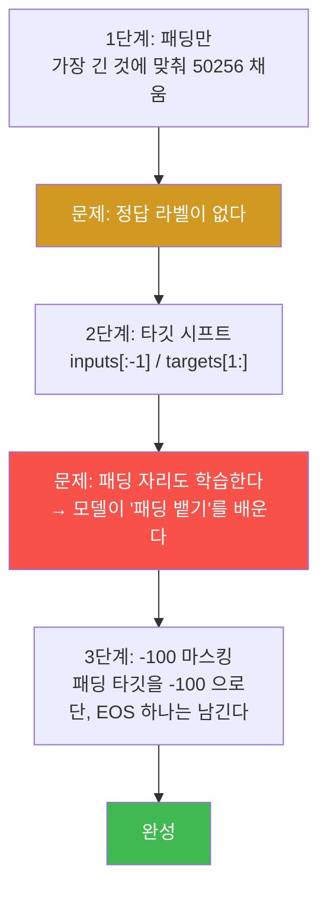

# LLM from scratch W12 — 데이터가 절반이다

> **한 줄 요약** — 지시를 따르는 모델을 만들려면 먼저 **데이터**를 만들어야 한다. 이번 주는
> Alpaca 프롬프트 포맷터를 만들고, collate 함수를 **3단계로 진화**시킨다 — 패딩 → 타깃 시프트 →
> `-100` 마스킹. 특히 `-100`(`ignore_index`)이 **손실에서 정말로 제외되는지** 2토큰 vs 3토큰
> 손실 비교로 실증한다. 그리고 "데이터를 의심하라" — 중복과 품질 문제를 직접 찾아낸다.

---

## 학습 목표

1. 학생은 Alpaca 프롬프트 포맷을 구현하고 `input` 이 빈 항목에서 블록이 통째로 빠지는지 확인할 수 있다.
2. 학생은 collate 함수를 3단계로 진화시키며 각 단계가 무엇을 해결하는지 설명할 수 있다.
3. 학생은 `-100` 이 손실에서 제외되는 것을 **2토큰 vs 3토큰 손실 비교**로 실증할 수 있다.
4. 학생은 각 행에 `50256` 이 정확히 한 번만 남는 이유를 설명할 수 있다.
5. 학생은 실제 데이터에 적용해 `-100` 구간이 "응답 종료 후 패딩 영역"에만 있는지 확인할 수 있다.
6. 학생은 데이터 품질(중복·길이·형식)을 점검하고 문제를 정량적으로 보고할 수 있다.

---

## 0. 용어 해설

| 용어 | 영문 | 쉽게 말하면 | 비유 |
|------|------|------------|------|
| **지시 튜닝** | Instruction Tuning | 지시-응답 쌍으로 파인튜닝 | 업무 지시 훈련 |
| **Alpaca 포맷** | Alpaca Format | 지시/입력/응답을 고정 틀로 감싼 형식 | 표준 서식 |
| **collate** | Collate Function | 여러 샘플을 배치 텐서로 묶는 함수 | 서류 묶기 |
| **`ignore_index`** | — | 손실 계산에서 제외할 라벨 값 (기본 `-100`) | 채점 제외 문항 |
| **패딩 마스킹** | Padding Mask | 채운 자리를 학습에서 빼는 것 | 빈칸은 채점 안 함 |
| **EOS** | End of Sequence | 시퀀스 끝 표시 (`<\|endoftext\|>` = 50256) | 마침표 |
| **데이터 누수** | Data Leakage | 평가 정보가 훈련에 새어 듦 | 시험지 유출 |

---

## 0.5 신입생을 위한 핵심 개념

### 왜 프롬프트 "포맷"이 필요한가

모델은 `"### Instruction:"` 같은 **고정된 신호**를 보고 "여기서부터 지시" / "여기서부터 응답"을
구분하는 법을 배웁니다. 포맷이 흔들리면 그 신호가 사라집니다.

```
Below is an instruction that describes a task. Write a response that appropriately completes the request.

### Instruction:
Convert 45 kilometers to meters.

### Response:
45 kilometers is 45000 meters.
```

`input` 이 있는 항목에만 `### Input:` 블록이 들어갑니다. **없으면 블록 자체가 통째로
빠집니다** — 빈 블록을 남기면 모델이 "빈 Input" 이라는 잘못된 패턴을 배웁니다.

> ⚠️ **고정 서두를 정확히 쓰세요.** `"Below is an instruction that describes a task. Write a
> response that appropriately completes the request."` 이 문장 전체가 포맷의 일부입니다.
> 이것을 생략하고 `"..."` 로 대충 쓰면, 결과가 맞아 보여도 그건 **모델의 사전 지식이 채운
> 것**이지 여러분의 명세가 유도한 것이 아닙니다.

### collate 3단계 진화 — 각 단계가 무엇을 푸는가



### 장난감 배치로 정답지 확인

입력 `[[0,1,2,3,4], [5,6], [7,8,9]]` 에 대해:

| 행 | inputs | targets |
|---|---|---|
| 1 | `[0, 1, 2, 3, 4]` | `[1, 2, 3, 4, 50256]` |
| 2 | `[5, 6, 50256, 50256, 50256]` | `[6, 50256, -100, -100, -100]` |
| 3 | `[7, 8, 9, 50256, 50256]` | `[8, 9, 50256, -100, -100]` |

**각 행의 targets 에 `50256` 이 정확히 한 번씩 있습니다.** 왜일까요?

> 📌 **모델은 "언제 멈출지"를 배워야 합니다.** EOS 를 전부 `-100` 으로 지우면 종료 신호를
> 학습할 기회가 사라집니다. 그래서 **첫 번째 패딩(= 실제 종료 지점)은 남기고, 그 뒤만 지웁니다.**

---

## 1. 미션 1 — 프롬프트 포맷터

**📋 실행 프롬프트 P12-1** (요지)

```text
[목표] Alpaca 스타일 프롬프트 포맷터 구현
[할 일] week12/instr_data.py 에 format_input(entry) 작성:
 고정 서두 "Below is an instruction that describes a task. Write a response that
 appropriately completes the request." 뒤에
 "### Instruction:\n{instruction}" 을 붙이고,
 entry['input'] 이 비어 있지 않을 때만 "\n\n### Input:\n{input}" 을 추가
[검증] input 이 있는 항목과 없는 항목을 각각 출력해 차이를 보일 것
      교재 ch07 노트북 출력과 문자 단위로 일치하는지 대조
```

**예상 결과:** 데이터 **1,100**개. `input` 이 빈 항목에서는 `### Input:` 블록이 **통째로**
빠집니다.

---

## 2. 미션 2 — 3분할

**예상 결과 (정답지):** train **935** / test **110** / val **55** (합 1,100).

비율은 85% / 10% / 5% 입니다. 11주차(70/10/20)와 다른 이유는 지시 튜닝에서는 **훈련 데이터가
많을수록 좋고**, 평가는 LLM-as-judge 로 하기 때문에 큰 test 셋이 필요 없어서입니다.

---

## 3. 미션 3 — collate 3단계 진화 (장난감 배치로)

### 3.1 왜 3단계로 나누는가

**한 번에 완성된 코드를 받으면 각 부분이 왜 필요한지 모릅니다.** 단계마다 "이 상태의 문제가
무엇인가"를 확인하고 다음 단계로 갑니다. **이것이 이 교재의 지시 설계 철학입니다.**

| 단계 | 하는 일 | 남은 문제 |
|---|---|---|
| 1 | 패딩만 (50256으로 길이 맞춤) | 정답 라벨이 없다 |
| 2 | 타깃 시프트 (`inputs[:-1]` / `targets[1:]`) | **패딩 자리도 학습한다** |
| 3 | `-100` 마스킹 (EOS 하나는 남김) | 완성 |

### 3.2 2단계의 문제가 왜 심각한가

패딩 자리를 그대로 학습하면 모델은 **"응답이 끝나면 `<|endoftext|>` 를 계속 뱉어라"** 를
배웁니다. 짧은 응답이 많은 배치에서는 패딩이 대부분이라, 모델이 **패딩 생성기**가 됩니다.

### 3.3 `-100` 이 정말 제외되는가 — 실증

**말로 믿지 말고 숫자로 확인합니다.**

```
로짓 2개 / 타깃 [0, 1]           → 손실 1.126928
로짓 3개 / 타깃 [0, 1, -100]     → 손실 1.126928   ← 완전히 같다
```

세 번째 항목을 추가했는데 손실이 **소수점 6자리까지 동일**합니다. `-100` 위치는 계산에서
**완전히 빠집니다**(평균의 분모에서도 빠집니다).

> 💡 **`-100` 은 마법의 숫자가 아닙니다.** `F.cross_entropy(..., ignore_index=-100)` 의
> 기본값일 뿐입니다. 다른 값으로 바꾸려면 `ignore_index` 를 명시하면 됩니다.

**통과 기준:** pytest `3 passed` (정답지 일치 / 각 행 EOS 정확히 1개 / `-100` 손실 제외).

---

## 4. 미션 4~5 — 실제 데이터 적용과 품질 점검

### 4.1 마스킹 지도 보기

실제 데이터에 적용한 뒤, `-100` 이 **어디에** 있는지 확인합니다.

> **`-100` 구간은 "응답 종료 후 패딩 영역"에만 있어야 합니다.**

지시 부분이나 응답 중간에 `-100` 이 있으면 마스킹 로직이 틀린 것입니다.

> 💡 **참고:** 이 교재의 구현은 **지시 부분도 학습**시킵니다(마스킹하지 않음). 실무에서는
> 지시 부분을 마스킹해 응답만 학습시키는 변형도 씁니다 — 어느 쪽이 나은지는 데이터와 과제에
> 따라 다릅니다. **선택지가 있다는 것을 아는 것이 중요합니다.**

### 4.2 데이터를 의심하라

**📋 실행 프롬프트 P12-5** 는 품질 점검을 시킵니다.

| 점검 | 실측 결과 |
|---|---|
| 최장 토큰 길이 | **91** (컨텍스트 1024에 **한참** 못 미침 — 여유 933) |
| 평균 토큰 길이 | 56.4 |
| 완전 중복 (instruction + input) | **20 그룹** |

> 🔴 **교재는 "심각한 문제는 적을 것"이라고 예상했지만, 완전 중복이 20그룹 45건 있습니다.**
> 이 문구가 학생의 탐색을 **조기 종료**시킵니다. "문제가 적을 것"이라고 들으면 대충 보고
> 넘어갑니다.
>
> **다만 중복 45건의 output 은 전부 서로 달랐습니다** — 같은 질문에 다른 답이 달린 것입니다.
> 이것이 "제거해야 할 중복"인지 "다양성 데이터"인지는 판단이 필요합니다. **그 판단이
> 여러분의 몫입니다.**

### 4.3 최장 길이가 91인 것의 의미

컨텍스트 1024 중 **91** 만 씁니다. 즉 **패딩이 대부분**입니다. 이것이 3단계 `-100` 마스킹이
없으면 안 되는 이유이고, 동시에 "배치 안에서 가장 긴 것에만 맞추는" 동적 패딩이 효율적인
이유입니다(고정 1024로 채우면 90%가 낭비입니다).

---

## 실습 안내

이번 주 실습(`lab_week12.yaml`, 6단계)은 llm-lab 컨테이너에서 진행합니다. GPU 는 쓰지 않습니다.

### 1) 이 실습을 왜 하는가?

**13주차 지시 튜닝의 재료를 만드는 주간입니다.** 그리고 "데이터가 절반이다"라는 제목대로,
모델 코드보다 데이터 처리에서 더 많은 버그가 납니다. 특히 `-100` 마스킹은 **틀려도 오류가
안 나서** 조용히 모델을 망칩니다.

### 2) 무엇을 알 수 있는가?

- 프롬프트 포맷이 **모델에게 주는 신호**라는 것.
- collate 3단계가 각각 무슨 문제를 푸는지.
- `-100` 이 손실에서 빠지는 것을 **소수점 6자리로** 확인하는 법.
- 데이터에 문제가 **있다**는 것 — 교재가 "적을 것"이라 해도.

### 3) 결과 해석 (정상 vs 비정상)

| 확인 | 정상 | 비정상 → 의심할 곳 |
|------|------|-------------------|
| 데이터 수 | **1,100** | 다르면 파일 확인 |
| 분할 | **935 / 110 / 55** | 합이 1,100인지 |
| `input` 빈 항목 | `### Input:` **없음** | 있으면 조건 분기 확인 |
| targets 1행 | `[1,2,3,4,50256]` | 시프트 확인 |
| targets 2행 | `[6,50256,-100,-100,-100]` | EOS 하나 남기기 확인 |
| 각 행 EOS | 정확히 **1개** | 0개면 전부 지운 것 |
| `-100` 손실 | 2토큰과 **완전 동일** | 다르면 `ignore_index` 확인 |
| `-100` 위치 | 응답 종료 **후에만** | 지시부에 있으면 로직 오류 |
| 최장 길이 | **91** (1024 미만) | 1024 초과면 잘림 발생 |
| 완전 중복 | **20 그룹** | 0이면 비교 키 확인 |

### 4) 실전 활용

`ignore_index` 마스킹은 모든 지시 튜닝 파이프라인의 핵심입니다. 그리고 데이터 품질 점검
(중복·길이 분포·형식 일관성)은 파인튜닝 전에 반드시 하는 작업입니다 — **모델을 고치는 것보다
데이터를 고치는 것이 거의 항상 효과적**입니다.

---

## 흔한 오해

- ❌ **"고정 서두는 대충 써도 된다"** → 결과가 맞아 보여도 그건 모델의 **사전 지식**이 채운
  것입니다. 소형 오픈 모델로 바꾸면 재현되지 않습니다.
- ❌ **"패딩은 어차피 무시되니 신경 안 써도 된다"** → 마스킹하지 않으면 **학습됩니다.**
  모델이 패딩 생성기가 됩니다.
- ❌ **"EOS 도 패딩이니 전부 지워야 한다"** → 그러면 모델이 **언제 멈출지 못 배웁니다.**
  첫 번째 하나는 남깁니다.
- ❌ **"`-100` 은 특별한 값"** → `ignore_index` 의 기본값일 뿐입니다.
- ❌ **"교재가 문제가 적다고 했으니 대충 봐도 된다"** → 완전 중복이 **20그룹** 있습니다.
  예상 결과가 탐색을 좁히지 않게 하세요.
- ❌ **"컨텍스트가 1024니까 그만큼 채워야 한다"** → 최장이 **91** 입니다. 고정 채움은 90% 낭비입니다.

---

## 다음 주차 예고 — W13 지시를 따르는 모델, 그리고 심판

데이터가 준비됐습니다. 13주차는 **355M 모델을 지시 튜닝**합니다 — 튜닝 전 손실 3.8 이 2에폭
후 1 미만으로 떨어지고, 모델이 `### Response:` 뒤에 진짜 응답을 씁니다. 그리고 **평가 문제**를
만납니다: 자유 형식 응답을 어떻게 채점할 것인가? 답은 **LLM-as-judge** — 로컬 Ollama 모델을
심판으로 세웁니다. 그런데 그 심판이 얼마나 믿을 만한지도 **여러분이 검증해야 합니다.**
마지막으로 **LoRA** 로 "곁가지만 훈련하기"를 배웁니다.
