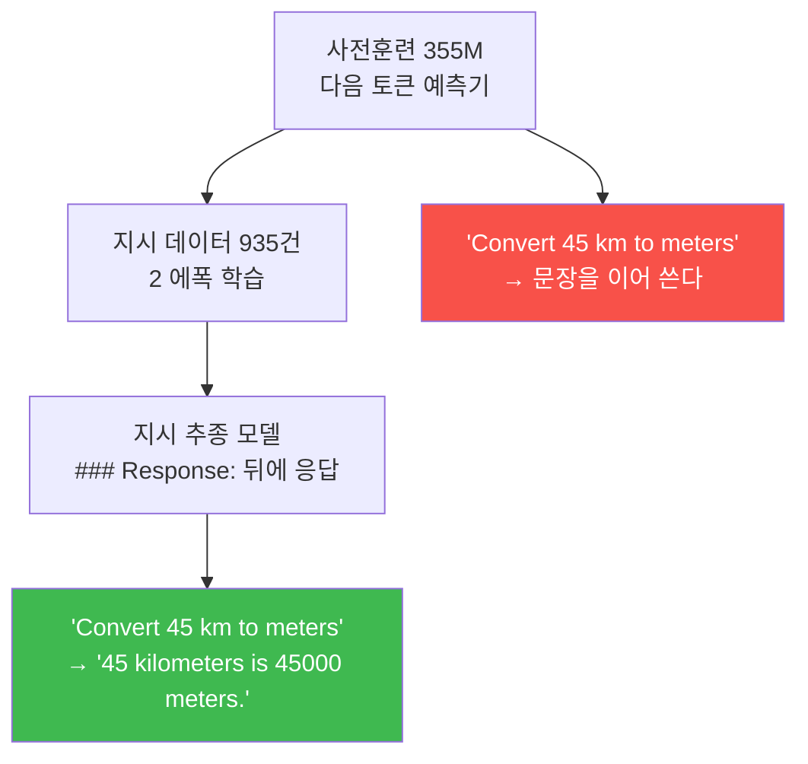
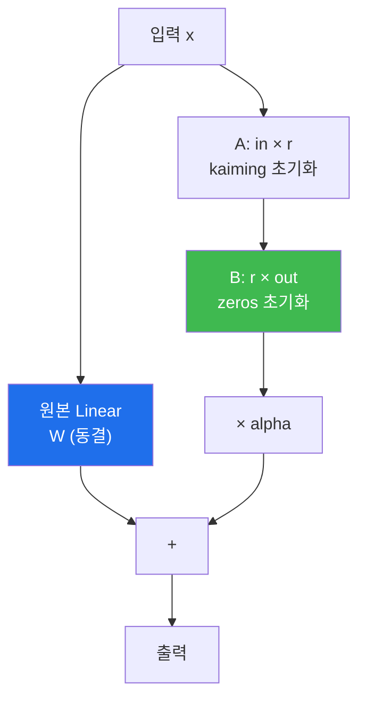

# LLM from scratch W13 — 지시를 따르는 모델, 그리고 심판

> **한 줄 요약** — 355M 모델을 **지시 튜닝**한다. 튜닝 전 손실 3.8 이 2에폭 후 1 미만으로
> 떨어지고, 모델이 `### Response:` 뒤에 진짜 응답을 쓰기 시작한다. 그런데 곧 **평가 문제**를
> 만난다 — 자유 형식 응답을 어떻게 채점할 것인가? 답은 **LLM-as-judge**. 로컬 Ollama 모델을
> 심판으로 세운다. **그런데 그 심판이 얼마나 믿을 만한지도 여러분이 검증해야 한다.**
> 마지막으로 **LoRA** 로 "곁가지만 훈련하기"를 배운다.

---

## 학습 목표

1. 학생은 지시 튜닝 전후의 손실·응답 형식 변화를 관찰하고 해석할 수 있다.
2. 학생은 테스트셋 응답을 일괄 생성하고 빈 응답 0건을 확인할 수 있다.
3. 학생은 로컬 LLM 을 심판으로 세우고 **컨테이너에서 호스트 Ollama 로 접속**하는 법을 안다.
4. 학생은 심판의 **상한·하한·결정성**을 스스로 검증할 수 있다.
5. 학생은 `temperature=0` 이어도 저지 점수가 흔들린다는 것을 실측으로 확인하고 해석할 수 있다.
6. 학생은 LoRA 를 구현하고 **B=0 초기화가 항등 게이트**임을 증명할 수 있다.
7. 학생은 LoRA 와 풀 튜닝을 파라미터·메모리·시간·품질 4축으로 비교할 수 있다.

---

## 0. 용어 해설

| 용어 | 영문 | 쉽게 말하면 | 비유 |
|------|------|------------|------|
| **지시 튜닝** | Instruction Tuning / SFT | 지시-응답 쌍으로 파인튜닝 | 업무 지시 훈련 |
| **LLM-as-judge** | — | LLM 에게 채점을 맡기는 평가 | AI 채점관 |
| **저지 상한/하한** | Judge Ceiling/Floor | 정답 자체 / 엉터리 문장의 점수 | 만점 답안 / 백지 |
| **결정성** | Determinism | 같은 입력에 같은 출력 | 재현성 |
| **LoRA** | Low-Rank Adaptation | 원본은 얼리고 저차원 곁가지만 훈련 | 본체는 두고 어댑터만 |
| **rank (r)** | — | 곁가지의 차원 | 어댑터 굵기 |
| **alpha (α)** | — | 곁가지 출력의 배율 | 어댑터 볼륨 |
| **항등 게이트** | Identity Gate | 적용해도 출력이 안 바뀌는 초기 상태 | 스위치 OFF |
| **peak memory** | — | 훈련 중 최대 GPU 메모리 | 최대 적재량 |

---

## 0.5 신입생을 위한 핵심 개념

### 지시 튜닝이 무엇을 바꾸나



**구조는 하나도 안 바뀝니다.** 같은 GPTModel, 같은 파라미터 수입니다. 바뀌는 것은
**가중치의 값**과, 그로 인한 **행동**입니다.

| 항목 | 튜닝 전 | 튜닝 후 |
|---|---|---|
| train 손실 | 3.8 안팎 | **0.31** |
| val 손실 | 3.8 안팎 | **0.61** |
| 응답 형식 | 지시를 무시하고 이어 씀 | `### Response:` 뒤에 응답 |

> 💡 **train < val 인 것에 주목하세요.** 과적합의 시작이지만, 9주차처럼 val 이 다시 올라갈
> 정도는 아닙니다. 데이터가 935건으로 5,145 토큰보다 훨씬 많기 때문입니다.

### 평가 문제 — 자유 형식 응답을 어떻게 채점하나

11주차 분류는 쉬웠습니다. 정답이 spam/not spam 둘 중 하나였으니까요.
그런데 `"Define the term 'simile'."` 에 대한 응답은?

| 방법 | 문제 |
|---|---|
| 문자열 완전 일치 | 표현만 달라도 0점 |
| BLEU/ROUGE | 의미가 같아도 단어가 다르면 낮음 |
| 사람 채점 | 110건 × 여러 모델 = 비현실적 |
| **LLM-as-judge** | ✅ 의미를 본다. **단, 심판을 믿을 수 있는가?** |

---

## 1. 준비 — 튜닝 전 상태 기록

**📋 실행 프롬프트 P13-0** 은 튜닝 **전** 상태를 기록하게 합니다.

**예상 결과:** 355M 의 train/val 손실 **3.8 안팎**, 생성은 지시를 따르지 않음.

> 📌 **"전"을 기록하지 않으면 "후"를 말할 수 없습니다.** 이 습관은 9주차 훈련 전 손실,
> 11주차 훈련 전 정확도와 같습니다.

---

## 2. 미션 1~2 — 지시 튜닝과 응답 생성

**예상 결과 (실측):**

| 항목 | 값 |
|---|---|
| 훈련 시간 | **98초** (2 에폭) |
| peak 메모리 | **8.28 GB** |
| train 손실 | **0.3146** |
| val 손실 | **0.6131** |

테스트셋 **110개** 응답을 일괄 생성합니다. **빈 응답이 0건**이어야 합니다 — 하나라도 비어
있으면 EOS 처리나 생성 길이 설정을 확인해야 합니다(12주차 "EOS 하나 남기기"가 여기서 회수됩니다).

---

## 3. 미션 3 — 심판 소환: Ollama LLM-as-judge

### 3.1 컨테이너에서 호스트 Ollama 로 접속하기

> 🔴 **`http://localhost:11434` 는 컨테이너 안에서 동작하지 않습니다.**
> 컨테이너의 `localhost` 는 **컨테이너 자신**입니다. Ollama 는 호스트에서 돕니다.

| 주소 | 결과 |
|---|---|
| `http://localhost:11434` | ❌ 연결 거부 (`exit=7`) |
| **`http://172.17.0.1:11434`** | ✅ **동작** (docker0 브리지 게이트웨이) |

`172.17.0.1` 은 기본 Docker 브리지 네트워크에서 **호스트를 가리키는 주소**입니다.
환경에 따라 다를 수 있으니 `ip route | grep default` 나 `docker network inspect bridge` 로
확인하세요.

### 3.2 저지 설정 — 재현을 위한 옵션

```python
options = {"seed": 123, "temperature": 0, "num_ctx": 2048}
```

- `temperature: 0` — 결정적 출력을 의도
- `seed: 123` — 난수 고정
- `num_ctx: 2048` — 프롬프트가 잘리지 않게 충분히

**저지 모델:** `llama3.1:8b` (교재는 모델명을 플레이스홀더로 두었지만, **어떤 모델을 쓰느냐가
점수를 크게 바꾸므로** 반드시 명시해야 합니다).

### 3.3 실측 결과

| 항목 | 값 |
|---|---|
| 채점 성공 | **110 / 110** |
| 파싱 실패 | **0** |
| 평균 | **60.92점** |
| 표준편차 | 29.34 |
| 중앙값 | 62.5 |

> ⚠️ **교재는 "50점 안팎"을 예상했지만 실측은 60.92 입니다.** 교재가 저지 모델명을
> 플레이스홀더로 두었기 때문에 **예상값 자체가 성립할 수 없습니다.** 저지가 바뀌면 점수가
> 바뀝니다. **평가 지표를 제시할 때는 반드시 "어떤 심판으로"를 함께 적어야 합니다.**

### 3.4 🔴 심판을 검증하라 — V13-1

**심판의 점수를 믿기 전에, 심판이 믿을 만한지 확인합니다.**

| 검증 | 방법 | 실측 |
|---|---|---|
| **상한** | 정답 자체를 채점 → 90점 이상이어야 | ✅ 통과 |
| **하한** | 엉터리 문장을 채점 → 낮아야 | ⚠️ **부분 실패** |
| **결정성** | 같은 (항목, 응답) 3회 채점 → 동일 점수 | ⚠️ **부분 실패** |

**하한 검증의 발견:** `"The weather is nice today."` 라는 완전히 무관한 문장이 소수·합성수
분류 문제에서 **95점**을 받았습니다. 저지도 실수합니다.

**결정성 검증의 발견:** `temperature=0` 인데도 110개 재채점에서 **9건(8.2%)** 이 달라졌습니다.

```
평균 변동폭: 31점 (최대 83점)
그런데 전체 평균은 60.92 → 61.13 (0.21점만 이동)
```

> 📌 **개별 점수는 흔들리지만 평균은 안정적입니다.** 이것이 이 발견의 핵심입니다.
> **"이 응답은 75점"** 이라고 말하면 안 되고, **"이 모델의 평균은 61점"** 이라고 말해야 합니다.
>
> 원인은 서버 측 실행 경로(배치 구성, KV 캐시 상태 등)로 추정되며, **클라이언트에서
> seed/temperature 로 제거할 수 없습니다.**

### 3.5 점수 앵커링 — 저지의 또 다른 특성

110개 점수 중 **61.8%** 가 `{0, 50, 75, 95, 100}` 다섯 값에 몰렸고, 전체 110건에서 서로 다른
값은 **15개**뿐이었습니다.

**이것이 25점 단위 점프의 원인입니다.** 저지는 연속적인 점수를 주지 않고 몇 개의 "앵커"에
붙습니다. 경계선상의 응답은 실행마다 인접 앵커로 튑니다.

---

## 4. 미션 4 — LoRA: 곁가지만 훈련하기

### 4.1 아이디어



**원본 가중치는 얼리고, `A @ B` 라는 저차원 곁가지만 훈련합니다.**
`768 × 768 = 589,824` 대신 `768 × 16 + 16 × 768 = 24,576` 만 학습합니다.

### 4.2 B=0 초기화가 왜 결정적인가

```python
self.A = nn.Parameter(torch.empty(in_dim, rank))
nn.init.kaiming_uniform_(self.A, a=math.sqrt(5))
self.B = nn.Parameter(torch.zeros(rank, out_dim))   # ← 0!
```

`B = 0` 이므로 `x @ A @ B = 0` 입니다. 따라서 **LoRA 를 붙인 직후의 출력은 원본과 완전히
같습니다.**

> 📌 **이것이 "항등 게이트"입니다.** 훈련을 시작하기 전 모델이 망가지지 않았음을 보장합니다.
> **LoRA 적용 직후 val 손실이 원본과 일치하는지 확인하는 것**이 이 미션의 게이트입니다
> (실측 3.8172 — 튜닝 전 손실과 동일).

### 4.3 스케일은 α 인가 α/r 인가

원 논문은 `α/r` 스케일을 씁니다. 이 교재의 구현은 **`α`** 를 씁니다.

> ⚠️ `r = α = 16` 이면 두 방식이 **16배** 차이납니다. **어느 쪽이든 상관없지만
> 일관되게 쓰고 명시해야 합니다.** 이 실습은 `α` 기준입니다.

### 4.4 실측 비교

| 방식 | 훈련 가능 파라미터 | 비율 | 시간 | peak 메모리 | val 손실 | 저지 평균 |
|---|---|---|---|---|---|---|
| **풀 튜닝** | 406,286,336 | 100% | **98초** | **8.28 GB** | **0.613** | **60.93** |
| **LoRA r=16** | 7,898,384 | **1.94%** | **40초** | **4.58 GB** | 0.649 | **60.87** |
| **LoRA r=8** | 3,949,192 | **0.97%** | **39초** | **4.52 GB** | 0.658 | **62.14** |

**LoRA r=8 은 파라미터의 0.97% 만 훈련하고 메모리를 45% 줄이면서 저지 평균은 오히려 높습니다.**

> 💡 **단, 저지 평균 차이(60.87 vs 62.14 vs 60.93)는 3.4절에서 본 측정 오차 범위 안입니다.**
> "LoRA 가 더 좋다"고 결론 내리면 안 됩니다. 맞는 결론은 **"품질 저하 없이 비용을 크게
> 줄였다"** 입니다.

---

## 실습 안내

이번 주 실습(`lab_week13.yaml`, 7단계)은 llm-lab 컨테이너 + GPU + 호스트 Ollama 를 씁니다.

### 1) 이 실습을 왜 하는가?

**한 학기의 종착점입니다.** 무작위 초기화 모델에서 시작해 지시를 따르는 모델까지 왔습니다.
그리고 마지막으로 배우는 것은 **"평가를 어떻게 신뢰할 것인가"** 입니다 — 이것이 실무에서
가장 어려운 문제입니다.

### 2) 무엇을 알 수 있는가?

- 구조를 바꾸지 않고 **가중치만으로** 행동이 바뀐다는 것.
- LLM 심판도 **틀린다**는 것, 그리고 그것을 **검증하는 법**.
- `temperature=0` 이 결정성을 보장하지 **않는다**는 것 — 그러나 **평균은 안정적**이라는 것.
- 파라미터의 **1%** 만 훈련해도 품질이 유지된다는 것.

### 3) 결과 해석 (정상 vs 비정상)

| 확인 | 정상 | 비정상 → 의심할 곳 |
|------|------|-------------------|
| 튜닝 전 손실 | **3.8 안팎** | 6점대면 사전훈련 가중치 미로드 |
| 튜닝 후 손실 | train **0.31** / val **0.61** | 1 이상이면 에폭·lr 확인 |
| 응답 수 | **110**, 빈 응답 **0** | 빈 응답이 있으면 EOS 처리 확인 |
| Ollama 접속 | `172.17.0.1:11434` | `localhost` 는 **연결 거부** |
| 파싱 실패 | **0** | 많으면 "정수만" 지시 확인 |
| 저지 평균 | **60.92** (llama3.1:8b) | 저지가 다르면 값이 다름 |
| 저지 상한 | 정답 채점 **90점 이상** | 낮으면 저지 프롬프트 문제 |
| 저지 결정성 | **완전하지 않음** (8.2% 변동) | 완전히 같으면 운이 좋은 것 |
| LoRA B 초기값 | **전부 0** | 아니면 항등 게이트 실패 |
| LoRA 적용 직후 손실 | 원본과 **일치** (3.8172) | 다르면 B≠0 |
| LoRA 훈련 파라미터 | r=16 **1.94%** / r=8 **0.97%** | 100%면 동결 실패 |

### 4) 실전 활용

LoRA 는 오늘날 오픈 모델 파인튜닝의 **표준**입니다. 그리고 LLM-as-judge 는 챗봇·요약·번역 등
자유 형식 출력을 평가하는 사실상 유일한 실용적 방법입니다 — **다만 심판을 검증하는 절차
없이 쓰면 안 됩니다.** 이번 주가 그 절차를 가르칩니다.

---

## 흔한 오해

- ❌ **"`temperature=0` 이면 항상 같은 답"** → 110개 재채점에서 **9건(8.2%)** 이 달랐습니다.
  서버 측 실행 경로 요인은 클라이언트에서 못 없앱니다.
- ❌ **"저지 점수가 낮으면 모델이 나쁘다"** → 저지가 틀릴 수도 있습니다. **상한·하한 검증**을
  먼저 하세요.
- ❌ **"개별 점수를 인용해도 된다"** → 개별은 흔들립니다(평균 변동폭 31점). **평균을
  인용**하세요.
- ❌ **"컨테이너에서 localhost 로 Ollama 접속"** → **연결 거부**입니다. `172.17.0.1` 을 쓰세요.
- ❌ **"LoRA 는 성능이 떨어지는 대신 싸다"** → 이 실습에서는 저지 평균이 **거의 같았습니다**.
  "품질 저하 없이 비용 절감"이 맞는 표현입니다.
- ❌ **"LoRA 스케일은 α/r 이 정답"** → 구현마다 다릅니다. **일관되게 쓰고 명시**하는 것이
  중요합니다.
- ❌ **"저지 평균 62.14 > 60.93 이니 LoRA r=8 이 더 낫다"** → **측정 오차 범위 안**입니다.
  결론 내리면 안 됩니다.

---

## 다음 주차 예고 — W14 팀 프로젝트 주간

13주 동안 교재가 정답지를 줬습니다 — 4,690 토큰, 163,009,536 파라미터,
`"Featureiman Byeswickattribute argue"`. **14주차부터는 성공 기준을 여러분이 정의합니다.**
그리고 그 기준을 통과했음을 여러분의 검증으로 입증해야 합니다. 다행히 빈손이 아닙니다 —
한 학기 동안 쌓은 자산(성질 테스트, 정답지 수치, 분해표, 재현 게이트)이 있습니다.
14주차는 트랙을 고르고 제안서를 쓰고 **사전 부검(premortem)** 으로 리스크를 미리 죽입니다.
