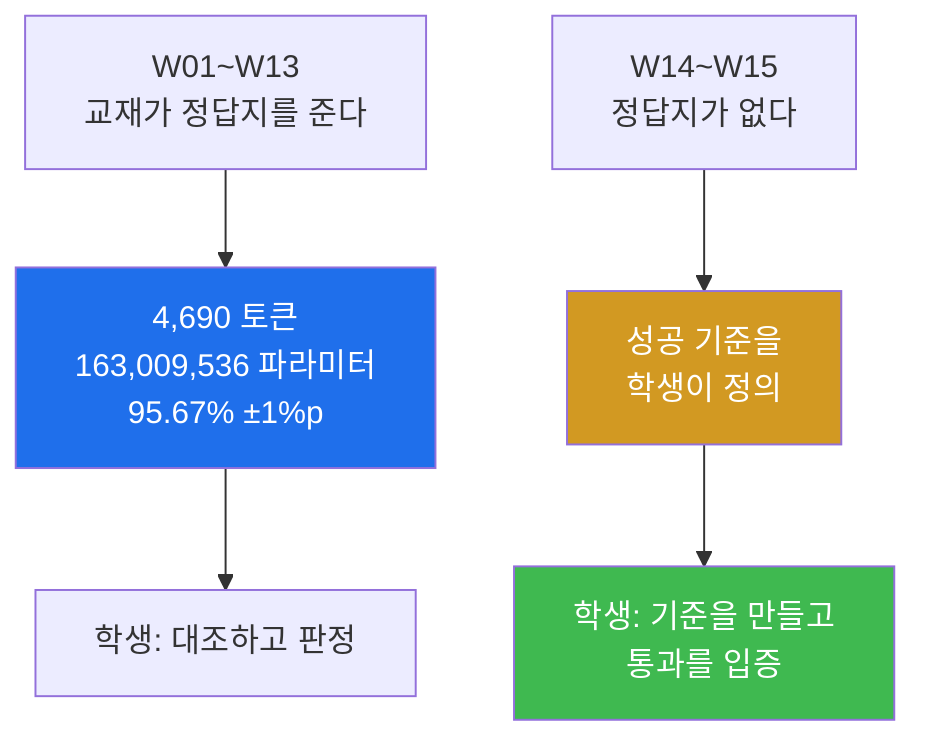
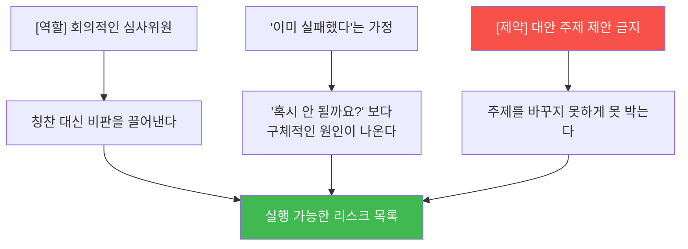

# LLM from scratch W14 — 팀 프로젝트 주간: 정답지 없는 첫 주

> **한 줄 요약** — 13주 동안 교재가 정답지를 줬다 — 4,690 토큰, 163,009,536 파라미터,
> `"Featureiman Byeswickattribute argue"`. **이번 주부터는 성공 기준을 여러분이 정의한다.**
> 그리고 그 기준을 통과했음을 여러분의 검증으로 입증해야 한다. 다행히 빈손이 아니다 —
> 한 학기 동안 쌓은 **자산**이 있다.

---

## 학습 목표

1. 학생은 정량적이고 **검증 가능한** 성공 기준을 스스로 정의할 수 있다.
2. 학생은 한 학기 자산(성질 테스트·품질 게이트·측정 규약)을 새 문제에 **이식**할 수 있다.
3. 학생은 6개 트랙 중 팀 역량과 자원에 맞는 것을 고르고 마일스톤을 3단계로 나눌 수 있다.
4. 학생은 **사전 부검(pre-mortem)** 으로 리스크를 미리 발굴하고 조기 신호·예방 조치를 설계할 수 있다.
5. 학생은 에이전트에게 주제를 정하게 하지 않고, 자기 아이디어를 **두들기는 망치**로 쓸 수 있다.
6. 학생은 팀 저장소와 개인 프롬프트 로그로 개인 기여를 증빙할 수 있다.

---

## 0. 용어 해설

| 용어 | 영문 | 쉽게 말하면 | 비유 |
|------|------|------------|------|
| **사전 부검** | Pre-mortem | "이미 실패했다"고 가정하고 원인을 역추적 | 사고 예방 훈련 |
| **조기 신호** | Early Signal | 실패가 확정되기 전 감지 가능한 징후 | 계기판 경고등 |
| **마일스톤 3단계** | — | 최소(통과) / 기대(표준) / 도전(가산) | 통과·목표·기록 |
| **동일성 게이트** | Equivalence Gate | 최적화 전후 출력이 **완전히** 같아야 통과 | 리팩터링 안전망 |
| **통제 변인** | Control Variable | 비교할 때 고정해야 하는 조건 | 대조군 |
| **KV 캐시** | KV Cache | 이전 토큰의 Key/Value 를 저장해 재계산 제거 | 계산 결과 메모 |
| **DPO** | Direct Preference Optimization | 선호쌍으로 직접 정렬 | 둘 중 나은 것 고르기 학습 |
| **DDP** | Distributed Data Parallel | 여러 장비로 나눠 훈련 | 분업 |
| **스탠드업** | Stand-up | 짧은 진행 상황 공유 | 조회 |

---

## 0.5 이번 주가 다른 이유 — 그리고 여러분이 가진 것

### 정답지가 사라진다



### 한 학기 자산 목록 — 이것을 이식하는 것이 평가의 절반이다

| 분류 | 자산 | 출처 |
|---|---|---|
| **성질 테스트** | 인과성 불변 | W05·W06·W11 |
| | greedy 결정성 | W07·W10 |
| | top-k 제약 | W10 |
| | LoRA 항등 게이트 (B=0) | W13 |
| **품질 게이트** | 초기 손실 `ln(vocab) ± 0.5` | W09 |
| | 가중치 이식 후 val 손실 < 5.0 | W10 |
| | ±1%p 재현 게이트 | W11 |
| **절차** | 작게 검증 → 크게 실행 | W10 |
| | 점검·조치 분리 | W01 |
| | 계획·승인 게이트 | W01·W06 |
| **측정 규약** | 워밍업 + `synchronize` + tokens/sec | W09 |
| | peak 메모리 | W11·W13 |
| | 저지 상한·하한·결정성 검증 | W13 |

> 📌 **프로젝트 평가표의 절반은 사실상 "이 자산들을 자기 문제에 이식했는가"를 봅니다.**

---

## 1. 트랙 카드 — 6개 중 하나

각 트랙의 출발 자료는 교재 저장소(`rickiepark/llm-from-scratch`)의 해당 장 **보너스 폴더**입니다.
마일스톤은 **최소(통과선) / 기대(표준) / 도전(가산)** 3단계입니다.

### 트랙 A — 아키텍처: KV 캐시

| 항목 | 내용 |
|---|---|
| **목표** | 생성 시 매 토큰 전체 재계산의 낭비를 캐시로 제거 |
| 최소 | KV 캐시 동작 구현 |
| **기대** | 캐시 on/off 의 greedy 출력 **완전 동일성 게이트** 통과 + 생성 길이별 속도 벤치마크 |
| 도전 | GQA 등 변형 1종 추가 비교 |
| **검증 기준** | 동일성 게이트(출력이 **1토큰이라도** 다르면 실패) + tokens/sec 곡선 |
| ⚠️ 주의 | 캐시 자료구조의 context 초과 처리 — **W07 크롭 테스트를 이식하라** |

### 트랙 B — 최신 모델 재현: Llama 3.2 / Qwen3 / Gemma 3

| 항목 | 내용 |
|---|---|
| **목표** | GPT-2 와 최신 아키텍처의 구조적 차이(RoPE, RMSNorm, GQA)를 코드로 확인 |
| 최소 | 보너스 구현 구동 + 구조 차이표 |
| **기대** | 공개 가중치 로드 후 유창한 생성 (**W10 이식 절차 재사용**) |
| 도전 | 동일 프롬프트로 GPT-2 355M 과 정성·정량 비교 |
| **검증 기준** | 로드 후 생성 품질 + **파라미터 분해표(W07 방식)를 새 모델에 재작성** |
| ⚠️ 주의 | 토크나이저가 다르다 — **W02 감각으로 어휘·특수 토큰부터** |

### 트랙 C — 정렬: DPO 밑바닥 구현

| 항목 | 내용 |
|---|---|
| **목표** | 선호쌍(chosen/rejected)으로 응답 품질 향상 |
| 최소 | DPO 손실 구현 + 소규모 선호 데이터 |
| **기대** | W13 SFT 모델에 DPO 적용, 저지 평균 향상 입증 |
| 도전 | **W13 저지로 선호 데이터를 자동 생성**하는 파이프라인 |
| **검증 기준** | 저지 점수 전후 비교 (**W13 신뢰성 검증을 통과한 저지로**) + DPO 손실 곡선 |
| ⚠️ 주의 | **참조 모델 동결**을 잊으면 손실이 무의미 — LoRA 항등 게이트류 시작점 검증 설계 |

### 트랙 D — 분산 훈련: Spark 2대 (2인 필수)

| 항목 | 내용 |
|---|---|
| **목표** | DDP 로 멀티노드 사전 훈련, "2대 = 몇 배?" 실측 |
| 최소 | 2대 네트워크 연결 + 단일 노드 DDP 프로세스 검증 |
| **기대** | 2노드 훈련 성공 + tokens/sec 배율 측정 (**W09 규약**) |
| 도전 | 구텐베르크급 데이터로 1대·2대 손실 궤적 비교 |
| ⚠️ 주의 | 방화벽 규칙 추가를 **"계획·승인 게이트"** 로 (W01 하드닝과 충돌 방지) |

### 트랙 E — 서빙: 내 모델의 챗 UI

| 항목 | 내용 |
|---|---|
| **목표** | W13 튜닝 모델을 스트리밍 챗 서비스로 |
| 최소 | 로컬 API + 단순 UI 대화 |
| **기대** | 토큰 스트리밍, eos 종료, 대화 이력 컨텍스트 관리(**크롭 정책 명시**) |
| 도전 | 동시 사용자 2인 이상 + 부하 측정 |
| ⚠️ 주의 | **교내망 노출 범위와 입력 검증**을 리포트에 한 절로 (W01 포트 감사 회수) |

### 트랙 F — 자율 (승인 필요)

예시: 보안 로그 분류기(W11 이식), 시큐리티 QA 지시 튜닝(W12~W13 이식 + 자체 데이터),
피싱 문자 탐지(W11 + **한국어 토큰 문제 정면 돌파**).

**조건:** 제안서에 **성공 기준을 정량으로 자체 정의**하고 승인받을 것.
⚠️ **데이터 구축이 절반 이상의 일이다** — W12 품질 점검을 자기 데이터에 반드시 적용하라.

---

## 2. 제안서 (1쪽, 월요일 마감)

```markdown
# 팀명 / 트랙 / 팀원(역할)
## 1. 목표 (2~3문장)
## 2. 성공 기준 (정량 — 무엇을 측정해 얼마면 성공인가)
## 3. 마일스톤: 최소 / 기대 / 도전
## 4. 역할 분담 (누가 어떤 미션의 지시·검증을 맡나)
## 5. 리스크 상위 3개와 플랜 B
```

### 2.1 성공 기준이 "검증 가능"하다는 것

| 나쁜 기준 | 왜 나쁜가 | 좋은 기준 |
|---|---|---|
| "성능을 개선한다" | 무엇을 얼마나? | "동일 출력 게이트 통과 + 512토큰 생성에서 **1.5배 이상**" |
| "잘 동작한다" | 측정 방법 없음 | "저지 평균 **65점 이상**(llama3.1:8b, seed 123)" |
| "빠르게 만든다" | 기준선 없음 | "tokens/sec 가 캐시 없음 대비 **2배 이상**" |

**측정 방법이 빠진 기준은 반려됩니다.**

---

## 3. 사전 부검 — 실패를 미리 죽이기

**아이디어는 팀의 것, 에이전트는 그 아이디어를 두들기는 망치입니다.**

> 🔴 **에이전트에게 주제를 정하게 하면 안 됩니다.** "뭘 하면 좋을까?"라고 물으면
> 그럴듯하지만 팀 역량·자원과 무관한 답이 옵니다. 그리고 그 순간부터 그 프로젝트는
> 여러분의 것이 아닙니다.

**📋 프롬프트 P14-1 — 사전 부검(pre-mortem)**

```text
[역할] 너는 이 제안서의 회의적인 심사위원이다
[입력] (제안서 붙여넣기)
[할 일]
 1. "이 프로젝트가 금요일에 실패했다"고 가정하고, 가장 그럴듯한 실패
    원인 5개를 구체적으로 서술해줘 (기술·일정·협업 각 1개 이상)
 2. 각 원인마다: 화요일에 감지할 수 있는 조기 신호 1개와 예방 조치 1개
 3. 성공 기준(2번 항목)이 검증 가능하게 쓰였는지 비판해줘 —
    측정 방법이 빠졌으면 지적할 것
[제약] 대안 주제를 제안하지 말 것. 이 주제 안에서만 비판하라
```

### 3.1 프롬프트 설계의 세 장치



**"화요일에 감지할 수 있는 조기 신호"** 라는 요구가 핵심입니다. 리스크 목록만 있으면
아무 소용이 없습니다 — **언제 무엇을 보고 알아챌 것인가**가 있어야 실제로 막을 수 있습니다.

### 3.2 이 프롬프트의 검증 포인트

산출물을 받으면 다음을 확인하세요.

- [ ] 실패 원인이 **5개**이고 기술·일정·협업이 **각각 1개 이상** 포함되었나
- [ ] 각 원인에 **조기 신호**와 **예방 조치**가 붙었나
- [ ] 성공 기준 **각각**에 대해 비판했나 (하나만 하고 넘어가지 않았나)
- [ ] **대안 주제를 제안하지 않았나** — 제약 위반 여부

> 💡 **마지막 항목이 가장 자주 깨집니다.** 에이전트는 친절해서 "이런 주제는 어떠세요?"를
> 덧붙이려 합니다. 제약을 명시해도 어깁니다. **제약 준수 자체를 검증 항목으로 두세요.**

---

## 4. 팀 협업 규약

- 팀 저장소 **1개**(브랜치로 분업). 개인 프롬프트 로그는 **각자** `prompts_<이름>.md` —
  **개인 기여의 증빙이자 개인 평가 근거**입니다.
- **커밋 작성자 = 그 작업을 지시·검증한 사람.** 에이전트가 짰어도 책임자는 사람입니다.
- 매일 마지막 작업 후 push. **W01 의 `CLAUDE.md` 규칙을 팀 저장소에도 심으세요.**

### 4.1 수업 시간 운영

| 활동 | 형식 |
|---|---|
| **스탠드업** (팀당 90초) | 어제 한 것 / 오늘 할 것 / 막힌 것 |
| **공개 디버깅 ("프롬프트 회진")** | 막힌 팀이 화면 공유 → 전원이 "다음에 던질 프롬프트" 제안 |

> 📌 **막힌 것이 없다고 말하는 팀에게는 성공 기준을 캐묻습니다.**
> 그리고 **막힘은 부끄러운 것이 아니라 이 수업의 교보재입니다.** 채택된 프롬프트가 문제를
> 풀면 제안자에게 참여 점수를 줍니다.

---

## 5. 채점 루브릭

| 항목 | 배점 | 기준 |
|---|---|---|
| **실험 설계** | **30** | 성공 기준의 정량성, 통제 변인, **학기 자산의 이식** |
| **검증과 실패 분석** | **30** | 주장마다 증거가 붙었는가. **실패를 원인 수준까지** 파고들었는가 |
| 결과 완성도 | 20 | 마일스톤 도달 (최소 = 12, 기대 = 17, 도전 = 20) |
| 협업·로그 | 10 | 개인 로그의 실재성, 역할 분담 균형 |
| 회고 정합성 | 10 | 제안서의 리스크 예측과 실제의 대조 |
| **합계** | **100** | |

> 🔴 **실패 자체는 감점이 아닙니다.** 배점 60점이 "설계"와 "검증·분석"에 있습니다.
> 목표를 못 이뤄도 **왜 안 됐는지 원인 수준까지 규명**하면 높은 점수를 받습니다.
> 반대로 목표를 이뤘어도 증거가 없으면 낮습니다.

---

## 실습 안내

이번 주 실습(`lab_week14.yaml`, 5단계)은 **문서 작업과 검증**입니다. GPU 는 거의 쓰지 않습니다.

### 1) 이 실습을 왜 하는가?

**"기준을 만드는 법"을 배우는 주간입니다.** 실무에서 정답지를 주는 사람은 없습니다.
무엇을 측정할지, 얼마면 성공인지, 어떻게 증명할지를 스스로 정해야 합니다.

### 2) 무엇을 알 수 있는가?

- 측정 가능한 기준과 불가능한 기준의 차이.
- 에이전트를 **비판자**로 쓰는 법 — 그리고 그 비판을 검증하는 법.
- 리스크는 목록이 아니라 **조기 신호 + 예방 조치**로 관리한다는 것.

### 3) 결과 해석 (정상 vs 비정상)

| 확인 | 정상 | 비정상 → 의심할 곳 |
|------|------|-------------------|
| 제안서 성공 기준 | **숫자와 측정 방법** 포함 | "개선한다" 류면 반려 |
| 사전 부검 원인 | **5개**, 기술·일정·협업 각 1+ | 기술만 5개면 편향 |
| 조기 신호 | 각 원인마다 **화요일 시점** | 없으면 관리 불가 |
| 대안 주제 제안 | **0건** | 있으면 제약 위반 |
| 루브릭 합 | **100** | 다르면 배점 오류 |
| 트랙 출발 자료 | 교재 저장소에 **실재** | 없으면 트랙 변경 |

### 4) 실전 활용

사전 부검은 실무 프로젝트 킥오프의 표준 기법입니다(NASA·의료·소프트웨어 전반).
그리고 "성공 기준을 정량으로 먼저 정의한다"는 것은 **A/B 테스트, 성능 최적화, SLA 설계**의
공통 출발점입니다.

---

## 흔한 오해

- ❌ **"에이전트에게 좋은 주제를 물어보면 된다"** → 팀 역량·자원과 무관한 답이 옵니다.
  그리고 그 순간 프로젝트가 여러분의 것이 아니게 됩니다.
- ❌ **"실패하면 점수가 깎인다"** → 배점 60점이 설계와 분석에 있습니다. **원인 규명이
  더 중요합니다.**
- ❌ **"리스크 목록을 쓰면 리스크 관리"** → **조기 신호와 예방 조치**가 없으면 목록일 뿐입니다.
- ❌ **"제약을 쓰면 에이전트가 지킨다"** → 지키는지 **검증해야** 합니다. 특히 "대안 제안 금지"는
  자주 깨집니다.
- ❌ **"학기 자산은 과제 제출용"** → 프로젝트 평가의 **절반**이 자산 이식입니다.
  성질 테스트와 게이트를 새 문제에 옮기세요.
- ❌ **"KV 캐시는 출력이 거의 같으면 성공"** → **1토큰이라도 다르면 실패**입니다.
  동일성 게이트는 "거의"를 허용하지 않습니다.

---

## 다음 주차 예고 — W15 발표회: 내가 키운 LLM

마지막 주는 발표입니다. **자기 Spark 에서 라이브 시연이 필수**입니다(녹화는 장애 대비
백업으로만). 시연 시나리오에는 반드시 **"검증의 순간"** 을 하나 넣어야 합니다 — 게이트 통과,
성질 테스트 실행, 전후 비교 수치. **데모는 쇼가 아니라 증명입니다.** 그리고 시연 중 실패는
감점이 아닙니다 — **대응이 평가입니다.** 마지막으로 저장소를 포트폴리오로 정리합니다.
