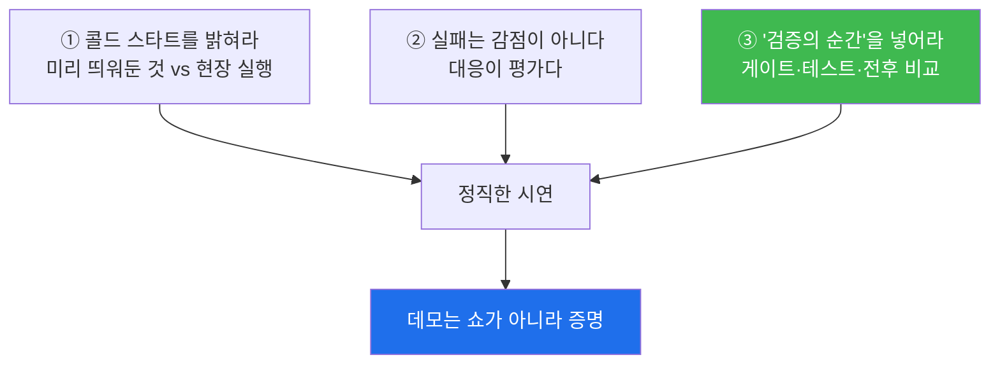
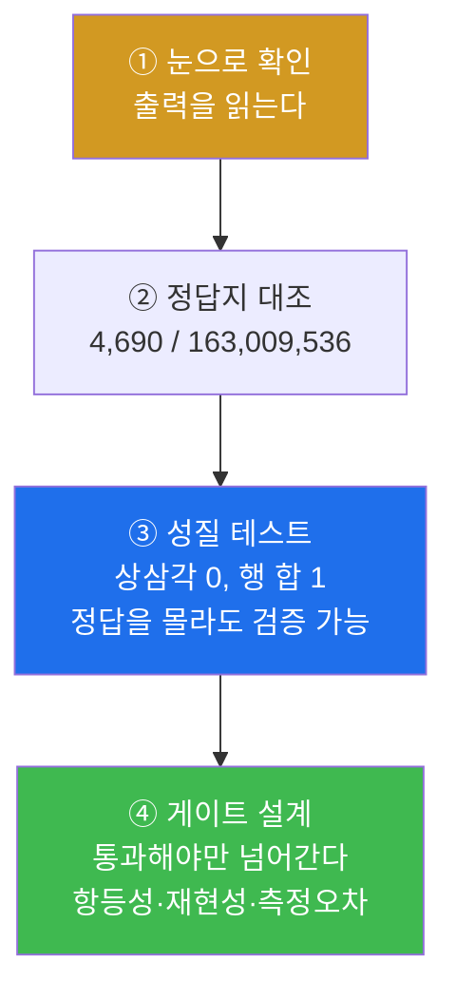
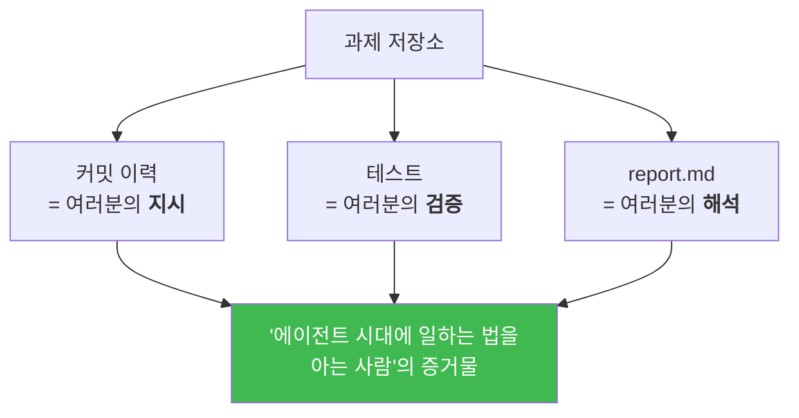

# W15 — 발표회: 내가 키운 LLM

> **한 줄 요약** — 마지막 주는 발표다. **자기 Spark 에서 라이브 시연이 필수**다(녹화는 장애 대비
> 백업으로만). 시연 시나리오에는 반드시 **"검증의 순간"** 을 하나 넣어야 한다 — 게이트 통과,
> 성질 테스트 실행, 전후 비교 수치. **데모는 쇼가 아니라 증명이다.** 그리고 시연 중 실패는
> 감점이 아니다 — **대응이 평가다.** 마지막으로 저장소를 포트폴리오로 정리한다.

---

## 학습 목표

1. 학생은 시연 시나리오를 설계하고 **실행 시간과 설명 시간을 따로** 산정해 18분에 맞출 수 있다.
2. 학생은 시나리오에 **"검증의 순간"** 을 배치해 데모를 증명으로 만들 수 있다.
3. 학생은 드라이런을 2회 반복해 재현성과 리스크(콜드 스타트·캐시·포트)를 점검할 수 있다.
4. 학생은 실물 증거(로그·프롬프트 원문)에 기반한 **기술 회고**를 작성할 수 있다.
5. 학생은 한 학기 저장소를 **재현 가능한 포트폴리오**로 정리하고 모든 링크를 검증할 수 있다.

---

## 0. 용어 해설

| 용어 | 영문 | 쉽게 말하면 | 비유 |
|------|------|------------|------|
| **콜드 스타트** | Cold Start | 캐시·로딩이 안 된 첫 실행 | 시동 걸기 |
| **드라이런** | Dry Run | 실전과 같게 미리 돌려보기 | 리허설 |
| **검증의 순간** | — | 시연 중 게이트·테스트를 실물로 돌리는 지점 | 공개 검사 |
| **잔여 상태** | Residual State | 이전 실행이 남긴 캐시·포트 점유 | 치우지 않은 흔적 |
| **첫 토큰 지연** | Time To First Token | 생성 시작까지의 대기 | 예열 시간 |
| **포트폴리오** | Portfolio | 남에게 보여줄 수 있는 작업 기록 | 작품집 |

---

## 1. 발표 형식

| 항목 | 내용 |
|---|---|
| 발표 | 팀당 **18분**: 라이브 시연 **10** + 회고 **5** + Q&A **3** |
| 시연 | **자기 Spark 에서 라이브 필수** (녹화는 장애 대비 백업으로만) |
| 개인 제출 | 기말 리포트 2쪽 + 동료 평가 |

### 1.1 시연 규칙 세 가지



**① 콜드 스타트를 밝혀라.** 미리 띄워둔 것(모델 로딩 등)과 현장에서 실행하는 것을 시작할 때
구분해 선언합니다. 숨기면 "저건 미리 돌려놨겠지"라는 의심이 남습니다.

**② 시연 중 실패는 감점이 아닙니다 — 대응이 평가입니다.** 침착하게 원인을 좁히는 3분
(로그 확인 → 가설 → 우회)은 오히려 **가산 대상**입니다. **한 학기 내내 연습한 것이 바로
그것입니다.**

**③ "검증의 순간"을 하나 넣으세요.** 게이트 통과, 성질 테스트 실행, 전후 비교 수치.
**데모는 쇼가 아니라 증명입니다.**

---

## 2. 리허설 — 드라이런

**📋 프롬프트 P15-1 — 시연 드라이런**

```text
[목표] 발표 시연 리허설과 리스크 점검
[입력] 시연 시나리오(단계별 명령·기대 화면)를 붙여넣는다
[할 일]
 1. 시나리오를 처음부터 끝까지 실제로 실행하며 각 단계의 **명령 실행 시간**을
    측정하고, 각 단계에 필요한 **설명 시간**을 별도로 산정해
    (실행 + 설명) 합계를 내라. 합계가 10분을 넘으면 어디를 줄일지 제안해줘
    ⚠️ 명령 실행 시간만으로는 10분을 넘기 어렵다 (Spark 기준 참고 실측:
       8단계 시나리오 총 11~14초). 발표의 병목은 사람의 말이지 GPU 가 아니다.
       각 단계에 "이 화면에서 무엇을 말할 것인가"를 한 줄씩 적고,
       그 분량을 분당 300자로 환산해 설명 시간을 잡아라.
 2. 리스크 점검: 모델 로딩 시간, 첫 토큰 지연, 네트워크 의존 단계,
    이전 실행의 잔여 상태(캐시·포트 점유)를 각각 확인하고 완화책 제시
 3. "발표 5분 전 체크리스트"를 명령어 수준으로 만들어줘
[검증] 드라이런을 한 번 더 반복해 두 실행의 소요 시간 차이를 보고할 것
```

### 2.1 🔴 "실행 시간 10분"이라는 함정

**명령 실행 시간만으로는 10분을 넘기 어렵습니다.**

| 단계 (8단계 시나리오, 실측) | 시간 |
|---|---|
| 1. 환경 확인 (nvidia-smi) | 0.04초 |
| 2. 튜닝 전 355M 로드 | 4.0초 |
| 3. 튜닝 전 응답 3개 | 2.7초 |
| 4. 튜닝 후 모델 로드 | 2.9초 |
| 5. 튜닝 후 응답 3개 | 1.3초 |
| 6. **검증의 순간 ① — LoRA 항등 게이트** | 7.4초 |
| 7. **검증의 순간 ② — 저지 상한/하한** | 8.4초 |
| 8. 3축 비교표 출력 | 0.01초 |
| **합계** | **약 27초** (재실행 시 약 22초) |

> 📌 **발표의 병목은 사람의 말이지 GPU 가 아닙니다.**
> 각 단계에 "이 화면에서 무엇을 말할 것인가"를 한 줄씩 적고, 그 분량을
> **분당 300자**로 환산해 설명 시간을 잡으세요. 그것이 진짜 10분입니다.

### 2.2 두 번 돌려서 차이를 보라

첫 실행과 두 번째 실행의 시간이 다릅니다 — **파일 캐시가 데워졌기 때문**입니다.
발표장에서는 두 번째 실행 조건을 만들어 두는 것이 안전합니다(사전에 한 번 돌려 캐시를 데운다).

### 2.3 발표 5분 전 체크리스트 — 명령어 수준으로

```bash
# 1. 컨테이너 살아 있나
docker ps --filter name=llm-lab --format '{{.Status}}'
# 2. GPU 비어 있나
nvidia-smi --query-gpu=memory.used --format=csv,noheader
# 3. 체크포인트 있나
ls -la code/week13/sft_355m.pth code/week13/lora_355m_r16.pth
# 4. 가중치 캐시 있나
ls -la code/week10/gpt2_weights/
# 5. Ollama 응답하나
docker exec llm-lab curl -s --max-time 5 http://172.17.0.1:11434/api/tags | head -c 40
# 6. 파일 캐시 데우기
docker exec llm-lab python3 -c "open('/work/week13/sft_355m.pth','rb').read(1)"
# 7. 테스트 한 번 돌려보기
docker exec -w /work/week13 llm-lab python3 -m pytest test_sft.py -q
```

**"돌아갈 것이다"가 아니라 "방금 돌았다"를 확인하고 무대에 오르세요.**

---

## 3. 회고 5분 — 소감문이 아니라 기술 회고

다음 네 질문에 **실물 증거(로그·프롬프트 원문)로** 답합니다.

| # | 질문 | 증거 |
|---|---|---|
| 1 | 이번 학기 **가장 효과적이었던 프롬프트 패턴 1개** | 실제 프롬프트를 화면에 띄우고 왜 통했는지 |
| 2 | **최악의 지시 1개**와 그것이 만든 사고, 얻은 교훈 | 로그 |
| 3 | 에이전트가 **끝내 잘 못하더라**는 것 1개 | 발견 경위 포함 |
| 4 | 다시 시작한다면 **1주차의 나에게** 해줄 조언 한 문장 | — |

> 💡 **3번이 가장 어렵고 가장 가치 있습니다.** 예를 들면 — "출력의 마지막 차원 평균"을
> "배치 축 평균"으로 오독한 뒤 **그 틀린 테스트에 구현을 맞춰** 15/15 green 을 만든 사례
> (W06), 또는 `temperature=0` 인데도 저지 점수가 8.2% 흔들린 사례(W13).

---

## 4. 동료 평가

| 항목 | 5점 기준 |
|---|---|
| **명확성** | 무엇을 왜 했는지 비전공 친구에게도 통할 수준 |
| **검증 신뢰성** | 주장에 증거가 붙어 있고, 게이트/테스트가 **실물로 돌았다** |
| **시연 완성도** | 시나리오 완주 또는 **실패 시 훌륭한 대응** |
| **회고 깊이** | 실물 증거 기반, 자기비판 포함 |

**+한 줄 코멘트(필수):** "이 팀에서 훔치고 싶은 것 하나".

### 4.1 환산 규칙

> 항목 4개 평균(5점 만점) → 팀별로 **자기 팀을 제외한** 전체 학생 평균을 내고,
> **상·하위 각 10% 를 절사**한 뒤 15.6절의 **5% 만점**으로 선형 환산한다.

**극단값 절사는 담합·보복 평가의 영향을 줄이기 위한 것입니다.**

---

## 5. 기말 평가 배분

| 항목 | 비중 |
|---|---|
| 프로젝트 결과물 (W14 루브릭) | **60%** |
| 발표·시연 | **25%** |
| 동료 평가 | **5%** |
| 기말 리포트 | **10%** |
| **합계** | **100%** |

---

## 5.5 15주간 배운 지휘법 — 한 장 정리

이 과목의 진짜 과목명은 "LLM 만들기"가 아니라 **"에이전트를 부려 무언가를 만들고, 그것이
맞는지 판정하는 법"** 이었습니다. 15주 동안 쌓은 것을 한 장으로 정리합니다.

### 프롬프트의 다섯 칸 — 왜 그 순서였나

| 칸 | 역할 | 처음 나온 곳 |
|---|---|---|
| **[목표]** | 범위를 못 박는다 | W01 P1-1 |
| **[할 일]** | 중간 산출물을 남긴다 | W01 P1-1 |
| **[제약]** | **하지 말아야 할 것** | W01 `LC_ALL=C`, W02 `아직 고치지 마` |
| **[검증]** | 기계가 판정 가능한 형태 | W02 토큰 30개 출력 |
| **[산출물]** | 파일로 남긴다 | W01 spec-report.md |

**가장 배우기 어려운 칸은 [제약]입니다.** "무엇을 하라"는 누구나 쓰지만,
**"무엇을 하지 마라"는 실패를 겪어 봐야 쓸 수 있습니다.**

### 학기 중 반복해서 나온 제약들 — 전부 사고에서 나왔다

| 제약 | 막으려던 사고 | 주차 |
|---|---|---|
| `LC_ALL=C 를 붙일 것` | 한국어 로케일로 grep 실패 | W01 |
| `아직 고치지 마` | OOV 를 몰래 고쳐 학습이 사라짐 | W02 |
| `테스트를 약화시키는 수정 금지` | 통과를 위해 테스트를 느슨하게 | W02 |
| `구현은 하지 말 것 (테스트만)` | 구현 보고 테스트를 맞춰 씀 | W06 |
| `공식 구현과 allclose 대조` | **틀린 테스트에 구현을 맞춤** | W06 |
| `기성 모듈을 쓰지 말 것` | `nn.MultiheadAttention` 한 줄로 끝냄 | W04·W05 |
| `.pth 지름길 금지` | `load_state_dict` 한 줄로 미션 무력화 | W10 |
| `해결책을 제안하지 마라` | 위험 목록 대신 수정안을 냄 | W14 |

> 📌 **이 목록이 이 과목의 핵심 산출물입니다.** 각 줄 뒤에는 실제로 무언가가 잘못됐던
> 경험이 있습니다. **여러분의 프로젝트에도 이런 목록이 생겼을 것입니다.** 회고에 적으십시오.

### 검증의 네 단계 — 학기 내내 격상되어 왔다



| 단계 | 한계 | 다음 단계가 필요한 이유 |
|---|---|---|
| ① 눈으로 | 코드가 늘면 못 읽는다 | 에이전트는 사람보다 빨리 쓴다 |
| ② 정답지 | 정답지가 없는 문제가 온다 | W14 프로젝트 |
| ③ 성질 | 성질을 통과해도 틀릴 수 있다 | W06 "green 인데 틀린 구현" |
| ④ 게이트 | — | **여기까지 와야 남에게 결과를 주장할 수 있다** |

### 결국 남는 한 문장

> **에이전트는 "완료했습니다"라고 말할 수 있다. 그 말이 참인지 아는 것은 사람의 일이다.**

15주 동안 이 문장을 여덟 번쯤 다른 형태로 만났습니다 — 2주차 왕복 실패, 6주차 초록불,
9주차 과적합, 10주차 이식 품질, 11주차 정답지 오류, 13주차 저지 신뢰성, 14주차 위조된
성공 로그. **전부 같은 이야기입니다.**

---

## 6. 학기 마무리 — 저장소를 포트폴리오로

**마지막 미션입니다.** 한 학기의 저장소를 남에게 보여줄 수 있는 상태로 만듭니다.

**📋 프롬프트 P15-2 — 아카이빙**

```text
[목표] 과제 저장소를 포트폴리오로 정리
[할 일] 저장소 루트에 README.md 를 만들어줘:
 1. 한 줄 소개: 이 저장소는 GPT-2급 LLM을 밑바닥부터 구현·훈련·튜닝한
    한 학기의 기록이다 (모든 코드는 코딩 에이전트 지휘로 작성)
 2. 주차별 산출물 지도: weekNN | 주제 | 핵심 파일 | 대표 결과 한 줄
 3. 재사용 자산 목록: 성질 테스트 4종, 품질 게이트 3종, 검증 패턴,
    정답지 수치 — 각각 파일 경로와 함께
 4. 하이라이트: 10주차 4모델 비교표와 프로젝트 결과 요약
 5. 재현 방법: 환경(컨테이너), 주차별 실행 진입점
[제약] 없는 것을 포장하지 말 것 — 링크가 실재하는지 전부 확인 후 작성
[검증] README의 모든 상대 링크가 유효한지 검사해 보고할 것
```

### 6.1 `[제약] 없는 것을 포장하지 말 것`

이 한 줄이 이번 프롬프트의 핵심입니다. 에이전트는 README 를 쓸 때 **그럴듯한 파일 경로를
지어냅니다.** 그리고 그건 포트폴리오를 여는 사람이 링크를 눌러 보는 순간 드러납니다.

**그래서 "모든 상대 링크가 유효한지 검사"를 검증 항목으로 둡니다.**

### 6.2 이 저장소가 무엇인가



> 📌 **이 저장소는 과제 제출물이 아니라 증거물입니다.**
> 커밋 이력에는 여러분의 지시가, 테스트에는 여러분의 검증이, report 에는 여러분의 해석이
> 남아 있습니다.
>
> **그것이 이 수업이 가르치려던 전부입니다 — 모델의 구조, 그리고 명세하고 검증하고
> 해석하는 사람의 역할.**

---

## 실습 안내

이번 주 실습(`lab_week15.yaml`, 5단계)은 리허설과 아카이빙입니다.

### 1) 이 실습을 왜 하는가?

**증명하는 법을 배우는 마지막 단계입니다.** 만든 것을 남에게 보여주고, 그것이 진짜임을
현장에서 증명하고, 나중에 다시 재현할 수 있게 남기는 일 — 실무에서 가장 자주 하면서
가장 자주 대충 하는 일입니다.

### 2) 무엇을 알 수 있는가?

- 발표의 병목은 **GPU 가 아니라 사람의 말**이라는 것 (실행 27초 vs 설명 10분).
- 콜드 스타트와 워밍업의 차이가 **실측으로** 얼마나 나는지.
- 에이전트가 README 에 **없는 링크를 지어낸다**는 것, 그리고 그것을 잡는 법.

### 3) 결과 해석 (정상 vs 비정상)

| 확인 | 정상 | 비정상 → 의심할 곳 |
|------|------|-------------------|
| 드라이런 실행 시간 | 총 **10~30초** 수준 | 몇 분이면 모델을 매번 새로 로드하는 것 |
| 2회 실행 차이 | 두 번째가 **더 빠름** | 같으면 이미 캐시가 데워진 상태 |
| 검증의 순간 | 시나리오에 **1개 이상** | 없으면 데모가 쇼에 그침 |
| 5분 전 체크리스트 | **명령어 수준** | "확인한다" 류 서술이면 실행 불가 |
| README 상대 링크 | **전부 유효** | 하나라도 깨지면 지어낸 것 |
| 기말 평가 배분 | 합 **100%** | 다르면 배분 오류 |

### 4) 실전 활용

데모 리허설, 5분 전 체크리스트, 링크 검증 — 셋 다 실무의 릴리스 절차와 같습니다.
그리고 "재현 방법을 문서에 남긴다"는 것은 오픈소스 프로젝트 README 의 최소 요구사항입니다.

---

## 흔한 오해

- ❌ **"시연 중 실패하면 끝"** → **대응이 평가**입니다. 침착하게 원인을 좁히는 3분은
  가산 대상입니다.
- ❌ **"명령 실행 시간만 재면 된다"** → 8단계에 **27초**입니다. 10분을 채우는 것은
  여러분의 말입니다.
- ❌ **"미리 띄워둔 것은 말 안 해도 된다"** → 밝히지 않으면 시연 전체의 신뢰가 떨어집니다.
- ❌ **"데모는 잘 보이면 성공"** → **증명**이어야 합니다. 검증의 순간이 없으면 쇼입니다.
- ❌ **"README 는 에이전트가 잘 쓴다"** → **없는 링크를 지어냅니다.** 전부 검증하세요.
- ❌ **"저장소는 과제 제출용"** → **에이전트 시대에 일하는 법을 아는 사람의 증거물**입니다.

---

## 한 학기를 마치며

무작위 초기화 모델이 `"Featureiman Byeswickattribute argue"` 라고 말하던 7주차에서,
지시를 따르는 355M 모델과 LoRA 비교까지 왔습니다. 그 사이에 여러분이 실제로 한 일은
**코드를 친 것이 아니라 명세하고 검증하고 해석한 것**입니다.

그리고 배운 것 중 가장 오래 쓰일 것은 아마도 이것들일 겁니다.

- **"됐습니다"는 결과가 아니다** — 모든 판정에는 출력 원문이 붙는다.
- **초록불을 믿지 말고 독립 기준과 대조하라** — 테스트 15개가 전부 통과해도 틀릴 수 있다.
- **정답지도 틀릴 수 있다** — 여러분이 직접 세어 본 7,090,946 이 그 증거다.
- **무엇이 실패해도 되는가를 먼저 정의하라** — 검증 설계의 절반이다.
- **개별 값은 못 믿어도 평균은 쓸 수 있다** — 측정 오차를 아는 것이 측정의 시작이다.
